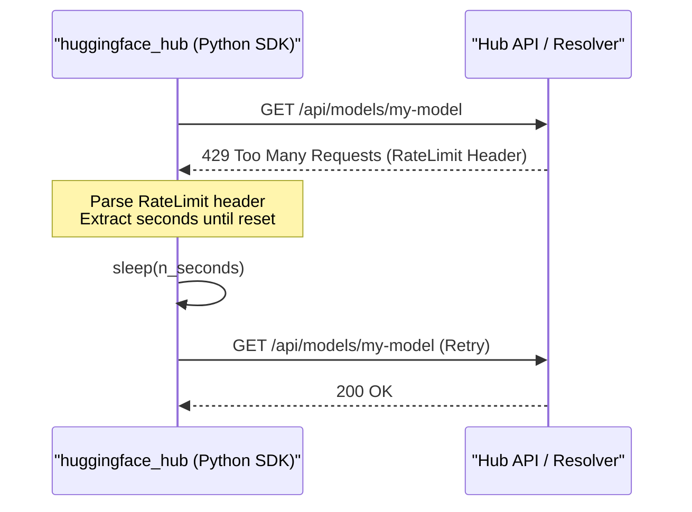
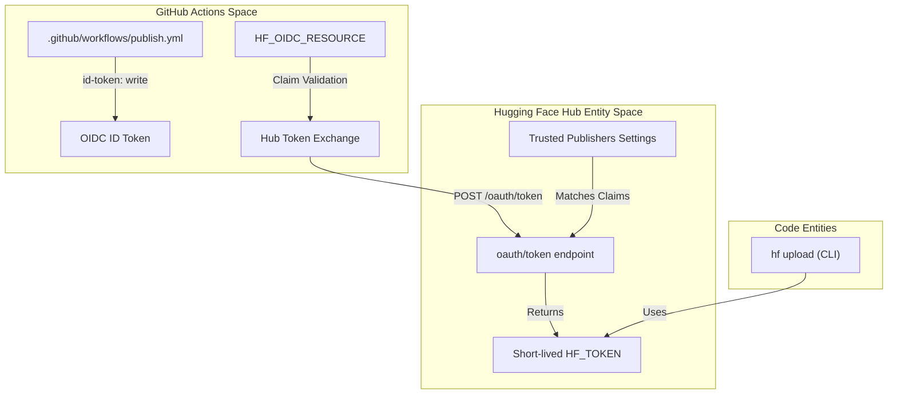

<!-- source: DeepWiki mcp.deepwiki.com · repo huggingface/hub-docs · page 3.1 REST API and Client Libraries · fetched 2026-10-26 -->

# REST API and Client Libraries

<details>
<summary>Relevant source files</summary>

The following files were used as context for generating this wiki page:

- [docs/hub/api.md](docs/hub/api.md)
- [docs/hub/datasets-audio.md](docs/hub/datasets-audio.md)
- [docs/hub/datasets-data-files-configuration.md](docs/hub/datasets-data-files-configuration.md)
- [docs/hub/datasets-image.md](docs/hub/datasets-image.md)
- [docs/hub/datasets-manual-configuration.md](docs/hub/datasets-manual-configuration.md)
- [docs/hub/datasets-overview.md](docs/hub/datasets-overview.md)
- [docs/hub/datasets-video.md](docs/hub/datasets-video.md)
- [docs/hub/datasets-webdataset.md](docs/hub/datasets-webdataset.md)
- [docs/hub/rate-limits.md](docs/hub/rate-limits.md)
- [docs/hub/repositories-github-actions.md](docs/hub/repositories-github-actions.md)
- [docs/hub/search.md](docs/hub/search.md)
- [docs/hub/security-tokens.md](docs/hub/security-tokens.md)
- [docs/hub/spaces-github-actions.md](docs/hub/spaces-github-actions.md)
- [docs/hub/trusted-publishers.md](docs/hub/trusted-publishers.md)

</details>


This page documents the programmatic interfaces for interacting with the Hugging Face Hub. It covers the foundational REST API, the primary client libraries in Python and JavaScript, authentication mechanisms, and modern CI/CD integration via Trusted Publishers.

## Hub REST API

The Hugging Face Hub is built on a comprehensive REST API that facilitates repository management, file operations, and metadata retrieval. The API is documented via an OpenAPI specification, which is the authoritative source for all endpoint definitions [docs/hub/api.md:6-6]().

### Core API Categories
The Hub classifies requests into three primary buckets to manage traffic and performance:

| Bucket | Purpose | Example Operations |
| :--- | :--- | :--- |
| **Hub APIs** | Repository and user management | Searching models/datasets, creating repos, managing organizations [docs/hub/rate-limits:7-8]() |
| **Resolvers** | Serving user-generated content | Downloading model weights or dataset files via `/resolve/` URLs [docs/hub/rate-limits:9-11]() |
| **Pages** | Human-readable web content | Rendering repository landing pages on `huggingface.co` [docs/hub/rate-limits:13-14]() |

### Rate Limiting and Retries
All API calls are subject to rate limits calculated over 5-minute fixed windows [docs/hub/rate-limits:9-9](), [docs/hub/rate-limits:17-18](). When a limit is exceeded, the server returns a `429 Too Many Requests` error including `RateLimit` and `RateLimit-Policy` headers [docs/hub/rate-limits:38-44]().

**Data Flow: Rate Limit Handling**
The following diagram illustrates how the `huggingface_hub` Python library interacts with the Hub's rate-limiting headers to perform smart retries.


Sources: [docs/hub/rate-limits:38-57](), [docs/hub/rate-limits:92-98]()

---

## Client Libraries

While the REST API can be accessed directly, Hugging Face provides high-level wrappers to simplify development.

### Python: `huggingface_hub`
The `huggingface_hub` library is the primary tool for Python developers. It handles authentication, local caching, and optimized file transfers.
- **Smart Retries**: Versions 1.2.0+ automatically parse `RateLimit` headers to wait the precise duration before retrying [docs/hub/rate-limits:92-98]().
- **Integration**: It is used internally by `transformers`, `datasets`, and `diffusers` to manage model loading [docs/hub/security-tokens:48-56]().

### JavaScript: `huggingface.js`
The `huggingface.js` client provides similar functionality for web and Node.js environments, enabling browser-based interactions with Hub repositories and Inference Providers [docs/hub/api.md:3-3]().

---

## Authentication and Tokens

Programmatic access to private or gated resources requires authentication via User Access Tokens. These are managed in the user's [settings](https://huggingface.co/settings/tokens) [docs/hub/security-tokens:5-6]().

### Token Types and Scopes
| Role | Capabilities |
| :--- | :--- |
| `fine-grained` | Scoped access to specific repositories or organizations; recommended for production [docs/hub/security-tokens:14-14](), [docs/hub/security-tokens:71-71](). |
| `read` | Download public and private repositories the user has access to [docs/hub/security-tokens:16-16](). |
| `write` | Create repositories and push content [docs/hub/security-tokens:18-19](). |

### Enterprise Token Policies
Organizations on Team or Enterprise plans can enforce approval workflows for fine-grained tokens. Tokens may exist in `Pending`, `Approved`, `Denied`, or `Revoked` states [docs/hub/security-tokens:83-103]().

Sources: [docs/hub/security-tokens:12-21](), [docs/hub/security-tokens:87-92]()

---

## Trusted Publishers and CI/CD

Trusted Publishers allow CI/CD environments (like GitHub Actions or GitLab CI) to interact with the Hub without storing long-lived `HF_TOKEN` secrets [docs/hub/trusted-publishers:3-5]().

### OIDC Token Exchange
The system uses OpenID Connect (OIDC) to prove the identity of a CI job. The CI provider mints an ID token, which the Hub exchanges for a short-lived (1 hour) Hugging Face token [docs/hub/trusted-publishers:9-12]().

**Code Entity Mapping: OIDC Exchange Flow**
This diagram bridges the CI configuration space to the Hub's authentication entities.


Sources: [docs/hub/trusted-publishers:16-32](), [docs/hub/trusted-publishers:49-66](), [docs/hub/trusted-publishers:141-143]()

### GitHub Actions Integration
The official `huggingface/hub-sync` action facilitates automatic synchronization between a GitHub repository and a Hub repository (Model, Dataset, or Space) [docs/hub/repositories-github-actions:3-4]().

**Key Parameters for `huggingface/hub-sync`:**
- `github_repo_id`: The source GitHub repository [docs/hub/repositories-github-actions:49-49]().
- `huggingface_repo_id`: The target Hub repository [docs/hub/repositories-github-actions:50-50]().
- `repo_type`: One of `model`, `dataset`, or `space` [docs/hub/repositories-github-actions:52-52]().

**Example Workflow Fragment:**
```yaml
- uses: huggingface/hub-sync@v0.1.0
  with:
    github_repo_id: ${{ github.repository }}
    huggingface_repo_id: acme/my-model
    hf_token: ${{ secrets.HF_TOKEN }}
    repo_type: model
```
Sources: [docs/hub/repositories-github-actions:37-43](), [docs/hub/repositories-github-actions:47-56]()

---

