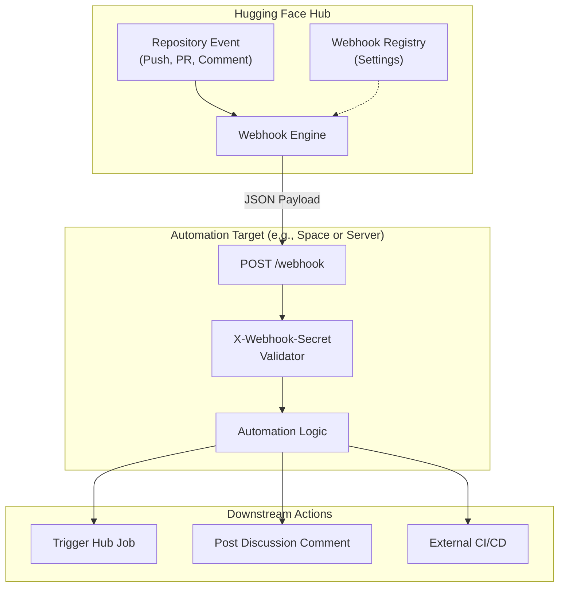
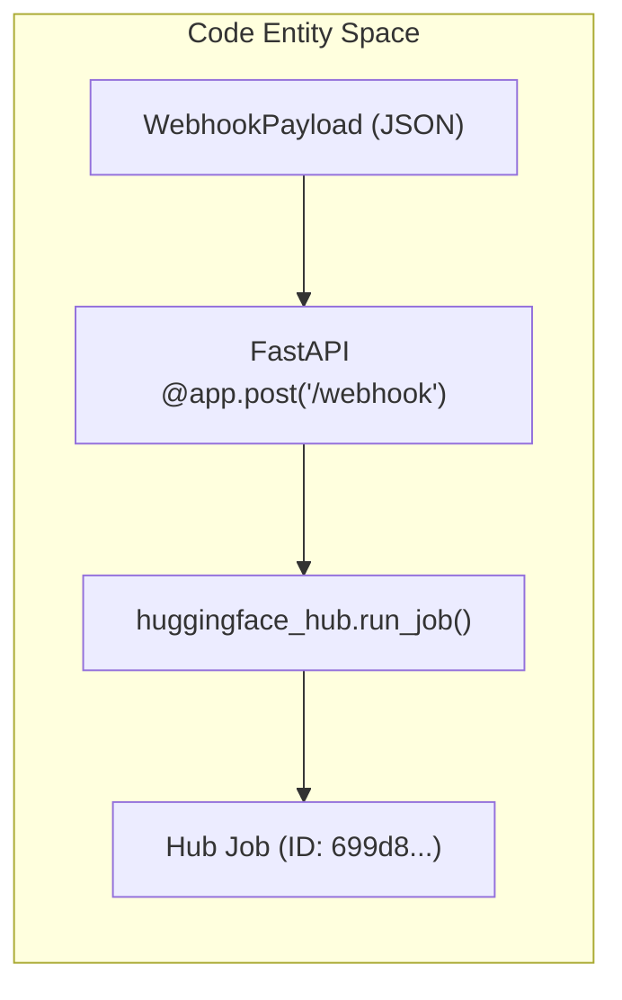

<!-- source: DeepWiki mcp.deepwiki.com · repo huggingface/hub-docs · page 3.2 Webhooks and Automation · fetched 2026-10-26 -->

# Webhooks and Automation

<details>
<summary>Relevant source files</summary>

The following files were used as context for generating this wiki page:

- [docs/hub/jobs-configuration.md](docs/hub/jobs-configuration.md)
- [docs/hub/jobs-examples.md](docs/hub/jobs-examples.md)
- [docs/hub/jobs-large-datasets.md](docs/hub/jobs-large-datasets.md)
- [docs/hub/jobs-manage.md](docs/hub/jobs-manage.md)
- [docs/hub/jobs-popular-images.md](docs/hub/jobs-popular-images.md)
- [docs/hub/jobs-pricing.md](docs/hub/jobs-pricing.md)
- [docs/hub/jobs-quickstart.md](docs/hub/jobs-quickstart.md)
- [docs/hub/jobs-reference.md](docs/hub/jobs-reference.md)
- [docs/hub/jobs-schedule.md](docs/hub/jobs-schedule.md)
- [docs/hub/jobs-webhooks.md](docs/hub/jobs-webhooks.md)
- [docs/hub/webhooks-guide-auto-retrain.md](docs/hub/webhooks-guide-auto-retrain.md)
- [docs/hub/webhooks-guide-discussion-bot.md](docs/hub/webhooks-guide-discussion-bot.md)
- [docs/hub/webhooks-guide-metadata-review.md](docs/hub/webhooks-guide-metadata-review.md)
- [docs/hub/webhooks.md](docs/hub/webhooks.md)

</details>


Webhooks and automated Jobs form the backbone of MLOps on the Hugging Face Hub. They allow developers to build reactive systems that respond to repository events—such as code pushes, new discussions, or dataset updates—by triggering compute tasks, bots, or metadata reviews.

## Webhook Architecture

Webhooks function by sending an `HTTP POST` request with a JSON payload to a user-defined target URL whenever a specified event occurs. This enables a push-based integration model.



**System Data Flow: Hub Events to Automation Actions**

Sources: [docs/hub/webhooks.md:3-6](), [docs/hub/webhooks.md:24-26]()

## Event Scopes and Payloads

The nature of an event is defined by its `event.scope` and `event.action`.

| Scope | Description | Common Actions |
| :--- | :--- | :--- |
| `repo` | Global repository operations | `create`, `delete`, `update`, `move` |
| `repo.content` | Changes to files, commits, or tags | `update` |
| `repo.config` | Changes to settings (e.g., visibility, secrets) | `update` |
| `discussion` | PR and Discussion lifecycle | `create`, `delete`, `update` |
| `discussion.comment` | Comment interactions | `create`, `update` |

### Payload Structure
The payload contains detailed context about the repository and the event. For content changes, the `updatedRefs` array identifies exactly which branches or tags were modified.

```json
{
  "event": { "action": "update", "scope": "repo.content" },
  "repo": {
    "type": "model",
    "name": "username/repo",
    "headSha": "c379e821..."
  },
  "updatedRefs": [
    {
      "ref": "refs/heads/main",
      "oldSha": "ce9a4674...",
      "newSha": "575db8b7..."
    }
  ],
  "webhook": { "id": "6390e855...", "version": 3 }
}
```

Sources: [docs/hub/webhooks.md:94-100](), [docs/hub/webhooks.md:131-146]()

## Automation with Hub Jobs

Webhooks can directly trigger **Hub Jobs**, which are managed compute instances for tasks like training, evaluation, or data processing.

### Webhook to Job Workflow
A common pattern involves a "Dispatcher" Space that receives the webhook and uses the `huggingface_hub` library's `run_job` or `hf jobs` CLI to start compute.



**Dispatcher Logic Association**

### Triggering Jobs Programmatically
When a webhook triggers a Job, you can pass repository metadata as environment variables or secrets to the container.

```python
from huggingface_hub import run_job

# Logic inside a Webhook Handler Space
def handle_webhook(payload):
    if payload.event.scope == "repo.content":
        run_job(
            image="huggingface/trl",
            command=["python", "train.py"],
            flavor="a100-large",
            secrets={"HF_TOKEN": os.environ["HF_TOKEN"]},
            environment={
                "REPO_ID": payload.repo.name,
                "REVISION": payload.updatedRefs[0].newSha
            }
        )
```

Sources: [docs/hub/jobs-configuration.md:156-163](), [docs/hub/webhooks-guide-auto-retrain.md:121-134]()

## Automation Use Cases

### 1. Metadata Quality Review
Automate checks for model/dataset cards. When a `README.md` is updated, a webhook triggers a script that parses the YAML header and posts a "Report Card" in the repository's discussions.

*   **Key Functions**: `ModelCard.load(repo_id).data.to_dict()` is used to extract metadata for validation.
*   **Action**: Posts a markdown table using the Discussion API.

Sources: [docs/hub/webhooks-guide-metadata-review.md:43-54](), [docs/hub/webhooks-guide-metadata-review.md:129-136]()

### 2. Discussion Bots
Create bots that respond to mentions.
*   **Logic**: The handler checks if `comment.content` includes the `@bot-username`.
*   **Integration**: Calls an LLM via [Inference Providers](https://huggingface.co/docs/inference-providers) and posts the generated response back to the Hub API.

Sources: [docs/hub/webhooks-guide-discussion-bot.md:52-65](), [docs/hub/webhooks-guide-discussion-bot.md:102-111]()

### 3. Auto-Retraining
Trigger a fine-tuning pipeline when a dataset is updated.
*   **Workflow**: Detects `repo.content` updates on a dataset, then creates an AutoTrain project or a custom Hub Job.
*   **Persistance**: Results are typically pushed back to the Hub using `push_to_hub` or saved to a [Storage Bucket](./7.2).

Sources: [docs/hub/webhooks-guide-auto-retrain.md:107-116](), [docs/hub/jobs-quickstart.md:96-97]()

## Implementation Best Practices

### Security: Secret Validation
Always verify the `X-Webhook-Secret` header in your endpoint to ensure the request originated from the Hugging Face Hub.

```python
# FastAPI Example
@app.post("/webhook")
async def post_webhook(payload: WebhookPayload, x_webhook_secret: str = Header(None)):
    if x_webhook_secret != os.environ.get("WEBHOOK_SECRET"):
        raise HTTPException(status_code=403)
    # Process event...
```

Sources: [docs/hub/webhooks-guide-auto-retrain.md:63-74](), [docs/hub/webhooks-guide-discussion-bot.md:41-48]()

### Resource Management
*   **Timeouts**: Use `--timeout` (default 30m) for Jobs to prevent runaway costs.
*   **Hardware Selection**: Choose a `--flavor` (e.g., `cpu-upgrade`, `a10g-small`) that matches the task requirements.
*   **Volumes**: Use `-v hf://...` to mount large datasets lazily rather than downloading them, saving ephemeral disk space.

Sources: [docs/hub/jobs-pricing.md:126-134](), [docs/hub/jobs-configuration.md:106-110](), [docs/hub/jobs-large-datasets.md:58-65]()

---

