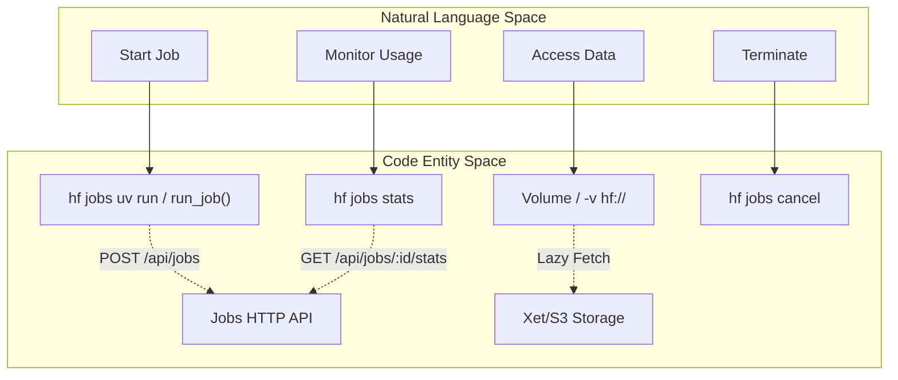
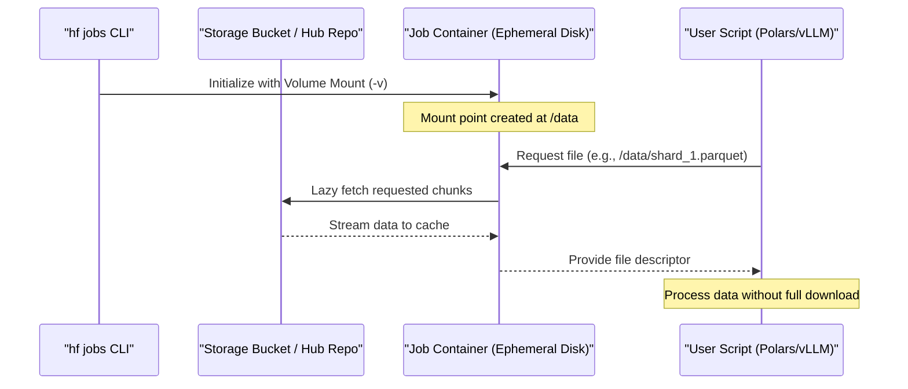

<!-- source: DeepWiki mcp.deepwiki.com · repo huggingface/hub-docs · page 3.3 Hub Jobs · fetched 2026-10-26 -->

# Hub Jobs

<details>
<summary>Relevant source files</summary>

The following files were used as context for generating this wiki page:

- [docs/hub/jobs-configuration.md](docs/hub/jobs-configuration.md)
- [docs/hub/jobs-examples.md](docs/hub/jobs-examples.md)
- [docs/hub/jobs-large-datasets.md](docs/hub/jobs-large-datasets.md)
- [docs/hub/jobs-manage.md](docs/hub/jobs-manage.md)
- [docs/hub/jobs-overview.md](docs/hub/jobs-overview.md)
- [docs/hub/jobs-popular-images.md](docs/hub/jobs-popular-images.md)
- [docs/hub/jobs-pricing.md](docs/hub/jobs-pricing.md)
- [docs/hub/jobs-quickstart.md](docs/hub/jobs-quickstart.md)
- [docs/hub/jobs-reference.md](docs/hub/jobs-reference.md)
- [docs/hub/jobs-schedule.md](docs/hub/jobs-schedule.md)
- [docs/hub/jobs-serving.md](docs/hub/jobs-serving.md)
- [docs/hub/jobs.md](docs/hub/jobs.md)

</details>


`Hugging Face Jobs` provide a serverless compute infrastructure for AI and data workflows, supporting a familiar `uv` and Docker-like interface. They are designed for fine-tuning models, running batch inference, and large-scale data processing [docs/hub/jobs.md:1-6](). Jobs support a wide range of hardware flavors, from basic CPUs to multi-GPU clusters (e.g., 8x Nvidia H200) [docs/hub/jobs-pricing.md:20-55]().

## System Architecture and Data Flow

The Jobs ecosystem bridges local development with cloud execution by synchronizing code, mounting remote data, and providing real-time telemetry.

### Job Lifecycle Diagram
This diagram maps the high-level Job lifecycle to the underlying CLI commands and API concepts.


**Sources:** [docs/hub/jobs-reference.md:22-31](), [docs/hub/jobs-manage.md:92-95](), [docs/hub/jobs-configuration.md:104-106]()

### Data Flow for Large Datasets
Jobs use a lazy-loading mechanism for volumes, allowing them to process datasets far larger than the ephemeral disk provided by the hardware flavor [docs/hub/jobs-large-datasets.md:3-4]().


**Sources:** [docs/hub/jobs-large-datasets.md:57-65](), [docs/hub/jobs-configuration.md:104-110]()

## Configuration and Execution

### Execution Modes
1.  **UV Jobs**: Uses the `uv` package manager to handle dependencies dynamically. By default, these run on `ghcr.io/astral-sh/uv:python3.12-bookworm` [docs/hub/jobs-configuration.md:9-37]().
    *   Command: `hf jobs uv run --with <deps> <script.py>` [docs/hub/jobs-configuration.md:25]().
2.  **Docker Jobs**: Runs any public or private Docker image [docs/hub/jobs-configuration.md:39-44]().
    *   Command: `hf jobs run <image> <command>` [docs/hub/jobs-configuration.md:44]().

### Environment and Secrets
Jobs provide built-in environment variables for resource discovery:
| Variable | Description |
|----------|-------------|
| `JOB_ID` | Unique identifier for the job |
| `ACCELERATOR` | Type of GPU (e.g., `a100x4`) or `none` |
| `CPU_CORES` | Number of allocated cores |
| `MEMORY` | Allocated RAM (e.g., `8Gi`) |

**Sources:** [docs/hub/jobs-configuration.md:57-67]()

Secrets (like `HF_TOKEN`) are encrypted server-side and exposed as environment variables within the container using the `-s` or `--secrets` flag [docs/hub/jobs-configuration.md:90-97]().

### Volume Management
Volumes allow mounting Hugging Face repositories or Storage Buckets using the `hf://` URI scheme [docs/hub/jobs-configuration.md:104-106]().

*   **Read-Only**: Models and datasets are always mounted read-only [docs/hub/jobs-configuration.md:140]().
*   **Read-Write**: Storage buckets are read-write by default, enabling persistence of checkpoints and logs [docs/hub/jobs-configuration.md:140-141]().
*   **Local Sync**: Passing a local directory (e.g., `-v ./data:/mnt`) automatically syncs files to a `jobs-artifacts` bucket before starting the job [docs/hub/jobs-configuration.md:146-154]().

## Scheduling and Automation

Jobs can be scheduled using standard CRON expressions or aliases like `@hourly` [docs/hub/jobs-schedule.md:5]().

| Command | Action |
|---------|--------|
| `hf jobs scheduled ps` | List active schedules [docs/hub/jobs-schedule.md:32-33]() |
| `hf jobs scheduled suspend` | Pause a schedule [docs/hub/jobs-schedule.md:41-42]() |
| `hf jobs scheduled trigger` | Immediate manual execution [docs/hub/jobs-schedule.md:47-48]() |

## Serving Endpoints

Jobs can act as ephemeral inference servers by exposing ports. This is billed at a flat rate of **$0.01/hour** in addition to hardware costs [docs/hub/jobs-pricing.md:62-68]().

### Example: vLLM Server
A Job can be detached to run a vLLM OpenAI-compatible server:
```bash
hf jobs run --detach --expose 8000 --flavor a10g-small -s HF_TOKEN \
  vllm/vllm-openai \
  vllm serve LiquidAI/LFM2.5-8B-A1B --max-model-len 8192
```
**Sources:** [docs/hub/jobs-serving.md:12-23]()

The endpoint is reachable at `https://{job_id}--{port}.hf.jobs` and requires an `Authorization: Bearer <HF_TOKEN>` header for access [docs/hub/jobs-serving.md:34-43]().

## Pricing and Billing

Billing is computed **per minute** based on the hardware flavor and is only active when the job is in the `Starting` or `Running` state [docs/hub/jobs-pricing.md:8-10]().

*   **CPU Basic**: $0.01/hr (2 vCPU, 16GB RAM) [docs/hub/jobs-pricing.md:24]().
*   **Nvidia A100 - large**: $2.50/hr (80GB GPU Memory) [docs/hub/jobs-pricing.md:44]().
*   **8x Nvidia H200**: $40.00/hr (1128GB GPU Memory) [docs/hub/jobs-pricing.md:50]().

Users can set a `--timeout` (default 30 minutes) to prevent runaway costs [docs/hub/jobs-pricing.md:124-134]().

## Popular Framework Images

For optimized GPU execution, it is recommended to use framework-specific images that include the CUDA toolkit and `nvcc` [docs/hub/jobs-popular-images:40-54]().

| Framework | Image |
|-----------|-------|
| **vLLM** | `vllm/vllm-openai` [docs/hub/jobs-popular-images.md:15]() |
| **TRL** | `huggingface/trl` [docs/hub/jobs-popular-images.md:32]() |
| **llama.cpp**| `ghcr.io/ggml-org/llama.cpp:server-cuda` [docs/hub/jobs-serving.md:71]() |

**Sources:** [docs/hub/jobs-popular-images.md:12-38]()

---

