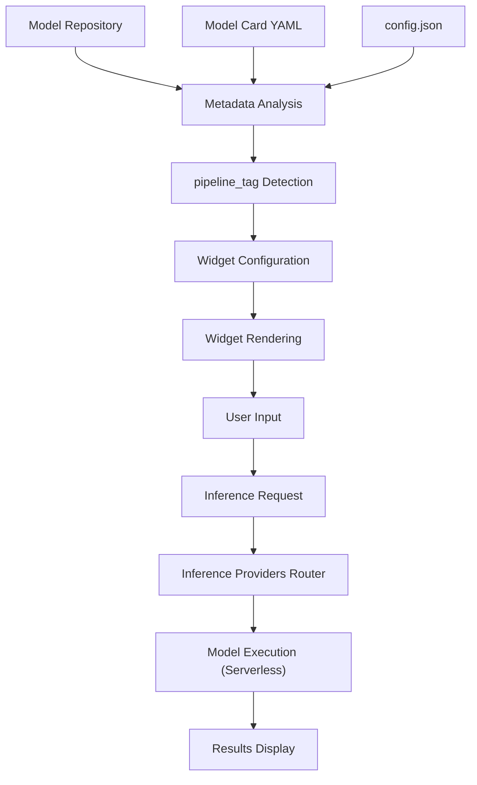
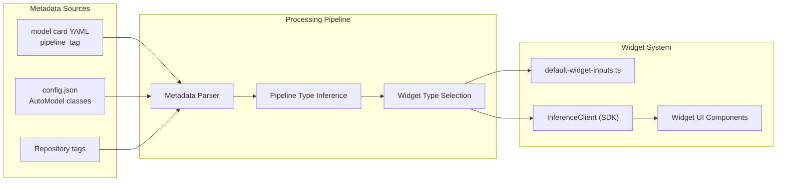
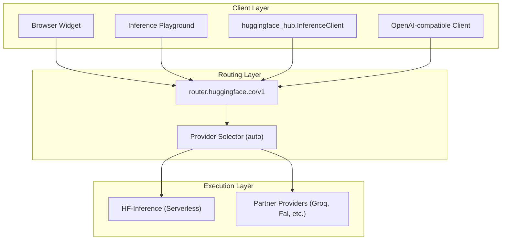

<!-- source: DeepWiki mcp.deepwiki.com · repo huggingface/hub-docs · page 4.1 Model Inference and Widgets · fetched 2026-10-26 -->

# Model Inference and Widgets

<details>
<summary>Relevant source files</summary>

The following files were used as context for generating this wiki page:

- [docs/hub/models-inference.md](docs/hub/models-inference.md)
- [docs/hub/models-the-hub.md](docs/hub/models-the-hub.md)
- [docs/hub/models-widgets-examples.md](docs/hub/models-widgets-examples.md)
- [docs/hub/models-widgets.md](docs/hub/models-widgets.md)
- [docs/hub/paddlenlp.md](docs/hub/paddlenlp.md)

</details>


This document covers the interactive inference capabilities available directly on Hugging Face Hub model pages, including browser-based widgets, the Inference API, the Inference Playground, and model execution architecture.

## Overview

The Hugging Face Hub provides immediate access to model inference through interactive widgets displayed on model pages and programmatic access via Inference Providers. These systems allow users to experiment with models directly in their browser without requiring local setup.

**Widget Generation and Inference Flow**



Sources: [docs/hub/models-widgets.md:16-26](), [docs/hub/models-inference.md:7-14]()

## Interactive Widgets

Widgets are automatically generated browser-based interfaces that allow users to test models directly on their Hub pages. These widgets are powered by [Inference Providers](https://huggingface.co/docs/inference-providers), which provide unified access to machine learning models backed by serverless partners [docs/hub/models-widgets.md:3-5]().

### Widget Generation Process

The Hub determines which widget to display through a hierarchical analysis process:

1.  **Explicit Pipeline Tag**: Checks for `pipeline_tag` in model card metadata [docs/hub/models-widgets.md:26-26]().
2.  **Library-Specific Detection**: For libraries like `transformers`, the architecture in `config.json` (e.g., `AutoModelForTokenClassification`) determines the type [docs/hub/models-widgets.md:22-23]().
3.  **Tag-Based Inference**: Falls back to analyzing model tags (e.g., `tag: text-classification`) [docs/hub/models-widgets.md:24-25]().

**Widget Detection Architecture**



Sources: [docs/hub/models-widgets.md:16-26](), [docs/hub/models-widgets.md:97-98](), [docs/hub/models-inference.md:26-34]()

### Widget Configuration

Users can customize widget behavior through YAML metadata in their model cards.

#### Input Examples Configuration
The `widget` field defines example inputs. You can provide multiple examples and optional `example_title` [docs/hub/models-widgets.md:30-42]().

```yaml
widget:
  - text: "This new restaurant has amazing food!"
    example_title: "Positive Review"
  - text: "I'm really disappointed."
    example_title: "Negative Review"
```

For vision and audio, use `src`. Files can be external URLs or relative paths within the repository [docs/hub/models-widgets.md:61-95]().

```yaml
widget:
  - src: sample1.flac
    example_title: "Custom Speech Sample"
```

#### Example Outputs
If a model is not yet supported by Inference Providers, you can describe the model output in the `output` property to showcase results [docs/hub/models-widgets.md:99-103]().

```yaml
widget:
  - text: "I liked this movie"
    output:
      - label: POSITIVE
        score: 0.8
```

Sources: [docs/hub/models-widgets.md:30-133]()

## Inference Providers and Playground

The Hub integrates with Inference Providers to offer pay-as-you-go and free-tier inference [docs/hub/models-inference.md:1-5]().

### Inference Playground
The [Inference Playground](https://huggingface.co/playground) allows users to test and compare chat completion models interactively [docs/hub/models-inference.md:12-12]().

### Programmatic Access
Developers can use the `InferenceClient` via Python or JavaScript SDKs, or use an OpenAI-compatible API [docs/hub/models-inference.md:26-114]().

**Inference Execution Architecture**



Sources: [docs/hub/models-inference.md:31-40](), [docs/hub/models-inference.md:56-62](), [docs/hub/models-inference.md:133-138]()

## Widget Types and Tasks

The Hub supports a wide range of tasks across NLP, Audio, and Computer Vision.

| Category | Widget Examples | Source |
| :--- | :--- | :--- |
| **NLP** | Fill-Mask, Summarization, Question Answering, Zero-Shot Classification | [docs/hub/models-widgets-examples.md:5-126]() |
| **Audio** | Text-to-Speech, ASR, Audio Classification | [docs/hub/models-widgets-examples.md:159-209]() |
| **Vision** | Image Classification, Object Detection, Segmentation | [docs/hub/models-widgets-examples.md:211-241]() |

The `conversational` widget is a special case shown for `text-generation` or `image-text-to-text` models if they are also tagged as `conversational` [docs/hub/models-widgets.md:20-20]().

Sources: [docs/hub/models-widgets.md:20-20](), [docs/hub/models-widgets-examples.md:1-247]()

---

