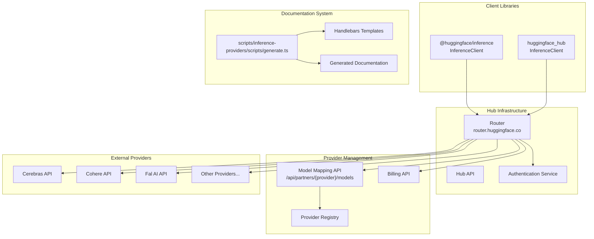
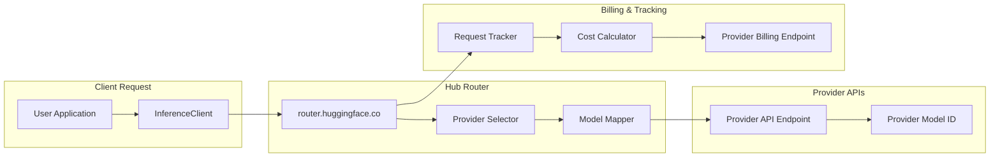
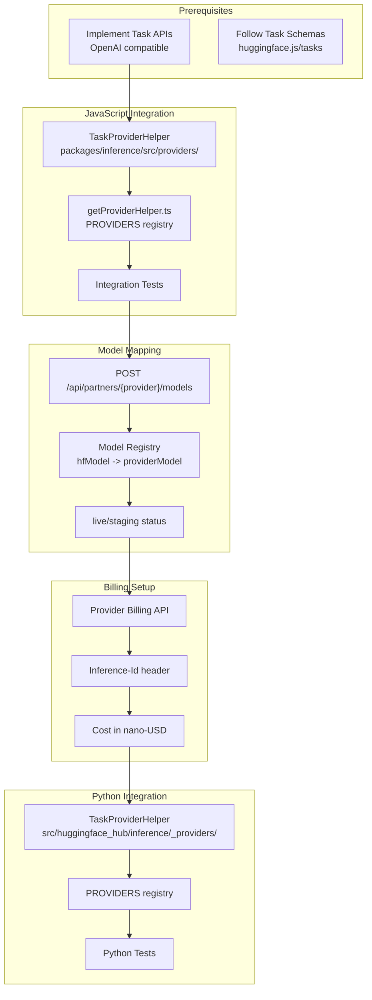
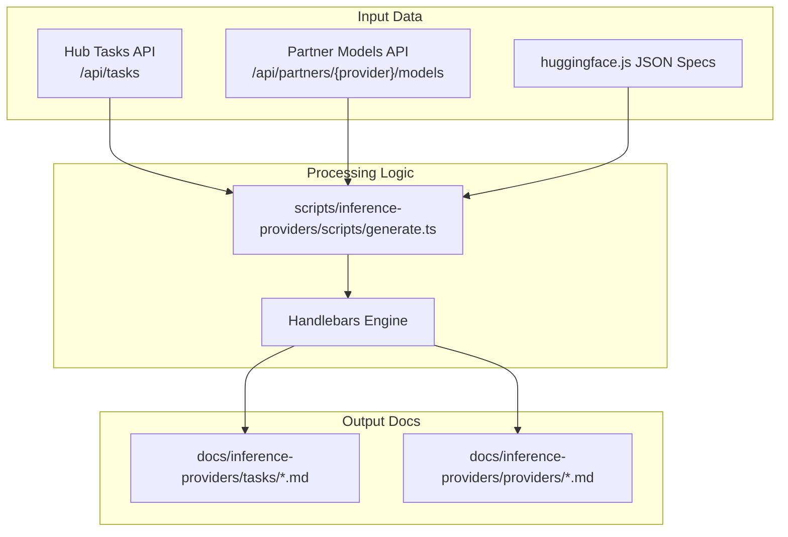

<!-- source: DeepWiki mcp.deepwiki.com · repo huggingface/hub-docs · page 4.2 Inference Providers · fetched 2026-10-26 -->

# Inference Providers

Relevant source files

The following files were used as context for generating this wiki page:

- [README.md](README.md)
- [docs/hub/agents-sdk.md](docs/hub/agents-sdk.md)
- [docs/inference-providers/_redirects.yml](docs/inference-providers/_redirects.yml)
- [docs/inference-providers/_toctree.yml](docs/inference-providers/_toctree.yml)
- [docs/inference-providers/guides/building-first-app.md](docs/inference-providers/guides/building-first-app.md)
- [docs/inference-providers/guides/evaluation-inspect-ai.md](docs/inference-providers/guides/evaluation-inspect-ai.md)
- [docs/inference-providers/guides/first-api-call.md](docs/inference-providers/guides/first-api-call.md)
- [docs/inference-providers/guides/function-calling.md](docs/inference-providers/guides/function-calling.md)
- [docs/inference-providers/guides/gpt-oss.md](docs/inference-providers/guides/gpt-oss.md)
- [docs/inference-providers/guides/image-editor.md](docs/inference-providers/guides/image-editor.md)
- [docs/inference-providers/guides/responses-api.md](docs/inference-providers/guides/responses-api.md)
- [docs/inference-providers/guides/structured-output.md](docs/inference-providers/guides/structured-output.md)
- [docs/inference-providers/hub-api.md](docs/inference-providers/hub-api.md)
- [docs/inference-providers/index.md](docs/inference-providers/index.md)
- [docs/inference-providers/integrations/vscode.md](docs/inference-providers/integrations/vscode.md)
- [docs/inference-providers/pricing.md](docs/inference-providers/pricing.md)
- [docs/inference-providers/providers/cerebras.md](docs/inference-providers/providers/cerebras.md)
- [docs/inference-providers/providers/cohere.md](docs/inference-providers/providers/cohere.md)
- [docs/inference-providers/providers/deepinfra.md](docs/inference-providers/providers/deepinfra.md)
- [docs/inference-providers/providers/featherless-ai.md](docs/inference-providers/providers/featherless-ai.md)
- [docs/inference-providers/providers/fireworks-ai.md](docs/inference-providers/providers/fireworks-ai.md)
- [docs/inference-providers/providers/groq.md](docs/inference-providers/providers/groq.md)
- [docs/inference-providers/providers/novita.md](docs/inference-providers/providers/novita.md)
- [docs/inference-providers/providers/nscale.md](docs/inference-providers/providers/nscale.md)
- [docs/inference-providers/providers/ovhcloud.md](docs/inference-providers/providers/ovhcloud.md)
- [docs/inference-providers/providers/publicai.md](docs/inference-providers/providers/publicai.md)
- [docs/inference-providers/providers/scaleway.md](docs/inference-providers/providers/scaleway.md)
- [docs/inference-providers/providers/together.md](docs/inference-providers/providers/together.md)
- [docs/inference-providers/providers/wavespeed.md](docs/inference-providers/providers/wavespeed.md)
- [docs/inference-providers/register-as-a-provider.md](docs/inference-providers/register-as-a-provider.md)
- [scripts/inference-providers/scripts/generate.ts](scripts/inference-providers/scripts/generate.ts)

## Purpose and Scope

Inference Providers is Hugging Face's unified platform for accessing machine learning models through third-party inference providers. This system enables developers to run inference on thousands of models through a single API while leveraging the infrastructure of multiple specialized providers like Cerebras, Cohere, DeepInfra, Fal AI, Featherless, Fireworks, Groq, Novita, nScale, OVHcloud, PublicAI, Replicate, Scaleway, Together, Wavespeed, and Z.ai.

This document covers the technical architecture, provider integration process, client implementations, and the `generate.ts` documentation pipeline.

## System Architecture

### Core Infrastructure

The Inference Providers system consists of several interconnected components that handle routing, authentication, billing, and provider management.

Sources: [docs/inference-providers/index.md:8-12](), [scripts/inference-providers/scripts/generate.ts:36-58](), [docs/inference-providers/register-as-a-provider.md:1-20]()

### Request Flow Architecture

The system processes inference requests through a routing mechanism that handles provider selection, model mapping, and billing.

Sources: [docs/inference-providers/index.md:8-9](), [docs/inference-providers/register-as-a-provider.md:301-350]()

## Provider Integration Process

### Registration Workflow

Providers must complete several integration steps to become part of the Inference Providers ecosystem, including implementing OpenAI-compatible APIs and registering their Hub organization.

Sources: [docs/inference-providers/register-as-a-provider.md:22-72](), [docs/inference-providers/register-as-a-provider.md:124-196]()

## Provider-Specific Documentation

Documentation for providers is generated automatically using templates. Each provider page includes supported tasks and specific model mappings.

### Supported Providers
The following providers are integrated into the Hub ecosystem:
- **Cerebras**: Specialized in fast AI inference and training [docs/inference-providers/providers/cerebras.md:39-39]().
- **Cohere**: Multilingual models and enterprise AI workspace [docs/inference-providers/providers/cohere.md:39-41]().
- **Featherless AI**: Serverless platform making thousands of open-source models available [docs/inference-providers/providers/featherless-ai.md:39-41]().
- **Fireworks AI**: High-performance generative AI solutions for LLMs and image models [docs/inference-providers/providers/fireworks-ai.md:39-39]().
- **Novita**: Low-cost, reliable solution for shipping AI models with 200+ APIs [docs/inference-providers/providers/novita.md:39-41]().
- **nScale**: Vertically integrated AI cloud for bespoke infrastructure [docs/inference-providers/providers/nscale.md:39-41]().
- **PublicAI**: Nonprofit open-source project building public AI infrastructure [docs/inference-providers/providers/publicai.md:39-41]().
- **Scaleway**: European cloud provider offering Generative APIs [docs/inference-providers/providers/scaleway.md:39-39]().
- **Together**: Decentralized cloud services for training and deploying generative models [docs/inference-providers/providers/together.md:39-39]().

### Model Mapping Examples
Providers map Hugging Face model IDs to their internal provider IDs:
- **Together**: Maps `black-forest-labs/FLUX.1-schnell` directly [docs/inference-providers/providers/together.md:100-100]().
- **Novita**: Maps `zai-org/GLM-5.2` to `zai-org/glm-5.2` [docs/inference-providers/providers/novita.md:52-52]().
- **Fireworks AI**: Maps `moonshotai/Kimi-K3` to `accounts/fireworks/models/kimi-k3` [docs/inference-providers/providers/fireworks-ai.md:59-59]().

Sources: [docs/inference-providers/providers/together.md](), [docs/inference-providers/providers/novita.md](), [docs/inference-providers/providers/fireworks-ai.md]()

## The generate.ts Pipeline

The documentation for Inference Providers is generated via a TypeScript script that fetches data from the Hub API and applies it to Handlebars templates.

### Pipeline Flow

### Key Functions and Constants
- `TASKS`: Defines the list of supported `PipelineType` values like `text-generation` and `automatic-speech-recognition` [scripts/inference-providers/scripts/generate.ts:8-28]().
- `PROVIDERS_URLS`: A record mapping provider keys to their marketing URLs [scripts/inference-providers/scripts/generate.ts:36-54]().
- `authFetchJson()`: Helper function to fetch data from protected Hub endpoints using `HF_TOKEN` [scripts/inference-providers/scripts/generate.ts:60-73]().
- `PER_TASK_SUPPORTED_PROVIDERS`: A global registry populated by fetching `/api/partners/{provider}/models` to determine which providers support which tasks [scripts/inference-providers/scripts/generate.ts:98-125]().
- `writeProviderDoc()`: Generates the markdown file for a specific provider using templates [scripts/inference-providers/scripts/generate.ts:171-184]().

Sources: [scripts/inference-providers/scripts/generate.ts:1-184]()

---

