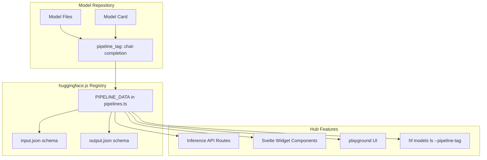

<!-- source: DeepWiki mcp.deepwiki.com · repo huggingface/hub-docs · page 4.3 Tasks and Pipeline Types · fetched 2026-10-26 -->

# Tasks and Pipeline Types

<details>
<summary>Relevant source files</summary>

The following files were used as context for generating this wiki page:

- [docs/inference-providers/providers/fal-ai.md](docs/inference-providers/providers/fal-ai.md)
- [docs/inference-providers/providers/hf-inference.md](docs/inference-providers/providers/hf-inference.md)
- [docs/inference-providers/providers/replicate.md](docs/inference-providers/providers/replicate.md)
- [docs/inference-providers/providers/zai-org.md](docs/inference-providers/providers/zai-org.md)
- [docs/inference-providers/tasks/audio-classification.md](docs/inference-providers/tasks/audio-classification.md)
- [docs/inference-providers/tasks/automatic-speech-recognition.md](docs/inference-providers/tasks/automatic-speech-recognition.md)
- [docs/inference-providers/tasks/chat-completion.md](docs/inference-providers/tasks/chat-completion.md)
- [docs/inference-providers/tasks/feature-extraction.md](docs/inference-providers/tasks/feature-extraction.md)
- [docs/inference-providers/tasks/fill-mask.md](docs/inference-providers/tasks/fill-mask.md)
- [docs/inference-providers/tasks/image-classification.md](docs/inference-providers/tasks/image-classification.md)
- [docs/inference-providers/tasks/image-segmentation.md](docs/inference-providers/tasks/image-segmentation.md)
- [docs/inference-providers/tasks/image-text-to-text.md](docs/inference-providers/tasks/image-text-to-text.md)
- [docs/inference-providers/tasks/image-to-image.md](docs/inference-providers/tasks/image-to-image.md)
- [docs/inference-providers/tasks/object-detection.md](docs/inference-providers/tasks/object-detection.md)
- [docs/inference-providers/tasks/question-answering.md](docs/inference-providers/tasks/question-answering.md)
- [docs/inference-providers/tasks/summarization.md](docs/inference-providers/tasks/summarization.md)
- [docs/inference-providers/tasks/table-question-answering.md](docs/inference-providers/tasks/table-question-answering.md)
- [docs/inference-providers/tasks/text-classification.md](docs/inference-providers/tasks/text-classification.md)
- [docs/inference-providers/tasks/text-generation.md](docs/inference-providers/tasks/text-generation.md)
- [docs/inference-providers/tasks/text-to-image.md](docs/inference-providers/tasks/text-to-image.md)
- [docs/inference-providers/tasks/text-to-video.md](docs/inference-providers/tasks/text-to-video.md)
- [docs/inference-providers/tasks/token-classification.md](docs/inference-providers/tasks/token-classification.md)
- [docs/inference-providers/tasks/translation.md](docs/inference-providers/tasks/translation.md)
- [docs/inference-providers/tasks/zero-shot-classification.md](docs/inference-providers/tasks/zero-shot-classification.md)
- [scripts/inference-providers/package.json](scripts/inference-providers/package.json)
- [scripts/inference-providers/pnpm-lock.yaml](scripts/inference-providers/pnpm-lock.yaml)

</details>


This document covers the task and pipeline type system in the Hugging Face Hub, which defines the standardized interface for machine learning models and their execution. Tasks describe the "shape" of model APIs (inputs and outputs) and serve as the foundation for model discovery, inference execution, and widget generation across the Hub ecosystem.

## What are Tasks and Pipeline Types

Tasks, also referred to as pipeline types, are standardized categories that define the input-output interface for machine learning models. They serve as a classification system that enables the Hub to automatically determine which inference API, interactive widgets, and user interface elements to display for any given model.

### Natural Language Space to Code Entity Space: Task Resolution



Tasks enable several key Hub functionalities:
- **Model Discovery**: Users can filter models via `hf models ls --warm --pipeline-tag <tag>` [docs/inference-providers/tasks/chat-completion.md:37-41]().
- **Automatic Interface Generation**: The Hub provides an interactive UI Playground for testing models like Chat Completion [docs/inference-providers/tasks/chat-completion.md:43-56]().
- **Inference Execution**: Requests are routed based on the `pipeline` parameter in `InferenceSnippet` components [docs/inference-providers/providers/hf-inference.md:51-54]().
- **Provider Integration**: Third-party providers map their internal IDs to Hub task tags via `providersMapping` [docs/inference-providers/tasks/text-to-image.md:38-41]().

Sources: [docs/inference-providers/tasks/chat-completion.md:15-18](), [docs/inference-providers/tasks/chat-completion.md:37-41](), [docs/inference-providers/tasks/chat-completion.md:43-56]()

## Core Task Categories and Implementations

The Hub supports a wide array of tasks across vision, audio, and text domains. Each task is backed by specific JSON schemas for request/response validation.

### Supported Tasks Overview

| Task Tag | Domain | Key Input Parameters | Source |
| :--- | :--- | :--- | :--- |
| `chat-completion` | Multimodal/Text | `messages`, `tools`, `frequency_penalty` | [docs/inference-providers/tasks/chat-completion.md:15-100]() |
| `text-generation` | Text | `inputs`, `max_new_tokens`, `grammar` | [docs/inference-providers/tasks/text-generation.md:15-82]() |
| `text-to-image` | Vision | `inputs` (prompt), `guidance_scale`, `num_inference_steps` | [docs/inference-providers/tasks/text-to-image.md:15-60]() |
| `image-to-image` | Vision | `inputs` (base64/bytes), `prompt`, `target_size` | [docs/inference-providers/tasks/image-to-image.md:15-68]() |
| `image-text-to-text`| Multimodal | Conversational inputs (VLM) | [docs/inference-providers/tasks/image-text-to-text.md:15-47]() |
| `image-segmentation`| Vision | `inputs`, `mask_threshold`, `subtask` | [docs/inference-providers/tasks/image-segmentation.md:15-58]() |
| `automatic-speech-recognition` | Audio | Audio bytes/file | [docs/inference-providers/providers/hf-inference.md:47-54]() |

### Implementation Data Flow

The following diagram illustrates how a request flows from a client through the Hub's task-based validation layer to an Inference Provider.

```mermaid
sequenceDiagram
    participant Client
    participant HubAPI["Hub Inference API"]
    participant TaskSpec["@huggingface/tasks Specs"]
    participant Provider["Inference Provider (e.g., Z.ai, Fal, Replicate)"]
    
    Client->>HubAPI: POST /models/{model_id} (Task: text-to-image)
    HubAPI->>TaskSpec: Load input.json schema
    TaskSpec-->>HubAPI: Return validation rules (guidance_scale, etc.)
    HubAPI->>HubAPI: Validate payload
    HubAPI->>Provider: Forward request to providerModelId
    Provider-->>HubAPI: Return raw bytes or JSON
    HubAPI->>TaskSpec: Load output.json schema
    HubAPI-->>Client: Return validated response (image bytes/JSON)
```

Sources: [docs/inference-providers/tasks/text-to-image.md:45-73](), [docs/inference-providers/tasks/chat-completion.md:6-11](), [docs/inference-providers/providers/zai-org.md:53-70]()

## Task Specializations

### Chat Completion and VLMs
`chat-completion` is a specialized subtask of `text-generation` and `image-text-to-text` [docs/inference-providers/tasks/chat-completion.md:18](). It supports:
- **Conversational LLMs**: Text-only models like `google/gemma-2-2b-it` [docs/inference-providers/tasks/chat-completion.md:24]().
- **Conversational VLMs**: Vision-Language Models like `zai-org/GLM-4.5V` [docs/inference-providers/tasks/chat-completion.md:34]().
- **Advanced Features**: Supports tool calling, streaming, and grammar constraints (JSON/Regex) [docs/inference-providers/tasks/chat-completion.md:60-64]().

### Image and Video Generation
- **Text-to-Image**: Generates images from text prompts. Key parameters include `negative_prompt` and `seed` [docs/inference-providers/tasks/text-to-image.md:59-64]().
- **Image-to-Image**: Transforms source images. Used for style transfer, colorization, and upscaling [docs/inference-providers/tasks/image-to-image.md:17-23]().
- **Text-to-Video**: Supported by providers like Replicate and Fal for models like `Wan-AI/Wan2.2` [docs/inference-providers/providers/replicate.md:74-81](), [docs/inference-providers/providers/fal-ai.md:84-91]().

### Analytical and Discriminative Tasks
The `hf-inference` (serverless) provider focuses heavily on CPU-bound analytical tasks [docs/inference-providers/providers/hf-inference.md:39-43]():
- **Feature Extraction**: Mapping text to embeddings [docs/inference-providers/providers/hf-inference.md:57-64]().
- **Classification**: Text, image, and token classification (NER) [docs/inference-providers/providers/hf-inference.md:137-165]().
- **Segmentation**: Identifying object boundaries in images [docs/inference-providers/providers/hf-inference.md:87-94]().

Sources: [docs/inference-providers/tasks/chat-completion.md:60-64](), [docs/inference-providers/providers/hf-inference.md:39-43](), [docs/inference-providers/tasks/image-to-image.md:17-23]()

## Technical Registry and Tooling

The task system is managed via the `@huggingface/tasks` package [scripts/inference-providers/package.json:18]().

### Registry Components
- **JSON Schemas**: Located in `packages/tasks/src/tasks/{task_name}/spec/` [docs/inference-providers/tasks/chat-completion.md:6-7]().
- **Code Snippets**: Generators for `curl`, `python`, and `js` reside in `packages/tasks/src/snippets/` [docs/inference-providers/tasks/chat-completion.md:8-11]().
- **Generation Logic**: The `generate.ts` script orchestrates the creation of task documentation from these schemas and templates [docs/inference-providers/tasks/chat-completion.md:4-5]().

### Provider Mapping Logic
Providers map Hub model IDs to their internal IDs using the `providersMapping` structure in documentation snippets:
```typescript
// Example from Text-to-Image
providersMapping={ {
    "fal-ai": {"modelId": "krea/Krea-2-Turbo", "providerModelId": "fal-ai/krea-2/turbo"},
    "hf-inference": {"modelId": "stabilityai/stable-diffusion-3", "providerModelId": "stabilityai/stable-diffusion-3"}
} }
```
Sources: [docs/inference-providers/tasks/text-to-image.md:40](), [scripts/inference-providers/package.json:17-18](), [docs/inference-providers/tasks/chat-completion.md:4-11]()

Sources:
- [docs/inference-providers/tasks/chat-completion.md:1-100]()
- [docs/inference-providers/tasks/text-generation.md:1-85]()
- [docs/inference-providers/tasks/text-to-image.md:1-73]()
- [docs/inference-providers/tasks/image-to-image.md:1-78]()
- [docs/inference-providers/tasks/image-segment-ation.md:1-72]()
- [docs/inference-providers/providers/hf-inference.md:1-186]()
- [docs/inference-providers/providers/zai-org.md:50-73]()
- [scripts/inference-providers/package.json:1-28]()

---

