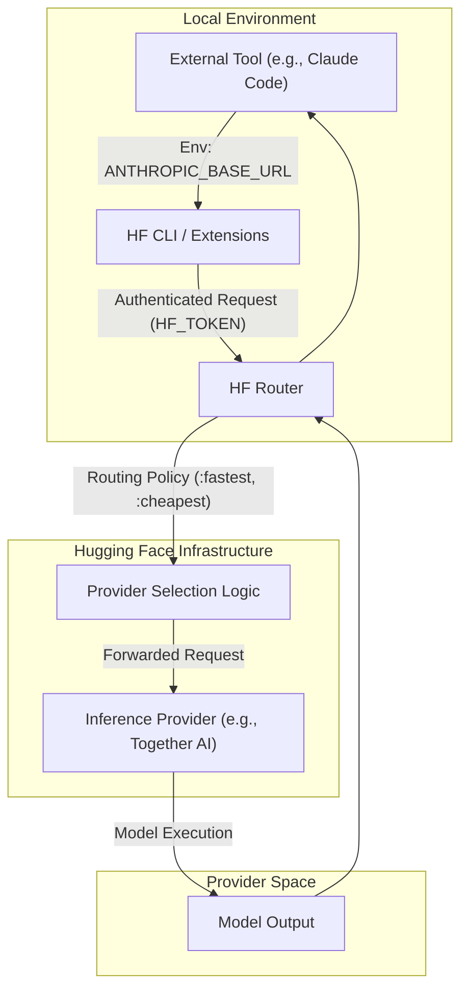
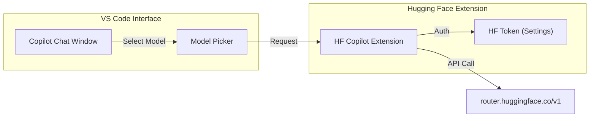

<!-- source: DeepWiki mcp.deepwiki.com · repo huggingface/hub-docs · page 4.4 Inference Provider Integrations · fetched 2026-10-26 -->

# Inference Provider Integrations

<details>
<summary>Relevant source files</summary>

The following files were used as context for generating this wiki page:

- [docs/inference-providers/_redirects.yml](docs/inference-providers/_redirects.yml)
- [docs/inference-providers/_toctree.yml](docs/inference-providers/_toctree.yml)
- [docs/inference-providers/guides/evaluation-inspect-ai.md](docs/inference-providers/guides/evaluation-inspect-ai.md)
- [docs/inference-providers/guides/first-api-call.md](docs/inference-providers/guides/first-api-call.md)
- [docs/inference-providers/guides/function-calling.md](docs/inference-providers/guides/function-calling.md)
- [docs/inference-providers/hub-api.md](docs/inference-providers/hub-api.md)
- [docs/inference-providers/index.md](docs/inference-providers/index.md)
- [docs/inference-providers/integrations/claude-code.md](docs/inference-providers/integrations/claude-code.md)
- [docs/inference-providers/integrations/codex.md](docs/inference-providers/integrations/codex.md)
- [docs/inference-providers/integrations/datadesigner.md](docs/inference-providers/integrations/datadesigner.md)
- [docs/inference-providers/integrations/hermes-agent.md](docs/inference-providers/integrations/hermes-agent.md)
- [docs/inference-providers/integrations/index.md](docs/inference-providers/integrations/index.md)
- [docs/inference-providers/integrations/pi.md](docs/inference-providers/integrations/pi.md)
- [docs/inference-providers/integrations/visionagents.md](docs/inference-providers/integrations/visionagents.md)
- [docs/inference-providers/integrations/vscode.md](docs/inference-providers/integrations/vscode.md)
- [scripts/inference-providers/scripts/generate.ts](scripts/inference-providers/scripts/generate.ts)

</details>


Hugging Face Inference Providers allow developers to integrate state-of-the-art open models into their existing workflows, tools, and frameworks. By utilizing a single Hugging Face token, users can access dozens of world-class inference providers (e.g., Together, Groq, Cerebras, Fal AI) without changing their code structure, thanks to standardized API endpoints and OpenAI-compatible routing [docs/inference-providers/integrations/index.md:1-12]().

## Architectural Overview

The integration layer sits between external developer tools and the Hugging Face router. The router acts as a gateway that translates standardized requests (like OpenAI-compatible chat completions) into provider-specific calls.

### Data Flow: External Tool to Inference Provider
The following diagram illustrates how an external tool like Claude Code or VS Code communicates with a model through the Hugging Face infrastructure.

**Integration Data Flow**

Sources: [docs/inference-providers/integrations/claude-code.md:7-8](), [docs/inference-providers/integrations/claude-code.md:51-68](), [docs/inference-providers/guides/first-api-call.md:149-156]()

## Supported Coding Agents and CLI Tools

Hugging Face Inference Providers are integrated into several popular terminal-based coding agents. These tools typically use environment variables to redirect their API calls to the Hugging Face router [docs/inference-providers/integrations/index.md:3-4]().

| Integration | Description | Configuration Method |
| :--- | :--- | :--- |
| **Claude Code** | Anthropic's agentic coding tool for the terminal. | `ANTHROPIC_BASE_URL="https://router.huggingface.co"` |
| **Pi** | Minimalist terminal-based coding assistant. | Native HF Token support. |
| **OpenCode** | AI coding agent built for the terminal. | CLI configuration. |
| **Codex** | OpenAI's agentic coding CLI for the terminal. | API Base URL redirection. |
| **Hermes Agent** | Open-source AI agent CLI for coding and development. | CLI configuration. |

Sources: [docs/inference-providers/integrations/index.md:16-22](), [docs/inference-providers/integrations/claude-code.md:50-58]()

### Implementation Example: Claude Code
Claude Code integration can be handled manually or via the `hf-claude` extension. The extension provides an interactive model and provider picker [docs/inference-providers/integrations/claude-code.md:16-19]().

**Claude Code Environment Setup**
```bash
export ANTHROPIC_BASE_URL="https://router.huggingface.co"
export ANTHROPIC_AUTH_TOKEN="${HF_TOKEN}"
export ANTHROPIC_API_KEY="${HF_TOKEN}"
# Mapping internal slots to HF models
export ANTHROPIC_DEFAULT_SONNET_MODEL="zai-org/GLM-5.1:fastest"
```
Sources: [docs/inference-providers/integrations/claude-code.md:50-58](), [docs/inference-providers/integrations/claude-code.md:70-72]()

## IDE Integrations: VS Code

The **HF Copilot Chat extension** allows users to bring open LLMs (like DeepSeek V3 or Kimi K2) directly into the GitHub Copilot Chat interface in VS Code [docs/inference-providers/integrations/vscode.md:1-5]().

**VS Code Integration Logic**

Sources: [docs/inference-providers/integrations/vscode.md:9-14]()

## Framework Integrations

Inference Providers are compatible with major LLM orchestration and evaluation frameworks. Most integrations utilize the OpenAI-compatible endpoint at `https://router.huggingface.co/v1` [docs/inference-providers/hub-api.md:141-143]().

### DataDesigner (NVIDIA NeMo)
`DataDesigner` uses Inference Providers to generate synthetic datasets. It maps a `ModelProvider` class to the Hugging Face router [docs/inference-providers/integrations/datadesigner.md:3-7]().

**Code Entity Mapping: DataDesigner**
*   **Class**: `ModelProvider` [docs/inference-providers/integrations/datadesigner.md:37-42]() - Defines the API endpoint and provider type (`openai`).
*   **Class**: `ModelConfig` [docs/inference-providers/integrations/datadesigner.md:45-49]() - Links a specific model ID (e.g., `openai/gpt-oss-120b`) to the provider.
*   **Function**: `push_to_hub` [docs/inference-providers/integrations/datadesigner.md:110-114]() - Exports the generated synthetic data back to Hugging Face.

### Inspect AI (UK AI Security Institute)
Inspect AI uses the `hf-inference-providers/` prefix to route evaluation tasks through the Hub [docs/inference-providers/guides/evaluation-inspect-ai:53]().

**Inspect AI Evaluation Flow**
```bash
# Evaluating a specific model via a specific provider
inspect eval theory-of-mind.py --model hf-inference-providers/openai/gpt-oss-120b:groq
```
Sources: [docs/inference-providers/guides/evaluation-inspect-ai.md:53-54](), [docs/inference-providers/guides/evaluation-inspect-ai.md:103-105]()

## Advanced Integration Features

### Provider Routing Policies
When integrating via the router, developers can append suffixes to model IDs to control how the Hub selects a provider [docs/inference-providers/integrations/claude-code.md:66-68]().

| Suffix | Behavior |
| :--- | :--- |
| `:fastest` | Picks the provider with the highest throughput and lowest latency. |
| `:cheapest` | Picks the provider with the lowest cost per token. |
| `:preferred` | Follows the user's preference order set in Hub settings. |
| `:{provider_name}` | Pins the request to a specific provider (e.g., `:together`). |

Sources: [docs/inference-providers/integrations/claude-code.md:68](), [docs/inference-providers/guides/first-api-call.md:151-155]()

### Programmatic Discovery
Tools can dynamically discover supported models and providers using the Hub API [docs/inference-providers/hub-api.md:5-7]().

*   **List Models**: `GET /api/models?inference_provider=all` [docs/inference-providers/hub-api.md:43-45]()
*   **Provider Metadata**: `GET /v1/models` (OpenAI-compatible) returns pricing, context length, and latency per provider [docs/inference-providers/hub-api.md:143-146](), [docs/inference-providers/hub-api.md:229-241]().

Sources: [docs/inference-providers/hub-api.md:5-53](), [docs/inference-providers/hub-api.md:141-241]()

---

