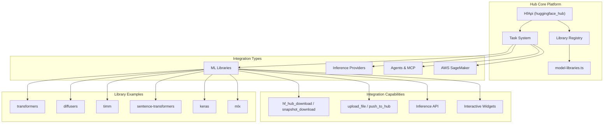
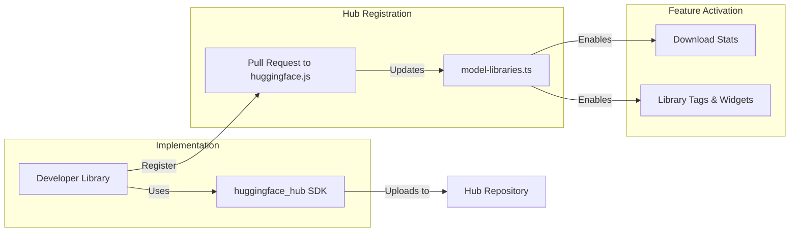

<!-- source: DeepWiki mcp.deepwiki.com · repo huggingface/hub-docs · page 5 Integration and Development · fetched 2026-10-26 -->

# Integration and Development

Relevant source files

The following files were used as context for generating this wiki page:

- [docs/hub/adapters.md](docs/hub/adapters.md)
- [docs/hub/datasets-download-stats.md](docs/hub/datasets-download-stats.md)
- [docs/hub/diffusers.md](docs/hub/diffusers.md)
- [docs/hub/models-adding-libraries.md](docs/hub/models-adding-libraries.md)
- [docs/hub/models-download-stats.md](docs/hub/models-download-stats.md)
- [docs/hub/models-libraries.md](docs/hub/models-libraries.md)
- [docs/hub/security-pickle.md](docs/hub/security-pickle.md)
- [docs/hub/setfit.md](docs/hub/setfit.md)
- [docs/hub/timm.md](docs/hub/timm.md)
- [docs/hub/transformers.md](docs/hub/transformers.md)

This document covers how external libraries, tools, and frameworks integrate with the Hugging Face Hub platform. It provides an overview of the integration architecture, supported integration types, and development workflows for extending Hub functionality.

For specific library integration details, see [Library Integrations](#5.1). For information about specialized model formats and storage systems, see [Model Formats and Storage](#5.2). For AI agents and the Model Context Protocol, see [AI Agents and MCP](#5.3). For AWS SageMaker deployment and training, see [AWS SageMaker Integration](#5.4).

## Integration Architecture Overview

The Hub serves as a central integration platform for the machine learning ecosystem, supporting dozens of libraries. The integration architecture provides standardized interfaces for content management, inference, and development workflows.

### Hub Integration Components

Sources: [docs/hub/models-libraries.md:1-45](), [docs/hub/models-adding-libraries.md:58-90]()

## Integration Types and Levels

The Hub supports varying levels of integration. Developers can register their libraries in the `model-libraries.ts` file to enable specific features like download metrics and UI widgets.

| Integration Level | Download from Hub | Push to Hub | Inference Providers | Widgets |
|------------------|-------------------|-------------|---------------------|---------|
| **Full Integration** | ✅ | ✅ | ✅ | ✅ |
| **Partial Integration** | ✅ | ✅ | ❌ | ❌ |
| **Download Only** | ✅ | ❌ | ❌ | ❌ |

### Library Categories and Formats

The Hub ecosystem supports a wide range of modalities and specialized formats:

*   **NLP:** `transformers`, `spaCy`, `flair`, `allennlp`, `paddlenlp`.
*   **Computer Vision:** `diffusers`, `timm`, `open_clip`.
*   **Audio/Speech:** `speechbrain`, `espnet`, `asteroid`.
*   **Specialized Formats:** `GGUF` for local execution, `safetensors` for secure weight storage.
*   **Parameter-Efficient Fine-Tuning:** `PEFT`, `adapters`.

Sources: [docs/hub/models-libraries.md:7-45](), [docs/hub/security-pickle.md:3-5]()

## Library Integration Patterns

### Core Programmatic Access

Most integrations utilize the `huggingface_hub` Python library (or `@huggingface/hub` for JS) to handle authentication and file transfers.

#### Authentication and Downloads
Users typically authenticate via `hf auth login` which stores a token in the `HF_HOME` directory [docs/hub/models-adding-libraries.md:39-45](). Libraries then use `hf_hub_download` for single files or `snapshot_download` for entire repositories [docs/hub/models-adding-libraries.md:67-79]().

#### Model Uploading
Libraries implement a `push_to_hub` pattern using `create_repo` and `upload_file` or `upload_folder` [docs/hub/models-adding-libraries.md:89-116]().

### Integration Examples

*   **Transformers:** Uses `AutoModel.from_pretrained()` to load weights and `config.json` [docs/hub/transformers.md:78-87]().
*   **Timm:** Loads models via `timm.create_model("hf-hub:..." )` and supports `push_to_hf_hub` [docs/hub/timm.md:17-24, 130-134]().
*   **Adapters:** Extends base models using `load_adapter()` to add parameter-efficient modules [docs/hub/adapters.md:31-41]().

## Security and Analytics in Development

### Safe Serialization
The Hub encourages the use of `safetensors` over `pickle` to prevent arbitrary code execution during model loading [docs/hub/security-pickle.md:3-5](). The Hub automatically scans for dangerous opcodes like `GLOBAL` or `REDUCE` in pickle files [docs/hub/security-pickle.md:156-160]().

### Download Metrics
Download counts are tracked server-side. For models, the Hub tracks hits to specific "query files" like `config.json` or library-specific files defined in `model-libraries.ts` [docs/hub/models-download-stats.md:5-11](). Dataset downloads are aggregated by IP address within 5-minute windows [docs/hub/datasets-download-stats.md:5]().

## Development Workflow for New Integrations

Sources: [docs/hub/models-adding-libraries.md:18-20](), [docs/hub/models-download-stats.md:13-15]()

### Requirements for New Libraries
1.  **Dependency:** Add `huggingface_hub` to library requirements [docs/hub/models-adding-libraries.md:24-28]().
2.  **Methods:** Implement `from_pretrained` and `push_to_hub` methods [docs/hub/models-adding-libraries.md:58-62]().
3.  **Metadata:** Ensure model repositories include a `README.md` with appropriate `library_name` tags.
4.  **Registration:** Update `model-libraries.ts` in the `huggingface.js` repository to enable download tracking and UI widgets [docs/hub/models-download-stats.md:13-15]().

For detailed instructions on specific integration targets, see the following child pages:
*   [Library Integrations](#5.1) — Detailed list of supported ML frameworks.
*   [Model Formats and Storage](#5.2) — GGUF, DDUF, and local application support.
*   [AI Agents and MCP](#5.3) — Connecting Hub models to agentic workflows.
*   [AWS SageMaker Integration](#5.4) — Deployment on managed AWS infrastructure.

Sources: [docs/hub/models-libraries.md:1-50](), [docs/hub/models-adding-libraries.md:1-125](), [docs/hub/security-pickle.md:1-180](), [docs/hub/models-download-stats.md:1-25](), [docs/hub/datasets-download-stats.md:1-15]()

---

