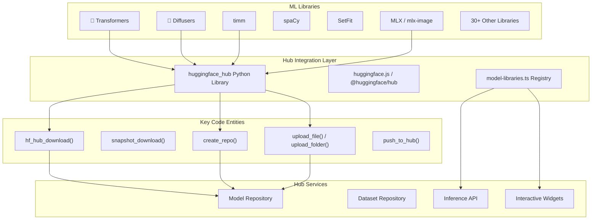
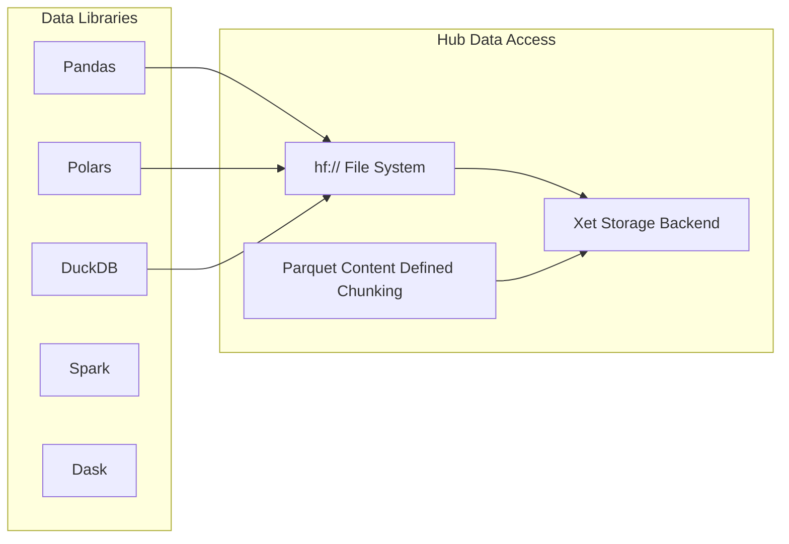

<!-- source: DeepWiki mcp.deepwiki.com · repo huggingface/hub-docs · page 5.1 Library Integrations · fetched 2026-10-26 -->

# Library Integrations

<details>
<summary>Relevant source files</summary>

The following files were used as context for generating this wiki page:

- [docs/hub/adapters.md](docs/hub/adapters.md)
- [docs/hub/allennlp.md](docs/hub/allennlp.md)
- [docs/hub/asteroid.md](docs/hub/asteroid.md)
- [docs/hub/datasets-download-stats.md](docs/hub/datasets-download-stats.md)
- [docs/hub/datasets-editing.md](docs/hub/datasets-editing.md)
- [docs/hub/datasets-libraries.md](docs/hub/datasets-libraries.md)
- [docs/hub/datasets-pandas.md](docs/hub/datasets-pandas.md)
- [docs/hub/datasets-pyarrow.md](docs/hub/datasets-pyarrow.md)
- [docs/hub/datasets-streaming.md](docs/hub/datasets-streaming.md)
- [docs/hub/diffusers.md](docs/hub/diffusers.md)
- [docs/hub/espnet.md](docs/hub/espnet.md)
- [docs/hub/fastai.md](docs/hub/fastai.md)
- [docs/hub/flair.md](docs/hub/flair.md)
- [docs/hub/ml-agents.md](docs/hub/ml-agents.md)
- [docs/hub/mlx-image.md](docs/hub/mlx-image.md)
- [docs/hub/models-adding-libraries.md](docs/hub/models-adding-libraries.md)
- [docs/hub/models-download-stats.md](docs/hub/models-download-stats.md)
- [docs/hub/models-libraries.md](docs/hub/models-libraries.md)
- [docs/hub/notifications.md](docs/hub/notifications.md)
- [docs/hub/ollama.md](docs/hub/ollama.md)
- [docs/hub/rl-baselines3-zoo.md](docs/hub/rl-baselines3-zoo.md)
- [docs/hub/security-pickle.md](docs/hub/security-pickle.md)
- [docs/hub/setfit.md](docs/hub/setfit.md)
- [docs/hub/spacy.md](docs/hub/spacy.md)
- [docs/hub/stable-baselines3.md](docs/hub/stable-baselines3.md)
- [docs/hub/timm.md](docs/hub/timm.md)
- [docs/hub/transformers.md](docs/hub/transformers.md)
- [docs/hub/unity-sentis.md](docs/hub/unity-sentis.md)

</details>


This document covers how machine learning libraries integrate with the Hugging Face Hub ecosystem, enabling seamless model sharing, inference, and discovery across 30+ supported libraries. Library integrations allow users to upload, download, and use models from various ML frameworks through standardized APIs and interfaces.

For information about specific model formats and storage backends, see [Model Formats and Storage](#5.2). For details about inference execution and providers, see [Model Inference and Widgets](#4.1).

## Integration Architecture

The Hub provides a standardized integration framework that allows ML libraries to connect with Hub services through multiple integration points. Libraries can leverage the `huggingface_hub` Python client and Hub APIs to provide users with familiar interfaces while gaining access to Hub features.



**Sources:** [docs/hub/models-libraries.md:3-5](), [docs/hub/models-adding-libraries:20-24](), [docs/hub/models-adding-libraries:58-82](), [docs/hub/models-adding-libraries:87-118]()

## Integration Levels

Libraries can integrate with the Hub at different levels, providing varying degrees of functionality. The integration capabilities are tracked in the library registry and determine which Hub features are available for each library.

| Integration Level | Description | Hub Features Enabled |
|------------------|-------------|---------------------|
| **Inference Providers** | Library models can be used through Hub's inference endpoints | Real-time model execution, API access |
| **Widgets** | Interactive model testing directly in browser | Model demos, quick testing |
| **Download from Hub** | Library can load models from Hub repositories | `from_pretrained()` or `hf_hub_download()` functionality |
| **Push to Hub** | Library can upload models to Hub repositories | `push_to_hub()` or `upload_folder()` methods |

### Capability Comparison Matrix

| Library | Inference | Widgets | Download | Push |
|---------|-----------|---------|----------|------|
| **Transformers** | ✅ | ✅ | ✅ | ✅ |
| **Diffusers** | ✅ | ✅ | ✅ | ✅ |
| **Timm** | ✅ | ✅ | ✅ | ✅ |
| **Keras** | ❌ | ❌ | ✅ | ✅ |
| **MLX** | ❌ | ❌ | ✅ | ✅ |
| **Sentence Transformers** | ✅ | ✅ | ✅ | ✅ |
| **Unity Sentis** | ❌ | ❌ | ❌ | ❌ |

**Sources:** [docs/hub/models-libraries.md:7-45](), [docs/hub/timm.md:15-24](), [docs/hub/mlx-image.md:21-30]()

## Implementation Patterns

### Model Download and Instantiation
Integrations typically provide a `from_pretrained` or `load_from_hf` method. This method uses `hf_hub_download` for single files (like `config.json`) or `snapshot_download` for entire repositories.

```python
# Internal implementation pattern
from huggingface_hub import hf_hub_download

def from_pretrained(repo_id, filename="model.bin"):
    # Returns local path to the cached file
    file_path = hf_hub_download(repo_id=repo_id, filename=filename)
    return MyLibraryModel.load(file_path)
```

### Model Upload and Sharing
Libraries implement `push_to_hub` by wrapping `create_repo` and `upload_folder`.

```python
# Internal implementation pattern
from huggingface_hub import HfApi

def push_to_hub(model, repo_id):
    api = HfApi()
    api.create_repo(repo_id=repo_id, exist_ok=True)
    model.save_pretrained("temp_dir")
    api.upload_folder(folder_path="temp_dir", repo_id=repo_id)
```

**Sources:** [docs/hub/models-adding-libraries:58-82](), [docs/hub/models-adding-libraries:87-121]()

## Dataset Library Integrations

The Datasets Hub supports a distinct set of libraries for data processing and analysis. These integrations often focus on streaming and optimized file formats like Parquet.



### Optimized Parquet Support
Libraries like `Pandas` and `PyArrow` can write optimized Parquet files that leverage the Hub's Xet storage backend for chunk-level deduplication.

*   `use_content_defined_chunking=True`: Enables [Parquet CDC](https://huggingface.co/blog/parquet-cdc) for efficient editing and storage.
*   `write_page_index=True`: Accelerates filters during streaming and random access.

**Sources:** [docs/hub/datasets-libraries.md:11-28](), [docs/hub/datasets-libraries.md:52-61](), [docs/hub/datasets-pandas.md:80-91]()

## Specialized Integrations

### Timm (PyTorch Image Models)
`timm` models on the Hub use the `hf-hub:` prefix. The integration uses `timm.create_model` to fetch weights directly from the Hub.
*   **Source:** [docs/hub/timm.md:17-24]()

### MLX (Apple Silicon)
The `mlx-image` library replicates `timm` functionality for Apple's MLX framework. It supports loading weights from the `mlx-vision` community.
*   **Source:** [docs/hub/mlx-image.md:3-9](), [docs/hub/mlx-image.md:21-30]()

### Ollama (Local GGUF)
Ollama integrates with the Hub to run GGUF models locally. It uses the `hf.co/` domain mapping to fetch models directly.
*   **Command:** `ollama run hf.co/{username}/{repository}:{quantization}`
*   **Source:** [docs/hub/ollama.md:7-23](), [docs/hub/ollama.md:52-54]()

## Download Statistics and Query Files

The Hub counts downloads server-side by monitoring requests to specific "query files" defined for each library. These definitions are stored in `model-libraries.ts`.

| Library | Query File / Filter |
|---------|---------------------|
| **Default** | `config.json`, `config.yaml`, `params.json` |
| **NeMo** | Files with `.nemo` extension |
| **Diffusers** | `model_index.json` or top-level `.safetensors` |
| **GGUF** | All `.gguf` files (self-contained) |

**Sources:** [docs/hub/models-download-stats.md:5-11](), [docs/hub/models-download-stats.md:17-24](), [docs/hub/datasets-download-stats.md:3-5]()

## Security and Pickle Scanning

Since many library integrations (like PyTorch/Pickle-based ones) involve serializing Python objects, the Hub performs automated **Pickle Scanning**.
*   The Hub disassembles pickles using `pickletools` to vet imports without execution.
*   It flags dangerous instructions like `REDUCE`, `GLOBAL`, and `STACK_GLOBAL`.
*   Integrations are encouraged to move toward `safetensors` to eliminate arbitrary code execution risks.

**Sources:** [docs/hub/security-pickle.md:3-5](), [docs/hub/security-pickle.md:47-50](), [docs/hub/security-pickle.md:156-160]()

---

