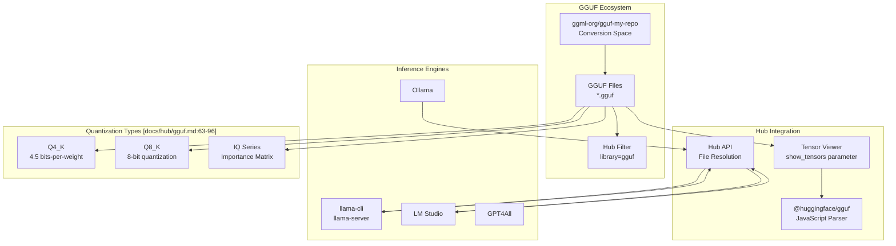
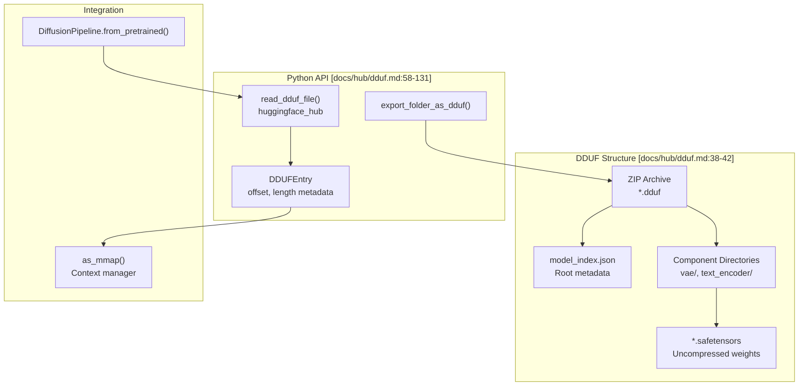
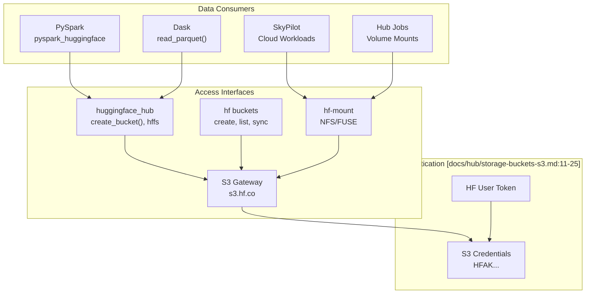

<!-- source: DeepWiki mcp.deepwiki.com · repo huggingface/hub-docs · page 5.2 Model Formats and Storage · fetched 2026-10-26 -->

# Model Formats and Storage

Relevant source files

The following files were used as context for generating this wiki page:

- [docs/hub/academia-hub.md](docs/hub/academia-hub.md)
- [docs/hub/datasets-spark.md](docs/hub/datasets-spark.md)
- [docs/hub/datasets-upload-guide-llm.md](docs/hub/datasets-upload-guide-llm.md)
- [docs/hub/dduf.md](docs/hub/dduf.md)
- [docs/hub/gguf-gpt4all.md](docs/hub/gguf-gpt4all.md)
- [docs/hub/gguf-llamacpp.md](docs/hub/gguf-llamacpp.md)
- [docs/hub/gguf.md](docs/hub/gguf.md)
- [docs/hub/lmstudio.md](docs/hub/lmstudio.md)
- [docs/hub/local-apps.md](docs/hub/local-apps.md)
- [docs/hub/models-advanced.md](docs/hub/models-advanced.md)
- [docs/hub/storage-buckets-access.md](docs/hub/storage-buckets-access.md)
- [docs/hub/storage-buckets-integrations.md](docs/hub/storage-buckets-integrations.md)
- [docs/hub/storage-buckets-s3.md](docs/hub/storage-buckets-s3.md)
- [docs/hub/storage-buckets.md](docs/hub/storage-buckets.md)
- [docs/hub/storage-limits.md](docs/hub/storage-limits.md)

This document covers the specialized model formats and storage backends supported by the Hugging Face Hub. It details the technical implementation of binary model formats like GGUF and DDUF, as well as the underlying storage systems that handle large file versioning, deduplication, and mutable object storage.

## Model Format Support

The Hub supports various specialized binary formats optimized for different ML inference engines and use cases. These formats extend beyond standard framework formats like PyTorch `.bin` files or Safetensors.

### GGUF Format

GGUF (GGML Universal Format) is a binary format optimized for quick loading and inference, particularly designed for use with GGML and llama.cpp executors [docs/hub/gguf.md:3](). Unlike tensor-only formats, GGUF encodes both tensors and standardized metadata in a single file [docs/hub/gguf.md:9]().

The Hub provides built-in GGUF support through several components:

- **File Discovery**: Models can be filtered using the `library=gguf` tag [docs/hub/gguf.md:13]().
- **Tensor Visualization**: Interactive viewer for metadata and tensors (name, shape, precision) available on model and files pages [docs/hub/gguf.md:27-29]().
- **JavaScript Parser**: The `@huggingface/gguf` package enables remote metadata parsing without downloading the full file [docs/hub/gguf.md:47-61]().
- **Direct Engine Integration**: Tools like `llama-cli` and `llama-server` can reference Hub models directly using the `-hf` flag [docs/hub/gguf-llamacpp.md:40-52]().

#### Local Application Support
GGUF is the primary format for local applications that prioritize privacy and speed [docs/hub/local-apps.md:3-8]().
- **LM Studio**: Desktop GUI for running and experimenting with local LLMs [docs/hub/local-apps.md:83-91]().
- **Ollama**: CLI tool for running models locally with direct Hub integration [docs/hub/local-apps.md:58-69]().
- **GPT4All**: Ecosystem for running open-source LLMs on consumer hardware [docs/hub/gguf.md:40]().

Sources: [docs/hub/gguf.md:1-96](), [docs/hub/gguf-llamacpp.md:1-75](), [docs/hub/local-apps.md:1-98]()

### DDUF Format

DDUF (Diffusion Unified Format) packages complete diffusion model pipelines into single archives while maintaining `mmap` compatibility and HTTP-friendly remote access.

DDUF enforces specific constraints for ML compatibility:
- **Uncompressed storage**: Uses compression flag `0` to allow memory mapping [docs/hub/dduf.md:38]().
- **ZIP64 protocol**: Required for files exceeding 4GB [docs/hub/dduf.md:39]().
- **Mandatory `model_index.json`**: Must exist at the archive root [docs/hub/dduf.md:41]().

Sources: [docs/hub/dduf.md:1-180](), [docs/hub/models-advanced.md:7-8]()

## Storage Backends and Infrastructure

The Hub employs specialized storage systems to handle both versioned Git repositories and high-performance mutable object storage.

### Storage Buckets (S3-Compatible)

Storage Buckets provide non-versioned, mutable S3-like object storage powered by the Xet backend [docs/hub/storage-buckets.md:3](). They are designed for training checkpoints, logs, and intermediate artifacts [docs/hub/storage-buckets.md:27]().

#### Access Methods
- **S3 API**: Accessible via `https://s3.hf.co/<namespace>` using standard S3 tools (AWS CLI, boto3, s5cmd) [docs/hub/storage-buckets-s3.md:3-33]().
- **Filesystem Mounts**: `hf-mount` allows mounting buckets as local filesystems via NFS or FUSE for lazy byte fetching [docs/hub/storage-buckets-access.md:19-31]().
- **Python Data Tools**: `HfFileSystem` provides `fsspec`-compatible access using `hf://buckets/` paths for pandas, Dask, and DuckDB [docs/hub/storage-buckets-access.md:52-73]().
- **Distributed Processing**: `pyspark_huggingface` enables reading Hub repositories and buckets as Spark DataSources [docs/hub/datasets-spark.md:5-15]().

Sources: [docs/hub/storage-buckets.md:1-136](), [docs/hub/storage-buckets-s3.md:1-130](), [docs/hub/storage-buckets-access.md:1-74](), [docs/hub/datasets-spark.md:1-109]()

### Storage Limits and Plans

The Hub provides generous free storage for public repositories with paid tiers for expanded private and public capacity.

| Account Type | Public Storage | Private Storage |
| :--- | :--- | :--- |
| **Free user/org** | Best-effort | 100GB |
| **PRO** | Up to 10TB included | 1TB + Pay-as-you-go |
| **Team** | 12TB base + 1TB/seat | 1TB/seat + Pay-as-you-go |
| **Enterprise** | 200TB base + 1TB/seat | 1TB/seat + Pay-as-you-go |

Sources: [docs/hub/storage-limits.md:16-21](), [docs/hub/academia-hub.md:28-29]()

#### Repository Recommendations
To maintain performance, the Hub suggests the following constraints for Git-backed repositories:
- **Repo size**: Use storage plans or contact HF for TB-scale repos [docs/hub/storage-limits.md:72]().
- **Files per repo**: Recommended < 100k files [docs/hub/storage-limits.md:73]().
- **File size**: Maximum 200GB (hard stop by LFS), < 50GB recommended [docs/hub/storage-limits.md:75](), [docs/hub/datasets-upload-guide-llm.md:73-74]().
- **Entries per folder**: Recommended < 10k files [docs/hub/storage-limits.md:74]().

Sources: [docs/hub/storage-limits.md:57-81](), [docs/hub/datasets-upload-guide-llm.md:68-89]()

---

