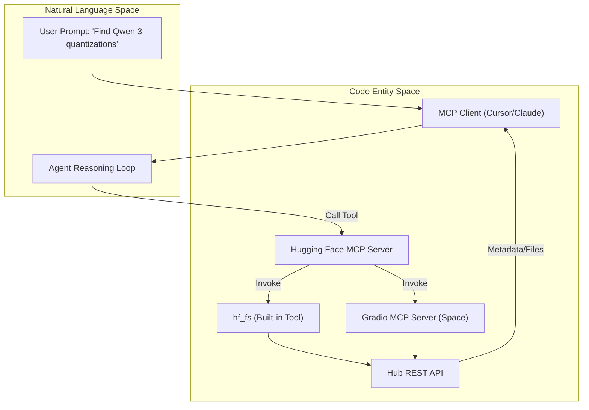
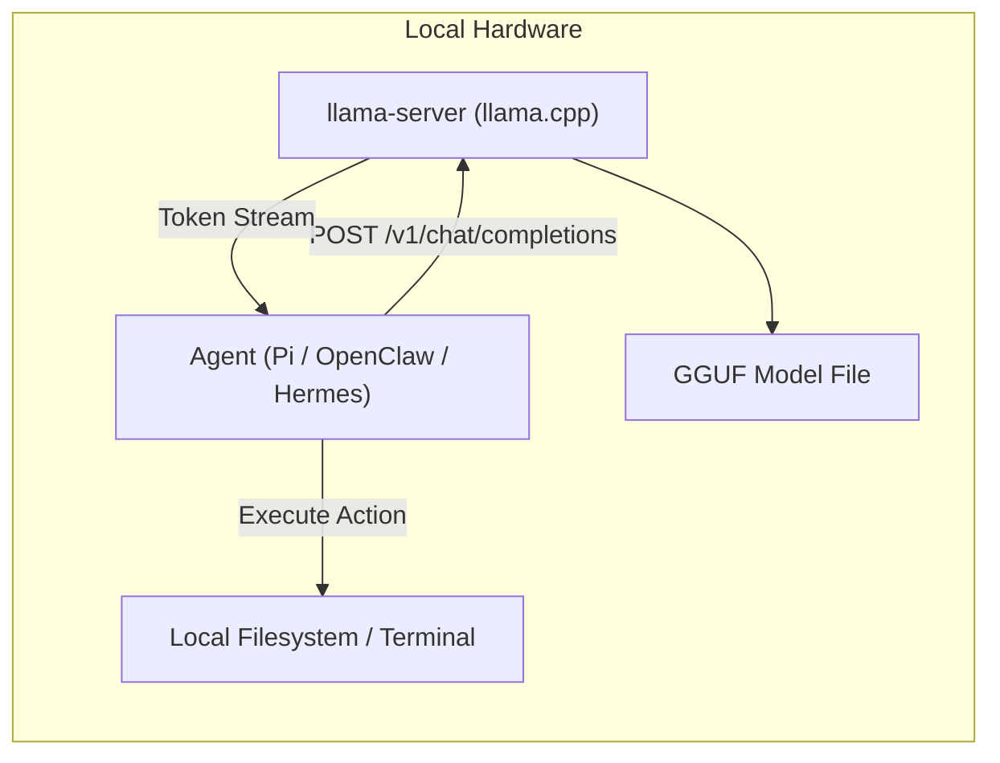

<!-- source: DeepWiki mcp.deepwiki.com · repo huggingface/hub-docs · page 5.3 AI Agents and MCP · fetched 2026-10-26 -->

# AI Agents and MCP

<details>
<summary>Relevant source files</summary>

The following files were used as context for generating this wiki page:

- [docs/hub/agent-traces.md](docs/hub/agent-traces.md)
- [docs/hub/agents-cli.md](docs/hub/agents-cli.md)
- [docs/hub/agents-libraries.md](docs/hub/agents-libraries.md)
- [docs/hub/agents-local.md](docs/hub/agents-local.md)
- [docs/hub/agents-mcp.md](docs/hub/agents-mcp.md)
- [docs/hub/agents-overview.md](docs/hub/agents-overview.md)
- [docs/hub/agents-skills.md](docs/hub/agents-skills.md)
- [docs/hub/agents.md](docs/hub/agents.md)
- [docs/hub/datasets-lance.md](docs/hub/datasets-lance.md)
- [docs/hub/datasets.md](docs/hub/datasets.md)
- [docs/hub/download-analytics.md](docs/hub/download-analytics.md)
- [docs/hub/enterprise-service-accounts.md](docs/hub/enterprise-service-accounts.md)
- [docs/hub/enterprise-tokens-management.md](docs/hub/enterprise-tokens-management.md)
- [docs/hub/enterprise.md](docs/hub/enterprise.md)
- [docs/hub/session-traces-format.md](docs/hub/session-traces-format.md)
- [docs/hub/spaces-api-endpoints.md](docs/hub/spaces-api-endpoints.md)
- [docs/hub/spaces-mcp-servers.md](docs/hub/spaces-mcp-servers.md)

</details>


Hugging Face Agents connect AI assistants and coding tools directly to the Hub ecosystem. By utilizing the **Model Context Protocol (MCP)**, specialized **Skills**, and the `huggingface_hub` SDK, agents can programmatically search models, explore datasets, execute community tools via Spaces, and manage compute jobs [docs/hub/agents.md:1-5]().

## Model Context Protocol (MCP) Integration

The Hugging Face MCP Server acts as a bridge between MCP-compatible clients (such as Claude Desktop, Cursor, VS Code, and ChatGPT) and the Hub [docs/hub/agents-mcp.md:1-3](). It exposes Hub resources as tools that an LLM can invoke to retrieve real-time context.

### Connection Architecture

The data flow follows the Model Context Protocol standard, where the client (IDE/Chat) hosts the agent logic and communicates with the HF MCP Server to access Hub-specific tools.

**MCP Tool Resolution Flow**

Sources: [docs/hub/agents-mcp.md:26-45](), [docs/hub/spaces-mcp-servers.md:33-64]()

### Built-in MCP Tools
The server provides several core tools for Hub interaction:
*   `hf_fs`: The primary tool for navigating the Hub, performing semantic searches of documentation, and exploring repository files [docs/hub/agents-mcp.md:41-43]().
*   **Contribute Repos**: Allows agents to create repositories and write files [docs/hub/agents-mcp.md:49-49]().
*   **Sandboxes**: Provides isolated environments for code execution [docs/hub/agents-mcp.md:50-50]().
*   **Run and Manage Jobs**: Enables scheduling and monitoring of compute jobs on HF infrastructure [docs/hub/agents-mcp.md:51-51]().

## Agent Skills

Skills are task-specific guidance files (following the `SKILL.md` format) that provide agents with the context needed to perform complex ML workflows [docs/hub/agents-skills.md:6-8]().

| Skill | Purpose |
| :--- | :--- |
| `hf-cli` | Hub operations (upload/download/jobs) via the `hf` CLI [docs/hub/agents-skills.md:54-54](). |
| `huggingface-datasets` | Advanced dataset exploration, row pagination, and filtering [docs/hub/agents-skills.md:55-55](). |
| `huggingface-llm-trainer` | Fine-tuning LLMs using TRL (SFT, DPO, GRPO) on HF Jobs [docs/hub/agents-skills.md:56-56](). |
| `huggingface-community-evals` | Running model benchmarks on local hardware [docs/hub/agents-skills.md:58-58](). |

Sources: [docs/hub/agents-skills.md:50-65]()

## Local Agents and llama.cpp

For privacy or performance, agents can run entirely on local hardware by connecting to a `llama.cpp` server [docs/hub/agents-local.md:1-3]().

### Local Execution Flow
The local setup decouples the inference engine from the agent logic, using an OpenAI-compatible API layer.

**Local Agent Architecture**

Sources: [docs/hub/agents-local.md:198-214](), [docs/hub/agents-local.md:32-67]()

### Implementation Example: Pi Agent
The Pi coding agent connects to a local `llama-server` by configuring the `baseUrl` in `~/.pi/agent/models.json` [docs/hub/agents-local.md:42-59](). Vision support can be enabled by adding the `image` input type to the model definition [docs/hub/agents-local.md:71-82]().

## Spaces as MCP Servers

Public Gradio Spaces can be transformed into MCP tools without additional code by enabling the `mcp_server` parameter in the `launch()` method [docs/hub/spaces-mcp-servers.md:33-64]().

### Building an MCP Space
To expose a Space as a tool, the functions must include clear Python type hints and docstrings, which the MCP server uses to generate the tool schema for the LLM [docs/hub/spaces-mcp-servers.md:43-64]().

```python
# Example from docs/hub/spaces-mcp-servers.md
import gradio as gr

def letter_counter(word: str, letter: str) -> int:
    """Count occurrences of a letter in a word."""
    return word.lower().count(letter.lower())

demo = gr.Interface(fn=letter_counter, inputs=["text", "text"], outputs="number")
demo.launch(mcp_server=True) # Automatically exposes MCP schema
```
Sources: [docs/hub/spaces-mcp-servers.md:45-64]()

## Agent Traces and STS-Format

Agent sessions from tools like Claude Code, Codex, and Pi can be uploaded to the Hub for visualization [docs/hub/session-traces-format.md:1-3](). The Hub uses the **Session Trace Simple Format (STS-Format)**, a JSONL structure, to render these traces [docs/hub/session-traces-format.md:5-6]().

### STS-Format Structure
1.  **Session Header**: Defines the `harness` (e.g., `llama.app`) and session `id` [docs/hub/session-traces-format.md:7-11]().
2.  **Messages**: Individual lines representing `user`, `assistant`, `system`, or `tool` roles [docs/hub/session-traces-format.md:25-31]().

Sources: [docs/hub/session-traces-format.md:7-46]()

---

