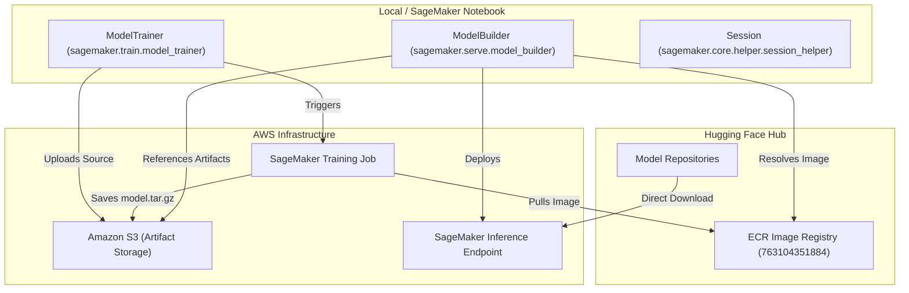
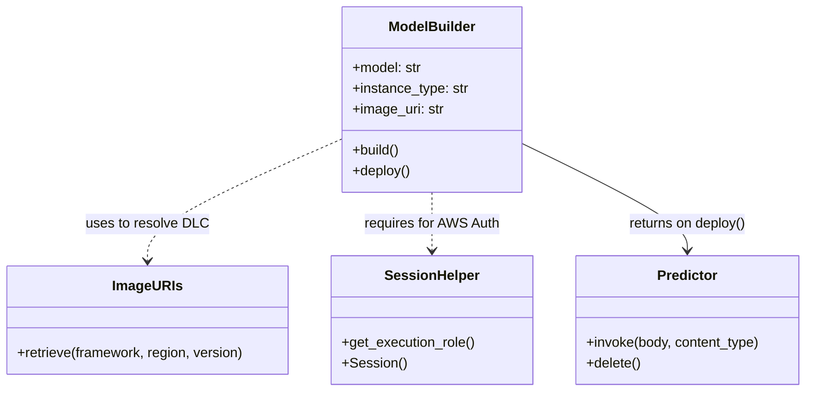

<!-- source: DeepWiki mcp.deepwiki.com · repo huggingface/hub-docs · page 5.4 AWS SageMaker Integration · fetched 2026-10-26 -->

# AWS SageMaker Integration

Relevant source files

The following files were used as context for generating this wiki page:

- [.gitignore](.gitignore)
- [docs/sagemaker/notebooks/sagemaker-sdk/deepseek-ocr-sagemaker/sagemaker-notebook.ipynb](docs/sagemaker/notebooks/sagemaker-sdk/deepseek-ocr-sagemaker/sagemaker-notebook.ipynb)
- [docs/sagemaker/notebooks/sagemaker-sdk/deploy-embedding-models/sagemaker-notebook.ipynb](docs/sagemaker/notebooks/sagemaker-sdk/deploy-embedding-models/sagemaker-notebook.ipynb)
- [docs/sagemaker/notebooks/sagemaker-sdk/deploy-llama-3-3-70b-inferentia2/sagemaker-notebook.ipynb](docs/sagemaker/notebooks/sagemaker-sdk/deploy-llama-3-3-70b-inferentia2/sagemaker-notebook.ipynb)
- [docs/sagemaker/notebooks/sagemaker-sdk/evaluate-llm-lighteval/sagemaker-notebook.ipynb](docs/sagemaker/notebooks/sagemaker-sdk/evaluate-llm-lighteval/sagemaker-notebook.ipynb)
- [docs/sagemaker/notebooks/sagemaker-sdk/evaluate-llm-lighteval/scripts/requirements.txt](docs/sagemaker/notebooks/sagemaker-sdk/evaluate-llm-lighteval/scripts/requirements.txt)
- [docs/sagemaker/notebooks/sagemaker-sdk/evaluate-llm-lighteval/scripts/run_lighteval.py](docs/sagemaker/notebooks/sagemaker-sdk/evaluate-llm-lighteval/scripts/run_lighteval.py)
- [docs/sagemaker/notebooks/sagemaker-sdk/fine-tune-embedding-models/sagemaker-notebook.ipynb](docs/sagemaker/notebooks/sagemaker-sdk/fine-tune-embedding-models/sagemaker-notebook.ipynb)
- [docs/sagemaker/notebooks/sagemaker-sdk/fine-tune-embedding-models/scripts/requirements.txt](docs/sagemaker/notebooks/sagemaker-sdk/fine-tune-embedding-models/scripts/requirements.txt)
- [docs/sagemaker/notebooks/sagemaker-sdk/fine-tune-embedding-models/scripts/run_mnr.py](docs/sagemaker/notebooks/sagemaker-sdk/fine-tune-embedding-models/scripts/run_mnr.py)
- [docs/sagemaker/notebooks/sagemaker-sdk/fine-tune-trl-cli/sagemaker-notebook.ipynb](docs/sagemaker/notebooks/sagemaker-sdk/fine-tune-trl-cli/sagemaker-notebook.ipynb)
- [docs/sagemaker/notebooks/sagemaker-sdk/flux-2-image-generation/assets/comparison.png](docs/sagemaker/notebooks/sagemaker-sdk/flux-2-image-generation/assets/comparison.png)
- [docs/sagemaker/notebooks/sagemaker-sdk/flux-2-image-generation/assets/cover.png](docs/sagemaker/notebooks/sagemaker-sdk/flux-2-image-generation/assets/cover.png)
- [docs/sagemaker/notebooks/sagemaker-sdk/flux-2-image-generation/assets/old_kitchen.png](docs/sagemaker/notebooks/sagemaker-sdk/flux-2-image-generation/assets/old_kitchen.png)
- [docs/sagemaker/notebooks/sagemaker-sdk/flux-2-image-generation/sagemaker-notebook.ipynb](docs/sagemaker/notebooks/sagemaker-sdk/flux-2-image-generation/sagemaker-notebook.ipynb)
- [docs/sagemaker/scripts/auto-generate-examples.py](docs/sagemaker/scripts/auto-generate-examples.py)
- [docs/sagemaker/scripts/auto-update-toctree.py](docs/sagemaker/scripts/auto-update-toctree.py)
- [docs/sagemaker/source/dlcs/available.md](docs/sagemaker/source/dlcs/available.md)
- [docs/sagemaker/source/index.md](docs/sagemaker/source/index.md)
- [docs/sagemaker/source/tutorials/jumpstart/jumpstart-quickstart.md](docs/sagemaker/source/tutorials/jumpstart/jumpstart-quickstart.md)
- [docs/sagemaker/source/tutorials/sagemaker-sdk/deploy-sagemaker-sdk.md](docs/sagemaker/source/tutorials/sagemaker-sdk/deploy-sagemaker-sdk.md)
- [docs/sagemaker/source/tutorials/sagemaker-sdk/sagemaker-sdk-quickstart.md](docs/sagemaker/source/tutorials/sagemaker-sdk/sagemaker-sdk-quickstart.md)
- [docs/sagemaker/source/tutorials/sagemaker-sdk/training-sagemaker-sdk.md](docs/sagemaker/source/tutorials/sagemaker-sdk/training-sagemaker-sdk.md)

The Hugging Face integration with Amazon SageMaker provides a managed ecosystem for training and deploying state-of-the-art machine learning models on AWS infrastructure. This integration is primarily driven by the **SageMaker Python SDK v3**, which utilizes specialized **Deep Learning Containers (DLCs)** optimized for Hugging Face libraries like `transformers`, `diffusers`, and `text-generation-inference` [docs/sagemaker/source/index.md:5-16]().

## Architecture and Data Flow

The integration bridges the Hugging Face Hub with AWS managed services. The flow typically involves fetching model artifacts from the Hub and executing them within SageMaker's managed compute environments (Training Jobs or Inference Endpoints).

### SageMaker SDK V3 Data Flow
The following diagram illustrates how the `ModelTrainer` and `ModelBuilder` classes interact with AWS and Hugging Face resources.

**Diagram: SageMaker SDK V3 Component Interaction**

**Sources:** [docs/sagemaker/source/tutorials/sagemaker-sdk/training-sagemaker-sdk.md:109-115](), [docs/sagemaker/source/tutorials/sagemaker-sdk/deploy-sagemaker-sdk.md:87-110](), [docs/sagemaker/source/dlcs/available.md:19-32]()

## Training with `ModelTrainer`

SageMaker Training Jobs provide managed infrastructure for compute-intensive workloads, billed per second of execution [docs/sagemaker/notebooks/sagemaker-sdk/deepseek-ocr-sagemaker/sagemaker-notebook.ipynb:66-78](). The `ModelTrainer` class (v3 SDK) replaces the legacy `HuggingFace` estimator [docs/sagemaker/source/tutorials/sagemaker-sdk/training-sagemaker-sdk.md:36-37]().

### Implementation Details
- **Entrypoint**: Users provide a Python script (e.g., `train.py`) and a `source_dir`. SageMaker sets environment variables like `SM_MODEL_DIR` (`/opt/ml/model`) and `SM_CHANNEL_TRAIN` to manage paths [docs/sagemaker/source/tutorials/sagemaker-sdk/training-sagemaker-sdk.md:66-74]().
- **Checkpointing**: By configuring `CheckpointConfig`, artifacts are continuously synced to S3 rather than only at the end of the job [docs/sagemaker/source/tutorials/sagemaker-sdk/training-sagemaker-sdk.md:106-107]().
- **TRL CLI**: For zero-code fine-tuning, the `trl sft` CLI can be executed within a Training Job using standard YAML configurations [docs/sagemaker/notebooks/sagemaker-sdk/fine-tune-trl-cli/sagemaker-notebook.ipynb:7-17]().

**Sources:** [docs/sagemaker/source/tutorials/sagemaker-sdk/training-sagemaker-sdk.md:64-115](), [docs/sagemaker/notebooks/sagemaker-sdk/fine-tune-trl-cli/sagemaker-notebook.ipynb:138-140]()

## Deployment with `ModelBuilder`

The `ModelBuilder` class simplifies the creation of SageMaker endpoints by automatically resolving the appropriate DLC and handling model serialization [docs/sagemaker/source/dlcs/available.md:107-117]().

### Inference DLC Frameworks
SageMaker supports several specialized inference backends via Hugging Face DLCs:

| Framework | Use Case | Accelerator |
| :--- | :--- | :--- |
| `huggingface-pytorch-inference` | General Purpose Transformers | CPU/GPU/Neuron |
| `huggingface-vllm` | High-throughput LLM serving | GPU/Neuron |
| `huggingface-tei` | Text Embeddings Inference | CPU/GPU |
| `huggingface-llama.cpp` | Lightweight GGUF serving | CPU/GPU |

**Sources:** [docs/sagemaker/source/dlcs/available.md:22-80]()

### Code Entity Space: Deployment Logic
The following diagram maps SDK classes to their functional roles in the deployment lifecycle.

**Diagram: Deployment Code Entities**

**Sources:** [docs/sagemaker/source/dlcs/available.md:88-117](), [docs/sagemaker/source/tutorials/sagemaker-sdk/deploy-sagemaker-sdk.md:135-168]()

## SageMaker JumpStart

JumpStart provides a curated "one-click" catalog for popular models like Qwen or Llama [docs/sagemaker/source/tutorials/jumpstart/jumpstart-quickstart.md:1-7](). 

- **UI Deployment**: Models can be deployed directly from the SageMaker Studio console [docs/sagemaker/source/tutorials/jumpstart/jumpstart-quickstart.md:25-29]().
- **SDK Deployment**: By passing a JumpStart Model ID to `ModelBuilder`, the SDK resolves pre-configured artifacts and network isolation settings [docs/sagemaker/source/tutorials/jumpstart/jumpstart-quickstart.md:44-57]().

## Hardware Accelerators

The integration includes deep support for AWS-specific hardware:
1. **AWS Trainium/Inferentia**: Supported via `huggingface-pytorch-training-neuronx` and `huggingface-pytorch-inference-neuronx` containers [docs/sagemaker/source/dlcs/available.md:20,32]().
2. **Optimum Neuron**: Models for Inferentia2 often require pre-compilation or use of the `neuron model cache` to handle static shapes [docs/sagemaker/notebooks/sagemaker-sdk/deploy-llama-3-3-70b-inferentia2/sagemaker-notebook.ipynb:138-143]().

**Sources:** [docs/sagemaker/source/dlcs/available.md:7-9](), [docs/sagemaker/notebooks/sagemaker-sdk/deploy-llama-3-3-70b-inferentia2/sagemaker-notebook.ipynb:10-28]()

---

