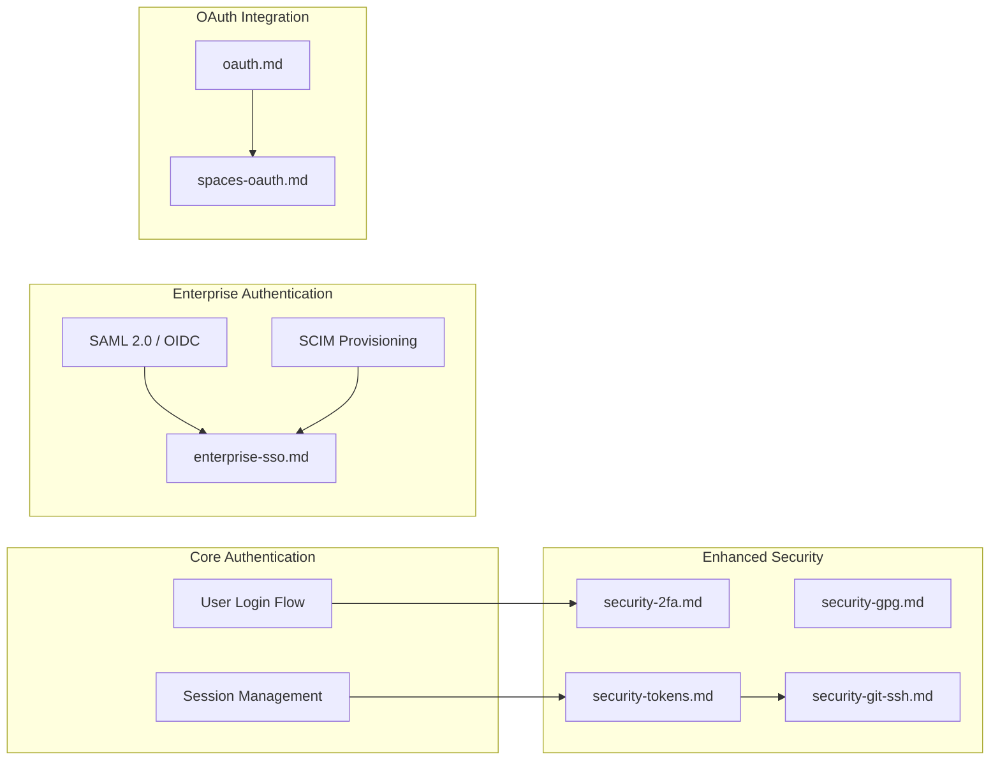
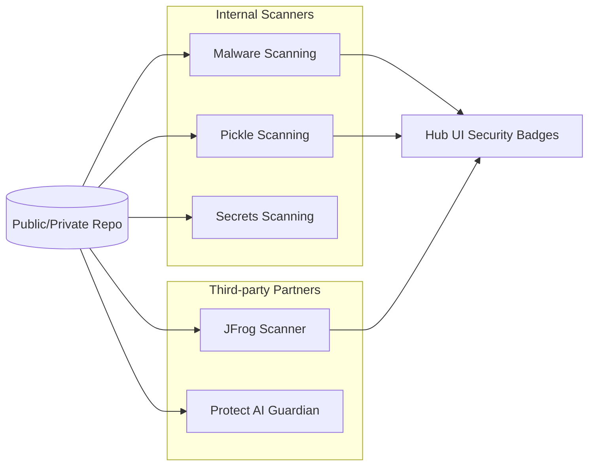

<!-- source: DeepWiki mcp.deepwiki.com · repo huggingface/hub-docs · page 6 Security and Enterprise Features · fetched 2026-10-26 -->

# Security and Enterprise Features

Relevant source files

The following files were used as context for generating this wiki page:

- [docs/hub/download-analytics.md](docs/hub/download-analytics.md)
- [docs/hub/enterprise-service-accounts.md](docs/hub/enterprise-service-accounts.md)
- [docs/hub/enterprise-tokens-management.md](docs/hub/enterprise-tokens-management.md)
- [docs/hub/enterprise.md](docs/hub/enterprise.md)
- [docs/hub/organizations.md](docs/hub/organizations.md)
- [docs/hub/security-2fa.md](docs/hub/security-2fa.md)
- [docs/hub/security-jfrog.md](docs/hub/security-jfrog.md)
- [docs/hub/security-protectai.md](docs/hub/security-protectai.md)
- [docs/hub/security.md](docs/hub/security.md)
- [docs/hub/spaces-api-endpoints.md](docs/hub/spaces-api-endpoints.md)
- [docs/hub/spaces-mcp-servers.md](docs/hub/spaces-mcp-servers.md)

This document covers the comprehensive security infrastructure and enterprise-grade features available on the Hugging Face Hub. It provides an overview of authentication systems, access control mechanisms, enterprise features for organizations, and security scanning capabilities that protect the platform and its users.

For detailed information about API authentication and programmatic access, see [Hub API and Programmatic Access](#3). For specific repository management features, see [Repository Management](#2).

## Security Architecture Overview

The Hugging Face Hub implements a multi-layered security architecture that spans from individual user authentication to enterprise-wide access control and compliance features. Hugging Face is **SOC2 Type 2 certified** and **GDPR compliant** [docs/hub/security.md:5-9]().

### Core Security Layers

```mermaid
graph TB
    subgraph "Authentication Layer"
        UserAuth["User Authentication"]
        OAuth["OAuth/OpenID Connect"]
        SSO["Single Sign-On"]
        TwoFA["Two-Factor Authentication"]
        GPGSigning["GPG Commit Signing"]
    end
    
    subgraph "Access Control Layer"
        UserTokens["User Access Tokens"]
        OrgManagement["Organization Management"]
        ResourceGroups["Resource Groups"]
        GatedAccess["Gated Models/Datasets"]
        PrivateRepos["Private Repositories"]
    end
    
    subgraph "Security Scanning Layer"
        MalwareScan["Malware Scanning"]
        PickleScan["Pickle Scanning"]
        SecretsScan["Secrets Scanning"]
        JFrogScan["JFrog Scanner"]
        ProtectAIScan["Protect AI Scanner"]
    end
    
    subgraph "Enterprise Features"
        EnterpriseSSO["Enterprise SSO"]
        StorageRegions["Storage Regions"]
        ServiceAccounts["Service Accounts"]
        TokenManagement["Token Management"]
        AdvancedSecurity["Advanced Security Controls"]
        Analytics["Analytics Dashboard"]
    end
    
    UserAuth --> UserTokens
    OAuth --> OrgManagement
    SSO --> EnterpriseSSO
    TwoFA --> UserTokens
    GPGSigning --> UserTokens
    
    OrgManagement --> ResourceGroups
    ResourceGroups --> PrivateRepos
    GatedAccess --> PrivateRepos
    
    MalwareScan --> SecurityNotifications["Security Notifications"]
    PickleScan --> SecurityNotifications
    SecretsScan --> SecurityNotifications
    JFrogScan --> SecurityNotifications
    ProtectAIScan --> SecurityNotifications
    
    EnterpriseSSO --> AuditLogs["Audit Logs"]
    StorageRegions --> ComplianceReporting["Compliance Reporting"]
    TokenManagement --> SecurityNotifications
    AdvancedSecurity --> DataGovernance["Data Governance"]
    ServiceAccounts --> UserTokens
```

Sources: [docs/hub/security.md:1-26](), [docs/hub/enterprise.md:58-90](), [docs/hub/enterprise-service-accounts.md:6-9]()

## Authentication Systems

The Hub provides multiple authentication mechanisms designed to meet different security requirements and use cases, ranging from personal developer access to corporate identity providers.

### User Authentication Components

The authentication system supports both individual users and enterprise organizations:

- **User Access Tokens**: Tokens for API access and Git operations. Organizations can enforce "Fine-Grained Tokens" only policies [docs/hub/enterprise-tokens-management.md:41-45]().
- **Two-Factor Authentication (2FA)**: Adds a one-time security code requirement via apps like Authy or Google Authenticator [docs/hub/security-2fa.md:5-22]().
- **Git over SSH & GPG Signing**: Secure Git operations and cryptographic verification of commit authenticity [docs/hub/security.md:17-18]().
- **OAuth & SSO**: Support for SAML/OIDC (Okta, Azure, Google) for managed identity [docs/hub/enterprise.md:75-76]().

For details, see [Authentication and OAuth](#6.1).

Sources: [docs/hub/security.md:15-25](), [docs/hub/security-2fa.md:1-22](), [docs/hub/enterprise-tokens-management.md:37-46]()

## Access Control and Gating

Access control on the Hub is managed through Organization roles, Resource Groups, and repository-level gating.

### Access Control Implementation

| Level | Feature | Description |
| :--- | :--- | :--- |
| **Org** | `Standard` vs `Fine-grained` | Team/Enterprise plans allow for detailed permission mapping beyond basic Read/Write/Admin [docs/hub/enterprise.md:62](). |
| **Repo** | `Gated Access` | Requires users to request access and potentially agree to terms before downloading [docs/hub/organizations.md:5](). |
| **Group** | `Gating Group Collections` | Enterprise feature to manage access to groups of repositories collectively [docs/hub/enterprise.md:69](). |
| **Service** | `Service Accounts` | Org-owned identities for CI/CD, decoupled from individual member accounts [docs/hub/enterprise-service-accounts.md:6-9](). |

Resource Groups allow for logical partitioning of repositories where private assets are only visible to specific subsets of organization members [docs/hub/security.md:20]().

For details, see [Access Control and Gating](#6.3).

Sources: [docs/hub/organizations.md:1-5](), [docs/hub/enterprise-service-accounts.md:1-9](), [docs/hub/enterprise.md:58-70]()

## Enterprise Hub

The **Team & Enterprise** plans offer advanced governance, auditing, and compliance capabilities for companies.

### Key Enterprise Capabilities

- **Managed SSO**: SAML and OIDC integration with support for Okta, Azure AD, and Entra ID [docs/hub/enterprise.md:75-76]().
- **Token Management**: Administrators can monitor, approve, deny, or revoke member access tokens to prevent leaks and ensure hygiene [docs/hub/enterprise-tokens-management.md:11-36]().
- **Data Residency**: Option to store data in specific regions (US, EU, etc.) to meet compliance requirements [docs/hub/enterprise.md:67]().
- **Download Analytics**: Bandwidth-level view of usage with per-member breakdowns [docs/hub/download-analytics.md:3-33]().
- **Service Accounts**: Programmatic access identities that don't consume a paid seat [docs/hub/enterprise-service-accounts.md:52-55]().

For details, see [Enterprise Hub](#6.2).

Sources: [docs/hub/enterprise.md:20-88](), [docs/hub/enterprise-tokens-management.md:1-10](), [docs/hub/download-analytics.md:1-33]()

## Security Scanning

The Hub implements automated scanning to protect the community from malicious serialization formats and exploits.

### Scanning Pipeline and Partners

- **Pickle Scanning**: Detects dangerous `pickle` files that could lead to arbitrary code execution [docs/hub/security-protectai.md:21-23]().
- **JFrog Scanner**: Analyzes model weights to detect malicious code while minimizing false positives [docs/hub/security-jfrog.md:4-11]().
- **Protect AI**: Scans for Keras Lambda layer exploits and other ML-specific vulnerabilities [docs/hub/security-protectai.md:6-25]().

Sources: [docs/hub/security.md:21-25](), [docs/hub/security-jfrog.md:4-12](), [docs/hub/security-protectai.md:6-13]()

---

