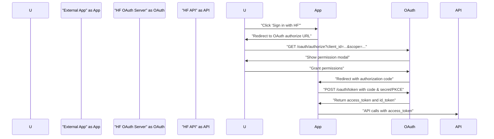
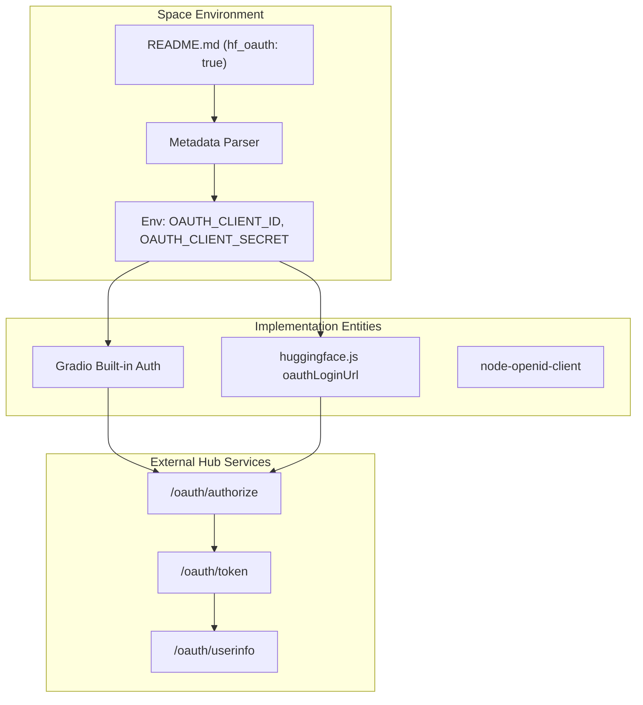

<!-- source: DeepWiki mcp.deepwiki.com · repo huggingface/hub-docs · page 6.1 Authentication and OAuth · fetched 2026-10-26 -->

# Authentication and OAuth

<details>
<summary>Relevant source files</summary>

The following files were used as context for generating this wiki page:

- [docs/hub/oauth.md](docs/hub/oauth.md)
- [docs/hub/organizations.md](docs/hub/organizations.md)
- [docs/hub/repositories-github-actions.md](docs/hub/repositories-github-actions.md)
- [docs/hub/security-2fa.md](docs/hub/security-2fa.md)
- [docs/hub/security-jfrog.md](docs/hub/security-jfrog.md)
- [docs/hub/security-protectai.md](docs/hub/security-protectai.md)
- [docs/hub/security-tokens.md](docs/hub/security-tokens.md)
- [docs/hub/security.md](docs/hub/security.md)
- [docs/hub/spaces-github-actions.md](docs/hub/spaces-github-actions.md)
- [docs/hub/spaces-oauth.md](docs/hub/spaces-oauth.md)
- [docs/hub/spaces-sdks-docker-chatui.md](docs/hub/spaces-sdks-docker-chatui.md)
- [docs/hub/trusted-publishers.md](docs/hub/trusted-publishers.md)

</details>


This document covers the authentication and authorization systems in the Hugging Face Hub, including OAuth flows for external applications, Spaces authentication, Trusted Publishers for CI/CD, and token management. For information about access control within organizations and resource groups, see [Access Control and Gating](#6.3).

## OAuth for External Applications

The Hugging Face Hub provides OAuth 2.0 and OpenID Connect (OIDC) support, allowing external applications to implement **"Sign in with HF"** functionality [docs/hub/oauth.md:1-3](). This enables users to authenticate with their HF accounts and grant applications specific permissions to access Hub resources.

### OAuth Application Registration

OAuth applications are created through the user settings interface at `/settings/applications/new` [docs/hub/oauth.md:15-18](). 

- **Public OAuth apps**: Apps can be created without a client secret, which is useful for native apps or CLIs where keeping a secret is impractical. These use PKCE for security [docs/hub/oauth.md:19-26]().
- **Automated creation (CIMD)**: The Hub supports Client ID Metadata Documents, allowing automated app creation for websites via a `/.well-known/oauth-cimd` endpoint [docs/hub/oauth.md:33-52]().

### OAuth Authorization Flow

The Hub supports standard Authorization Code flows and Device Code flows [docs/hub/oauth.md:54-56]().

**Authorization Code Flow:**



The authorization URL pattern is: `https://huggingface.co/oauth/authorize?redirect_uri={REDIRECT_URI}&scope=openid%20profile&client_id={CLIENT_ID}&state={STATE}` [docs/hub/spaces-oauth.md:103-104]().

### OAuth Scopes

The Hub supports multiple scopes that determine what permissions an application receives:

| Scope | Description |
|-------|-------------|
| `openid` | Get ID token in addition to access token [docs/hub/oauth.md:100]() |
| `profile` | Get user's profile information (username, avatar) [docs/hub/oauth.md:101]() |
| `email` | Get user's email address [docs/hub/oauth.md:102]() |
| `read-repos` | Read access to user's personal repos [docs/hub/oauth.md:104]() |
| `write-repos` | Write/read access to user's personal repos [docs/hub/oauth.md:107]() |
| `manage-repos` | Full access including repo creation and deletion [docs/hub/oauth.md:108]() |
| `inference-api` | Access to Inference Providers on behalf of user [docs/hub/oauth.md:111]() |
| `write-discussions` | Open/interact with discussions and PRs [docs/hub/oauth.md:114]() |

Sources: [docs/hub/oauth.md:98-115](), [docs/hub/spaces-oauth.md:67-87]()

## Spaces OAuth Integration

Hugging Face Spaces can integrate OAuth authentication by adding `hf_oauth: true` to the Space's metadata in the `README.md` file [docs/hub/spaces-oauth.md:13-15]().

### Spaces Configuration

```yaml
title: My Space
sdk: gradio
hf_oauth: true
hf_oauth_expiration_minutes: 480 # Optional, default 8 hours
hf_oauth_scopes:
  - read-repos
  - inference-api
hf_oauth_authorized_org: ORG_NAME # Optional restriction
```

Sources: [docs/hub/spaces-oauth.md:19-44]()

### Environment Variables in Spaces

When OAuth is enabled, the Space environment is automatically populated with:
- `OAUTH_CLIENT_ID`: The public client ID [docs/hub/spaces-oauth.md:50]().
- `OAUTH_CLIENT_SECRET`: The app secret [docs/hub/spaces-oauth.md:51]().
- `OAUTH_SCOPES`: Scopes accessible by the app [docs/hub/spaces-oauth.md:52]().
- `OPENID_PROVIDER_URL`: URL for OpenID metadata [docs/hub/spaces-oauth.md:53]().

**Spaces OAuth Implementation Architecture:**



Sources: [docs/hub/spaces-oauth.md:48-55](), [docs/hub/spaces-oauth.md:97-110]()

## Trusted Publishers (Keyless Auth)

Trusted Publishers allow CI/CD workflows (GitHub Actions, GitLab CI, etc.) to push to the Hub without storing a long-lived `HF_TOKEN` secret [docs/hub/trusted-publishers.md:1-5]().

### Mechanism
1. The CI provider mints a short-lived **OIDC ID token** [docs/hub/trusted-publishers.md:141]().
2. The workflow exchanges this for a short-lived Hugging Face token via `https://huggingface.co/oauth/token` [docs/hub/trusted-publishers.md:142]().
3. The Hub validates the CI provider's claims (repo, branch, workflow) against configured publishers [docs/hub/trusted-publishers.md:143]().

### Supported Flavors
- **Repo Publisher**: Configured on a specific repository's settings. Grants write access to that repo only [docs/hub/trusted-publishers.md:99]().
- **User Publisher**: Configured on account settings. Grants read access to gated repos and uses account rate limits [docs/hub/trusted-publishers.md:100]().

Sources: [docs/hub/trusted-publishers.md:95-102](), [docs/hub/trusted-publishers.md:139-144]()

## User Access Tokens

User Access Tokens are the primary method for programmatic authentication in scripts, notebooks, and libraries like `transformers` [docs/hub/security-tokens.md:3-5]().

### Token Types
- **Fine-grained**: Scoped to specific resources (e.g., one model). Recommended for production [docs/hub/security-tokens.md:14]().
- **Read**: Access to public and private repos the user can read [docs/hub/security-tokens.md:16]().
- **Write**: Additionally grants push access to repos the user owns or has write access to [docs/hub/security-tokens.md:18]().

### Enterprise Token Policies
Organizations on Team or Enterprise plans can enforce policies:
- **Pending State**: Fine-grained tokens scoped to an organization may require administrator approval before becoming active [docs/hub/security-tokens.md:87-91]().
- **Revocation**: Admins can permanently revoke tokens. Revoked tokens return a `403` error [docs/hub/security-tokens.md:102-106]().

Sources: [docs/hub/security-tokens.md:12-20](), [docs/hub/security-tokens.md:83-94]()

## Security Features

### Two-Factor Authentication (2FA)
The Hub supports TOTP (Time-based One-Time Password) via apps like Google Authenticator or Authy [docs/hub/security-2fa.md:5-22](). 
- **Recovery Codes**: Users are provided with single-use recovery codes to regain access if the authenticator is lost [docs/hub/security-2fa.md:41-46]().

### Git over SSH and GPG
- **SSH Keys**: Users can add SSH public keys to their settings to interact with Git repositories without passwords [docs/hub/security.md:17]().
- **GPG Signing**: Supports signing commits to verify the identity of the committer [docs/hub/security.md:18]().

### Security Scanning
The Hub integrates several scanners to protect users:
- **Malware Scanning**: General file scanning [docs/hub/security.md:21]().
- **Pickle Scanning**: Detects dangerous imports in Python pickle files [docs/hub/security.md:22]().
- **Secrets Scanning**: Detects leaked tokens or keys in repositories [docs/hub/security.md:23]().
- **Third-party Scanners**: Partnerships with **Protect AI** (Guardian) and **JFrog** provide additional exploit detection for Keras, Pickle, and other ML formats [docs/hub/security-protectai.md:6-11](), [docs/hub/security-jfrog.md:4-9]().

Sources: [docs/hub/security.md:15-26](), [docs/hub/security-2fa.md:1-29]()

---

