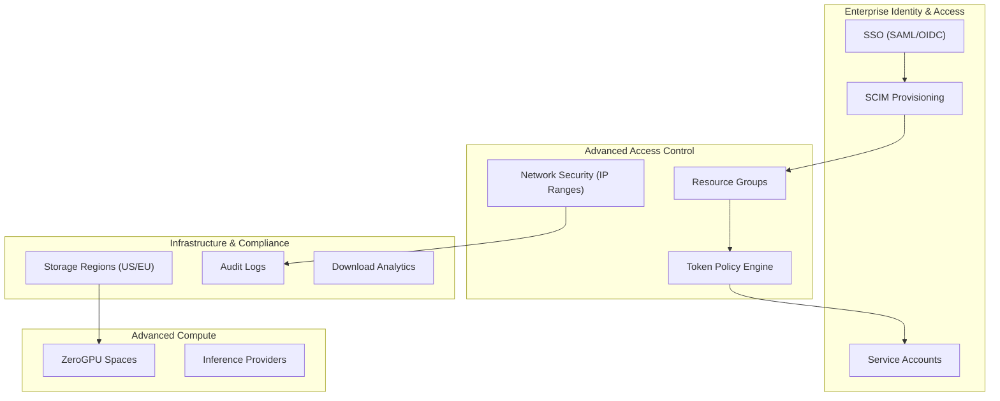
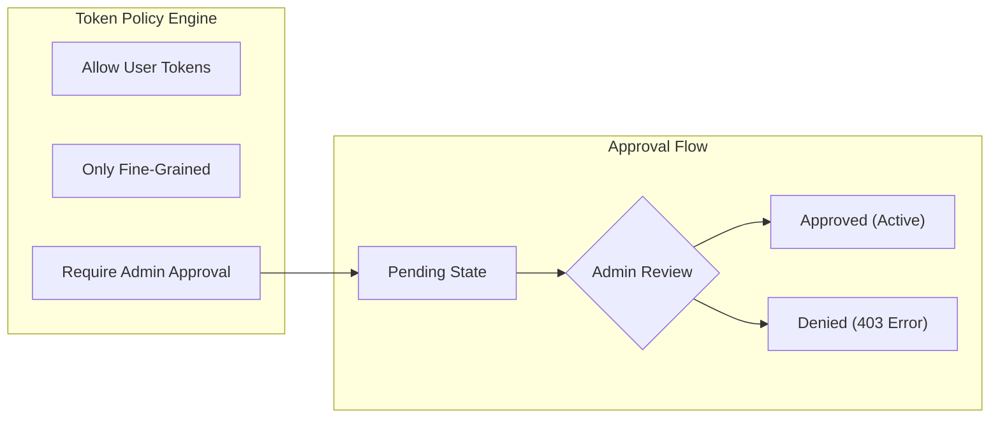

<!-- source: DeepWiki mcp.deepwiki.com · repo huggingface/hub-docs · page 6.2 Enterprise Hub · fetched 2026-10-26 -->

# Enterprise Hub

Relevant source files

The following files were used as context for generating this wiki page:

- [docs/hub/advanced-compute-options.md](docs/hub/advanced-compute-options.md)
- [docs/hub/audit-logs.md](docs/hub/audit-logs.md)
- [docs/hub/download-analytics.md](docs/hub/download-analytics.md)
- [docs/hub/enterprise-advanced-sso.md](docs/hub/enterprise-advanced-sso.md)
- [docs/hub/enterprise-network-security.md](docs/hub/enterprise-network-security.md)
- [docs/hub/enterprise-scim.md](docs/hub/enterprise-scim.md)
- [docs/hub/enterprise-service-accounts.md](docs/hub/enterprise-service-accounts.md)
- [docs/hub/enterprise-sso.md](docs/hub/enterprise-sso.md)
- [docs/hub/enterprise-tokens-management.md](docs/hub/enterprise-tokens-management.md)
- [docs/hub/enterprise.md](docs/hub/enterprise.md)
- [docs/hub/security-sso-azure-oidc.md](docs/hub/security-sso-azure-oidc.md)
- [docs/hub/security-sso-azure-saml.md](docs/hub/security-sso-azure-saml.md)
- [docs/hub/security-sso-entra-id-scim.md](docs/hub/security-sso-entra-id-scim.md)
- [docs/hub/security-sso-google-oidc.md](docs/hub/security-sso-google-oidc.md)
- [docs/hub/security-sso-google-saml.md](docs/hub/security-sso-google-saml.md)
- [docs/hub/security-sso-okta-oidc.md](docs/hub/security-sso-okta-oidc.md)
- [docs/hub/security-sso-okta-saml.md](docs/hub/security-sso-okta-saml.md)
- [docs/hub/security-sso-okta-scim.md](docs/hub/security-sso-okta-scim.md)
- [docs/hub/security-sso.md](docs/hub/security-sso.md)
- [docs/hub/spaces-api-endpoints.md](docs/hub/spaces-api-endpoints.md)
- [docs/hub/spaces-mcp-servers.md](docs/hub/spaces-mcp-servers.md)
- [docs/hub/storage-regions.md](docs/hub/storage-regions.md)

Enterprise Hub provides advanced organizational capabilities and enterprise-grade security features for companies and teams using Hugging Face. It extends the core Hub platform with mandatory Single Sign-On (SSO), fine-grained access controls, compliance features, and advanced infrastructure options.

## Enterprise Hub Architecture

Enterprise Hub integrates additional security, compliance, and management layers into the standard Hugging Face Hub architecture.

Sources: [docs/hub/enterprise.md:1-83](), [docs/hub/enterprise-sso.md:1-40]()

## Core Enterprise Components

### Single Sign-On (SSO) Models

Hugging Face supports two SSO models depending on the plan (Team, Enterprise, or Enterprise Plus). Both support SAML 2.0 and OIDC [docs/hub/security-sso.md:6-8]().

| Feature | Basic SSO | Managed SSO |
| :--- | :--- | :--- |
| **Plan** | Team & Enterprise | Enterprise Plus |
| **Scope** | Organization resources only | Entire Hugging Face platform |
| **Login Method** | Adds layer to HF login | Replaces HF login entirely |
| **User Accounts** | Personal accounts (linked) | Organization-owned & managed |
| **SCIM** | Invitation-based | Full lifecycle (create/deactivate) |

Sources: [docs/hub/enterprise-sso.md:10-24](), [docs/hub/security-sso.md:10-11]()

### Service Accounts

Service accounts are organization-owned identities for programmatic access (CI/CD, automation) [docs/hub/enterprise-service-accounts.md:6-9]().
- **Management**: Created by admins in organization settings; do not consume a paid seat [docs/hub/enterprise-service-accounts.md:12-17, 54-55]().
- **Authentication**: Accessed via fine-grained tokens; no interactive login [docs/hub/enterprise-service-accounts.md:24-25]().
- **Scoping**: Permissions can be Organization-wide or Per-repository [docs/hub/enterprise-service-accounts.md:30-35]().

Sources: [docs/hub/enterprise-service-accounts.md:1-55]()

### Storage Regions

Organizations can specify geographical storage locations for compliance and performance [docs/hub/storage-regions.md:6-11]().
- **Available Regions**: US, EU (GDPR compliant), with Asia-Pacific and GCC coming soon [docs/hub/storage-regions.md:13-19, 64-67]().
- **Performance**: European users see 4-5x faster speeds when using the EU region [docs/hub/storage-regions.md:87-88]().
- **Scope**: Chosen region applies to repository storage (models/datasets) and Spaces runtime/storage [docs/hub/storage-regions.md:91-93]().

Sources: [docs/hub/storage-regions.md:1-94]()

## Security and Compliance

### Token Management and Policy

Administrators can oversee and restrict how access tokens interact with organization resources [docs/hub/enterprise-tokens-management.md:6-7]().

- **Deny vs. Revoke**: "Deny" blocks access within the approval workflow and is reversible. "Revoke" (Enterprise Plus) is a permanent cut-off at the organization level [docs/hub/enterprise-tokens-management.md:82-90]().
- **Visibility**: Fine-grained token names and specific permissions are visible to admins during review [docs/hub/enterprise-tokens-management.md:26-31, 65-66]().

Sources: [docs/hub/enterprise-tokens-management.md:37-63, 78-99]()

### Network Security (Enterprise Plus)

Enterprise Plus enables strict network-level controls by defining **Organization IP Ranges** in CIDR format [docs/hub/enterprise-network-security.md:4-9]().

- **Higher Rate Limits**: Unlocks the highest HTTP rate limits for Hub API actions when traffic originates from defined IP ranges [docs/hub/enterprise-network-security.md:27-31]().
- **Content Access Policy (CAP)**: Admins can block specific repository types, organizations, or individual repositories for users within their network [docs/hub/enterprise-network-security.md:57-73]().
- **Metadata Visibility**: Option to keep repo cards visible while blocking actual content (file downloads, Space runtimes) [docs/hub/enterprise-network-security.md:77-82]().

Sources: [docs/hub/enterprise-network-security.md:1-90]()

### Audit Logs

Audit Logs enable administrators to review actions taken by members [docs/hub/audit-logs.md:6-7]().
- **Event Format**: Logged as `scope.action` (e.g., `repo.create`, `org.rotate_token`) [docs/hub/audit-logs.md:35]().
- **Export**: Logs can be downloaded as JSON for external analysis [docs/hub/audit-logs.md:31]().
- **Tracking**: Covers Org management, Membership (SCIM/SSO joins), Repository settings (secrets/variables), and Billing [docs/hub/audit-logs.md:37-110]().

Sources: [docs/hub/audit-logs.md:1-110]()

## Advanced Compute Features

### ZeroGPU for Organizations

ZeroGPU is a dynamic GPU allocation system utilizing NVIDIA RTX Pro 6000 Blackwell GPUs (96GB VRAM) [docs/hub/advanced-compute-options.md:10-11]().
- **Benefit**: Access powerful hardware at no additional cost via dynamic sharing [docs/hub/advanced-compute-options.md:27]().
- **Capacity**: Organizations can host up to 50 ZeroGPU Spaces [docs/hub/advanced-compute-options.md:28]().

Sources: [docs/hub/advanced-compute-options.md:8-32]()

### Inference Providers Usage Control

Organizations on Team or Enterprise plans get $2/seat/month included for Inference Providers [docs/hub/enterprise.md:37]().
- **Control**: Admins can manage usage and billing breakdown across the organization [docs/hub/enterprise.md:38]().
- **Marketplace Integration**: Support for AWS and GCP marketplace linking/billing [docs/hub/audit-logs.md:106-107]().

Sources: [docs/hub/enterprise.md:35-42](), [docs/hub/audit-logs.md:102-110]()

---

