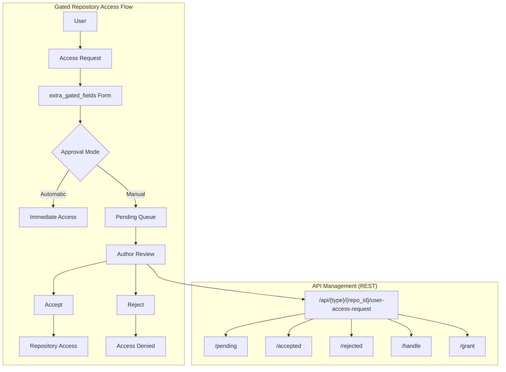
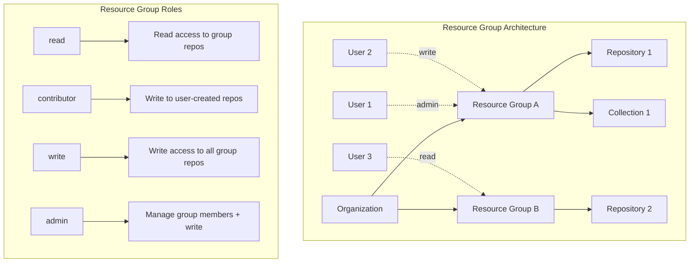
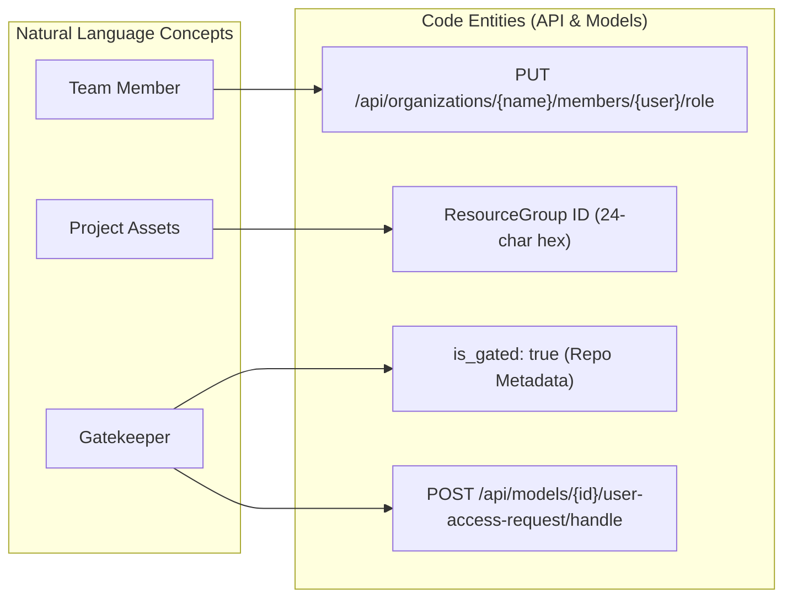

<!-- source: DeepWiki mcp.deepwiki.com · repo huggingface/hub-docs · page 6.3 Access Control and Gating · fetched 2026-10-26 -->

# Access Control and Gating

<details>
<summary>Relevant source files</summary>

The following files were used as context for generating this wiki page:

- [docs/hub/collections.md](docs/hub/collections.md)
- [docs/hub/datasets-gated.md](docs/hub/datasets-gated.md)
- [docs/hub/enterprise-gating-group-collections.md](docs/hub/enterprise-gating-group-collections.md)
- [docs/hub/enterprise-resource-groups.md](docs/hub/enterprise-resource-groups.md)
- [docs/hub/models-gated.md](docs/hub/models-gated.md)
- [docs/hub/organizations-security.md](docs/hub/organizations-security.md)
- [docs/hub/programmatic-user-access-control.md](docs/hub/programmatic-user-access-control.md)
- [docs/hub/security-resource-groups.md](docs/hub/security-resource-groups.md)

</details>


This document covers the access control and gating mechanisms available on the Hugging Face Hub, including repository-level gating, organization access management, and enterprise security features. The Hub provides multiple layers of access control, from individual repository gating to organization-wide security policies, enabling fine-grained control over who can access and contribute to repositories.

## Access Control Levels

The Hub implements access control at multiple levels, each serving different use cases and organizational structures.

### Repository-Level Gating

Repository gating allows authors to control access through user access requests. Users must agree to share contact information (username and email) to access gated repositories. Authors can configure these requests with custom fields via the repository settings.



**Repository Gating Components**

Sources: [docs/hub/models-gated.md:1-63](), [docs/hub/datasets-gated.md:1-63]()

### Organization Access Control

Members of organizations are assigned one of five roles, defining their permissions across the organization's namespace.

| Role | Description |
|------|-------------|
| `no_access` | Member of org but no access to repos/settings. Used with Resource Groups. |
| `read` | Read-only access to repos and metadata (member list, API tokens). |
| `contributor` | Write rights only to repositories created by the user. |
| `write` | Write rights to all organization repositories. |
| `admin` | Full write rights plus administrative control (billing, members, profile). |

Sources: [docs/hub/organizations-security.md:11-23]()

### Resource Groups (Enterprise & Team)

Resource Groups allow organization administrators to group related repositories and collections together, enabling independent team workflows within a single organization. A repository or collection can belong to exactly one Resource Group.



**Auto-join**: Organization admins can enable "Auto-include org members" to automatically add members to a Resource Group at a specified role (Read+ or All members). This is mutually exclusive with SCIM management.

Sources: [docs/hub/security-resource-groups.md:6-88](), [docs/hub/enterprise-resource-groups.md:6-31]()

## Gating Implementation

### Model and Dataset Gating Configuration

Gating is configured via repository metadata. The system supports custom forms using `extra_gated_fields`.

**Field Types for `extra_gated_fields`**:
- `text`: Single-line text input.
- `checkbox`: Boolean agreement.
- `date_picker`: Date selection.
- `country`: ISO 3166-1 alpha-2 dropdown.
- `select`: Dropdown with custom options.

Sources: [docs/hub/models-gated.md:88-127](), [docs/hub/datasets-gated.md:87-126]()

### Programmatic Access Control Management

The Hub provides REST API endpoints and `huggingface_hub` Python client methods for managing access.

| Action | REST URI (POST) | Python Method |
|--------|-----------------|---------------|
| Handle Request | `/user-access-request/handle` | `accept_access_request`, `reject_access_request` |
| Grant Access | `/user-access-request/grant` | `grant_access` |
| List Pending | `/user-access-request/pending` | `list_pending_access_requests` |

**Change Member Role API**:
Organization roles and Resource Group assignments are updated via:
`PUT /api/organizations/{org_name}/members/{username}/role`

Payload example:
```json
{
  "role": "write",
  "resourceGroups": [{"id": "group_id_hex", "role": "read"}]
}
```

Sources: [docs/hub/models-gated.md:55-65](), [docs/hub/programmatic-user-access-control.md:39-57]()

### Gating Group Collections (Enterprise & Team)

Gating Group Collections allow organizations to gate a group of models and datasets simultaneously. A user request for one repository in the collection applies to all items in that gating group.

**Requirements**:
- Collection owner must be an organization with a Team/Enterprise plan.
- All items must be owned by the same organization.
- Each item can only belong to one Gating Group Collection.

Sources: [docs/hub/enterprise-gating-group-collections.md:6-16](), [docs/hub/collections.md:58-62]()

## Access Control Integration

The access control system bridges high-level organizational structures with low-level API entities.



Sources: [docs/hub/programmatic-user-access-control.md:39-57](), [docs/hub/models-gated.md:60-65](), [docs/hub/security-resource-groups.md:18-23]()

---

