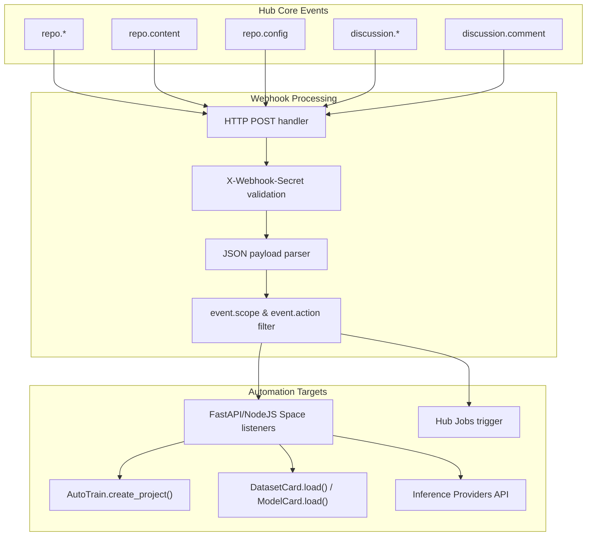
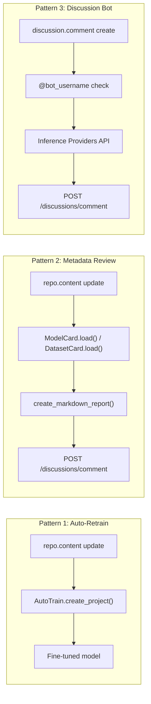
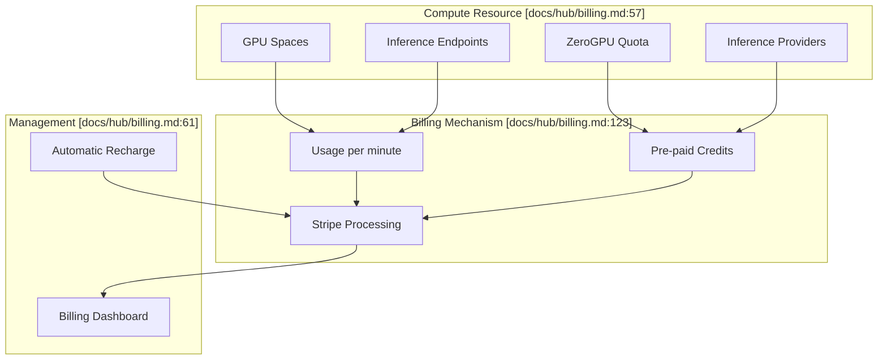

<!-- source: DeepWiki mcp.deepwiki.com · repo huggingface/hub-docs · page 7 Advanced Features and Administration · fetched 2026-10-26 -->

# Advanced Features and Administration

Relevant source files

The following files were used as context for generating this wiki page:

- [docs/hub/billing.md](docs/hub/billing.md)
- [docs/hub/jobs-webhooks.md](docs/hub/jobs-webhooks.md)
- [docs/hub/pro.md](docs/hub/pro.md)
- [docs/hub/spaces-gpus.md](docs/hub/spaces-gpus.md)
- [docs/hub/spaces-overview.md](docs/hub/spaces-overview.md)
- [docs/hub/spaces-sdks-static.md](docs/hub/spaces-sdks-static.md)
- [docs/hub/spaces-zerogpu.md](docs/hub/spaces-zerogpu.md)
- [docs/hub/webhooks-guide-auto-retrain.md](docs/hub/webhooks-guide-auto-retrain.md)
- [docs/hub/webhooks-guide-discussion-bot.md](docs/hub/webhooks-guide-discussion-bot.md)
- [docs/hub/webhooks-guide-metadata-review.md](docs/hub/webhooks-guide-metadata-review.md)
- [docs/hub/webhooks.md](docs/hub/webhooks.md)

This document covers advanced Hub features designed for automation, monitoring, and community management. These features are primarily intended for repository administrators, organization managers, and power users who need to implement automated workflows, manage large-scale operations, or maintain community standards.

For basic repository management, see [Repository Management](#2). For enterprise-specific features like SSO and resource groups, see [Enterprise Hub](#6.2). For API access and programmatic interactions, see [Hub API and Programmatic Access](#3).

## Overview of Advanced Features

The Hub provides several categories of advanced features that enable sophisticated automation and management workflows:

| Feature Category | Primary Use Cases | Target Users |
|------------------|-------------------|--------------|
| **Webhooks & Events** | CI/CD automation, model retraining, community bots | DevOps teams, ML engineers |
| **Billing & Resource Control** | Usage monitoring, cost management, quota enforcement | Finance teams, org admins |
| **Storage Management** | Large dataset hosting, cost optimization, usage tiers | Data engineers, administrators |
| **Community Moderation** | Content quality, metadata enhancement, social blogging | Community managers, curators |

These features integrate with the Hub's core infrastructure to provide enterprise-grade capabilities while maintaining the collaborative nature of the platform.

Sources: [docs/hub/webhooks.md:1-13](), [docs/hub/billing.md:1-6]()

## Automation and Integration Architecture

### Webhook System Architecture

The Hub's webhook system enables real-time automation by sending HTTP POST requests to external endpoints when repository events occur.

**Webhook Event Structure**

Webhook payloads follow a standardized JSON schema with event scope hierarchies:

- `repo` - Global events on repos (`create`, `delete`, `update`, `move`) [docs/hub/webhooks.md:96-96]()
- `repo.content` - Events on repo content, such as new commits or tags [docs/hub/webhooks.md:97-97]()
- `repo.config` - Configuration updates like Space secrets or settings [docs/hub/webhooks.md:98-98]()
- `discussion` - Creating or updating discussions and Pull Requests [docs/hub/webhooks.md:99-99]()
- `discussion.comment` - Creating, updating, or hiding comments [docs/hub/webhooks.md:100-100]()

For details, see [Webhooks and Events](#7.1).

Sources: [docs/hub/webhooks.md:90-105](), [docs/hub/webhooks-guide-auto-retrain.md:38-116](), [docs/hub/jobs-webhooks.md:19-37]()

### Webhook Implementation Patterns

The Hub supports several common webhook implementation patterns for automation:

Sources: [docs/hub/webhooks-guide-auto-retrain.md:121-134](), [docs/hub/webhooks-guide-metadata-review.md:43-54](), [docs/hub/webhooks-guide-discussion-bot.md:70-111]()

## Billing and Resource Control

### Subscription Tiers and Storage Limits

Hugging Face monetizes through advanced features and compute access. Storage management follows a tiered model with included capacity and pay-as-you-go overage.

| Plan | Included Private Storage | Storage Overage | Key Benefits |
|------|-------------------------|-----------------|--------------|
| **PRO** | 1TB [docs/hub/billing.md:47]() | $18/TB/month [docs/hub/billing.md:47]() | Higher rate limits, ZeroGPU priority, Dev Mode [docs/hub/pro.md:5-11]() |
| **Team** | 1TB per seat [docs/hub/billing.md:47]() | $18/TB/month [docs/hub/billing.md:47]() | SSO, Advanced Access Control, Org ZeroGPU [docs/hub/billing.md:9-16]() |
| **Enterprise** | 1TB per seat [docs/hub/billing.md:47]() | Custom | Annual contracts, compliance, dedicated support [docs/hub/billing.md:9-16]() |

For details, see [Billing and Storage Management](#7.2).

Sources: [docs/hub/billing.md:7-52](), [docs/hub/pro.md:1-12]()

### Compute Services Billing

Compute usage is usage-based (pay-as-you-go) and billed separately from subscriptions [docs/hub/billing.md:68]().

**ZeroGPU Usage Tiers**
ZeroGPU provides dynamic allocation of NVIDIA RTX Pro 6000 Blackwell GPUs [docs/hub/spaces-zerogpu:5](). Usage is subject to daily quotas based on account tier:
- **Free**: 5 minutes [docs/hub/spaces-zerogpu:160]()
- **PRO/Team**: 40 minutes (extensible with credits) [docs/hub/spaces-zerogpu:161-162]()
- **Enterprise**: 60 minutes (extensible with credits) [docs/hub/spaces-zerogpu:163]()

Sources: [docs/hub/billing.md:55-70](), [docs/hub/spaces-zerogpu:153-173](), [docs/hub/spaces-gpus:122-132]()

## Community and Metadata Enhancement

### Metadata Quality and Reporting

The Hub encourages high-quality documentation through automated metadata validation and community initiatives.

- **YAML Validation**: Model and dataset cards use a YAML header to define metadata like `language`, `license`, and `tags` [docs/hub/webhooks-guide-metadata-review.md:9-24]().
- **Automated Reviews**: Webhooks can trigger scripts using `huggingface_hub` to check for required fields and post a `markdown_report` to the repository's community tab [docs/hub/webhooks-guide-metadata-review.md:116-128]().
- **Social Features**: PRO users can publish Social Posts and Community Blogs to drive engagement [docs/hub/pro.md:10]().

For details, see [Community and Metadata Enhancement](#7.3).

Sources: [docs/hub/webhooks-guide-metadata-review.md:28-33](), [docs/hub/pro.md:10]()

## Administrative Child Pages

- [Webhooks and Events](#7.1) — Setting up webhooks for repository events, automation guides (metadata review, discussion bots, auto-retrain), and CI/CD integration.
- [Billing and Storage Management](#7.2) — Understanding Hub billing (subscriptions, pay-as-you-go), storage limits, storage buckets (S3-compatible), storage regions, and download analytics.
- [Community and Metadata Enhancement](#7.3) — Community contributions, Hacktoberfest challenges, metadata improvement (adding licenses, language tags), paper pages, leaderboards, and content quality initiatives.

---

