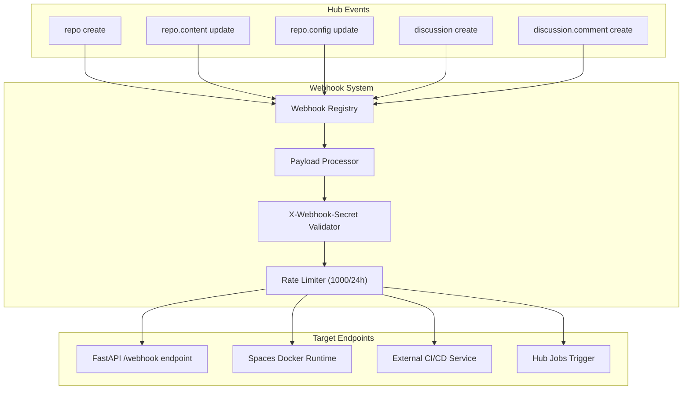
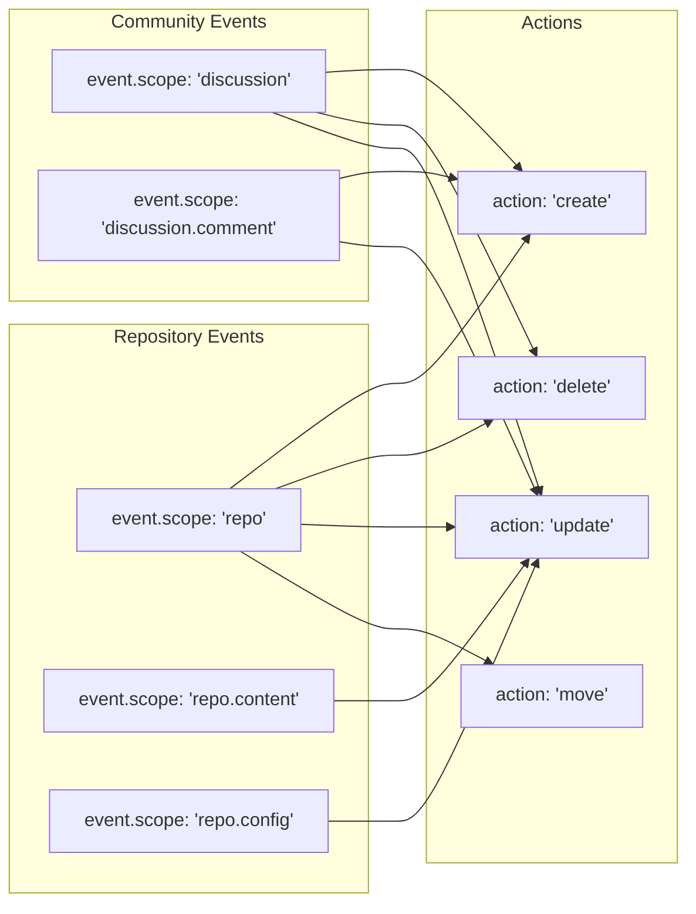
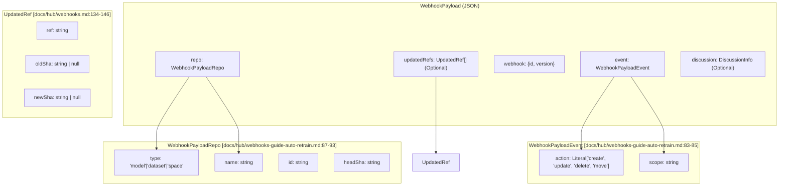
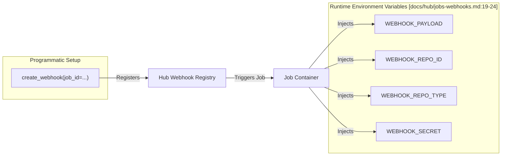

<!-- source: DeepWiki mcp.deepwiki.com · repo huggingface/hub-docs · page 7.1 Webhooks and Events · fetched 2026-10-26 -->

# Webhooks and Events

Relevant source files

The following files were used as context for generating this wiki page:

- [docs/hub/jobs-webhooks.md](docs/hub/jobs-webhooks.md)
- [docs/hub/webhooks-guide-auto-retrain.md](docs/hub/webhooks-guide-auto-retrain.md)
- [docs/hub/webhooks-guide-discussion-bot.md](docs/hub/webhooks-guide-discussion-bot.md)
- [docs/hub/webhooks-guide-metadata-review.md](docs/hub/webhooks-guide-metadata-review.md)
- [docs/hub/webhooks.md](docs/hub/webhooks.md)

Webhooks are a foundation for MLOps-related features on the Hugging Face Hub. They allow you to listen for changes on specific repositories or all repositories belonging to a particular set of users or organizations. Webhooks enable real-time integration with external systems for CI/CD pipelines, automated workflows, and community management [docs/hub/webhooks.md:1-5]().

## Overview

Webhooks provide `HTTP POST` notifications when specific events occur on Hub repositories. They enable automation for model validation, dataset processing, community moderation, and MLOps workflows without requiring polling [docs/hub/webhooks.md:22-25]().

Title: Webhook Event Delivery Flow

Sources: [docs/hub/webhooks.md:3-6](), [docs/hub/webhooks.md:24-25](), [docs/hub/webhooks.md:241-245]()

## Event Types and Scopes

The webhook system categorizes events using `event.scope` and `event.action` properties. Each scope represents a different aspect of repository activity [docs/hub/webhooks.md:88-93]().

| Scope | Actions | Description |
|-------|---------|-------------|
| `repo` | `create`, `delete`, `update`, `move` | Global repository operations [docs/hub/webhooks.md:96-96]() |
| `repo.content` | `update` | Content changes (commits, tags, PRs) [docs/hub/webhooks.md:97-97]() |
| `repo.config` | `update` | Configuration changes (secrets, settings, DOIs) [docs/hub/webhooks.md:98-98]() |
| `discussion` | `create`, `delete`, `update` | Discussion and PR lifecycle [docs/hub/webhooks.md:99-99]() |
| `discussion.comment` | `create`, `update` | Comment operations [docs/hub/webhooks.md:100-100]() |

Title: Event Scope and Action Mapping

Sources: [docs/hub/webhooks.md:94-101]()

## Payload Structure

Webhook payloads are JSON objects. The structure varies based on event type but always includes `event`, `repo`, and `webhook` properties [docs/hub/webhooks.md:31-35]().

### Data Models

Title: Webhook Payload Code Entity Space

Sources: [docs/hub/webhooks.md:33-85](), [docs/hub/webhooks-guide-auto-retrain.md:82-97]()

## Automation Use Cases

### CI/CD and Metadata Review
You can use the `huggingface_hub` library (specifically `ModelCard.load` or `DatasetCard.load`) to fetch repository metadata when a webhook triggers, allowing for automated quality reports [docs/hub/webhooks-guide-metadata-review.md:35-54]().

### Automated Training
Webhooks can trigger model re-training when a dataset is updated. This often involves calling `AutoTrain.create_project` in response to a `repo.content` update event [docs/hub/webhooks-guide-auto-retrain.md:121-134]().

### Discussion Bots
By listening to `discussion.comment` events with the `create` action, bots can respond to mentions using Inference Providers (e.g., calling `https://router.huggingface.co/v1/chat/completions`) [docs/hub/webhooks-guide-discussion-bot.md:52-95]().

## Security and Authentication

### Secret Validation
Webhooks include an `X-Webhook-Secret` HTTP header. Implementation must validate this header against a secret stored in the environment (e.g., `WEBHOOK_SECRET`) to prevent unauthorized triggers [docs/hub/webhooks-guide-discussion-bot.md:42-50](), [docs/hub/webhooks-guide-auto-retrain.md:59-74]().

### Rate Limiting
Webhooks are limited to 1,000 triggers per 24-hour period [docs/hub/webhooks.md:241-245]().

## CI/CD Integration with Hub Jobs

Webhooks can directly trigger **Hub Jobs** using the `huggingface_hub` Python client's `create_webhook` function with a `job_id` [docs/hub/jobs-webhooks.md:5-17]().

Title: Hub Jobs Webhook Integration

Sources: [docs/hub/jobs-webhooks.md:7-25]()

## Development and Debugging

The Webhooks settings page ([huggingface.co/settings/webhooks](https://huggingface.co/settings/webhooks)) provides:
- **Activity Tab**: View history of payloads sent [docs/hub/webhooks.md:26-29]().
- **Replay**: It is possible to replay past webhooks for easier debugging [docs/hub/webhooks.md:26-29]().
- **Direct URL**: When using Spaces to react to webhooks, the "Direct URL" (found in "Embed this Space") must be used as the target URL [docs/hub/webhooks-guide-discussion-bot.md:120-123]().

Sources: [docs/hub/webhooks.md:16-29](), [docs/hub/webhooks-guide-discussion-bot.md:118-127]()

---

