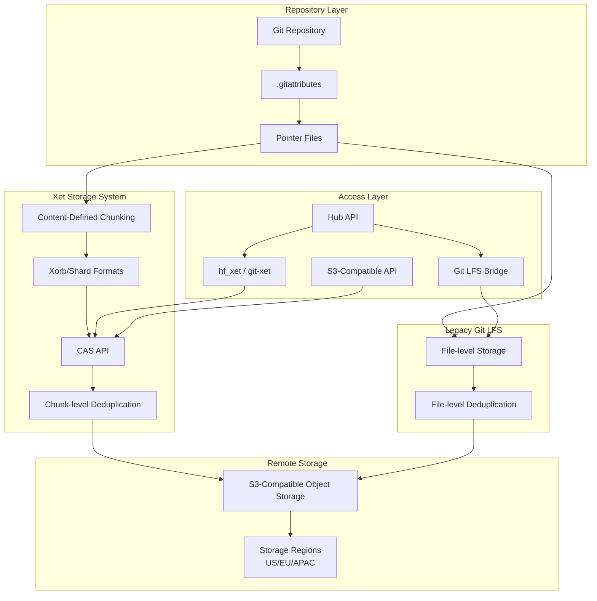
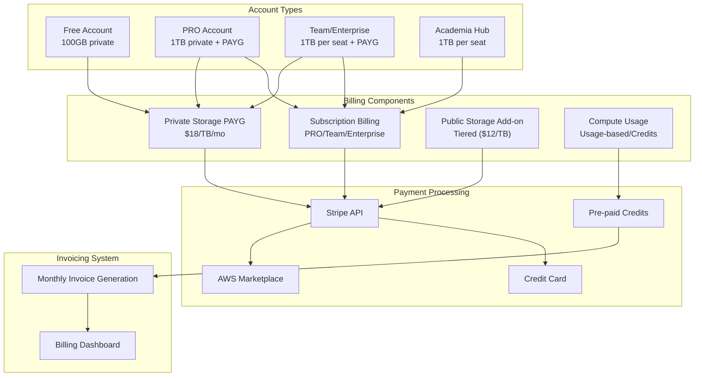
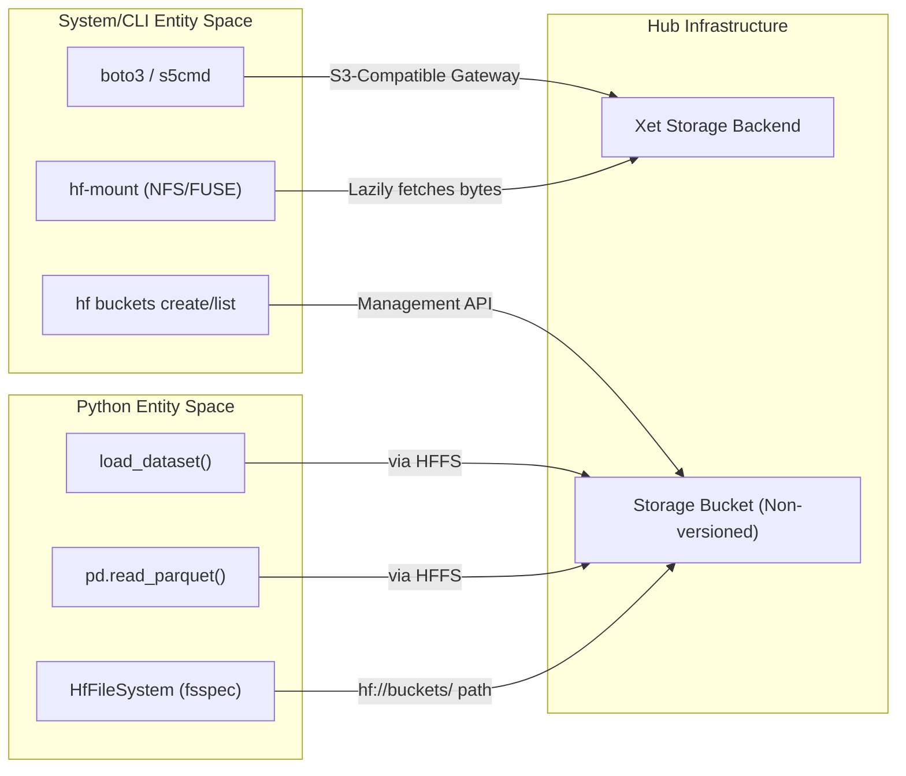

<!-- source: DeepWiki mcp.deepwiki.com · repo huggingface/hub-docs · page 7.2 Billing and Storage Management · fetched 2026-10-26 -->

# Billing and Storage Management

Relevant source files

The following files were used as context for generating this wiki page:

- [docs/hub/academia-hub.md](docs/hub/academia-hub.md)
- [docs/hub/advanced-compute-options.md](docs/hub/advanced-compute-options.md)
- [docs/hub/audit-logs.md](docs/hub/audit-logs.md)
- [docs/hub/billing.md](docs/hub/billing.md)
- [docs/hub/datasets-upload-guide-llm.md](docs/hub/datasets-upload-guide-llm.md)
- [docs/hub/enterprise-sso.md](docs/hub/enterprise-sso.md)
- [docs/hub/pro.md](docs/hub/pro.md)
- [docs/hub/spaces-gpus.md](docs/hub/spaces-gpus.md)
- [docs/hub/spaces-overview.md](docs/hub/spaces-overview.md)
- [docs/hub/spaces-sdks-static.md](docs/hub/spaces-sdks-static.md)
- [docs/hub/spaces-zerogpu.md](docs/hub/spaces-zerogpu.md)
- [docs/hub/storage-buckets-access.md](docs/hub/storage-buckets-access.md)
- [docs/hub/storage-buckets-integrations.md](docs/hub/storage-buckets-integrations.md)
- [docs/hub/storage-buckets-s3.md](docs/hub/storage-buckets-s3.md)
- [docs/hub/storage-buckets.md](docs/hub/storage-buckets.md)
- [docs/hub/storage-limits.md](docs/hub/storage-limits.md)
- [docs/hub/storage-regions.md](docs/hub/storage-regions.md)

This page covers the Hub's billing systems and storage management infrastructure, including pricing models, storage backends, account types, and administrative operations. For enterprise-specific features like SSO and resource groups, see [Enterprise Hub](#6.2). For repository access control, see [Access Control and Gating](#6.3).

## Overview

The Hub operates on a freemium model with three main pricing components: repository storage, compute services, and subscription features. Storage is managed through two primary architectures: Git-based repositories (Models, Datasets, Spaces) and non-versioned, mutable **Storage Buckets** powered by the Xet backend [docs/hub/storage-buckets.md:3-5]().

## Storage Architecture

### Storage Backend Systems

The Hub uses two storage systems for handling large files in repositories, with a transition toward Xet for chunk-level deduplication.

#### Storage Backend Architecture

Sources: [docs/hub/storage-buckets.md:3-5](), [docs/hub/storage-limits.md:10-11](), [docs/hub/storage-regions.md:6-18]()

### Storage Types Comparison

| Feature | Repositories (Git-based) | Storage Buckets |
|---------|-------------------------|-----------------|
| **Versioning** | Full Git history | None (mutable, overwrite-in-place) |
| **Primary Use** | Publishing finished artifacts | Working storage / intermediate data |
| **Deduplication** | Xet chunk-level | Xet chunk-level |
| **Access** | Hub API, Git push/pull | S3-like `sync`, `cp`, `rm`, FUSE mount |
| **PR Support** | Yes | No |

Sources: [docs/hub/storage-buckets.md:17-27]()

## Billing Systems Architecture

### Billing Components and Payment Flow

Sources: [docs/hub/billing.md:7-52](), [docs/hub/storage-limits.md:16-53](), [docs/hub/academia-hub.md:28-39]()

### Account Types and Storage Limits

| Account Type | Public Storage | Private Storage | Compute Benefits |
|--------------|----------------|-----------------|------------------|
| **Free** | Best-effort | 100GB | 2 Gradio Spaces (ZeroGPU) |
| **PRO** | 10TB included | 1TB + $18/TB/mo | 10 ZeroGPU Spaces, Inference Credits |
| **Team** | 12TB base + 1TB/seat | 1TB/seat + $18/TB/mo | Advanced Hardware, Org Management |
| **Enterprise** | 200TB base + 1TB/seat | 1TB/seat + $18/TB/mo | 50 ZeroGPU Spaces, SSO, Regions |

Sources: [docs/hub/storage-limits.md:16-21](), [docs/hub/billing.md:24-52](), [docs/hub/advanced-compute-options.md:28]()

## Storage Management Operations

### Repository Recommendations

The Hub implements recommendations to ensure optimal Git performance:

| Characteristic | Recommended | Tips |
|----------------|-------------|------|
| **Files per repo** | <100k | Merge data into fewer files |
| **Entries per folder** | <10k | Use subdirectories |
| **File size** | <200GB | Split into chunked files |
| **Commit size** | <100 files | `upload_folder` auto-splits commits |

Sources: [docs/hub/storage-limits.md:70-78]()

### Compute Billing and Credits

Compute services (Spaces, Inference Endpoints, Jobs) are usage-based.
1. **Usage-based**: Charged by the minute when `Starting` or `Running` [docs/hub/spaces-gpus.md:123-126]().
2. **Credits**: Users can pre-pay credits for services like ZeroGPU extension ($1 per 10 mins) or Inference Providers [docs/hub/spaces-zerogpu:172-173](), [docs/hub/billing.md:95-104]().
3. **Automatic Recharge**: Recommended to avoid service disruption when credits are exhausted [docs/hub/billing.md:108]().

## Enterprise and Advanced Storage Features

### Storage Regions and Compliance

Organizations on Team/Enterprise plans can control the physical location of their data [docs/hub/storage-regions.md:4-6]().

*   **Available Regions**: US (Default), EU, and upcoming APAC/GCC [docs/hub/storage-regions.md:13-18]().
*   **Performance**: EU storage provides 4-5x faster speeds for European users [docs/hub/storage-regions.md:87-88]().
*   **Compliance**: Enables GDPR-compliant development for EU-regulated industries [docs/hub/storage-regions.md:66-67]().

### Storage Buckets Access Patterns

Buckets support multiple high-performance access methods:

*   **hf-mount**: Mounts buckets as a local filesystem via NFS/FUSE. Buckets are mounted **read-write** [docs/hub/storage-buckets-access.md:19-36]().
*   **HfFileSystem**: An `fsspec`-compatible interface using `hf://buckets/` paths for Python tools like pandas and DuckDB [docs/hub/storage-buckets-access.md:52-73]().
*   **S3-Compatible API**: Allows use of standard S3 tooling (`boto3`, `aws cli`, `s5cmd`) [docs/hub/storage-buckets-access.md:13]().

#### Data Access Entity Mapping

Sources: [docs/hub/storage-buckets-access.md:9-13](), [docs/hub/storage-buckets-integrations.md:3-73](), [docs/hub/storage-buckets.md:3-5]()

## Payment Processing

*   **Stripe**: Processes all credit card payments. Supports 3D-secure [docs/hub/billing.md:73-112]().
*   **AWS Marketplace**: Allows linking a Hugging Face organization to an AWS account to include Hub usage in the AWS bill [docs/hub/billing.md:90-91]().
*   **Regional Restrictions**: Credit cards issued in India are currently not supported due to RBI compliance requirements; AWS Marketplace is the recommended alternative for these users [docs/hub/billing.md:112-114]().

Sources: [docs/hub/billing.md:71-91](), [docs/hub/billing.md:110-114]()

---

