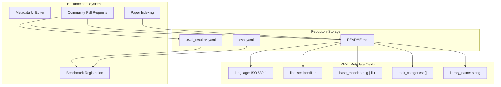
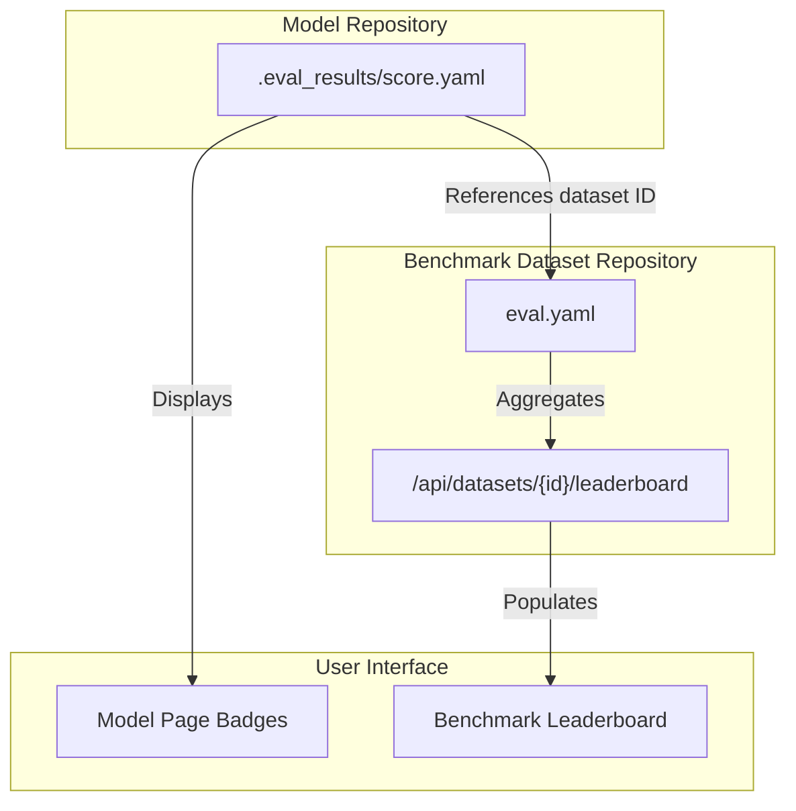

<!-- source: DeepWiki mcp.deepwiki.com · repo huggingface/hub-docs · page 7.3 Community and Metadata Enhancement · fetched 2026-10-26 -->

# Community and Metadata Enhancement

Relevant source files

The following files were used as context for generating this wiki page:

- [datasetcard.md](datasetcard.md)
- [docs/hub/datasets-cards.md](docs/hub/datasets-cards.md)
- [docs/hub/eval-results.md](docs/hub/eval-results.md)
- [docs/hub/leaderboard-data-guide.md](docs/hub/leaderboard-data-guide.md)
- [docs/hub/model-cards-co2.md](docs/hub/model-cards-co2.md)
- [docs/hub/model-cards.md](docs/hub/model-cards.md)
- [docs/hub/models.md](docs/hub/models.md)
- [docs/hub/paper-pages.md](docs/hub/paper-pages.md)
- [docs/hub/repositories-licenses.md](docs/hub/repositories-licenses.md)
- [eval_results.yaml](eval_results.yaml)
- [hacktoberfest_challenges/datasets_without_language.csv](hacktoberfest_challenges/datasets_without_language.csv)
- [hacktoberfest_challenges/datasets_without_language.md](hacktoberfest_challenges/datasets_without_language.md)
- [hacktoberfest_challenges/model_license_other.csv](hacktoberfest_challenges/model_license_other.csv)
- [hacktoberfest_challenges/model_license_other.md](hacktoberfest_challenges/model_license_other.md)
- [hacktoberfest_challenges/model_no_license.csv](hacktoberfest_challenges/model_no_license.csv)
- [hacktoberfest_challenges/model_no_license.md](hacktoberfest_challenges/model_no_license.md)
- [modelcard.md](modelcard.md)

This document covers the Hub's community-driven initiatives and systematic approaches for improving repository metadata quality, including license identification, language tagging, evaluation results, and paper indexing.

## Overview

The Hugging Face Hub hosts hundreds of thousands of public models and datasets. Metadata quality directly impacts discoverability, compliance, and user experience. Community and metadata enhancement encompasses both automated systems (like validation at push time) and community-driven initiatives to systematically improve the completeness and accuracy of repository metadata across the platform [hacktoberfest_challenges/datasets_without_language.md:5-8](), [docs/hub/eval-results.md:83-84]().

## Metadata Enhancement Architecture

### Core Metadata Components

Metadata is primarily stored in the YAML frontmatter of `README.md` files (cards) and specialized YAML files within the repository [docs/hub/model-cards.md:25-26](), [docs/hub/eval-results.md:16-17]().

Sources: [docs/hub/model-cards.md:23-41](), [docs/hub/datasets-cards.md:9-26](), [docs/hub/eval-results.md:16-30](), [docs/hub/eval-results.md:80-84](), [modelcard.md:1-21](), [datasetcard.md:1-34]()

## Community Enhancement Initiatives

### Language and License Metadata Challenges

The Hub maintains systematic community challenges (often during events like Hacktoberfest) to improve metadata coverage.

**Language Metadata Enhancement:**
- **Objective:** Fill the `language` field for datasets lacking it to improve discovery [hacktoberfest_challenges/datasets_without_language.md:22-23]().
- **Workflow:** Contributors identify datasets using the `huggingface_hub` library (e.g., `list_datasets(full=True)`) filtering for those with text-related tasks and sufficient downloads [hacktoberfest_challenges/datasets_without_language.md:63-71]().
- **Identification:** Methods include analyzing the dataset name (e.g., `imdb_de`), checking the dataset card text, or using the [facebook/fasttext-language-identification](https://huggingface.co/facebook/fasttext-language-identification) model [hacktoberfest_challenges/datasets_without_language.md:33-38]().

**License Enhancement:**
- **Standardizing "Other":** Models with `license: other` are updated to include `license_name` and `license_link` if a specific custom license (like Coqui's CPML) is found in the repo [hacktoberfest_challenges/model_license_other.md:10-20]().
- **Official Support Migration:** Transitioning models from `license: other` to newly supported identifiers, such as `license: llama2` [hacktoberfest_challenges/model_license_other.md:29-36]().

Sources: [hacktoberfest_challenges/datasets_without_language.md:25-42](), [hacktoberfest_challenges/model_license_other.md:42-53](), [docs/hub/repositories-licenses.md:11-68]()

## Evaluation Results and Leaderboards

The Hub provides a decentralized system for tracking model performance through benchmark datasets and model-resident evaluation scores [docs/hub/eval-results.md:6-7]().

### Data Flow for Leaderboards

Sources: [docs/hub/eval-results.md:16-23](), [docs/hub/eval-results.md:80-84](), [docs/hub/leaderboard-data-guide.md:23-31]()

### Benchmark Registration and Verification
- **Benchmark Datasets:** Repositories containing an `eval.yaml` in the root are defined as Benchmarks [docs/hub/eval-results.md:10-12]().
- **Verification:** Results can include a `verifyToken`, which is a cryptographic proof that the evaluation was run on trusted infrastructure (e.g., HF Jobs with `inspect-ai`) [docs/hub/eval-results.md:36-58](), [eval_results.yaml:11-12]().
- **Community Submissions:** Anyone can submit results to a model via a PR to the `.eval_results/` folder. These appear with a "community" badge while the PR is open [docs/hub/eval-results.md:65-72]().

Sources: [docs/hub/eval-results.md:56-62](), [docs/hub/eval-results.md:80-87](), [docs/hub/leaderboard-data-guide.md:103-118]()

## Paper Pages and ArXiv Integration

Paper pages serve as hubs for artifacts (models, datasets, Spaces) related to research papers [docs/hub/paper-pages.md:3-4]().

- **Automatic Linking:** If a `README.md` includes a link to an ArXiv abstract or PDF, the Hub extracts the ID and adds an `arxiv:<ID>` tag [docs/hub/paper-pages.md:10-12]().
- **Authorship:** Users can claim authorship of indexed papers. The Hub attempts to match users by email, but manual "claim authorship" requests are validated by the admin team [docs/hub/paper-pages.md:22-31]().
- **Indexing:** If a paper is not on the Hub, users can index it by searching for the ArXiv ID at `hf.co/papers` [docs/hub/paper-pages.md:51-54]().

Sources: [docs/hub/paper-pages.md:1-54](), [docs/hub/datasets-cards.md:48-60]()

## Metadata Validation and Discovery

The Hub implements strict validation for specific metadata fields to ensure search consistency.

| Field | Validation/Behavior |
| :--- | :--- |
| `library_name` | Validated against a list of supported libraries (e.g., `transformers`, `flair`, `timm`) [docs/hub/model-cards.md:81-89](), [modelcard.md:9](). |
| `license` | Must match valid identifiers (e.g., `apache-2.0`, `mit`) to display the license badge [docs/hub/repositories-licenses.md:11-68](), [datasetcard.md:99](). |
| `base_model` | Links the current model to its parent, enabling filtering by derived models [docs/hub/model-cards.md:103-112](). |
| `modality` | Automatically detected but can be forced via tags (e.g., `audio`, `geospatial`) [docs/hub/datasets-cards.md:62-72](). |

Sources: [docs/hub/model-cards.md:27-33](), [docs/hub/model-cards.md:79-81](), [docs/hub/datasets-cards.md:28-32](), [modelcard.md:53-54]()

---

