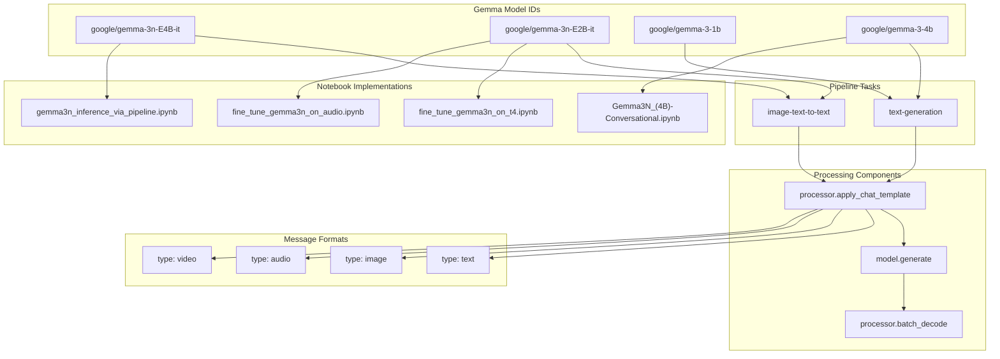
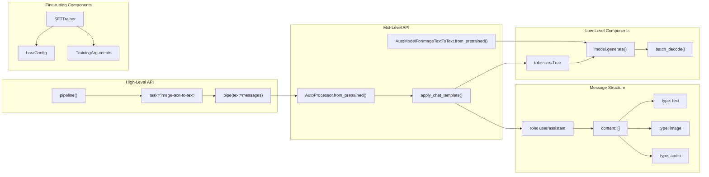

<!-- source: DeepWiki mcp.deepwiki.com · repo huggingface/huggingface-gemma-recipes · page 1 Overview · fetched 2026-10-26 -->

# Overview

Relevant source files

The following files were used as context for generating this wiki page:

- [.github/README.md](.github/README.md)

## Purpose and Scope

This document provides an overview of the Hugging Face Gemma Recipes repository, a collection of minimal, ready-to-use examples for working with Google's Gemma model family. The repository serves as a practical guide for both inference and fine-tuning of Gemma models across multiple modalities including text, images, audio, and video.

The repository focuses on providing quick-start examples rather than comprehensive tutorials. For detailed implementation guidance on specific tasks, see [Fine-tuning Guide](#4). For contribution guidelines and repository maintenance, see [Contributing](#5).

## Repository Architecture

The repository is organized around two main use cases: inference and fine-tuning, with support for both Gemma 3n (multimodal) and Gemma 3 (text-only) model variants.

```mermaid
graph TB
    subgraph "Entry Points"
        README[".github/README.md"]
        REQUIREMENTS["requirements.txt"]
    end
    
    subgraph "Inference Examples"
        PIPELINE_NB["notebooks/gemma3n_inference_via_pipeline.ipynb"]
        PIPELINE_API["transformers.pipeline"]
        AUTO_PROCESSOR["AutoProcessor"]
        AUTO_MODEL["AutoModelForImageTextToText"]
    end
    
    subgraph "Fine-tuning Notebooks"
        FT_T4["notebooks/fine_tune_gemma3n_on_t4.ipynb"]
        FT_CONV["notebooks/Gemma3N_(4B)-Conversational.ipynb"]
        FT_AUDIO["notebooks/fine_tune_gemma3n_on_audio.ipynb"]
        FT_GUI["notebooks/Gemma_3n_GUI_Finetune.ipynb"]
        FT_VISION["notebooks/Gemma3_(4B)-Vision.ipynb"]
        FT_GRPO["notebooks/Gemma3_(1B)-GRPO.ipynb"]
    end
    
    subgraph "Production Scripts"
        SCRIPT_IMG["scripts/ft_gemma3n_image_vt.py"]
        SCRIPT_AUDIO["scripts/ft_gemma3n_audio_vt.py"]
        SCRIPT_TRL["scripts/ft_gemma3n_image_trl.py"]
    end
    
    subgraph "Training Frameworks"
        TRL["TRL"]
        UNSLOTH["Unsloth"]
        TRANSFORMERS["Transformers"]
    end
    
    README --> PIPELINE_NB
    README --> FT_T4
    README --> FT_CONV
    
    PIPELINE_NB --> PIPELINE_API
    PIPELINE_API --> AUTO_PROCESSOR
    PIPELINE_API --> AUTO_MODEL
    
    FT_T4 --> TRL
    FT_CONV --> UNSLOTH
    FT_AUDIO --> TRANSFORMERS
    FT_GUI --> TRL
    FT_VISION --> UNSLOTH
    FT_GRPO --> UNSLOTH
    
    SCRIPT_IMG --> TRANSFORMERS
    SCRIPT_AUDIO --> TRANSFORMERS
    SCRIPT_TRL --> TRL
    
    REQUIREMENTS --> TRL
    REQUIREMENTS --> UNSLOTH
    REQUIREMENTS --> TRANSFORMERS
```

**Sources:** [.github/README.md:1-177]()

## Model Variants and Code Mappings

The repository supports multiple Gemma model variants, each with specific model identifiers and use cases mapped to corresponding code implementations.

**Sources:** [.github/README.md:31-49](), [.github/README.md:57-82](), [.github/README.md:152-167]()

## Task-to-Implementation Mapping

The repository provides specific implementations for different multimodal tasks, each with dedicated notebooks and scripts.

| Task Category | Model Variant | Implementation | Framework | Colab Link |
|---------------|---------------|----------------|-----------|------------|
| Multimodal Inference | `google/gemma-3n-E4B-it` | `gemma3n_inference_via_pipeline.ipynb` | `transformers.pipeline` | ✓ |
| Free T4 Fine-tuning | `google/gemma-3n-E2B-it` | `fine_tune_gemma3n_on_t4.ipynb` | TRL | ✓ |
| Conversational AI | Gemma 3n 4B | `Gemma3N_(4B)-Conversational.ipynb` | Unsloth | ✓ |
| Audio Transcription | Gemma 3n 2B | `fine_tune_gemma3n_on_audio.ipynb` | Transformers | - |
| GUI Grounding | Gemma 3n | `Gemma_3n_GUI_Finetune.ipynb` | TRL | - |
| Vision Tasks | Gemma 3 4B | `Gemma3_(4B)-Vision.ipynb` | Unsloth | ✓ |
| Math Reasoning | Gemma 3 1B | `Gemma3_(1B)-GRPO.ipynb` | Unsloth + TRL | ✓ |
| Production Image | Gemma 3n | `ft_gemma3n_image_vt.py` | Transformers | - |
| Production Audio | Gemma 3n | `ft_gemma3n_audio_vt.py` | Transformers | - |

**Sources:** [.github/README.md:142-167]()

## Key Components and APIs

The repository demonstrates three primary interaction patterns with Gemma models, each utilizing different levels of the transformers API.

**Sources:** [.github/README.md:27-49](), [.github/README.md:57-82](), [.github/README.md:89-133]()

## Installation and Dependencies

The repository requires minimal dependencies for basic usage, with additional packages needed for specific fine-tuning scenarios:

- **Core dependencies**: `transformers`, `timm` (for vision encoder)
- **Fine-tuning dependencies**: Available in `requirements.txt`
- **Framework-specific**: TRL for reinforcement learning, Unsloth for efficient training

The entry point for most users is the `pipeline` API from transformers, which provides the simplest interface for inference across all supported modalities.

**Sources:** [.github/README.md:17-21](), [.github/README.md:169-173]()

---

