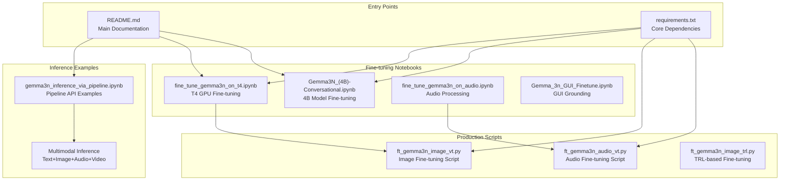
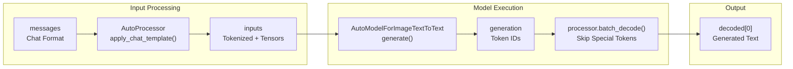
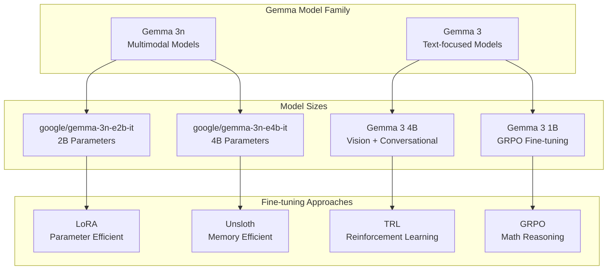

<!-- source: DeepWiki mcp.deepwiki.com · repo huggingface/huggingface-gemma-recipes · page 2 Getting Started · fetched 2026-10-26 -->

# Getting Started

<details>
<summary>Relevant source files</summary>

The following files were used as context for generating this wiki page:

- [.github/README.md](.github/README.md)
- [requirements.txt](requirements.txt)

</details>


This document provides a comprehensive guide to setting up and using the Hugging Face Gemma Recipes repository. It covers initial setup, dependency installation, and basic usage patterns for working with Gemma models across different modalities (text, image, audio, video). 

For detailed fine-tuning instructions, see [Fine-tuning Guide](#4). For advanced techniques and production deployment, see [Advanced Techniques](#4.4) and [Production Scripts](#4.5).

## Prerequisites and Installation

The repository requires Python with PyTorch and several key dependencies for multimodal processing.

### Core Dependencies

The minimal installation requires `transformers` and `timm` for vision processing:

```bash
pip install -U -q transformers timm
```

For full functionality including fine-tuning capabilities, install all dependencies:

```bash
pip install -U -q -r requirements.txt
```

### Required Packages

| Package | Purpose | Notes |
|---------|---------|-------|
| `torch` | Core PyTorch framework | Required for model inference and training |
| `transformers` | Hugging Face transformers library | Provides model classes and pipeline API |
| `timm` | Vision encoder components | Required for multimodal Gemma 3n models |
| `datasets` | Data loading and processing | Used in fine-tuning examples |
| `matplotlib` | Visualization utilities | Used in notebooks for plotting |

Sources: [requirements.txt:1-5](), [.github/README.md:17-21]()

## Repository Structure Overview

### Repository Architecture



Sources: [.github/README.md:1-177]()

## Quick Start Examples

### Basic Pipeline Inference

The simplest way to use Gemma models is through the `pipeline` API from transformers:

```python
# Basic multimodal inference setup
pipe = pipeline(
    "image-text-to-text",
    model="google/gemma-3n-E4B-it",
    device="cuda",
    torch_dtype=torch.bfloat16
)
```

This pattern is demonstrated in [.github/README.md:27-50]() and provides immediate access to multimodal capabilities.

### Model and Processor Initialization

For more control over the inference process, use the direct transformers API:

```python
# Direct model initialization
model_id = "google/gemma-3n-e4b-it"
processor = AutoProcessor.from_pretrained(model_id)
model = AutoModelForImageTextToText.from_pretrained(model_id)
```

The `model_generation` function handles chat template application and inference: [.github/README.md:64-82]()

Sources: [.github/README.md:23-82]()

## Understanding the Workflow

### Inference Processing Pipeline



### Supported Modalities

| Modality | Content Type | Example Usage |
|----------|-------------|---------------|
| Text | `{"type": "text", "text": "..."}` | Question answering, conversation |
| Image | `{"type": "image", "image": "url"}` | Visual analysis, description |
| Audio | `{"type": "audio", "audio": "url"}` | Speech transcription, analysis |
| Video | `{"type": "video", "video": "url"}` | Video understanding, description |

Sources: [.github/README.md:38-134]()

### Model Variants and Use Cases



Sources: [.github/README.md:60-61](), [.github/README.md:148-167]()

## Message Format and Templates

### Chat Message Structure

All interactions with Gemma models use a standardized message format:

```python
messages = [
    {
        "role": "user",
        "content": [
            {"type": "text", "text": "Your question here"},
            {"type": "image", "image": "path/to/image.jpg"}
        ]
    }
]
```

The `AutoProcessor.apply_chat_template()` method handles conversion to model-specific format with proper tokenization and tensor conversion.

### Modality-Specific Examples

Examples for each modality are provided in [.github/README.md:86-134]():

- **Text-only**: Simple question-answering format
- **Audio**: Speech transcription with audio URLs
- **Image**: Visual analysis with image URLs
- **Video**: Video understanding capabilities

Sources: [.github/README.md:38-134]()

## Next Steps

After completing the basic setup:

1. **For inference tasks**: Explore the pipeline notebook at [notebooks/gemma3n_inference_via_pipeline.ipynb]()
2. **For fine-tuning**: Start with the T4 notebook at [notebooks/fine_tune_gemma3n_on_t4.ipynb]()
3. **For production deployment**: Review the training scripts in [scripts/]()
4. **For advanced techniques**: See the GRPO and specialized fine-tuning notebooks

For detailed fine-tuning instructions across different modalities, see [Fine-tuning Guide](#4). For contribution guidelines and development setup, see [Contributing](#5).

Sources: [.github/README.md:140-175]()

---

