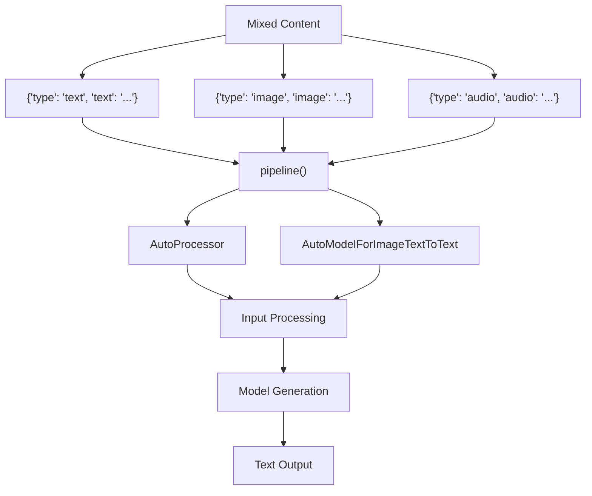
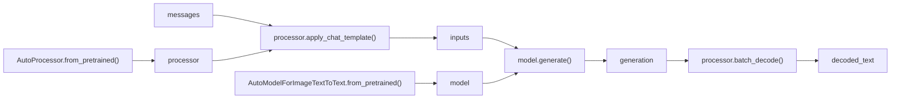
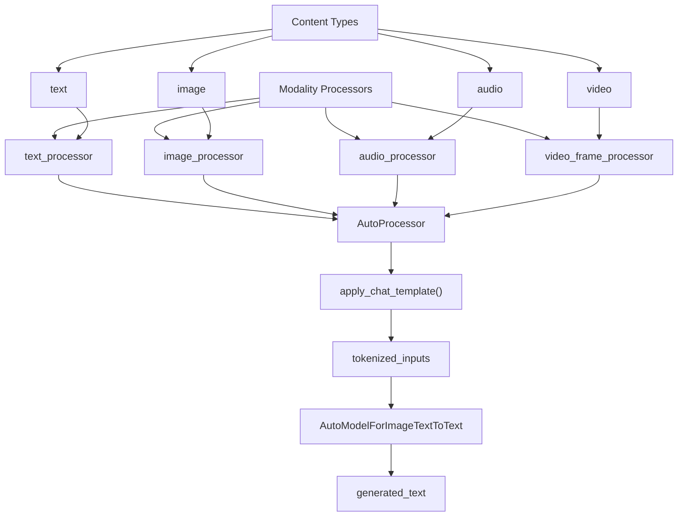
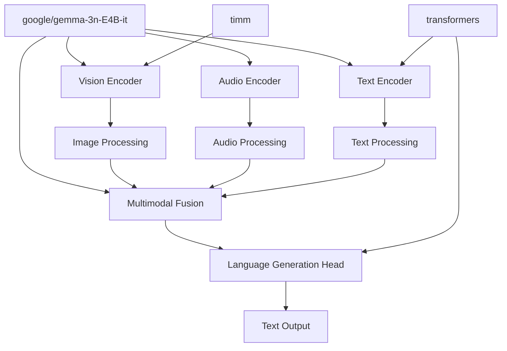
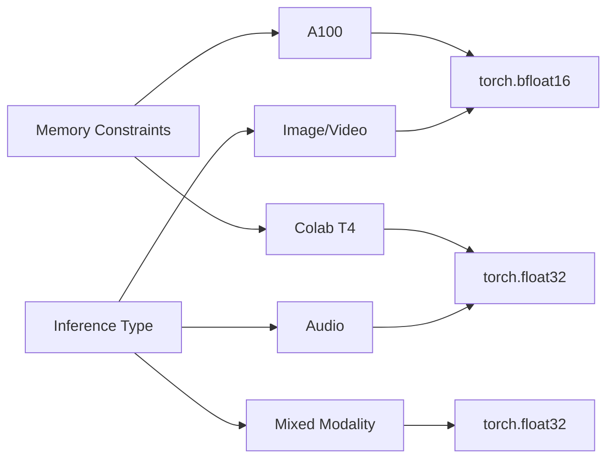
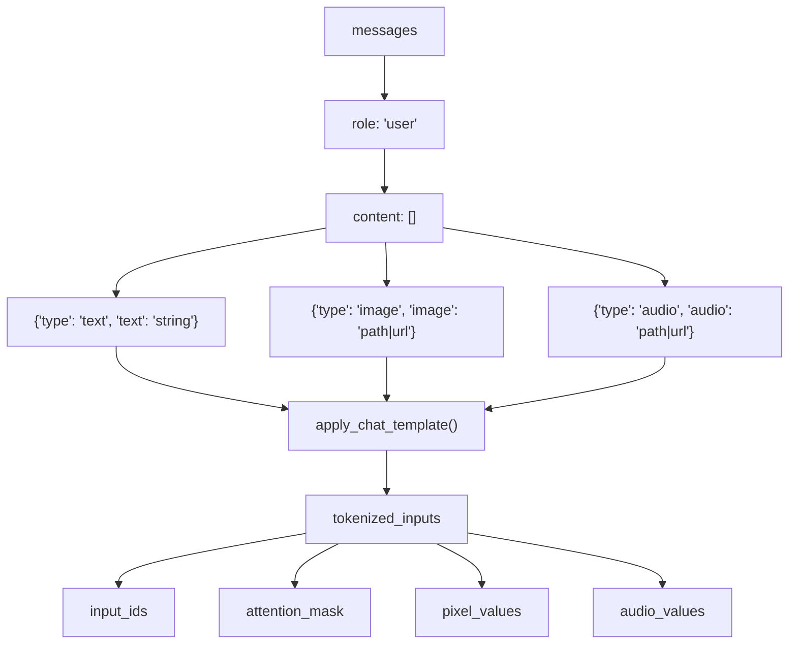
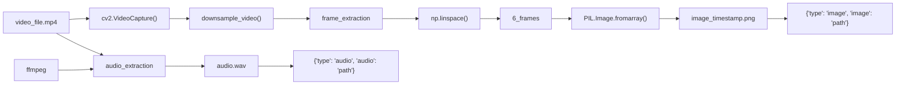

<!-- source: DeepWiki mcp.deepwiki.com · repo huggingface/huggingface-gemma-recipes · page 3 Inference and Usage · fetched 2026-10-26 -->

# Inference and Usage

Relevant source files

The following files were used as context for generating this wiki page:

- [.github/README.md](.github/README.md)
- [notebooks/gemma3n_inference_via_pipeline.ipynb](notebooks/gemma3n_inference_via_pipeline.ipynb)

This page covers how to perform inference with pre-trained Gemma models across multiple modalities (text, image, audio, video). It demonstrates both quick pipeline-based inference and detailed manual inference approaches using the transformers library.

For information about fine-tuning these models, see [Fine-tuning Guide](#4). For setup and installation instructions, see [Getting Started](#2).

## Overview

The repository provides two primary approaches for running inference with Gemma models:

1. **Pipeline API**: Simplified interface using `transformers.pipeline` for quick multimodal inference
2. **Manual Approach**: Direct model and processor usage for fine-grained control over the inference process

Both approaches support the Gemma 3n family of multimodal models, which can process combinations of text, images, audio, and video inputs to generate text responses.

## Inference Approaches

### Pipeline API

The pipeline API provides the simplest way to perform multimodal inference. It handles model loading, input processing, and output generation automatically.

**Pipeline Architecture for Multimodal Inference**

The pipeline automatically handles the complexity of processing different input modalities and routing them through the appropriate model components.

Sources: [.github/README.md:23-50](), [notebooks/gemma3n_inference_via_pipeline.ipynb:621-630]()

### Manual Inference Approach

For more control over the inference process, you can directly instantiate the model and processor components:

**Manual Inference Flow with Direct Model Access**

This approach allows for custom generation parameters, different chat templates, and fine-grained control over input processing.

Sources: [.github/README.md:52-82](), [.github/README.md:64-81]()

## Supported Modality Combinations

The Gemma 3n models support various combinations of input modalities:

| Input Combination | Output | Use Case | Example |
|-------------------|--------|----------|---------|
| Text only | Text | General Q&A | `"What is the capital of France?"` |
| Image + Text | Text | Visual Q&A | Image description, visual reasoning |
| Audio + Text | Text | Speech transcription | Audio transcription with context |
| Video + Text | Text | Video analysis | Video content description |
| Video + Audio | Text | Multimodal video | Complete video understanding |
| Video + Audio + Text | Text | Complex reasoning | Guided video analysis |

**Multimodal Input Processing Pipeline**

The `AutoProcessor` component handles the complexity of processing different modalities and combining them into a format suitable for the model.

Sources: [.github/README.md:86-134](), [notebooks/gemma3n_inference_via_pipeline.ipynb:6-16]()

## Model Variants and Capabilities

### Gemma 3n Model Family

The repository primarily focuses on the Gemma 3n multimodal model variants:

| Model ID | Size | Primary Use | Torch Dtype Support |
|----------|------|-------------|-------------------|
| `google/gemma-3n-E2B-it` | 2B | Lightweight multimodal | `bfloat16`, `float32` |
| `google/gemma-3n-E4B-it` | 4B | Full multimodal capability | `bfloat16`, `float32` |

**Gemma 3n Model Architecture Components**

The model combines specialized encoders for different modalities with a unified language generation component.

Sources: [.github/README.md:17-21](), [.github/README.md:33](), [.github/README.md:60]()

## Technical Configuration

### Torch Dtype Considerations

Different inference scenarios require specific torch dtype configurations:

- **Image/Video inference**: `torch.bfloat16` for optimal performance
- **Audio inference**: `torch.float32` for compatibility with audio processing

**Dtype Selection Strategy for Different Inference Scenarios**

The choice of torch dtype affects both memory usage and compatibility with different modality processors.

Sources: [notebooks/gemma3n_inference_via_pipeline.ipynb:624-629](), [notebooks/gemma3n_inference_via_pipeline.ipynb:872-877]()

### Message Format Structure

All inference approaches use a standardized message format:

**Message Format and Tokenization Pipeline**

The consistent message format allows the same code to handle any combination of modalities.

Sources: [.github/README.md:38-49](), [.github/README.md:91-98](), [notebooks/gemma3n_inference_via_pipeline.ipynb:658-666]()

### Video Processing Pipeline

Video inputs require preprocessing to extract representative frames:

**Video Preprocessing for Multimodal Inference**

Video files are decomposed into representative frames and audio tracks for processing by the multimodal model.

Sources: [notebooks/gemma3n_inference_via_pipeline.ipynb:741-760](), [notebooks/gemma3n_inference_via_pipeline.ipynb:181-201]()

---

