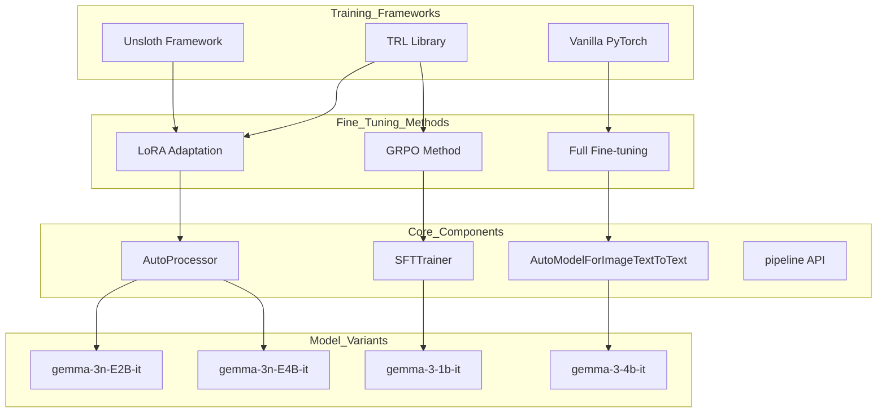
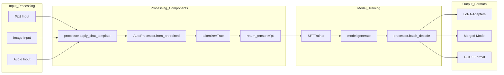

<!-- source: DeepWiki mcp.deepwiki.com · repo huggingface/huggingface-gemma-recipes · page 4 Fine-tuning Guide · fetched 2026-10-26 -->

# Fine-tuning Guide

<details>
<summary>Relevant source files</summary>

The following files were used as context for generating this wiki page:

- [.github/README.md](.github/README.md)

</details>


This document provides an overview of fine-tuning approaches and techniques available for adapting Gemma models to specific tasks. It covers the different model variants, training frameworks, and methodologies implemented in this repository.

For specific implementation details on vision tasks, see [Vision Tasks](#4.1). For audio processing fine-tuning, see [Audio Tasks](#4.2). For text and conversational AI fine-tuning, see [Text and Conversational AI](#4.3). For advanced techniques including GRPO, see [Advanced Techniques](#4.4). For production-ready scripts, see [Production Scripts](#4.5).

## Model Variants and Capabilities

The repository supports fine-tuning across multiple Gemma model variants, each optimized for different use cases and computational constraints.

### Gemma 3n (Multimodal Models)

| Model Size | Identifier | Primary Use Cases | Memory Requirements |
|------------|------------|-------------------|-------------------|
| 2B | `google/gemma-3n-E2B-it` | Audio transcription, basic vision | Low (T4 compatible) |
| 4B | `google/gemma-3n-E4B-it` | Advanced vision, GUI grounding | Medium (requires optimization) |

### Gemma 3 (Text Models)

| Model Size | Identifier | Primary Use Cases | Specialized Techniques |
|------------|------------|-------------------|----------------------|
| 1B | `google/gemma-3-1b-it` | Math reasoning, GRPO | Reinforcement Learning |
| 4B | `google/gemma-3-4b-it` | Conversational AI, complex text | Standard fine-tuning |

Sources: [.github/README.md:148-168]()

## Fine-tuning Frameworks and Approaches

### Framework Architecture



Sources: [.github/README.md:17-21](), [.github/README.md:57-82]()

### Parameter Efficient Fine-tuning (LoRA)

Most examples in this repository use LoRA (Low-Rank Adaptation) for memory-efficient fine-tuning. This approach modifies only a small subset of model parameters while maintaining performance.

**Key Characteristics:**
- Reduces memory requirements significantly
- Enables fine-tuning on consumer hardware (T4, RTX series)
- Produces lightweight adapter files
- Compatible with model merging and quantization

**Implementation Examples:**
- [notebooks/fine_tune_gemma3n_on_t4.ipynb:1-end]()
- [notebooks/Gemma3N_(4B)-Conversational.ipynb:1-end]()

### Full Fine-tuning

Production scripts implement full parameter fine-tuning for scenarios requiring maximum model adaptation.

**Key Characteristics:**
- Modifies all model parameters
- Requires significant computational resources
- Provides maximum flexibility for task adaptation
- Used in production environments

**Implementation Examples:**
- [scripts/ft_gemma3n_image_vt.py:1-end]()
- [scripts/ft_gemma3n_audio_vt.py:1-end]()

Sources: [.github/README.md:155-161]()

## Training Workflows and Data Processing

### Multimodal Training Pipeline



Sources: [.github/README.md:64-82]()

### Task-Specific Preprocessing

Different modalities require specialized preprocessing approaches:

| Modality | Preprocessing Components | Key Parameters |
|----------|-------------------------|----------------|
| Vision | `AutoProcessor`, `timm` | `add_generation_prompt=True` |
| Audio | `AutoProcessor`, sampling rate handling | `tokenize=True` |
| Text | Chat template formatting | `return_dict=True` |
| Multimodal | Combined processing pipeline | `return_tensors="pt"` |

**Common Processing Pattern:**
```python
inputs = processor.apply_chat_template(
    messages,
    add_generation_prompt=True,
    tokenize=True,
    return_dict=True,
    return_tensors="pt",
)
```

Sources: [.github/README.md:64-71]()

## Task Categories and Specializations

### Vision Tasks
- **LaTeX OCR**: Mathematical formula recognition
- **GUI Grounding**: User interface element detection
- **Image Analysis**: General visual understanding
- **Object Detection**: Specialized detection capabilities

### Audio Tasks
- **Speech Transcription**: Audio-to-text conversion
- **Multilingual Support**: French transcription examples
- **Multimodal Audio**: Combined audio-visual processing

### Text and Reasoning
- **Conversational AI**: Dialog system fine-tuning
- **Mathematical Reasoning**: GSM8K dataset training
- **Instruction Following**: General text task adaptation

### Advanced Techniques
- **GRPO**: Generalized Reward Policy Optimization for reinforcement learning
- **Response-Only Training**: Instruction masking for efficient learning
- **Layer-Specific Training**: Attention mechanism fine-tuning

Sources: [.github/README.md:152-167]()

## Hardware Requirements and Optimization

### Memory Optimization Strategies

| Approach | Memory Usage | Compatible Hardware | Trade-offs |
|----------|-------------|-------------------|------------|
| LoRA + Unsloth | Low | T4, RTX 3090 | Slight performance impact |
| Full Fine-tuning | High | A100, H100 | Maximum adaptation |
| Gradient Checkpointing | Medium | RTX 4090, V100 | Increased training time |

### Framework Selection Guidelines

**Choose TRL when:**
- Implementing reinforcement learning approaches
- Working with complex reward functions
- Requiring advanced training customization

**Choose Unsloth when:**
- Memory constraints are critical
- Training on consumer hardware
- Rapid prototyping needs

**Choose Vanilla PyTorch when:**
- Maximum control over training loop
- Custom architecture modifications
- Production deployment requirements

Sources: [.github/README.md:17-21](), [.github/README.md:169-173]()

## Getting Started

Before beginning fine-tuning, ensure dependencies are installed:

```bash
pip install -U -q -r requirements.txt
```

**Essential packages:**
- `transformers`: Core model handling
- `timm`: Vision encoder support
- `torch`: Deep learning framework
- `trl`: Reinforcement learning utilities (when applicable)

For quick experimentation, start with the T4-compatible notebooks:
- [notebooks/fine_tune_gemma3n_on_t4.ipynb:1-end]()
- [notebooks/Gemma3N_(4B)-Conversational.ipynb:1-end]()

For production workflows, examine the scripts:
- [scripts/ft_gemma3n_image_trl.py:1-end]()
- [scripts/ft_gemma3n_audio_vt.py:1-end]()

Sources: [.github/README.md:169-173]()

---

