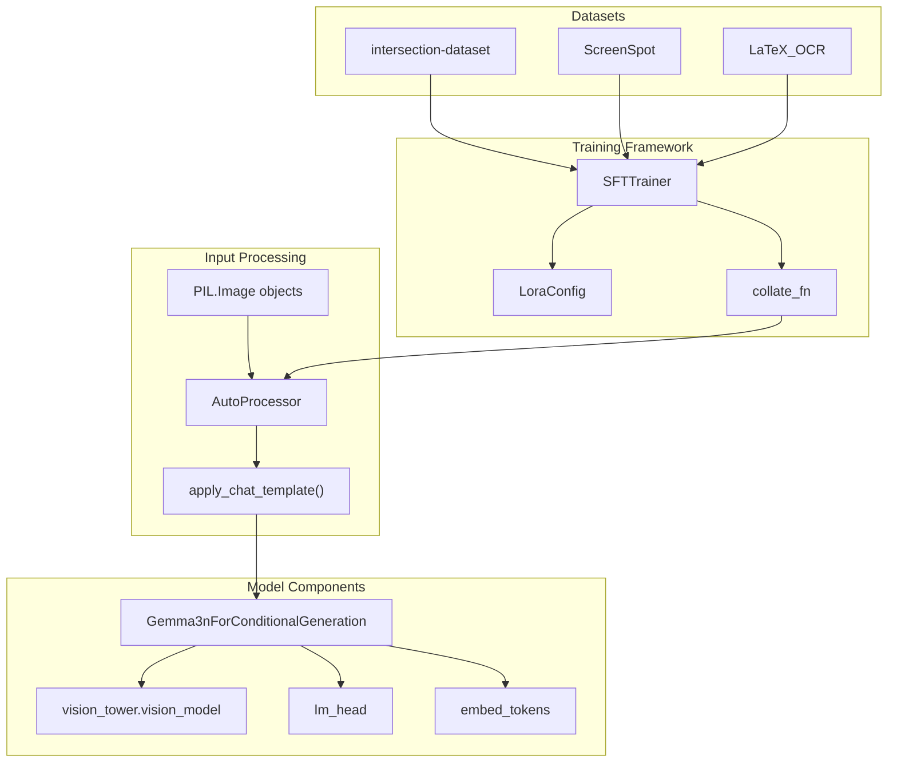
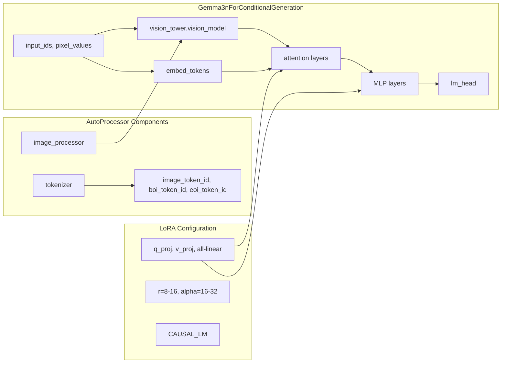
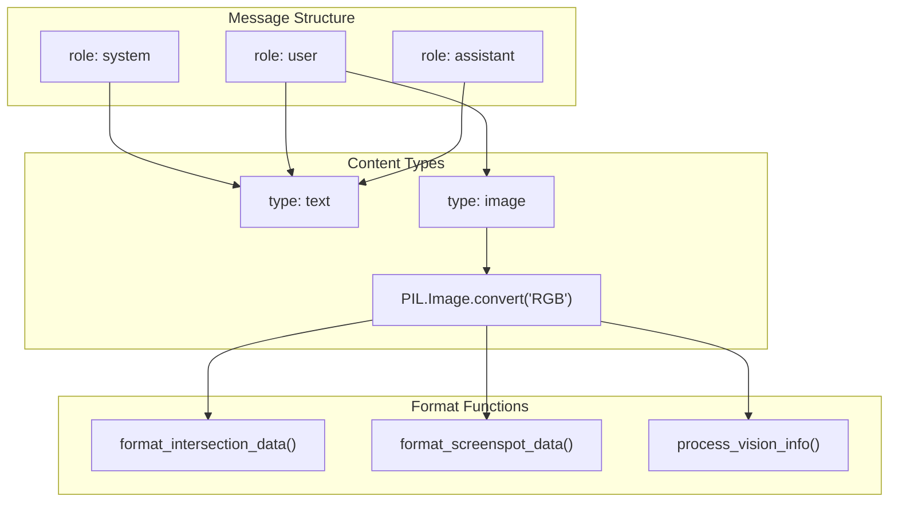
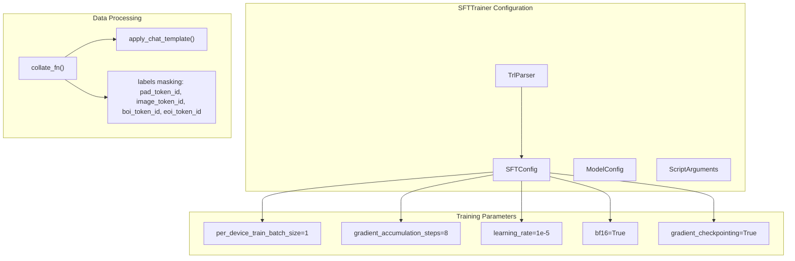
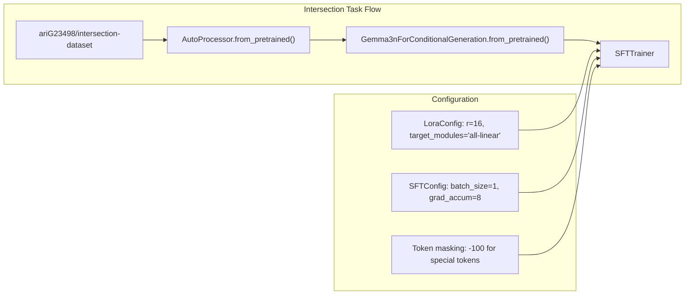

<!-- source: DeepWiki mcp.deepwiki.com · repo huggingface/huggingface-gemma-recipes · page 4.1 Vision Tasks · fetched 2026-10-26 -->

# Vision Tasks

<details>
<summary>Relevant source files</summary>

The following files were used as context for generating this wiki page:

- [notebooks/Gemma3_(4B)-Vision.ipynb](notebooks/Gemma3_(4B)-Vision.ipynb)
- [notebooks/Gemma_3n_GUI_Finetune.ipynb](notebooks/Gemma_3n_GUI_Finetune.ipynb)
- [notebooks/fine_tune_gemma3n_on_audio.ipynb](notebooks/fine_tune_gemma3n_on_audio.ipynb)
- [notebooks/fine_tune_gemma3n_on_t4.ipynb](notebooks/fine_tune_gemma3n_on_t4.ipynb)
- [scripts/ft_gemma3n_image_trl.py](scripts/ft_gemma3n_image_trl.py)
- [scripts/ft_gemma3n_image_vt.py](scripts/ft_gemma3n_image_vt.py)

</details>


This document covers fine-tuning Gemma models for computer vision tasks including geometric analysis, GUI element detection, and optical character recognition. The implementations demonstrate multimodal capabilities using vision-language models with parameter-efficient training techniques.

For audio-related multimodal tasks, see [Audio Tasks](#4.2). For general text generation and conversational AI fine-tuning, see [Text and Conversational AI](#4.3).

## Overview of Vision Tasks

The repository provides three main vision task implementations:

| Task | Model | Dataset | Purpose |
|------|-------|---------|---------|
| **Intersection Counting** | `google/gemma-3n-E2B-it` | `ariG23498/intersection-dataset` | Count geometric intersection points in images |
| **GUI Grounding** | `google/gemma-3n-E2B-it` | `rootsautomation/ScreenSpot` | Locate UI elements in screenshots |
| **LaTeX OCR** | `unsloth/gemma-3-4b-pt` | `unsloth/LaTeX_OCR` | Convert handwritten math to LaTeX |

### Vision Task Architecture



**Sources:** [notebooks/fine_tune_gemma3n_on_t4.ipynb:117-123](), [notebooks/Gemma_3n_GUI_Finetune.ipynb:252-261](), [scripts/ft_gemma3n_image_trl.py:247-258]()

## Model Architecture and Components

### Gemma3n Model Structure



**Sources:** [notebooks/fine_tune_gemma3n_on_t4.ipynb:225-236](), [scripts/ft_gemma3n_image_trl.py:87-97](), [notebooks/Gemma3_(4B)-Vision.ipynb:382-401]()

### Key Model Components

The vision tasks utilize several critical components:

- **`Gemma3nForConditionalGeneration`**: Main multimodal model class handling both vision and text inputs
- **`AutoProcessor`**: Handles tokenization and image preprocessing with `apply_chat_template()` for message formatting
- **`LoraConfig`**: Configures parameter-efficient fine-tuning with target modules like `q_proj`, `v_proj`, or `all-linear`
- **Special tokens**: `image_token_id`, `boi_token_id`, `eoi_token_id` for multimodal processing

## Dataset Processing

### Message Format Structure

All vision tasks use a consistent message format for multimodal conversations:



**Sources:** [notebooks/fine_tune_gemma3n_on_t4.ipynb:74-104](), [notebooks/Gemma_3n_GUI_Finetune.ipynb:132-185](), [scripts/ft_gemma3n_image_trl.py:103-133]()

### Dataset-Specific Processing

Each vision task implements specific data formatting functions:

#### Intersection Dataset Processing
- **Function**: `format_intersection_data()` [notebooks/fine_tune_gemma3n_on_t4.ipynb:74-104]()
- **Input**: Image with geometric shapes, integer label
- **System prompt**: "You are an assistant with great geometry skills."
- **Task**: "How many intersection points are there in the image?"

#### ScreenSpot Dataset Processing  
- **Function**: `format_screenspot_data()` [notebooks/Gemma_3n_GUI_Finetune.ipynb:132-185]()
- **Input**: GUI screenshot, instruction text, target/coordinates
- **System prompt**: "You are a helpful assistant that can identify and locate GUI elements in screenshots."
- **Task**: Locate specified UI elements

#### LaTeX OCR Processing
- **Dataset**: `unsloth/LaTeX_OCR` [notebooks/Gemma3_(4B)-Vision.ipynb:558-559]()
- **Input**: Handwritten math formula images
- **Output**: LaTeX markup strings
- **Features**: `image`, `text` columns with 68,686 training samples

## Training Approaches

### TRL-Based Training



**Sources:** [notebooks/fine_tune_gemma3n_on_t4.ipynb:247-264](), [scripts/ft_gemma3n_image_trl.py:219-223](), [notebooks/Gemma_3n_GUI_Finetune.ipynb:412-437]()

### Unsloth Fast Training

For LaTeX OCR, the implementation uses Unsloth for accelerated training:

- **Model**: `FastVisionModel.from_pretrained()` [notebooks/Gemma3_(4B)-Vision.ipynb:344-348]()
- **PEFT**: `FastVisionModel.get_peft_model()` with configurable layer targeting [notebooks/Gemma3_(4B)-Vision.ipynb:382-401]()
- **Options**: Separate control for vision layers, language layers, attention modules, and MLP modules

### Vanilla PyTorch Training

The repository also provides a custom training loop implementation:

- **Script**: [scripts/ft_gemma3n_image_vt.py]()
- **Layer freezing**: `freeze_layers()` function targeting attention layers [scripts/ft_gemma3n_image_vt.py:67-73]()
- **Custom optimization**: `torch.optim.AdamW` with gradient accumulation [scripts/ft_gemma3n_image_vt.py:158-182]()

## Implementation Examples

### Intersection Counting Setup



**Sources:** [notebooks/fine_tune_gemma3n_on_t4.ipynb:63-64](), [notebooks/fine_tune_gemma3n_on_t4.ipynb:117-123](), [notebooks/fine_tune_gemma3n_on_t4.ipynb:225-236]()

### GUI Grounding Implementation

The ScreenSpot fine-tuning follows a similar pattern but includes additional field handling:

- **Dataset loading**: `load_dataset("rootsautomation/ScreenSpot")` [notebooks/Gemma_3n_GUI_Finetune.ipynb:304]()
- **Field mapping**: Handles `instruction`, `text`, `query` fields and `target`, `answer`, `location`, `coordinates` [notebooks/Gemma_3n_GUI_Finetune.ipynb:139-160]()
- **Training configuration**: 3 epochs, cosine learning rate scheduling [notebooks/Gemma_3n_GUI_Finetune.ipynb:416-419]()

### Data Collation Function

The core data processing function handles multimodal batching:

```python
def collate_fn(examples):
    texts = []
    images_list = []
    
    for example in examples:
        text = processor.apply_chat_template(
            example["messages"], tokenize=False, add_generation_prompt=False
        ).strip()
        texts.append(text)
        
        images = process_vision_info(example["messages"])
        images_list.append(images)
    
    batch = processor(text=texts, images=images_list, return_tensors="pt", padding=True)
    labels = batch["input_ids"].clone()
    
    # Token masking for loss computation
    labels[labels == processor.tokenizer.pad_token_id] = -100
    # Additional special token masking...
    
    batch["labels"] = labels
    return batch
```

**Sources:** [notebooks/fine_tune_gemma3n_on_t4.ipynb:166-206](), [scripts/ft_gemma3n_image_trl.py:260-308]()

## Production Scripts

### TRL Training Script

The production script [scripts/ft_gemma3n_image_trl.py]() provides:

- **Multi-dataset support**: Handles intersection, ScreenSpot, and MMIU datasets
- **Flexible model selection**: Supports both `Gemma3nForConditionalGeneration` and `AutoModelForImageTextToText`
- **Configurable PEFT**: Custom `my_get_peft_config()` function for comma-separated target modules
- **Hub integration**: Automatic model and processor pushing to Hugging Face Hub

### Vanilla Training Script

The custom training script [scripts/ft_gemma3n_image_vt.py]() offers:

- **Selective layer freezing**: `freeze_layers()` function for attention-only training
- **Manual optimization**: Custom gradient accumulation and validation loops
- **Inference visualization**: `run_inference()` function with matplotlib plotting
- **Memory efficiency**: Gradient checkpointing and mixed precision training

**Sources:** [scripts/ft_gemma3n_image_trl.py:218-352](), [scripts/ft_gemma3n_image_vt.py:122-186]()

---

