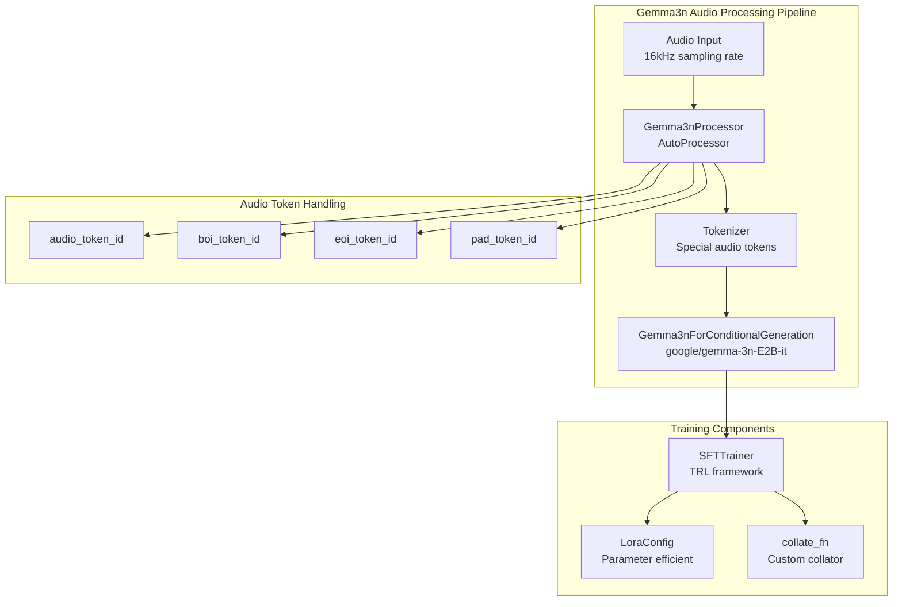
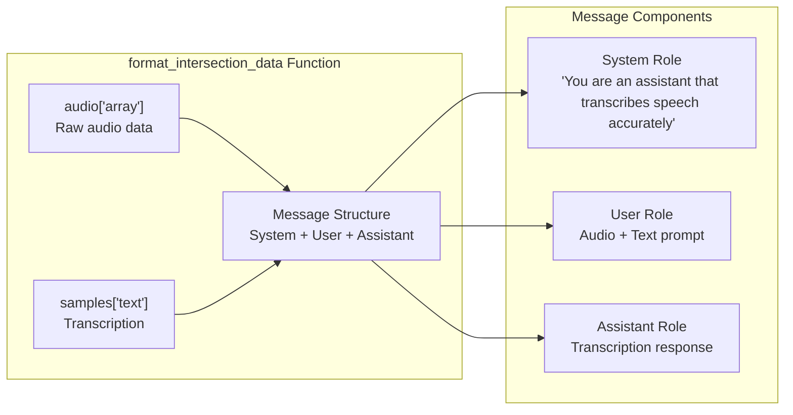
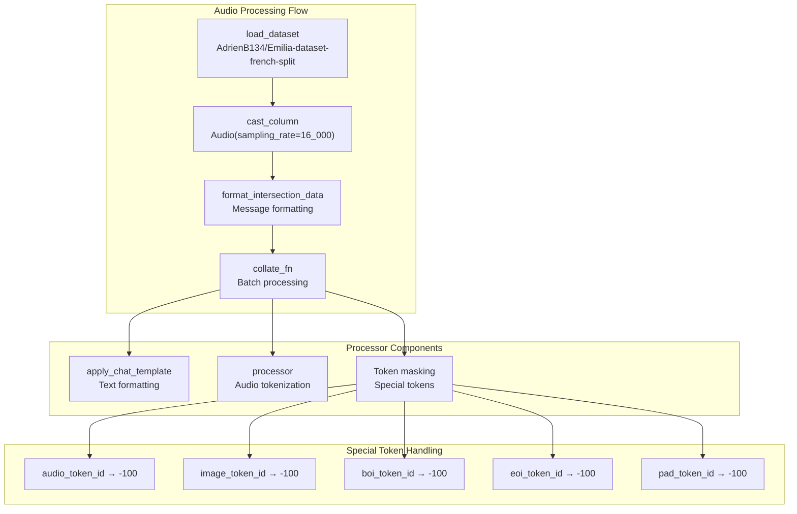
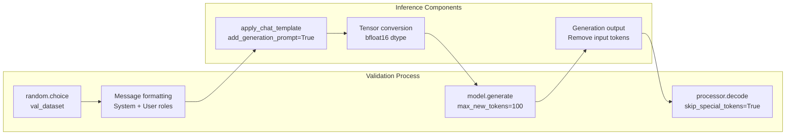

<!-- source: DeepWiki mcp.deepwiki.com · repo huggingface/huggingface-gemma-recipes · page 4.2 Audio Tasks · fetched 2026-10-26 -->

# Audio Tasks

<details>
<summary>Relevant source files</summary>

The following files were used as context for generating this wiki page:

- [notebooks/fine_tune_gemma3n_on_audio.ipynb](notebooks/fine_tune_gemma3n_on_audio.ipynb)
- [notebooks/fine_tune_gemma3n_on_t4.ipynb](notebooks/fine_tune_gemma3n_on_t4.ipynb)
- [scripts/ft_gemma3n_audio_vt.py](scripts/ft_gemma3n_audio_vt.py)

</details>


This document covers fine-tuning Gemma models for audio processing tasks, specifically speech transcription and audio understanding. The focus is on the multimodal Gemma3n model family which supports audio inputs alongside text and images.

For vision-related multimodal tasks, see [Vision Tasks](#4.1). For text-only conversational AI, see [Text and Conversational AI](#4.3).

## Audio Processing Overview

The Gemma3n model family provides native audio processing capabilities through multimodal input handling. The primary audio task demonstrated in this repository is French speech transcription, though the framework supports broader audio understanding tasks.

### Model Architecture



Sources: [notebooks/fine_tune_gemma3n_on_audio.ipynb:135-142](), [scripts/ft_gemma3n_audio_vt.py:114-116]()

## Dataset Preparation

Audio fine-tuning uses the Emilia French dataset, which contains French speech audio paired with transcriptions. The dataset is preprocessed to match the expected multimodal message format.

### Dataset Structure

| Field | Type | Description |
|-------|------|-------------|
| `audio` | Audio array | Raw audio data at 16kHz sampling rate |
| `text` | String | Ground truth transcription |
| `messages` | List[Dict] | Formatted conversation structure |

### Data Formatting

The audio data is formatted into a conversational structure compatible with the chat template:



Sources: [notebooks/fine_tune_gemma3n_on_audio.ipynb:83-114](), [scripts/ft_gemma3n_audio_vt.py:17-42]()

## Fine-tuning Approaches

### Notebook-based Training

The notebook approach ([notebooks/fine_tune_gemma3n_on_audio.ipynb]()) uses the TRL framework with SFTTrainer for supervised fine-tuning:

**Key Configuration:**
- **Model**: `google/gemma-3n-E2B-it`
- **Dataset**: `AdrienB134/Emilia-dataset-french-split` (1000 samples)
- **Training Framework**: TRL SFTTrainer
- **Parameter Efficiency**: LoRA with rank 8

**LoRA Configuration:**
```
r=8, target_modules=["q_proj", "v_proj"], lora_alpha=16, lora_dropout=0.00
```

Sources: [notebooks/fine_tune_gemma3n_on_audio.ipynb:207-217]()

### Production Script Training

The production script ([scripts/ft_gemma3n_audio_vt.py]()) implements custom training loops with layer freezing:

**Key Features:**
- **Layer Freezing**: Only attention layers are trained ([scripts/ft_gemma3n_audio_vt.py:65-71]())
- **Custom DataLoader**: Manual batch processing with gradient accumulation
- **Validation**: Periodic inference checks during training
- **Dataset Size**: 10,000 training samples, 100 validation samples

### Training Configuration Comparison

| Aspect | Notebook Approach | Production Script |
|--------|-------------------|-------------------|
| Framework | TRL SFTTrainer | Custom PyTorch |
| Parameter Efficiency | LoRA (q_proj, v_proj) | Layer freezing (attention only) |
| Batch Size | 1 (8 accumulation steps) | 1 (8 accumulation steps) |
| Learning Rate | 1e-5 | 1e-5 |
| Gradient Checkpointing | Yes | No |
| Validation | Optional | Every 100 steps |

Sources: [notebooks/fine_tune_gemma3n_on_audio.ipynb:228-245](), [scripts/ft_gemma3n_audio_vt.py:157-181]()

## Data Processing Pipeline

### Audio Preprocessing

Audio data is processed through several stages before model input:



Sources: [notebooks/fine_tune_gemma3n_on_audio.ipynb:70-72](), [notebooks/fine_tune_gemma3n_on_audio.ipynb:152-187](), [scripts/ft_gemma3n_audio_vt.py:51-61]()

### Collation Function

The `collate_fn` handles batch processing of audio and text data:

**Notebook Implementation:**
- Processes multiple examples simultaneously
- Applies chat templates to format conversations
- Extracts audio arrays from dataset format
- Handles special token masking for loss computation

**Production Script Implementation:**
- Uses partial function application for processor binding
- Processes audio arrays directly from dataset
- Implements comprehensive token masking
- Supports custom message formatting

Sources: [notebooks/fine_tune_gemma3n_on_audio.ipynb:152-187](), [scripts/ft_gemma3n_audio_vt.py:17-62]()

## Model Training Configuration

### Training Arguments

Both approaches share common training parameters:

| Parameter | Value | Purpose |
|-----------|-------|---------|
| `per_device_train_batch_size` | 1 | Memory optimization |
| `gradient_accumulation_steps` | 8 | Effective batch size of 8 |
| `learning_rate` | 1e-5 | Conservative learning rate |
| `bf16` | True | Mixed precision training |
| `num_train_epochs` | 1.0 | Single epoch training |

### Loss Computation

The training process masks specific tokens to focus learning on transcription outputs:

- **Padding tokens** (`pad_token_id`) are masked to -100
- **Audio tokens** (`audio_token_id`) are masked to exclude from loss
- **Image tokens** (`image_token_id`) are masked for audio-only training
- **Special boundary tokens** (`boi_token_id`, `eoi_token_id`) are masked

This ensures the model learns to generate transcriptions while ignoring input audio representations.

Sources: [notebooks/fine_tune_gemma3n_on_audio.ipynb:171-187](), [scripts/ft_gemma3n_audio_vt.py:51-61]()

## Inference and Evaluation

### Inference Pipeline

The trained model performs inference by:

1. **Input Formatting**: Audio and prompt are formatted using chat templates
2. **Token Generation**: Model generates tokens with `max_new_tokens=100`
3. **Decoding**: Generated tokens are decoded to text transcription
4. **Evaluation**: Comparison with ground truth transcriptions

### Validation During Training

The production script includes validation checks every 100 training steps:



Sources: [scripts/ft_gemma3n_audio_vt.py:74-112](), [scripts/ft_gemma3n_audio_vt.py:149-175]()

## Memory and Performance Optimization

### Parameter Efficient Training

**LoRA Configuration (Notebook):**
- Rank: 8
- Target modules: `q_proj`, `v_proj` (query and value projections)
- Alpha: 16
- Dropout: 0.0

**Layer Freezing (Production Script):**
- Only attention layers (`attn` in parameter names) are trainable
- All other parameters are frozen to reduce memory usage
- Enables training on larger datasets with limited GPU memory

### Batch Processing

Both approaches use:
- Batch size of 1 to fit audio data in memory
- Gradient accumulation over 8 steps for effective batch size of 8
- Mixed precision (bfloat16) for memory efficiency

Sources: [notebooks/fine_tune_gemma3n_on_audio.ipynb:207-217](), [scripts/ft_gemma3n_audio_vt.py:65-71]()

---

