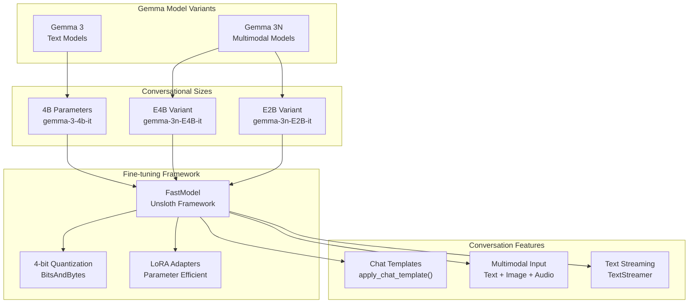
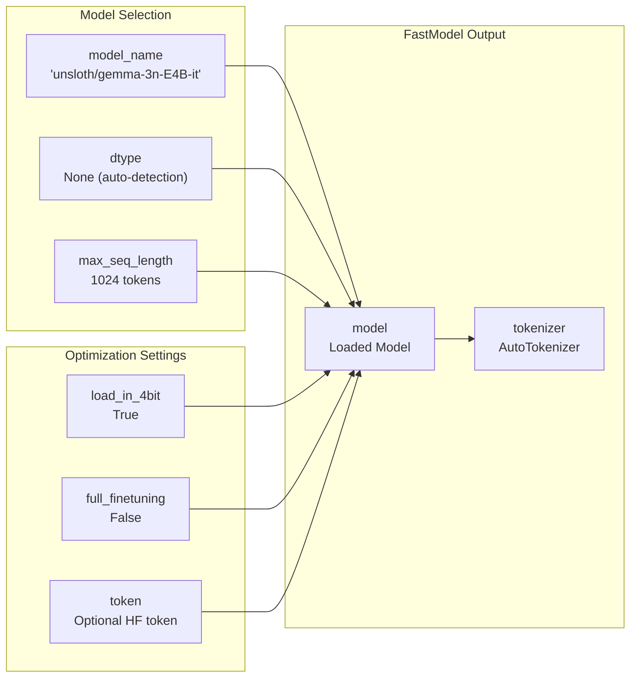
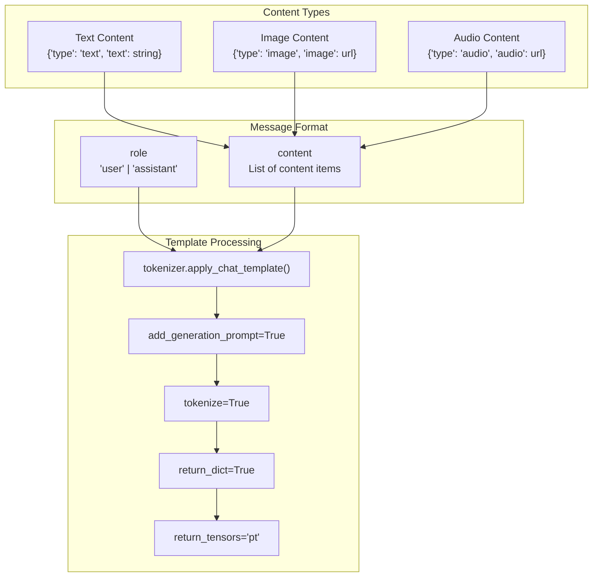
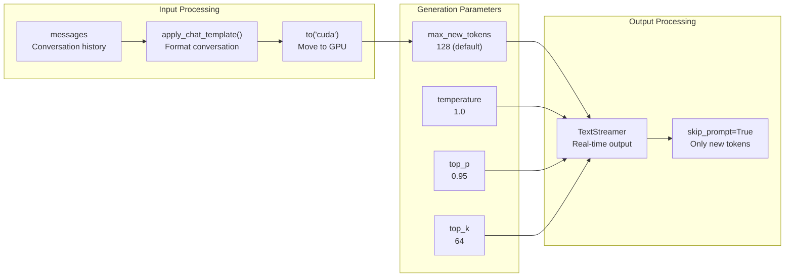
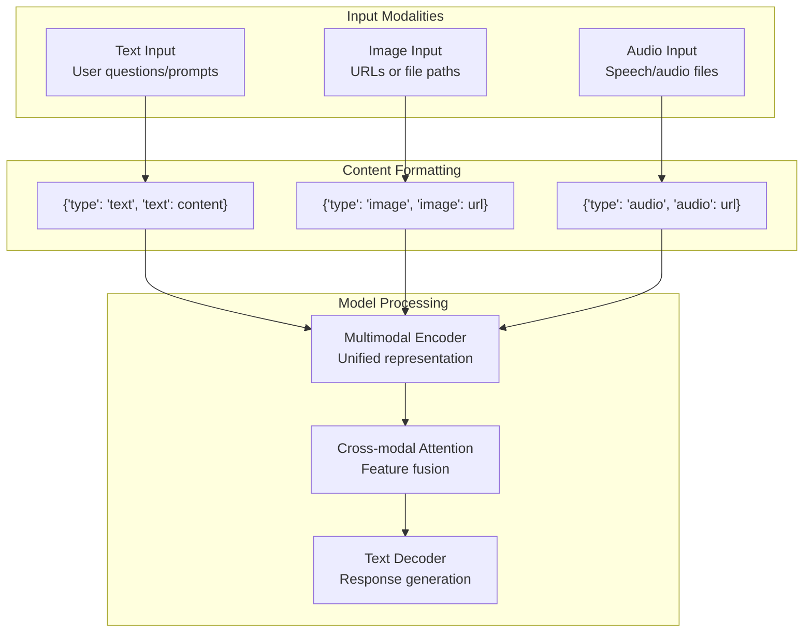
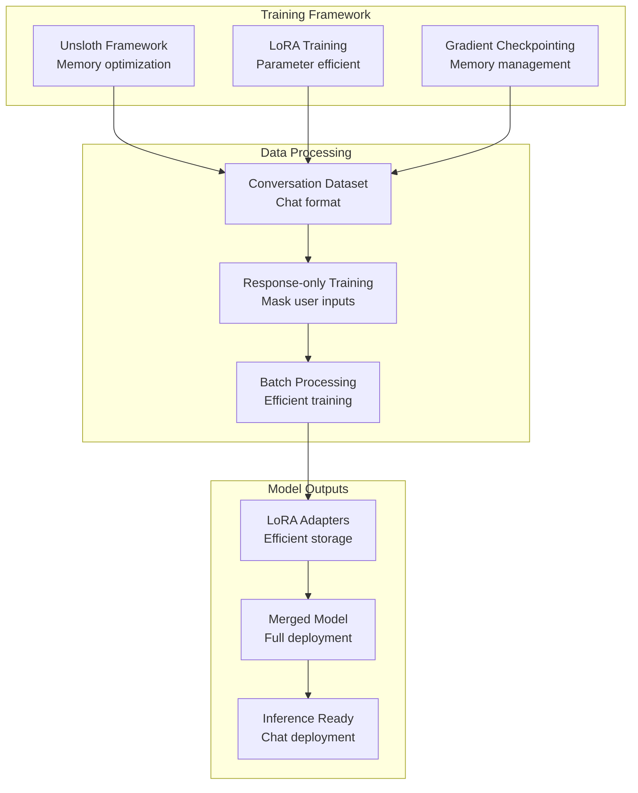

<!-- source: DeepWiki mcp.deepwiki.com · repo huggingface/huggingface-gemma-recipes · page 4.3 Text and Conversational AI · fetched 2026-10-26 -->

# Text and Conversational AI

<details>
<summary>Relevant source files</summary>

The following files were used as context for generating this wiki page:

- [notebooks/Gemma3N_(4B)-Conversational.ipynb](notebooks/Gemma3N_(4B)-Conversational.ipynb)
- [notebooks/Gemma3_(4B).ipynb](notebooks/Gemma3_(4B).ipynb)

</details>


This document covers fine-tuning Gemma models for text generation and conversational AI applications. It focuses on setting up conversational agents, formatting chat interactions, and leveraging Gemma's multimodal capabilities for text-based dialogue systems.

For vision-specific fine-tuning tasks, see [Vision Tasks](#4.1). For audio processing tasks, see [Audio Tasks](#4.2). For advanced techniques like GRPO, see [Advanced Techniques](#4.4).

## Model Architecture and Variants

The Gemma family provides several model variants optimized for conversational tasks. The primary models used for text and conversational AI include both text-only and multimodal variants.



Sources: [notebooks/Gemma3N_(4B)-Conversational.ipynb:455-477]()

## Setup and Configuration

The conversational AI setup uses the Unsloth framework for efficient model loading and fine-tuning. The `FastModel` class provides the primary interface for loading pre-trained models with optimizations.

### Model Loading Configuration



The key configuration parameters include:
- **Model Selection**: Choice between text-only (`gemma-3-4b-it`) and multimodal (`gemma-3n-E4B-it`) variants
- **Quantization**: 4-bit quantization for memory efficiency
- **Sequence Length**: Configurable context window (default 1024 tokens)
- **Fine-tuning Mode**: Parameter-efficient training vs full fine-tuning

Sources: [notebooks/Gemma3N_(4B)-Conversational.ipynb:470-477]()

## Conversation Formatting

Gemma models use a structured chat template system for formatting conversational interactions. The `apply_chat_template()` method handles proper conversation formatting.

### Chat Template Structure



Example message structure for multimodal conversation:
```python
messages = [{
    "role": "user",
    "content": [
        {"type": "image", "image": image_url},
        {"type": "text", "text": "What do you see in this image?"}
    ]
}]
```

Sources: [notebooks/Gemma3N_(4B)-Conversational.ipynb:498-509](), [notebooks/Gemma3N_(4B)-Conversational.ipynb:532-540]()

## Inference Capabilities

The inference system provides real-time text generation with streaming support and configurable generation parameters.

### Generation Pipeline



The `do_gemma_3n_inference()` helper function encapsulates the complete inference pipeline with optimized generation settings for conversational responses.

Sources: [notebooks/Gemma3N_(4B)-Conversational.ipynb:494-509]()

## Multimodal Integration

Gemma 3N models support integrated processing of text, images, and audio within conversational contexts. This enables rich multimodal dialogue experiences.

### Multimodal Content Processing



Example multimodal interactions:
- **Image Analysis**: Processing images with accompanying text questions
- **Audio Understanding**: Transcribing and responding to audio content
- **Mixed Media**: Combining multiple modalities in single conversations

Sources: [notebooks/Gemma3N_(4B)-Conversational.ipynb:530-569](), [notebooks/Gemma3N_(4B)-Conversational.ipynb:634-646]()

## Training Process Overview

While the notebook focuses on inference, it establishes the foundation for conversational fine-tuning using parameter-efficient methods.

### Fine-tuning Architecture



The training process leverages:
- **Parameter Efficiency**: LoRA adapters for memory-efficient fine-tuning
- **Response-only Training**: Masking user inputs to focus training on assistant responses
- **Multimodal Support**: Training on mixed text, image, and audio conversations

Sources: [notebooks/Gemma3N_(4B)-Conversational.ipynb:63-77](), [notebooks/Gemma3N_(4B)-Conversational.ipynb:470-477]()

## Key Configuration Parameters

| Parameter | Default | Description |
|-----------|---------|-------------|
| `model_name` | `"unsloth/gemma-3n-E4B-it"` | Pre-trained model identifier |
| `max_seq_length` | `1024` | Maximum context window |
| `load_in_4bit` | `True` | Enable 4-bit quantization |
| `temperature` | `1.0` | Generation randomness |
| `top_p` | `0.95` | Nucleus sampling threshold |
| `top_k` | `64` | Top-k sampling limit |
| `max_new_tokens` | `128` | Maximum response length |

This configuration provides a balanced approach between model performance, memory efficiency, and generation quality for conversational applications.

Sources: [notebooks/Gemma3N_(4B)-Conversational.ipynb:470-509]()

---

