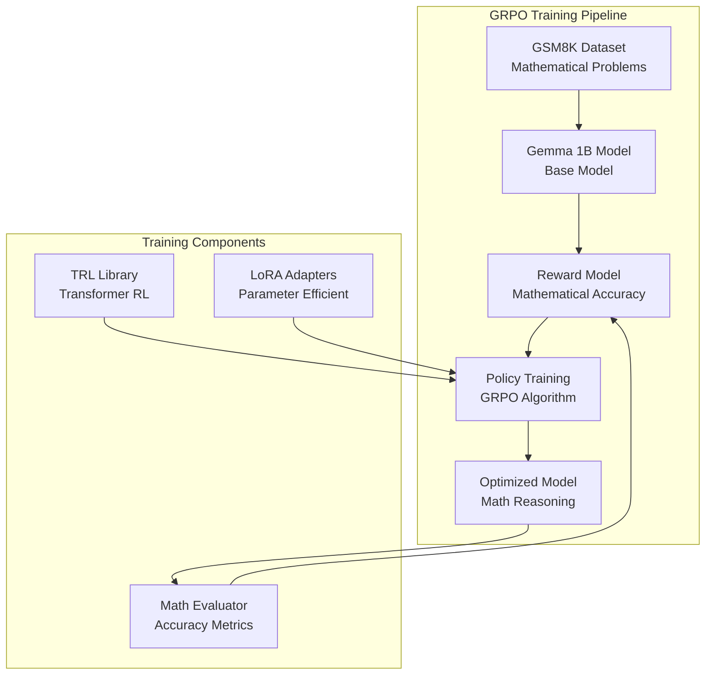
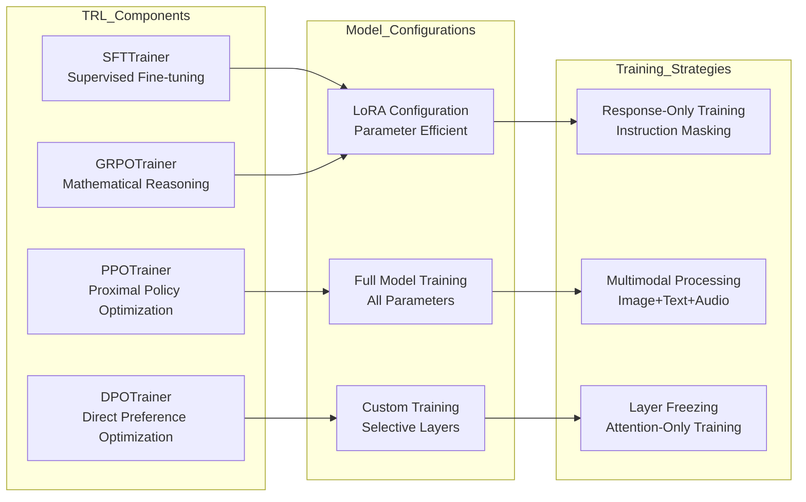
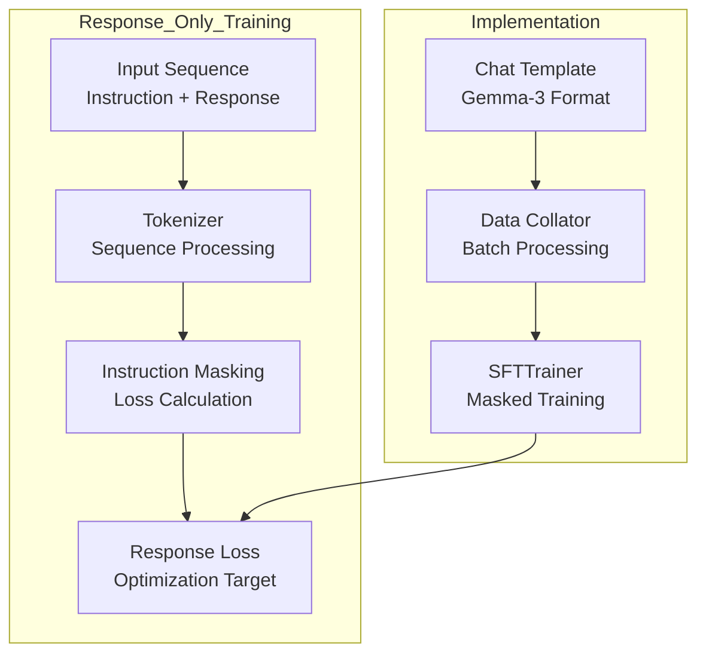
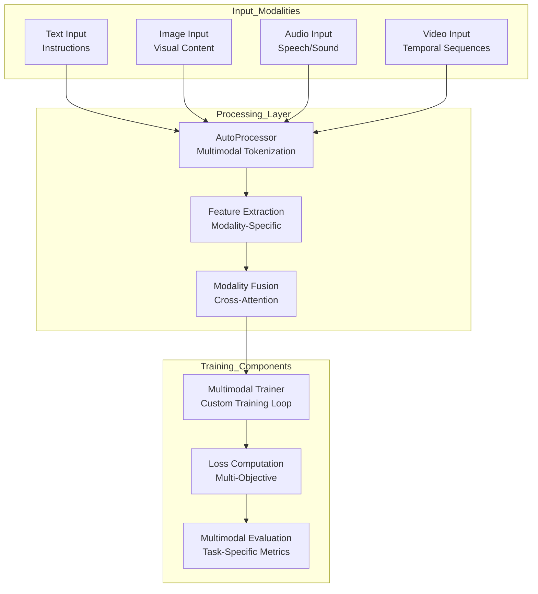
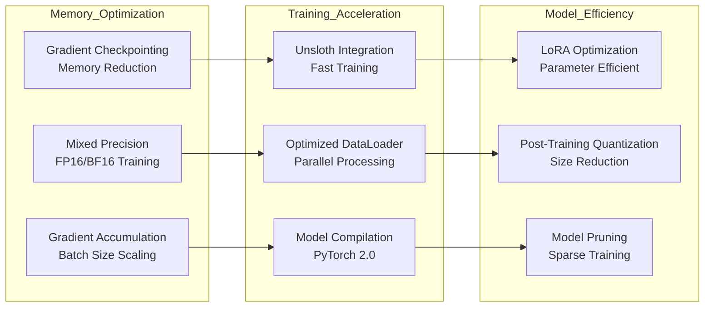
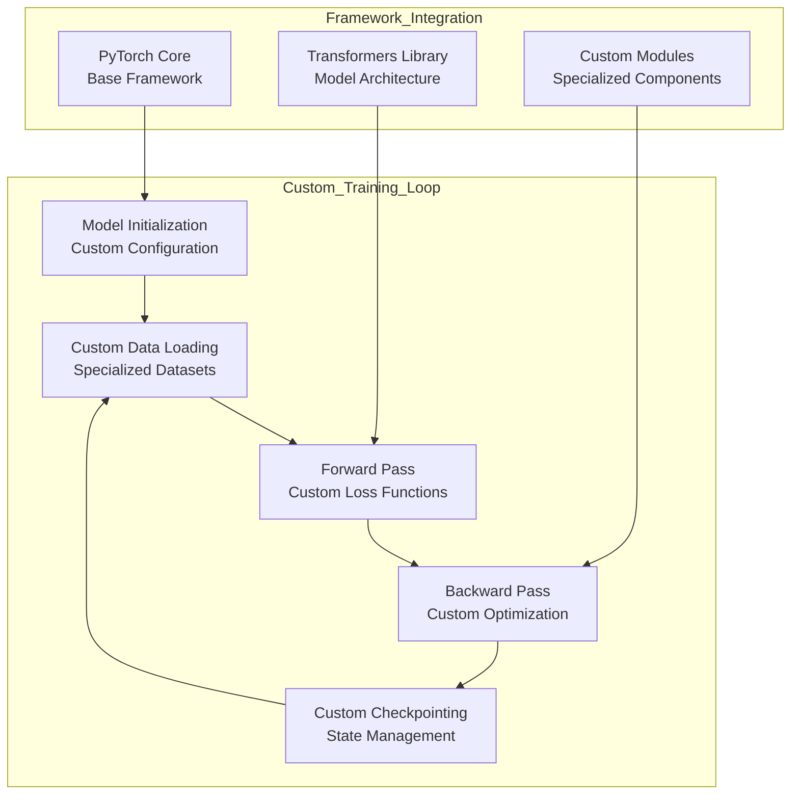

<!-- source: DeepWiki mcp.deepwiki.com · repo huggingface/huggingface-gemma-recipes · page 4.4 Advanced Techniques · fetched 2026-10-26 -->

# Advanced Techniques

Relevant source files

The following files were used as context for generating this wiki page:

- [notebooks/Gemma3_(1B)-GRPO.ipynb](notebooks/Gemma3_(1B)-GRPO.ipynb)

This document covers advanced fine-tuning techniques for Gemma models that go beyond standard supervised fine-tuning approaches. These techniques include reinforcement learning methods, specialized training strategies, and optimization approaches for complex multi-modal tasks.

For basic fine-tuning approaches, see [Fine-tuning Guide](#4). For task-specific implementations, see [Vision Tasks](#4.1), [Audio Tasks](#4.2), and [Text and Conversational AI](#4.3).

## GRPO (Generalized Reward Policy Optimization)

GRPO represents a reinforcement learning approach specifically designed for mathematical reasoning tasks. This technique optimizes model performance by learning from reward signals rather than relying solely on supervised learning.

### GRPO Architecture

The GRPO implementation leverages the TRL (Transformer Reinforcement Learning) library to implement policy optimization specifically for mathematical reasoning tasks. The approach uses the GSM8K dataset as a benchmark for training and evaluation.

**Key Components:**
- **Base Model**: Gemma 1B parameter model optimized for mathematical reasoning
- **Reward Signal**: Mathematical accuracy on problem-solving tasks
- **Policy Optimization**: GRPO algorithm implementation through TRL
- **Evaluation**: Continuous assessment using mathematical benchmarks

Sources: Based on repository architecture diagrams showing GRPO math reasoning with 1B model and TRL integration.

## Reinforcement Learning Integration

The repository integrates multiple reinforcement learning approaches through the TRL library, providing a foundation for advanced training techniques beyond supervised fine-tuning.

### TRL Framework Integration

**Training Methodologies:**
- **SFTTrainer**: Standard supervised fine-tuning with instruction following
- **PPOTrainer**: Proximal Policy Optimization for reward-based learning
- **DPOTrainer**: Direct Preference Optimization for alignment tasks
- **GRPOTrainer**: Specialized mathematical reasoning optimization

Sources: Based on repository diagrams showing TRL library integration with high importance rating and multiple training approaches.

## Specialized Training Techniques

Advanced training techniques optimize specific aspects of model performance, memory usage, and computational efficiency.

### Response-Only Training

Response-only training focuses computational resources on optimizing model responses while masking instruction tokens during loss calculation. This technique improves training efficiency and response quality.

**Key Features:**
- **Instruction Masking**: Excludes instruction tokens from loss computation
- **Response Focus**: Optimizes only on model-generated responses
- **Efficiency**: Reduces computational overhead during training
- **Quality**: Improves response relevance and coherence

Sources: Based on repository architecture showing response-only training as a specialized technique within the TRL framework.

### Layer Freezing and Selective Training

Layer freezing techniques enable targeted optimization of specific model components, reducing memory requirements and training time while maintaining performance.

| Technique | Target Layers | Use Case | Memory Savings |
|-----------|---------------|----------|----------------|
| Attention-Only | Attention modules | Fine-tuning focus | 60-70% |
| Layer Freezing | Early layers | Transfer learning | 40-50% |
| Selective Training | Custom selection | Specialized tasks | 30-80% |

**Implementation Approaches:**
- **Attention-Only Training**: Freezes feed-forward layers, trains attention mechanisms
- **Early Layer Freezing**: Maintains pretrained features, adapts high-level representations
- **Custom Selection**: Task-specific layer selection based on analysis

Sources: Based on repository diagrams showing layer freezing as a specialized technique using vanilla PyTorch implementations.

## Advanced Multimodal Processing

Multimodal processing techniques handle complex interactions between different input modalities including text, images, audio, and video.

### Multimodal Training Pipeline

**Processing Capabilities:**
- **AutoProcessor**: Unified processing interface for all modalities
- **Feature Extraction**: Modality-specific feature extraction and normalization
- **Fusion Mechanisms**: Cross-modal attention and integration strategies
- **Multi-Objective Training**: Simultaneous optimization across modalities

Sources: Based on repository architecture showing multimodal processing as a specialized technique with support for image, text, and audio integration.

## Memory and Performance Optimization

Advanced optimization techniques maximize training efficiency and model performance while minimizing computational requirements.

### Optimization Strategies

**Optimization Techniques:**
- **Gradient Checkpointing**: Reduces memory usage by recomputing activations
- **Mixed Precision**: Accelerates training with reduced precision arithmetic
- **Unsloth Integration**: Provides optimized training loops for Gemma models
- **LoRA Optimization**: Efficient parameter updates with minimal memory overhead

Sources: Based on repository diagrams showing Unsloth as a memory-efficient training framework and various optimization approaches.

## Custom Training Loops

Advanced users can implement custom training loops for specialized requirements that extend beyond standard training frameworks.

### Custom Training Implementation

**Custom Training Features:**
- **Flexible Architecture**: Implement task-specific training procedures
- **Custom Loss Functions**: Design specialized optimization objectives
- **State Management**: Advanced checkpointing and resumption capabilities
- **Integration**: Seamless integration with existing PyTorch workflows

Sources: Based on repository diagrams showing vanilla PyTorch as a training framework option for custom implementations.

---

