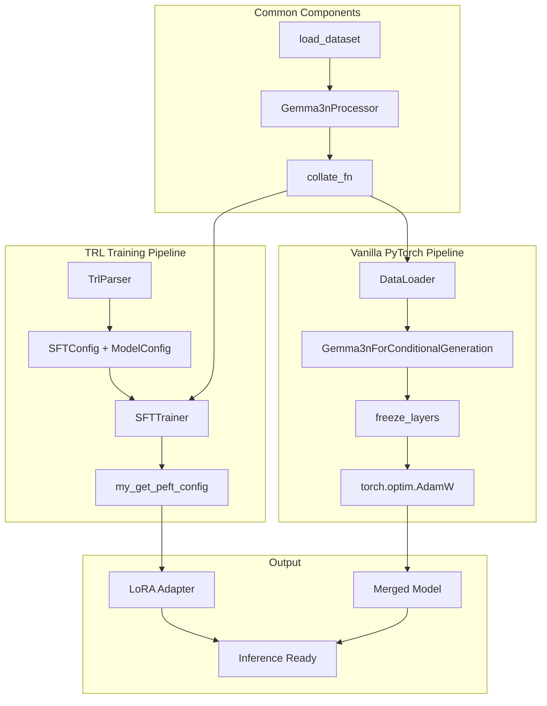
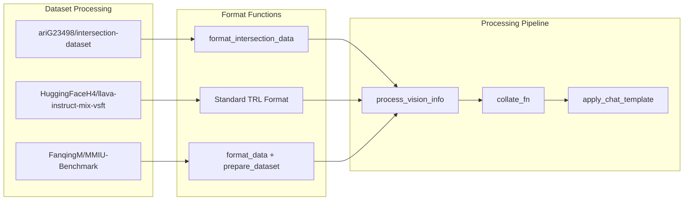
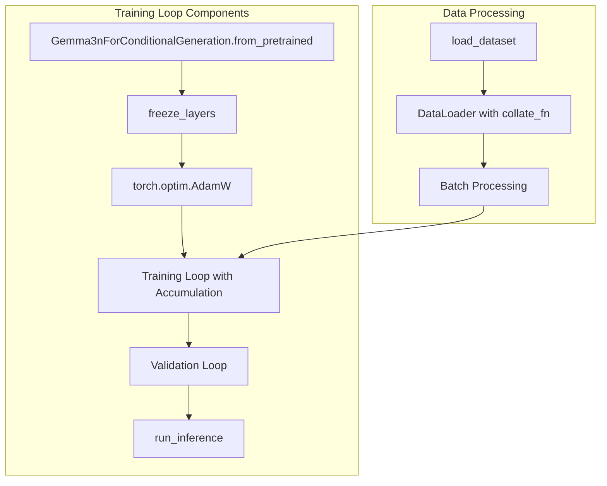
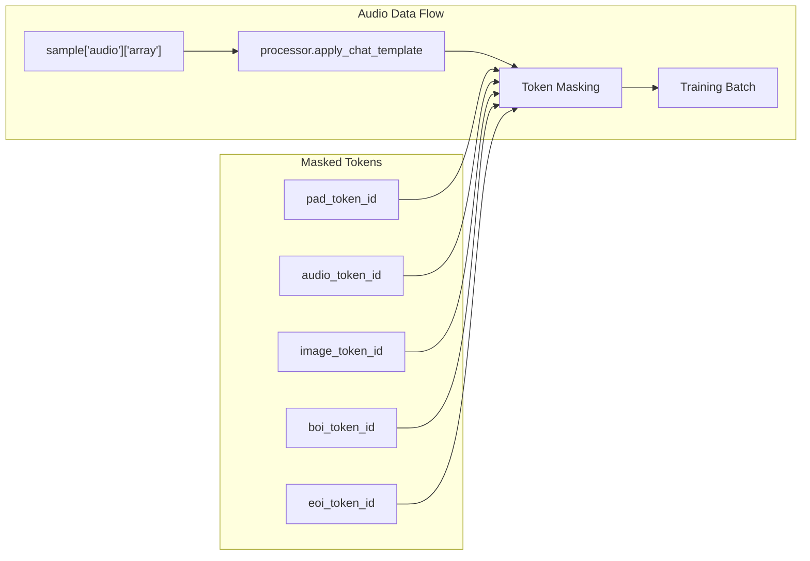

<!-- source: DeepWiki mcp.deepwiki.com · repo huggingface/huggingface-gemma-recipes · page 4.5 Production Scripts · fetched 2026-10-26 -->

# Production Scripts

<details>
<summary>Relevant source files</summary>

The following files were used as context for generating this wiki page:

- [scripts/ft_gemma3n_audio_vt.py](scripts/ft_gemma3n_audio_vt.py)
- [scripts/ft_gemma3n_image_trl.py](scripts/ft_gemma3n_image_trl.py)
- [scripts/ft_gemma3n_image_vt.py](scripts/ft_gemma3n_image_vt.py)

</details>


The production scripts provide automated fine-tuning workflows for Gemma models across different modalities and training approaches. These scripts are designed for batch processing and automated deployment scenarios, complementing the interactive notebook examples covered in other sections.

For interactive fine-tuning examples and tutorials, see [Fine-tuning Guide](#4). For general inference usage, see [Inference and Usage](#3).

## Script Overview

The repository contains three main production scripts, each targeting different modalities and training approaches:

| Script | Modality | Training Framework | Key Features |
|--------|----------|-------------------|--------------|
| `ft_gemma3n_image_trl.py` | Vision | TRL Library | Multi-dataset support, LoRA, Distributed training |
| `ft_gemma3n_image_vt.py` | Vision | Vanilla PyTorch | Custom training loop, Attention freezing, Visualization |
| `ft_gemma3n_audio_vt.py` | Audio | Vanilla PyTorch | Audio transcription, Custom collation, Validation loop |

Sources: [scripts/ft_gemma3n_image_trl.py:1-353](), [scripts/ft_gemma3n_image_vt.py:1-187](), [scripts/ft_gemma3n_audio_vt.py:1-185]()

## Training Pipeline Architecture



Sources: [scripts/ft_gemma3n_image_trl.py:219-342](), [scripts/ft_gemma3n_image_vt.py:122-186](), [scripts/ft_gemma3n_audio_vt.py:114-184]()

## TRL-based Training Script

The `ft_gemma3n_image_trl.py` script provides a production-ready training pipeline using the TRL library with distributed training support.

### Key Components

The script uses several core classes for configuration and training:

- `TrlParser` - Handles command-line argument parsing [scripts/ft_gemma3n_image_trl.py:219]()
- `SFTTrainer` - Manages the supervised fine-tuning process [scripts/ft_gemma3n_image_trl.py:329-342]()
- `my_get_peft_config` - Configures LoRA parameters [scripts/ft_gemma3n_image_trl.py:67-99]()

### Multi-Dataset Support

The script supports three different vision datasets with specialized processing:



Sources: [scripts/ft_gemma3n_image_trl.py:102-134](), [scripts/ft_gemma3n_image_trl.py:162-195](), [scripts/ft_gemma3n_image_trl.py:197-216]()

### Usage Commands

The script includes embedded usage examples for different datasets:

```bash
# Intersection dataset training
accelerate launch --config_file examples/accelerate_configs/deepspeed_zero3.yaml \
    scripts/ft_gemma3n_image_trl.py \
    --dataset_name ariG23498/intersection-dataset \
    --model_name_or_path google/gemma-3n-E2B-it \
    --use_peft --lora_target_modules all-linear
```

Sources: [scripts/ft_gemma3n_image_trl.py:1-51]()

## Vanilla PyTorch Training Scripts

The vanilla PyTorch scripts provide custom training loops with more granular control over the training process.

### Common Training Loop Pattern

Both `ft_gemma3n_image_vt.py` and `ft_gemma3n_audio_vt.py` follow a similar pattern:



Sources: [scripts/ft_gemma3n_image_vt.py:122-186](), [scripts/ft_gemma3n_audio_vt.py:114-184]()

### Layer Freezing Strategy

The `freeze_layers` function implements attention-only fine-tuning:

```python
def freeze_layers(model):
    for name, param in model.named_parameters():
        if "attn" in name:
            param.requires_grad = True
        else:
            param.requires_grad = False
    return model
```

This approach only trains attention parameters while freezing other model components.

Sources: [scripts/ft_gemma3n_image_vt.py:67-73](), [scripts/ft_gemma3n_audio_vt.py:65-71]()

## Data Processing Pipeline

### Audio Processing (`ft_gemma3n_audio_vt.py`)

The audio script processes French transcription data with specialized token masking:



Sources: [scripts/ft_gemma3n_audio_vt.py:17-62]()

### Image Processing 

Both image scripts use similar preprocessing but with different complexity levels:

- `ft_gemma3n_image_vt.py` - Simple intersection counting [scripts/ft_gemma3n_image_vt.py:17-64]()
- `ft_gemma3n_image_trl.py` - Multi-image and multi-dataset support [scripts/ft_gemma3n_image_trl.py:260-308]()

## Configuration and Parameters

### Model Configuration

All scripts use consistent model loading patterns:

| Parameter | TRL Script | Vanilla Scripts |
|-----------|------------|-----------------|
| Model Class | `Gemma3nForConditionalGeneration` | `Gemma3nForConditionalGeneration` |
| Processor | `AutoProcessor` | `Gemma3nProcessor` |
| Precision | `torch.bfloat16` | `torch.bfloat16` |
| Device | Automatic | `cuda` |

### Training Parameters

| Parameter | TRL Script | Vanilla Scripts |
|-----------|------------|-----------------|
| Batch Size | Configurable | Fixed (1-2) |
| Learning Rate | Configurable | `1e-5` |
| Gradient Accumulation | Configurable | `8` steps |
| Optimization | LoRA | Attention-only |

Sources: [scripts/ft_gemma3n_image_trl.py:228-259](), [scripts/ft_gemma3n_image_vt.py:152-159](), [scripts/ft_gemma3n_audio_vt.py:145-154]()

## Training Strategies

### Parameter-Efficient Fine-tuning (PEFT)

The TRL script implements LoRA configuration through `my_get_peft_config`:

- Target modules: `all-linear` or comma-separated list
- Rank (`r`): Configurable
- Alpha (`lora_alpha`): Configurable
- Dropout (`lora_dropout`): Configurable

### Attention-Only Training

The vanilla scripts use `freeze_layers` to only train attention parameters, reducing memory usage and training time while maintaining performance for specific tasks.

Sources: [scripts/ft_gemma3n_image_trl.py:67-99](), [scripts/ft_gemma3n_image_vt.py:67-73](), [scripts/ft_gemma3n_audio_vt.py:65-71]()

---

