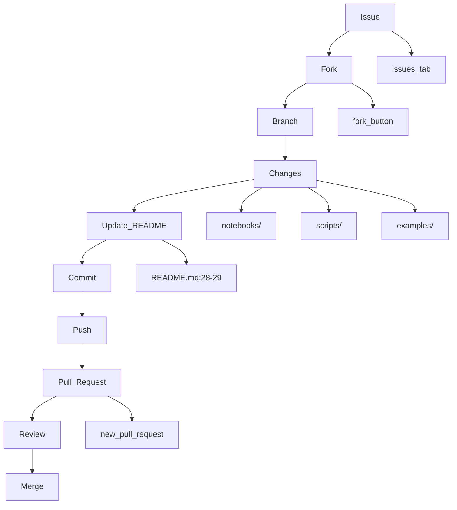
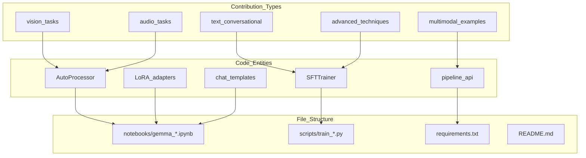
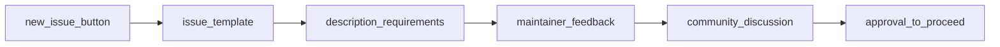
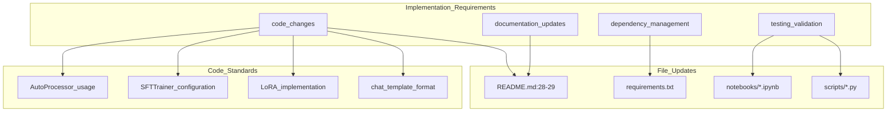
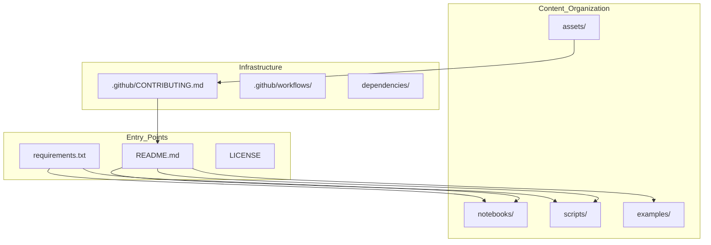
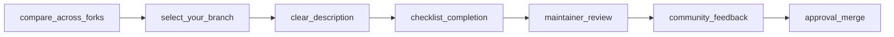

<!-- source: DeepWiki mcp.deepwiki.com · repo huggingface/huggingface-gemma-recipes · page 5 Contributing · fetched 2026-10-26 -->

# Contributing

<details>
<summary>Relevant source files</summary>

The following files were used as context for generating this wiki page:

- [.github/CONTRIBUTING.md](.github/CONTRIBUTING.md)
- [assets/Fork.png](assets/Fork.png)
- [assets/PR.png](assets/PR.png)
- [assets/new_issue.png](assets/new_issue.png)

</details>


This document provides comprehensive guidelines for contributing to the Hugging Face Gemma Recipes repository. It covers the contribution workflow, code organization, and technical requirements for submitting new recipes, examples, and improvements to the codebase.

For information about using the existing recipes and examples, see [Getting Started](#2) and [Inference and Usage](#3). For documentation on the various fine-tuning approaches available, see [Fine-tuning Guide](#4).

## Contribution Workflow Overview

The repository follows a standard GitHub-based contribution workflow with specific requirements for maintaining the quality and organization of Gemma model recipes.



Sources: [.github/CONTRIBUTING.md:7-51](), [assets/new_issue.png](), [assets/Fork.png](), [assets/PR.png]()

## Types of Contributions

The repository accepts several categories of contributions, each with specific organizational requirements and technical standards.

### Recipe Categories

| Category | Location | Requirements |
|----------|----------|-------------|
| Fine-tuning Notebooks | `notebooks/` | Jupyter notebooks with complete examples |
| Production Scripts | `scripts/` | Python scripts for automated training |
| Inference Examples | `examples/` | Pipeline-based usage demonstrations |
| Documentation | `README.md` | Updated table of contents and descriptions |

### Technical Requirements



Sources: [.github/CONTRIBUTING.md:26-29]()

## Step-by-Step Contribution Process

### 1. Issue Creation and Planning

Before implementing any changes, contributors must open an issue to discuss the proposed contribution with maintainers and the community.



**Required Information:**
- Detailed description of the proposed recipe or improvement
- Target Gemma model variant (e.g., `gemma-2b`, `gemma-7b`, `gemma-2-9b`)
- Dataset and task specifications
- Expected output format (`LoRA`, `merged_model`, `GGUF`)

Sources: [.github/CONTRIBUTING.md:9-12]()

### 2. Repository Fork and Branch Management

The standard GitHub fork-and-branch workflow applies with specific naming conventions for Gemma recipes.

```bash
git checkout -b feature/your-feature-name
```

**Branch Naming Conventions:**
- `feature/gemma-{model-size}-{task-type}` for new recipes
- `fix/issue-{number}-{description}` for bug fixes
- `docs/update-{section}` for documentation updates

Sources: [.github/CONTRIBUTING.md:19-24]()

### 3. Code Implementation Requirements

All contributions must follow the established code organization and technical standards.



**Mandatory Updates:**
- Add new recipe to `README.md` table of contents
- Update `requirements.txt` if new dependencies are introduced
- Include comprehensive documentation within notebooks
- Implement proper error handling and validation

Sources: [.github/CONTRIBUTING.md:26-29]()

### 4. Documentation and README Updates

The `README.md` file serves as the primary navigation interface for the repository and must be updated for all new contributions.

**Required README Sections:**
- Recipe title and description
- Target model specifications
- Dataset requirements
- Usage instructions
- Expected outputs

Sources: [.github/CONTRIBUTING.md:28-29]()

### 5. Commit and Push Standards

```bash
git commit -m "Add feature: your feature name"
git push origin feature/your-feature-name
```

**Commit Message Format:**
- Use descriptive commit messages
- Include relevant issue numbers
- Specify affected components (e.g., `[gemma-2b]`, `[vision]`, `[audio]`)

Sources: [.github/CONTRIBUTING.md:31-39]()

## Code Organization and Integration Points

Understanding the repository's code organization is essential for proper contribution placement and integration.

### Repository Structure Integration



### Technical Integration Points

| Component | Integration Point | Requirements |
|-----------|-------------------|-------------|
| `AutoProcessor` | Multimodal input handling | Vision, audio, text processing |
| `SFTTrainer` | Fine-tuning orchestration | LoRA, full fine-tuning support |
| `pipeline()` | Inference interface | Model loading, tokenization |
| `chat_templates` | Conversation formatting | Gemma-specific prompt structure |

Sources: [.github/CONTRIBUTING.md:1-51]()

## Pull Request and Review Process

### Pull Request Creation

Navigate to the original repository and create a new pull request with the following requirements:



**Pull Request Checklist:**
- [ ] Issue discussion completed
- [ ] Code changes implemented
- [ ] `README.md` updated
- [ ] Dependencies documented
- [ ] Testing completed
- [ ] Documentation comprehensive

Sources: [.github/CONTRIBUTING.md:41-47]()

### Review Criteria

Maintainers evaluate contributions based on:
- Technical correctness and efficiency
- Code quality and documentation
- Integration with existing recipes
- Reproducibility and testing
- Community value and usefulness

## Getting Help and Support

For questions, guidance, or assistance during the contribution process:

1. **Open an Issue**: Use the GitHub Issues tab for technical questions
2. **Draft Pull Request**: Create a draft PR for early feedback
3. **Community Discussion**: Engage with maintainers and other contributors

The maintainer team and community are available to provide support throughout the contribution process.

Sources: [.github/CONTRIBUTING.md:49-51]()

---

