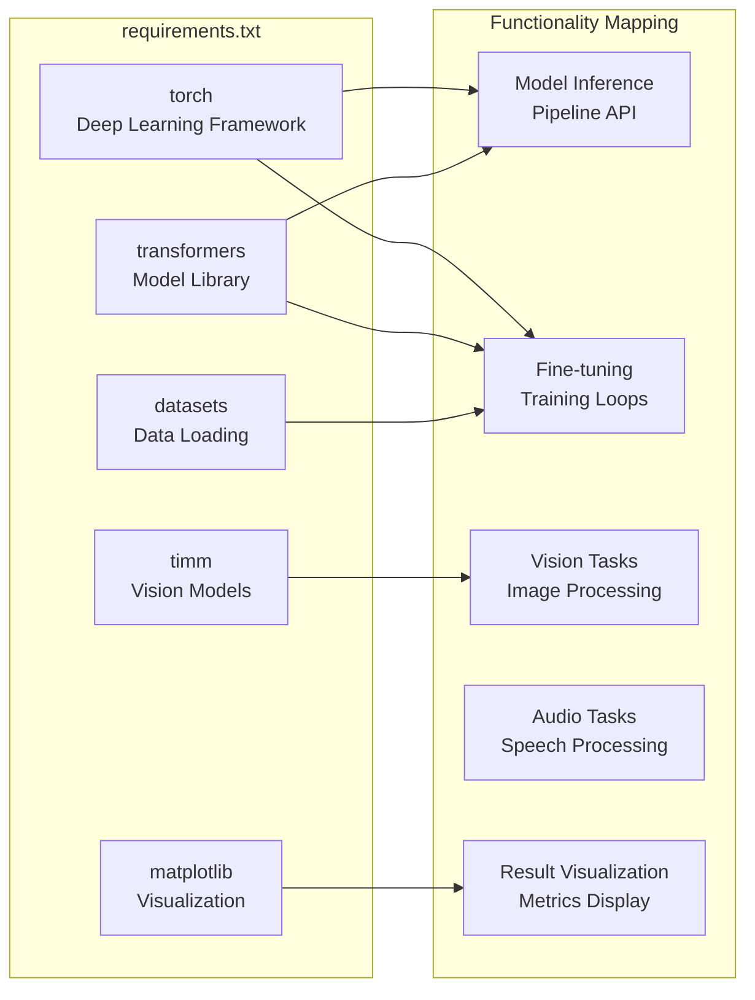
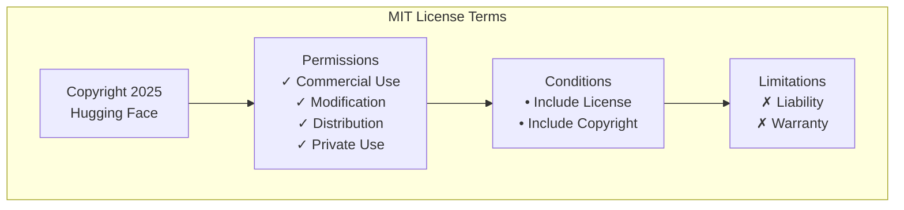

<!-- source: DeepWiki mcp.deepwiki.com · repo huggingface/huggingface-gemma-recipes · page 6 Reference · fetched 2026-10-26 -->

# Reference

<details>
<summary>Relevant source files</summary>

The following files were used as context for generating this wiki page:

- [.gitignore](.gitignore)
- [LICENSE](LICENSE)
- [assets/thumbnail.png](assets/thumbnail.png)
- [requirements.txt](requirements.txt)

</details>


This document provides technical reference information for the Hugging Face Gemma Recipes repository, including project configuration, licensing, dependencies, and development environment details. This reference covers the foundational aspects of the repository structure and setup requirements.

For information about getting started with the repository, see [Getting Started](#2). For contributing guidelines and workflow, see [Contributing](#5).

## Project Configuration

The repository follows standard Python project conventions with configuration files that define the development environment and project metadata.

### Repository Structure

```mermaid
graph TB
    subgraph "Root Configuration"
        LICENSE["LICENSE<br/>MIT License"]
        GITIGNORE[".gitignore<br/>Python Project Exclusions"]
        REQUIREMENTS["requirements.txt<br/>Core Dependencies"]
    end
    
    subgraph "Development Environment"
        PYTHON["Python Environment<br/>Standard ML/AI Stack"]
        VSCODE[".vscode/<br/>Editor Configuration"]
        CACHE["Cache Directories<br/>__pycache__, .ruff_cache"]
    end
    
    subgraph "Build Artifacts"
        DIST["dist/<br/>Distribution Files"]
        BUILD["build/<br/>Build Output"]
        EGGS["*.egg-info/<br/>Package Metadata"]
    end
    
    GITIGNORE --> PYTHON
    GITIGNORE --> VSCODE
    GITIGNORE --> CACHE
    GITIGNORE --> DIST
    GITIGNORE --> BUILD
    GITIGNORE --> EGGS
    
    REQUIREMENTS --> PYTHON
    LICENSE --> "Project Distribution"
```

**Sources:** [.gitignore:1-194](), [requirements.txt:1-5](), [LICENSE:1-22]()

### Git Configuration

The repository includes comprehensive exclusion patterns for Python development:

| Category | Excluded Items | Purpose |
|----------|---------------|---------|
| Python Runtime | `__pycache__/`, `*.pyc`, `*.pyo` | Compiled bytecode files |
| Package Management | `dist/`, `build/`, `*.egg-info/` | Distribution and build artifacts |
| Development Tools | `.vscode/`, `.idea/`, `.ruff_cache/` | IDE and linting tool cache |
| Virtual Environments | `venv/`, `.env`, `ENV/` | Environment isolation |
| Testing | `.pytest_cache/`, `.coverage` | Test execution artifacts |
| Documentation | `docs/_build/`, `/site` | Generated documentation |

**Sources:** [.gitignore:1-194]()

## Dependencies

The repository defines a minimal set of core dependencies required for machine learning and multimodal AI tasks.

### Core Dependencies



**Sources:** [requirements.txt:1-5]()

### Dependency Details

| Package | Purpose | Usage in Repository |
|---------|---------|-------------------|
| `torch` | PyTorch deep learning framework | Core tensor operations, model training, GPU acceleration |
| `transformers` | Hugging Face model library | Gemma model loading, tokenization, pipeline inference |
| `datasets` | Hugging Face datasets library | Training data loading, preprocessing, evaluation datasets |
| `timm` | PyTorch Image Models | Vision model components, image preprocessing utilities |
| `matplotlib` | Plotting and visualization | Training metrics visualization, result analysis |

**Sources:** [requirements.txt:1-5]()

## License Information

The repository is distributed under the MIT License, providing broad permissions for use, modification, and distribution.

### License Terms



**Sources:** [LICENSE:1-22]()

### License Summary

- **Copyright Holder**: Hugging Face (2025)
- **License Type**: MIT License
- **Key Permissions**: Commercial use, modification, distribution, private use
- **Requirements**: Include license and copyright notice in distributions
- **Limitations**: No warranty or liability provided

The full license text is available in [LICENSE:1-22]().

**Sources:** [LICENSE:1-22]()

## Development Environment

The repository supports multiple development environments and tools commonly used in machine learning projects.

### Supported Development Tools

| Tool Category | Supported Tools | Configuration |
|---------------|-----------------|---------------|
| Code Editors | VS Code, PyCharm, Cursor | Excluded from version control |
| Package Managers | pip, pipenv, poetry, pdm, uv | Lock files handling varies |
| Python Environments | venv, conda, pyenv | Virtual environment isolation |
| Linting/Formatting | ruff, mypy, pyre | Cache directories excluded |
| Testing | pytest, coverage | Test artifacts excluded |
| Documentation | Sphinx, mkdocs | Build directories excluded |

**Sources:** [.gitignore:1-194]()

### Environment Setup

The repository follows standard Python development practices:

1. **Virtual Environment Isolation**: All major Python environment tools are supported
2. **Cache Management**: Development tool caches are excluded from version control
3. **Build Artifact Handling**: Generated files are properly excluded
4. **Cross-Platform Support**: Configuration works across different operating systems

**Sources:** [.gitignore:1-194]()

## Additional Resources

### Related Documentation

- For initial setup and installation instructions, see [Getting Started](#2)
- For inference examples and usage patterns, see [Inference and Usage](#3)
- For fine-tuning guides and tutorials, see [Fine-tuning Guide](#4)
- For contribution guidelines and development workflow, see [Contributing](#5)

### External Resources

- **Hugging Face Transformers**: Documentation for the core model library
- **PyTorch Documentation**: Deep learning framework documentation
- **Gemma Model Cards**: Official model documentation and usage guidelines
- **Hugging Face Datasets**: Dataset library documentation

**Sources:** [requirements.txt:1-5](), [LICENSE:1-22]()