# Page: Overview

# Overview

<details>
<summary>Relevant source files</summary>

The following files were used as context for generating this wiki page:

- [.github/README.md](.github/README.md)

</details>


## Purpose and Scope

This document provides an overview of the Hugging Face Gemma Recipes repository, a collection of minimal, ready-to-use examples for working with Google's Gemma model family. The repository serves as a practical guide for both inference and fine-tuning of Gemma models across multiple modalities including text, images, audio, and video.

The repository focuses on providing quick-start examples rather than comprehensive tutorials. For detailed implementation guidance on specific tasks, see [Fine-tuning Guide](#4). For contribution guidelines and repository maintenance, see [Contributing](#5).

## Repository Architecture

The repository is organized around two main use cases: inference and fine-tuning, with support for both Gemma 3n (multimodal) and Gemma 3 (text-only) model variants.

```mermaid
graph TB
    subgraph "Entry Points"
        README[".github/README.md"]
        REQUIREMENTS["requirements.txt"]
    end
    
    subgraph "Inference Examples"
        PIPELINE_NB["notebooks/gemma3n_inference_via_pipeline.ipynb"]
        PIPELINE_API["transformers.pipeline"]
        AUTO_PROCESSOR["AutoProcessor"]
        AUTO_MODEL["AutoModelForImageTextToText"]
    end
    
    subgraph "Fine-tuning Notebooks"
        FT_T4["notebooks/fine_tune_gemma3n_on_t4.ipynb"]
        FT_CONV["notebooks/Gemma3N_(4B)-Conversational.ipynb"]
        FT_AUDIO["notebooks/fine_tune_gemma3n_on_audio.ipynb"]
        FT_GUI["notebooks/Gemma_3n_GUI_Finetune.ipynb"]
        FT_VISION["notebooks/Gemma3_(4B)-Vision.ipynb"]
        FT_GRPO["notebooks/Gemma3_(1B)-GRPO.ipynb"]
    end
    
    subgraph "Production Scripts"
        SCRIPT_IMG["scripts/ft_gemma3n_image_vt.py"]
        SCRIPT_AUDIO["scripts/ft_gemma3n_audio_vt.py"]
        SCRIPT_TRL["scripts/ft_gemma3n_image_trl.py"]
    end
    
    subgraph "Training Frameworks"
        TRL["TRL"]
        UNSLOTH["Unsloth"]
        TRANSFORMERS["Transformers"]
    end
    
    README --> PIPELINE_NB
    README --> FT_T4
    README --> FT_CONV
    
    PIPELINE_NB --> PIPELINE_API
    PIPELINE_API --> AUTO_PROCESSOR
    PIPELINE_API --> AUTO_MODEL
    
    FT_T4 --> TRL
    FT_CONV --> UNSLOTH
    FT_AUDIO --> TRANSFORMERS
    FT_GUI --> TRL
    FT_VISION --> UNSLOTH
    FT_GRPO --> UNSLOTH
    
    SCRIPT_IMG --> TRANSFORMERS
    SCRIPT_AUDIO --> TRANSFORMERS
    SCRIPT_TRL --> TRL
    
    REQUIREMENTS --> TRL
    REQUIREMENTS --> UNSLOTH
    REQUIREMENTS --> TRANSFORMERS
```

**Sources:** [.github/README.md:1-177]()

## Model Variants and Code Mappings

The repository supports multiple Gemma model variants, each with specific model identifiers and use cases mapped to corresponding code implementations.

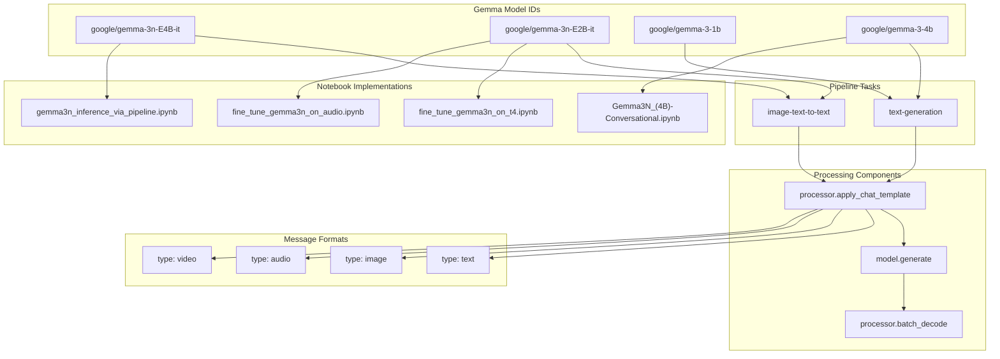

**Sources:** [.github/README.md:31-49](), [.github/README.md:57-82](), [.github/README.md:152-167]()

## Task-to-Implementation Mapping

The repository provides specific implementations for different multimodal tasks, each with dedicated notebooks and scripts.

| Task Category | Model Variant | Implementation | Framework | Colab Link |
|---------------|---------------|----------------|-----------|------------|
| Multimodal Inference | `google/gemma-3n-E4B-it` | `gemma3n_inference_via_pipeline.ipynb` | `transformers.pipeline` | ✓ |
| Free T4 Fine-tuning | `google/gemma-3n-E2B-it` | `fine_tune_gemma3n_on_t4.ipynb` | TRL | ✓ |
| Conversational AI | Gemma 3n 4B | `Gemma3N_(4B)-Conversational.ipynb` | Unsloth | ✓ |
| Audio Transcription | Gemma 3n 2B | `fine_tune_gemma3n_on_audio.ipynb` | Transformers | - |
| GUI Grounding | Gemma 3n | `Gemma_3n_GUI_Finetune.ipynb` | TRL | - |
| Vision Tasks | Gemma 3 4B | `Gemma3_(4B)-Vision.ipynb` | Unsloth | ✓ |
| Math Reasoning | Gemma 3 1B | `Gemma3_(1B)-GRPO.ipynb` | Unsloth + TRL | ✓ |
| Production Image | Gemma 3n | `ft_gemma3n_image_vt.py` | Transformers | - |
| Production Audio | Gemma 3n | `ft_gemma3n_audio_vt.py` | Transformers | - |

**Sources:** [.github/README.md:142-167]()

## Key Components and APIs

The repository demonstrates three primary interaction patterns with Gemma models, each utilizing different levels of the transformers API.

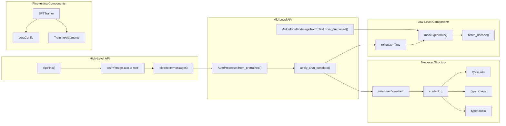

**Sources:** [.github/README.md:27-49](), [.github/README.md:57-82](), [.github/README.md:89-133]()

## Installation and Dependencies

The repository requires minimal dependencies for basic usage, with additional packages needed for specific fine-tuning scenarios:

- **Core dependencies**: `transformers`, `timm` (for vision encoder)
- **Fine-tuning dependencies**: Available in `requirements.txt`
- **Framework-specific**: TRL for reinforcement learning, Unsloth for efficient training

The entry point for most users is the `pipeline` API from transformers, which provides the simplest interface for inference across all supported modalities.

**Sources:** [.github/README.md:17-21](), [.github/README.md:169-173]()

---

# Page: Getting Started

# Getting Started

<details>
<summary>Relevant source files</summary>

The following files were used as context for generating this wiki page:

- [.github/README.md](.github/README.md)
- [requirements.txt](requirements.txt)

</details>


This document provides a comprehensive guide to setting up and using the Hugging Face Gemma Recipes repository. It covers initial setup, dependency installation, and basic usage patterns for working with Gemma models across different modalities (text, image, audio, video). 

For detailed fine-tuning instructions, see [Fine-tuning Guide](#4). For advanced techniques and production deployment, see [Advanced Techniques](#4.4) and [Production Scripts](#4.5).

## Prerequisites and Installation

The repository requires Python with PyTorch and several key dependencies for multimodal processing.

### Core Dependencies

The minimal installation requires `transformers` and `timm` for vision processing:

```bash
pip install -U -q transformers timm
```

For full functionality including fine-tuning capabilities, install all dependencies:

```bash
pip install -U -q -r requirements.txt
```

### Required Packages

| Package | Purpose | Notes |
|---------|---------|-------|
| `torch` | Core PyTorch framework | Required for model inference and training |
| `transformers` | Hugging Face transformers library | Provides model classes and pipeline API |
| `timm` | Vision encoder components | Required for multimodal Gemma 3n models |
| `datasets` | Data loading and processing | Used in fine-tuning examples |
| `matplotlib` | Visualization utilities | Used in notebooks for plotting |

Sources: [requirements.txt:1-5](), [.github/README.md:17-21]()

## Repository Structure Overview

### Repository Architecture

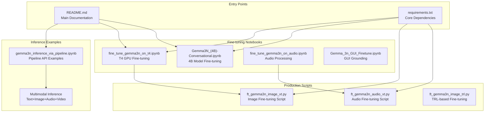

Sources: [.github/README.md:1-177]()

## Quick Start Examples

### Basic Pipeline Inference

The simplest way to use Gemma models is through the `pipeline` API from transformers:

```python
# Basic multimodal inference setup
pipe = pipeline(
    "image-text-to-text",
    model="google/gemma-3n-E4B-it",
    device="cuda",
    torch_dtype=torch.bfloat16
)
```

This pattern is demonstrated in [.github/README.md:27-50]() and provides immediate access to multimodal capabilities.

### Model and Processor Initialization

For more control over the inference process, use the direct transformers API:

```python
# Direct model initialization
model_id = "google/gemma-3n-e4b-it"
processor = AutoProcessor.from_pretrained(model_id)
model = AutoModelForImageTextToText.from_pretrained(model_id)
```

The `model_generation` function handles chat template application and inference: [.github/README.md:64-82]()

Sources: [.github/README.md:23-82]()

## Understanding the Workflow

### Inference Processing Pipeline

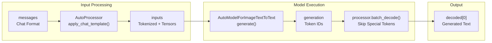

### Supported Modalities

| Modality | Content Type | Example Usage |
|----------|-------------|---------------|
| Text | `{"type": "text", "text": "..."}` | Question answering, conversation |
| Image | `{"type": "image", "image": "url"}` | Visual analysis, description |
| Audio | `{"type": "audio", "audio": "url"}` | Speech transcription, analysis |
| Video | `{"type": "video", "video": "url"}` | Video understanding, description |

Sources: [.github/README.md:38-134]()

### Model Variants and Use Cases

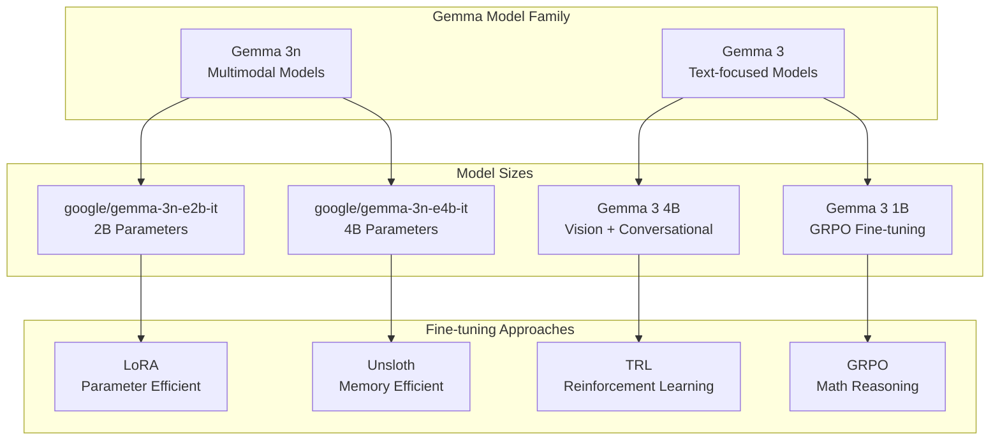

Sources: [.github/README.md:60-61](), [.github/README.md:148-167]()

## Message Format and Templates

### Chat Message Structure

All interactions with Gemma models use a standardized message format:

```python
messages = [
    {
        "role": "user",
        "content": [
            {"type": "text", "text": "Your question here"},
            {"type": "image", "image": "path/to/image.jpg"}
        ]
    }
]
```

The `AutoProcessor.apply_chat_template()` method handles conversion to model-specific format with proper tokenization and tensor conversion.

### Modality-Specific Examples

Examples for each modality are provided in [.github/README.md:86-134]():

- **Text-only**: Simple question-answering format
- **Audio**: Speech transcription with audio URLs
- **Image**: Visual analysis with image URLs
- **Video**: Video understanding capabilities

Sources: [.github/README.md:38-134]()

## Next Steps

After completing the basic setup:

1. **For inference tasks**: Explore the pipeline notebook at [notebooks/gemma3n_inference_via_pipeline.ipynb]()
2. **For fine-tuning**: Start with the T4 notebook at [notebooks/fine_tune_gemma3n_on_t4.ipynb]()
3. **For production deployment**: Review the training scripts in [scripts/]()
4. **For advanced techniques**: See the GRPO and specialized fine-tuning notebooks

For detailed fine-tuning instructions across different modalities, see [Fine-tuning Guide](#4). For contribution guidelines and development setup, see [Contributing](#5).

Sources: [.github/README.md:140-175]()

---

# Page: Inference and Usage

# Inference and Usage

<details>
<summary>Relevant source files</summary>

The following files were used as context for generating this wiki page:

- [.github/README.md](.github/README.md)
- [notebooks/gemma3n_inference_via_pipeline.ipynb](notebooks/gemma3n_inference_via_pipeline.ipynb)

</details>


This page covers how to perform inference with pre-trained Gemma models across multiple modalities (text, image, audio, video). It demonstrates both quick pipeline-based inference and detailed manual inference approaches using the transformers library.

For information about fine-tuning these models, see [Fine-tuning Guide](#4). For setup and installation instructions, see [Getting Started](#2).

## Overview

The repository provides two primary approaches for running inference with Gemma models:

1. **Pipeline API**: Simplified interface using `transformers.pipeline` for quick multimodal inference
2. **Manual Approach**: Direct model and processor usage for fine-grained control over the inference process

Both approaches support the Gemma 3n family of multimodal models, which can process combinations of text, images, audio, and video inputs to generate text responses.

## Inference Approaches

### Pipeline API

The pipeline API provides the simplest way to perform multimodal inference. It handles model loading, input processing, and output generation automatically.

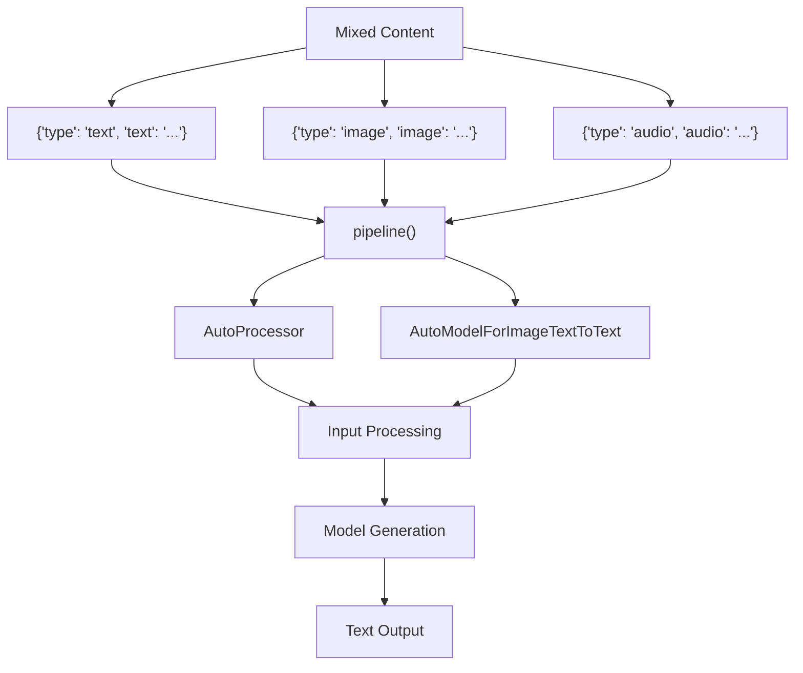

**Pipeline Architecture for Multimodal Inference**

The pipeline automatically handles the complexity of processing different input modalities and routing them through the appropriate model components.

Sources: [.github/README.md:23-50](), [notebooks/gemma3n_inference_via_pipeline.ipynb:621-630]()

### Manual Inference Approach

For more control over the inference process, you can directly instantiate the model and processor components:

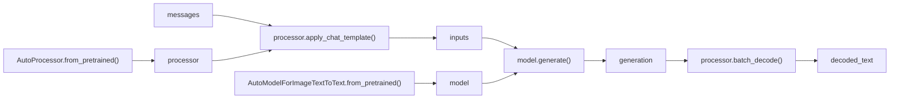

**Manual Inference Flow with Direct Model Access**

This approach allows for custom generation parameters, different chat templates, and fine-grained control over input processing.

Sources: [.github/README.md:52-82](), [.github/README.md:64-81]()

## Supported Modality Combinations

The Gemma 3n models support various combinations of input modalities:

| Input Combination | Output | Use Case | Example |
|-------------------|--------|----------|---------|
| Text only | Text | General Q&A | `"What is the capital of France?"` |
| Image + Text | Text | Visual Q&A | Image description, visual reasoning |
| Audio + Text | Text | Speech transcription | Audio transcription with context |
| Video + Text | Text | Video analysis | Video content description |
| Video + Audio | Text | Multimodal video | Complete video understanding |
| Video + Audio + Text | Text | Complex reasoning | Guided video analysis |

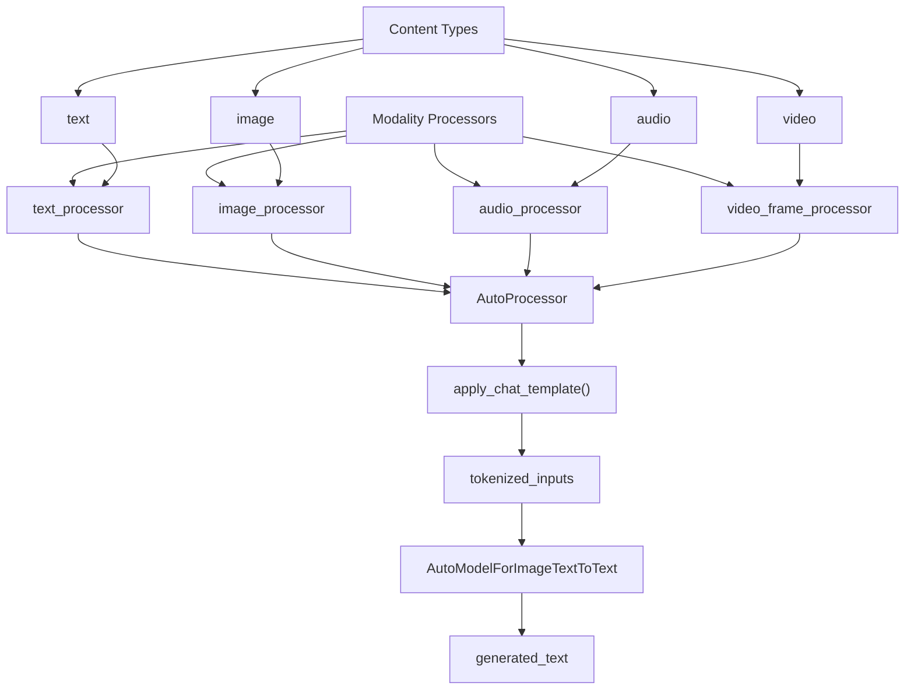

**Multimodal Input Processing Pipeline**

The `AutoProcessor` component handles the complexity of processing different modalities and combining them into a format suitable for the model.

Sources: [.github/README.md:86-134](), [notebooks/gemma3n_inference_via_pipeline.ipynb:6-16]()

## Model Variants and Capabilities

### Gemma 3n Model Family

The repository primarily focuses on the Gemma 3n multimodal model variants:

| Model ID | Size | Primary Use | Torch Dtype Support |
|----------|------|-------------|-------------------|
| `google/gemma-3n-E2B-it` | 2B | Lightweight multimodal | `bfloat16`, `float32` |
| `google/gemma-3n-E4B-it` | 4B | Full multimodal capability | `bfloat16`, `float32` |

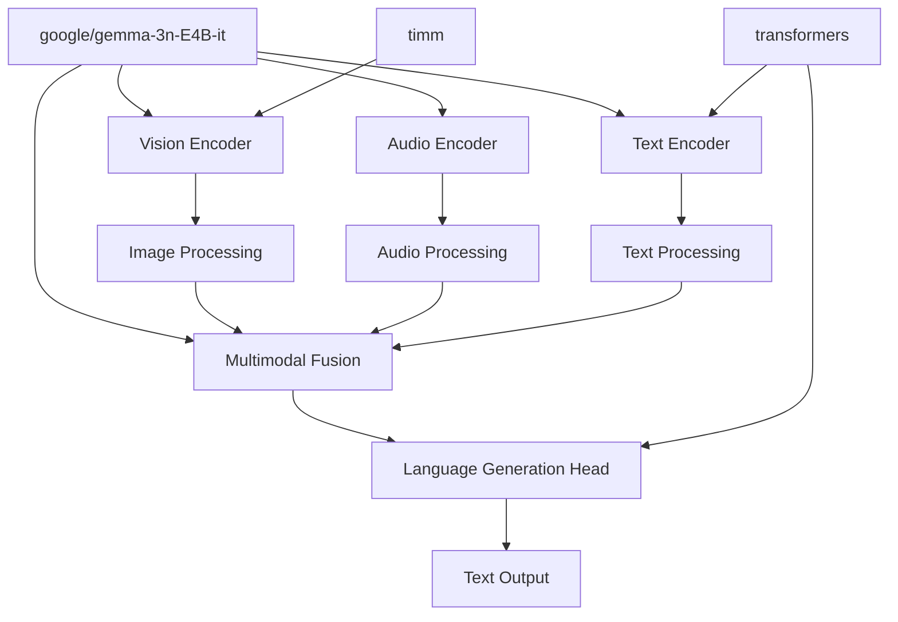

**Gemma 3n Model Architecture Components**

The model combines specialized encoders for different modalities with a unified language generation component.

Sources: [.github/README.md:17-21](), [.github/README.md:33](), [.github/README.md:60]()

## Technical Configuration

### Torch Dtype Considerations

Different inference scenarios require specific torch dtype configurations:

- **Image/Video inference**: `torch.bfloat16` for optimal performance
- **Audio inference**: `torch.float32` for compatibility with audio processing

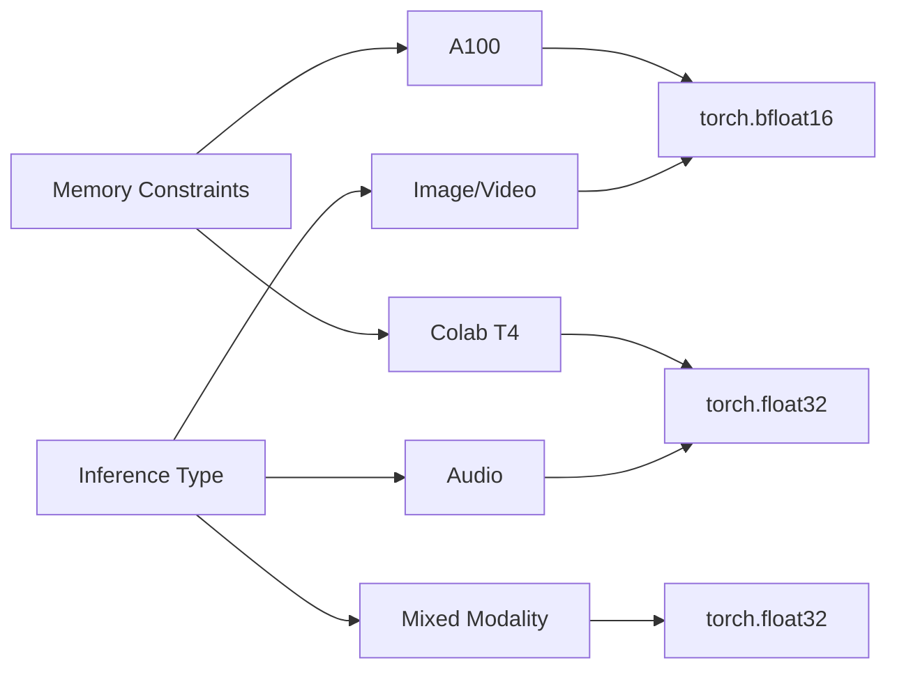

**Dtype Selection Strategy for Different Inference Scenarios**

The choice of torch dtype affects both memory usage and compatibility with different modality processors.

Sources: [notebooks/gemma3n_inference_via_pipeline.ipynb:624-629](), [notebooks/gemma3n_inference_via_pipeline.ipynb:872-877]()

### Message Format Structure

All inference approaches use a standardized message format:

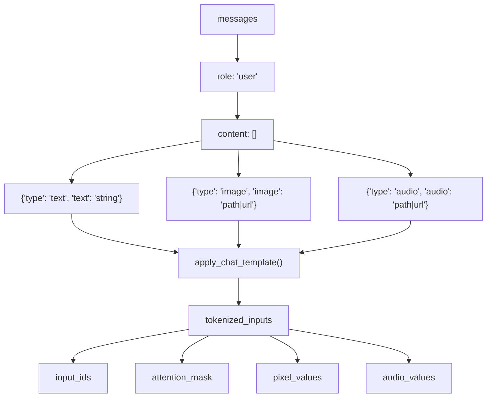

**Message Format and Tokenization Pipeline**

The consistent message format allows the same code to handle any combination of modalities.

Sources: [.github/README.md:38-49](), [.github/README.md:91-98](), [notebooks/gemma3n_inference_via_pipeline.ipynb:658-666]()

### Video Processing Pipeline

Video inputs require preprocessing to extract representative frames:

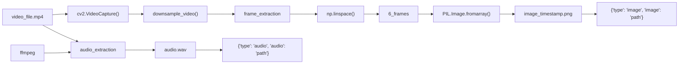

**Video Preprocessing for Multimodal Inference**

Video files are decomposed into representative frames and audio tracks for processing by the multimodal model.

Sources: [notebooks/gemma3n_inference_via_pipeline.ipynb:741-760](), [notebooks/gemma3n_inference_via_pipeline.ipynb:181-201]()

---

# Page: Fine-tuning Guide

# Fine-tuning Guide

<details>
<summary>Relevant source files</summary>

The following files were used as context for generating this wiki page:

- [.github/README.md](.github/README.md)

</details>


This document provides an overview of fine-tuning approaches and techniques available for adapting Gemma models to specific tasks. It covers the different model variants, training frameworks, and methodologies implemented in this repository.

For specific implementation details on vision tasks, see [Vision Tasks](#4.1). For audio processing fine-tuning, see [Audio Tasks](#4.2). For text and conversational AI fine-tuning, see [Text and Conversational AI](#4.3). For advanced techniques including GRPO, see [Advanced Techniques](#4.4). For production-ready scripts, see [Production Scripts](#4.5).

## Model Variants and Capabilities

The repository supports fine-tuning across multiple Gemma model variants, each optimized for different use cases and computational constraints.

### Gemma 3n (Multimodal Models)

| Model Size | Identifier | Primary Use Cases | Memory Requirements |
|------------|------------|-------------------|-------------------|
| 2B | `google/gemma-3n-E2B-it` | Audio transcription, basic vision | Low (T4 compatible) |
| 4B | `google/gemma-3n-E4B-it` | Advanced vision, GUI grounding | Medium (requires optimization) |

### Gemma 3 (Text Models)

| Model Size | Identifier | Primary Use Cases | Specialized Techniques |
|------------|------------|-------------------|----------------------|
| 1B | `google/gemma-3-1b-it` | Math reasoning, GRPO | Reinforcement Learning |
| 4B | `google/gemma-3-4b-it` | Conversational AI, complex text | Standard fine-tuning |

Sources: [.github/README.md:148-168]()

## Fine-tuning Frameworks and Approaches

### Framework Architecture

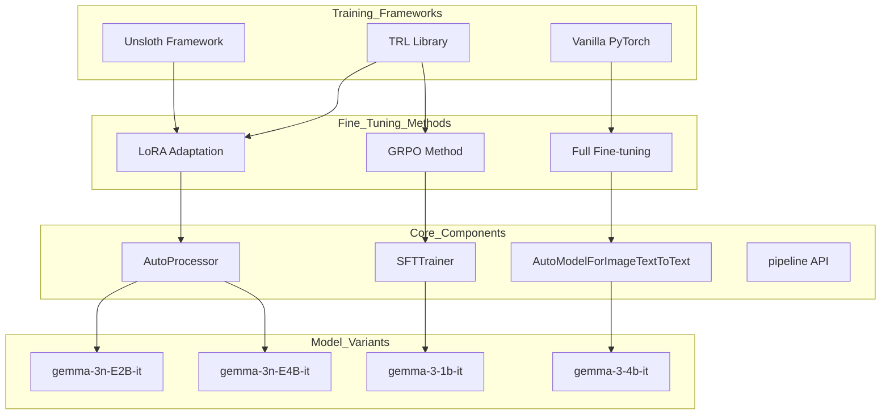

Sources: [.github/README.md:17-21](), [.github/README.md:57-82]()

### Parameter Efficient Fine-tuning (LoRA)

Most examples in this repository use LoRA (Low-Rank Adaptation) for memory-efficient fine-tuning. This approach modifies only a small subset of model parameters while maintaining performance.

**Key Characteristics:**
- Reduces memory requirements significantly
- Enables fine-tuning on consumer hardware (T4, RTX series)
- Produces lightweight adapter files
- Compatible with model merging and quantization

**Implementation Examples:**
- [notebooks/fine_tune_gemma3n_on_t4.ipynb:1-end]()
- [notebooks/Gemma3N_(4B)-Conversational.ipynb:1-end]()

### Full Fine-tuning

Production scripts implement full parameter fine-tuning for scenarios requiring maximum model adaptation.

**Key Characteristics:**
- Modifies all model parameters
- Requires significant computational resources
- Provides maximum flexibility for task adaptation
- Used in production environments

**Implementation Examples:**
- [scripts/ft_gemma3n_image_vt.py:1-end]()
- [scripts/ft_gemma3n_audio_vt.py:1-end]()

Sources: [.github/README.md:155-161]()

## Training Workflows and Data Processing

### Multimodal Training Pipeline

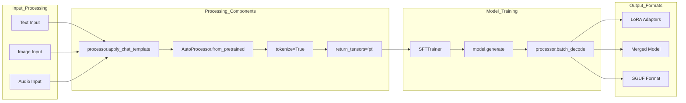

Sources: [.github/README.md:64-82]()

### Task-Specific Preprocessing

Different modalities require specialized preprocessing approaches:

| Modality | Preprocessing Components | Key Parameters |
|----------|-------------------------|----------------|
| Vision | `AutoProcessor`, `timm` | `add_generation_prompt=True` |
| Audio | `AutoProcessor`, sampling rate handling | `tokenize=True` |
| Text | Chat template formatting | `return_dict=True` |
| Multimodal | Combined processing pipeline | `return_tensors="pt"` |

**Common Processing Pattern:**
```python
inputs = processor.apply_chat_template(
    messages,
    add_generation_prompt=True,
    tokenize=True,
    return_dict=True,
    return_tensors="pt",
)
```

Sources: [.github/README.md:64-71]()

## Task Categories and Specializations

### Vision Tasks
- **LaTeX OCR**: Mathematical formula recognition
- **GUI Grounding**: User interface element detection
- **Image Analysis**: General visual understanding
- **Object Detection**: Specialized detection capabilities

### Audio Tasks
- **Speech Transcription**: Audio-to-text conversion
- **Multilingual Support**: French transcription examples
- **Multimodal Audio**: Combined audio-visual processing

### Text and Reasoning
- **Conversational AI**: Dialog system fine-tuning
- **Mathematical Reasoning**: GSM8K dataset training
- **Instruction Following**: General text task adaptation

### Advanced Techniques
- **GRPO**: Generalized Reward Policy Optimization for reinforcement learning
- **Response-Only Training**: Instruction masking for efficient learning
- **Layer-Specific Training**: Attention mechanism fine-tuning

Sources: [.github/README.md:152-167]()

## Hardware Requirements and Optimization

### Memory Optimization Strategies

| Approach | Memory Usage | Compatible Hardware | Trade-offs |
|----------|-------------|-------------------|------------|
| LoRA + Unsloth | Low | T4, RTX 3090 | Slight performance impact |
| Full Fine-tuning | High | A100, H100 | Maximum adaptation |
| Gradient Checkpointing | Medium | RTX 4090, V100 | Increased training time |

### Framework Selection Guidelines

**Choose TRL when:**
- Implementing reinforcement learning approaches
- Working with complex reward functions
- Requiring advanced training customization

**Choose Unsloth when:**
- Memory constraints are critical
- Training on consumer hardware
- Rapid prototyping needs

**Choose Vanilla PyTorch when:**
- Maximum control over training loop
- Custom architecture modifications
- Production deployment requirements

Sources: [.github/README.md:17-21](), [.github/README.md:169-173]()

## Getting Started

Before beginning fine-tuning, ensure dependencies are installed:

```bash
pip install -U -q -r requirements.txt
```

**Essential packages:**
- `transformers`: Core model handling
- `timm`: Vision encoder support
- `torch`: Deep learning framework
- `trl`: Reinforcement learning utilities (when applicable)

For quick experimentation, start with the T4-compatible notebooks:
- [notebooks/fine_tune_gemma3n_on_t4.ipynb:1-end]()
- [notebooks/Gemma3N_(4B)-Conversational.ipynb:1-end]()

For production workflows, examine the scripts:
- [scripts/ft_gemma3n_image_trl.py:1-end]()
- [scripts/ft_gemma3n_audio_vt.py:1-end]()

Sources: [.github/README.md:169-173]()

---

# Page: Vision Tasks

# Vision Tasks

<details>
<summary>Relevant source files</summary>

The following files were used as context for generating this wiki page:

- [notebooks/Gemma3_(4B)-Vision.ipynb](notebooks/Gemma3_(4B)-Vision.ipynb)
- [notebooks/Gemma_3n_GUI_Finetune.ipynb](notebooks/Gemma_3n_GUI_Finetune.ipynb)
- [notebooks/fine_tune_gemma3n_on_audio.ipynb](notebooks/fine_tune_gemma3n_on_audio.ipynb)
- [notebooks/fine_tune_gemma3n_on_t4.ipynb](notebooks/fine_tune_gemma3n_on_t4.ipynb)
- [scripts/ft_gemma3n_image_trl.py](scripts/ft_gemma3n_image_trl.py)
- [scripts/ft_gemma3n_image_vt.py](scripts/ft_gemma3n_image_vt.py)

</details>


This document covers fine-tuning Gemma models for computer vision tasks including geometric analysis, GUI element detection, and optical character recognition. The implementations demonstrate multimodal capabilities using vision-language models with parameter-efficient training techniques.

For audio-related multimodal tasks, see [Audio Tasks](#4.2). For general text generation and conversational AI fine-tuning, see [Text and Conversational AI](#4.3).

## Overview of Vision Tasks

The repository provides three main vision task implementations:

| Task | Model | Dataset | Purpose |
|------|-------|---------|---------|
| **Intersection Counting** | `google/gemma-3n-E2B-it` | `ariG23498/intersection-dataset` | Count geometric intersection points in images |
| **GUI Grounding** | `google/gemma-3n-E2B-it` | `rootsautomation/ScreenSpot` | Locate UI elements in screenshots |
| **LaTeX OCR** | `unsloth/gemma-3-4b-pt` | `unsloth/LaTeX_OCR` | Convert handwritten math to LaTeX |

### Vision Task Architecture

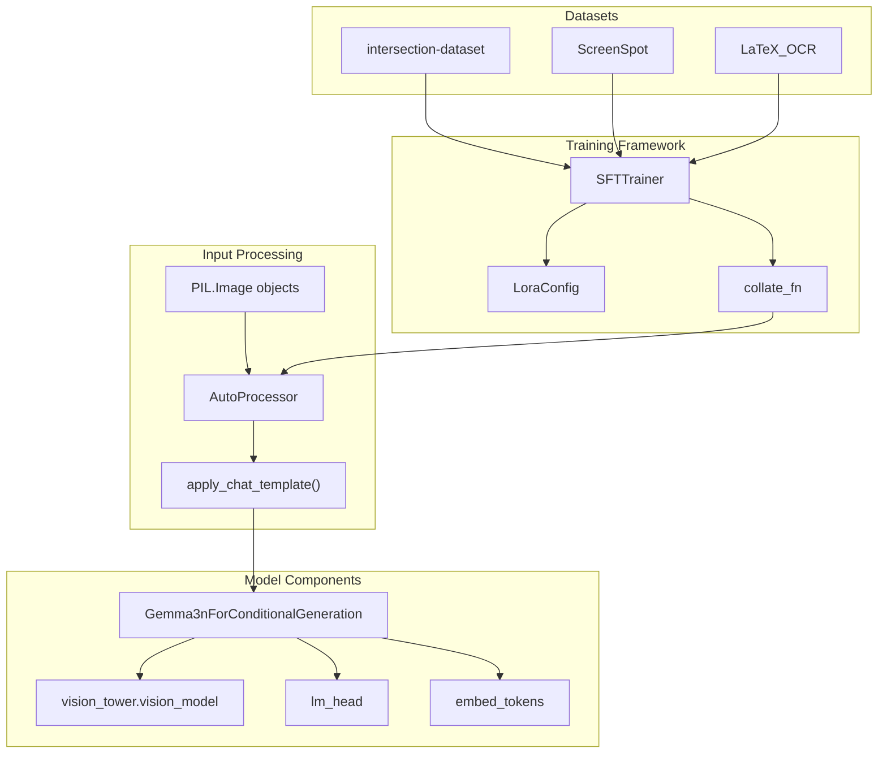

**Sources:** [notebooks/fine_tune_gemma3n_on_t4.ipynb:117-123](), [notebooks/Gemma_3n_GUI_Finetune.ipynb:252-261](), [scripts/ft_gemma3n_image_trl.py:247-258]()

## Model Architecture and Components

### Gemma3n Model Structure

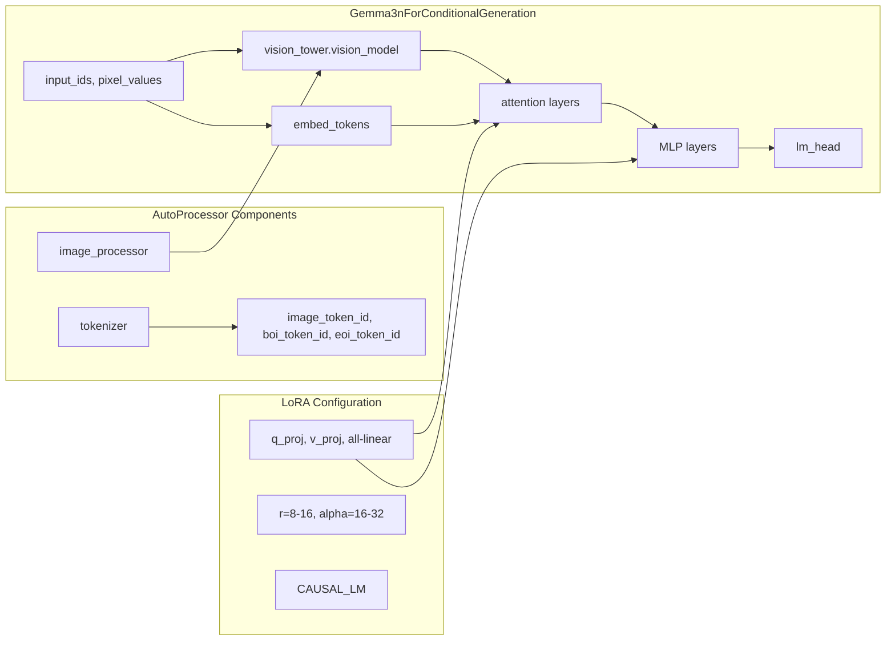

**Sources:** [notebooks/fine_tune_gemma3n_on_t4.ipynb:225-236](), [scripts/ft_gemma3n_image_trl.py:87-97](), [notebooks/Gemma3_(4B)-Vision.ipynb:382-401]()

### Key Model Components

The vision tasks utilize several critical components:

- **`Gemma3nForConditionalGeneration`**: Main multimodal model class handling both vision and text inputs
- **`AutoProcessor`**: Handles tokenization and image preprocessing with `apply_chat_template()` for message formatting
- **`LoraConfig`**: Configures parameter-efficient fine-tuning with target modules like `q_proj`, `v_proj`, or `all-linear`
- **Special tokens**: `image_token_id`, `boi_token_id`, `eoi_token_id` for multimodal processing

## Dataset Processing

### Message Format Structure

All vision tasks use a consistent message format for multimodal conversations:

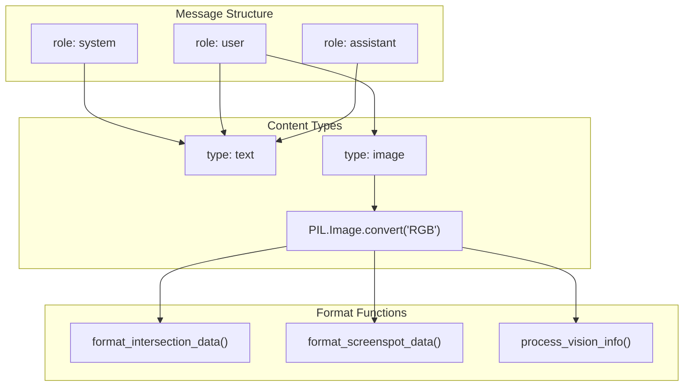

**Sources:** [notebooks/fine_tune_gemma3n_on_t4.ipynb:74-104](), [notebooks/Gemma_3n_GUI_Finetune.ipynb:132-185](), [scripts/ft_gemma3n_image_trl.py:103-133]()

### Dataset-Specific Processing

Each vision task implements specific data formatting functions:

#### Intersection Dataset Processing
- **Function**: `format_intersection_data()` [notebooks/fine_tune_gemma3n_on_t4.ipynb:74-104]()
- **Input**: Image with geometric shapes, integer label
- **System prompt**: "You are an assistant with great geometry skills."
- **Task**: "How many intersection points are there in the image?"

#### ScreenSpot Dataset Processing  
- **Function**: `format_screenspot_data()` [notebooks/Gemma_3n_GUI_Finetune.ipynb:132-185]()
- **Input**: GUI screenshot, instruction text, target/coordinates
- **System prompt**: "You are a helpful assistant that can identify and locate GUI elements in screenshots."
- **Task**: Locate specified UI elements

#### LaTeX OCR Processing
- **Dataset**: `unsloth/LaTeX_OCR` [notebooks/Gemma3_(4B)-Vision.ipynb:558-559]()
- **Input**: Handwritten math formula images
- **Output**: LaTeX markup strings
- **Features**: `image`, `text` columns with 68,686 training samples

## Training Approaches

### TRL-Based Training

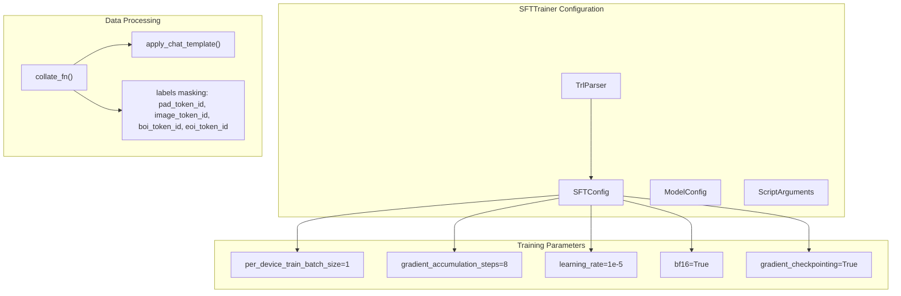

**Sources:** [notebooks/fine_tune_gemma3n_on_t4.ipynb:247-264](), [scripts/ft_gemma3n_image_trl.py:219-223](), [notebooks/Gemma_3n_GUI_Finetune.ipynb:412-437]()

### Unsloth Fast Training

For LaTeX OCR, the implementation uses Unsloth for accelerated training:

- **Model**: `FastVisionModel.from_pretrained()` [notebooks/Gemma3_(4B)-Vision.ipynb:344-348]()
- **PEFT**: `FastVisionModel.get_peft_model()` with configurable layer targeting [notebooks/Gemma3_(4B)-Vision.ipynb:382-401]()
- **Options**: Separate control for vision layers, language layers, attention modules, and MLP modules

### Vanilla PyTorch Training

The repository also provides a custom training loop implementation:

- **Script**: [scripts/ft_gemma3n_image_vt.py]()
- **Layer freezing**: `freeze_layers()` function targeting attention layers [scripts/ft_gemma3n_image_vt.py:67-73]()
- **Custom optimization**: `torch.optim.AdamW` with gradient accumulation [scripts/ft_gemma3n_image_vt.py:158-182]()

## Implementation Examples

### Intersection Counting Setup

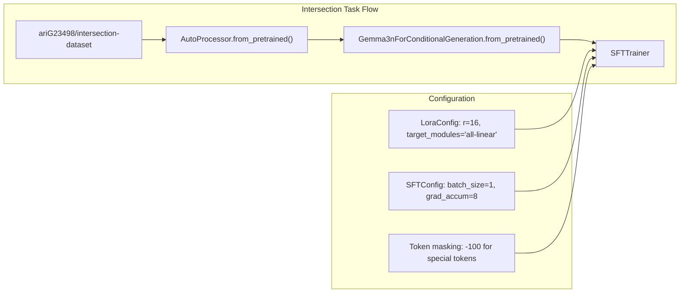

**Sources:** [notebooks/fine_tune_gemma3n_on_t4.ipynb:63-64](), [notebooks/fine_tune_gemma3n_on_t4.ipynb:117-123](), [notebooks/fine_tune_gemma3n_on_t4.ipynb:225-236]()

### GUI Grounding Implementation

The ScreenSpot fine-tuning follows a similar pattern but includes additional field handling:

- **Dataset loading**: `load_dataset("rootsautomation/ScreenSpot")` [notebooks/Gemma_3n_GUI_Finetune.ipynb:304]()
- **Field mapping**: Handles `instruction`, `text`, `query` fields and `target`, `answer`, `location`, `coordinates` [notebooks/Gemma_3n_GUI_Finetune.ipynb:139-160]()
- **Training configuration**: 3 epochs, cosine learning rate scheduling [notebooks/Gemma_3n_GUI_Finetune.ipynb:416-419]()

### Data Collation Function

The core data processing function handles multimodal batching:

```python
def collate_fn(examples):
    texts = []
    images_list = []
    
    for example in examples:
        text = processor.apply_chat_template(
            example["messages"], tokenize=False, add_generation_prompt=False
        ).strip()
        texts.append(text)
        
        images = process_vision_info(example["messages"])
        images_list.append(images)
    
    batch = processor(text=texts, images=images_list, return_tensors="pt", padding=True)
    labels = batch["input_ids"].clone()
    
    # Token masking for loss computation
    labels[labels == processor.tokenizer.pad_token_id] = -100
    # Additional special token masking...
    
    batch["labels"] = labels
    return batch
```

**Sources:** [notebooks/fine_tune_gemma3n_on_t4.ipynb:166-206](), [scripts/ft_gemma3n_image_trl.py:260-308]()

## Production Scripts

### TRL Training Script

The production script [scripts/ft_gemma3n_image_trl.py]() provides:

- **Multi-dataset support**: Handles intersection, ScreenSpot, and MMIU datasets
- **Flexible model selection**: Supports both `Gemma3nForConditionalGeneration` and `AutoModelForImageTextToText`
- **Configurable PEFT**: Custom `my_get_peft_config()` function for comma-separated target modules
- **Hub integration**: Automatic model and processor pushing to Hugging Face Hub

### Vanilla Training Script

The custom training script [scripts/ft_gemma3n_image_vt.py]() offers:

- **Selective layer freezing**: `freeze_layers()` function for attention-only training
- **Manual optimization**: Custom gradient accumulation and validation loops
- **Inference visualization**: `run_inference()` function with matplotlib plotting
- **Memory efficiency**: Gradient checkpointing and mixed precision training

**Sources:** [scripts/ft_gemma3n_image_trl.py:218-352](), [scripts/ft_gemma3n_image_vt.py:122-186]()

---

# Page: Audio Tasks

# Audio Tasks

<details>
<summary>Relevant source files</summary>

The following files were used as context for generating this wiki page:

- [notebooks/fine_tune_gemma3n_on_audio.ipynb](notebooks/fine_tune_gemma3n_on_audio.ipynb)
- [notebooks/fine_tune_gemma3n_on_t4.ipynb](notebooks/fine_tune_gemma3n_on_t4.ipynb)
- [scripts/ft_gemma3n_audio_vt.py](scripts/ft_gemma3n_audio_vt.py)

</details>


This document covers fine-tuning Gemma models for audio processing tasks, specifically speech transcription and audio understanding. The focus is on the multimodal Gemma3n model family which supports audio inputs alongside text and images.

For vision-related multimodal tasks, see [Vision Tasks](#4.1). For text-only conversational AI, see [Text and Conversational AI](#4.3).

## Audio Processing Overview

The Gemma3n model family provides native audio processing capabilities through multimodal input handling. The primary audio task demonstrated in this repository is French speech transcription, though the framework supports broader audio understanding tasks.

### Model Architecture

```mermaid
graph TB
    subgraph "Gemma3n Audio Processing Pipeline"
        AudioInput["Audio Input<br/>16kHz sampling rate"]
        Processor["Gemma3nProcessor<br/>AutoProcessor"]
        Tokenizer["Tokenizer<br/>Special audio tokens"]
        Model["Gemma3nForConditionalGeneration<br/>google/gemma-3n-E2B-it"]
    end
    
    subgraph "Audio Token Handling"
        AudioToken["audio_token_id"]
        BOIToken["boi_token_id"]
        EOIToken["eoi_token_id"]
        PadToken["pad_token_id"]
    end
    
    subgraph "Training Components"
        SFTTrainer["SFTTrainer<br/>TRL framework"]
        LoraConfig["LoraConfig<br/>Parameter efficient"]
        DataCollator["collate_fn<br/>Custom collator"]
    end
    
    AudioInput --> Processor
    Processor --> Tokenizer
    Tokenizer --> Model
    
    Processor --> AudioToken
    Processor --> BOIToken
    Processor --> EOIToken
    Processor --> PadToken
    
    Model --> SFTTrainer
    SFTTrainer --> LoraConfig
    SFTTrainer --> DataCollator
```

Sources: [notebooks/fine_tune_gemma3n_on_audio.ipynb:135-142](), [scripts/ft_gemma3n_audio_vt.py:114-116]()

## Dataset Preparation

Audio fine-tuning uses the Emilia French dataset, which contains French speech audio paired with transcriptions. The dataset is preprocessed to match the expected multimodal message format.

### Dataset Structure

| Field | Type | Description |
|-------|------|-------------|
| `audio` | Audio array | Raw audio data at 16kHz sampling rate |
| `text` | String | Ground truth transcription |
| `messages` | List[Dict] | Formatted conversation structure |

### Data Formatting

The audio data is formatted into a conversational structure compatible with the chat template:

```mermaid
graph LR
    subgraph "format_intersection_data Function"
        RawAudio["audio['array']<br/>Raw audio data"]
        RawText["samples['text']<br/>Transcription"]
        MessageFormat["Message Structure<br/>System + User + Assistant"]
    end
    
    subgraph "Message Components"
        SystemMsg["System Role<br/>'You are an assistant that transcribes speech accurately'"]
        UserMsg["User Role<br/>Audio + Text prompt"]
        AssistantMsg["Assistant Role<br/>Transcription response"]
    end
    
    RawAudio --> MessageFormat
    RawText --> MessageFormat
    MessageFormat --> SystemMsg
    MessageFormat --> UserMsg
    MessageFormat --> AssistantMsg
```

Sources: [notebooks/fine_tune_gemma3n_on_audio.ipynb:83-114](), [scripts/ft_gemma3n_audio_vt.py:17-42]()

## Fine-tuning Approaches

### Notebook-based Training

The notebook approach ([notebooks/fine_tune_gemma3n_on_audio.ipynb]()) uses the TRL framework with SFTTrainer for supervised fine-tuning:

**Key Configuration:**
- **Model**: `google/gemma-3n-E2B-it`
- **Dataset**: `AdrienB134/Emilia-dataset-french-split` (1000 samples)
- **Training Framework**: TRL SFTTrainer
- **Parameter Efficiency**: LoRA with rank 8

**LoRA Configuration:**
```
r=8, target_modules=["q_proj", "v_proj"], lora_alpha=16, lora_dropout=0.00
```

Sources: [notebooks/fine_tune_gemma3n_on_audio.ipynb:207-217]()

### Production Script Training

The production script ([scripts/ft_gemma3n_audio_vt.py]()) implements custom training loops with layer freezing:

**Key Features:**
- **Layer Freezing**: Only attention layers are trained ([scripts/ft_gemma3n_audio_vt.py:65-71]())
- **Custom DataLoader**: Manual batch processing with gradient accumulation
- **Validation**: Periodic inference checks during training
- **Dataset Size**: 10,000 training samples, 100 validation samples

### Training Configuration Comparison

| Aspect | Notebook Approach | Production Script |
|--------|-------------------|-------------------|
| Framework | TRL SFTTrainer | Custom PyTorch |
| Parameter Efficiency | LoRA (q_proj, v_proj) | Layer freezing (attention only) |
| Batch Size | 1 (8 accumulation steps) | 1 (8 accumulation steps) |
| Learning Rate | 1e-5 | 1e-5 |
| Gradient Checkpointing | Yes | No |
| Validation | Optional | Every 100 steps |

Sources: [notebooks/fine_tune_gemma3n_on_audio.ipynb:228-245](), [scripts/ft_gemma3n_audio_vt.py:157-181]()

## Data Processing Pipeline

### Audio Preprocessing

Audio data is processed through several stages before model input:

```mermaid
graph TB
    subgraph "Audio Processing Flow"
        Dataset["load_dataset<br/>AdrienB134/Emilia-dataset-french-split"]
        AudioCast["cast_column<br/>Audio(sampling_rate=16_000)"]
        FormatData["format_intersection_data<br/>Message formatting"]
        Collator["collate_fn<br/>Batch processing"]
    end
    
    subgraph "Processor Components"
        ChatTemplate["apply_chat_template<br/>Text formatting"]
        AudioProcess["processor<br/>Audio tokenization"]
        TokenMask["Token masking<br/>Special tokens"]
    end
    
    subgraph "Special Token Handling"
        AudioTokenMask["audio_token_id → -100"]
        ImageTokenMask["image_token_id → -100"]
        BOITokenMask["boi_token_id → -100"]
        EOITokenMask["eoi_token_id → -100"]
        PadTokenMask["pad_token_id → -100"]
    end
    
    Dataset --> AudioCast
    AudioCast --> FormatData
    FormatData --> Collator
    
    Collator --> ChatTemplate
    Collator --> AudioProcess
    Collator --> TokenMask
    
    TokenMask --> AudioTokenMask
    TokenMask --> ImageTokenMask
    TokenMask --> BOITokenMask
    TokenMask --> EOITokenMask
    TokenMask --> PadTokenMask
```

Sources: [notebooks/fine_tune_gemma3n_on_audio.ipynb:70-72](), [notebooks/fine_tune_gemma3n_on_audio.ipynb:152-187](), [scripts/ft_gemma3n_audio_vt.py:51-61]()

### Collation Function

The `collate_fn` handles batch processing of audio and text data:

**Notebook Implementation:**
- Processes multiple examples simultaneously
- Applies chat templates to format conversations
- Extracts audio arrays from dataset format
- Handles special token masking for loss computation

**Production Script Implementation:**
- Uses partial function application for processor binding
- Processes audio arrays directly from dataset
- Implements comprehensive token masking
- Supports custom message formatting

Sources: [notebooks/fine_tune_gemma3n_on_audio.ipynb:152-187](), [scripts/ft_gemma3n_audio_vt.py:17-62]()

## Model Training Configuration

### Training Arguments

Both approaches share common training parameters:

| Parameter | Value | Purpose |
|-----------|-------|---------|
| `per_device_train_batch_size` | 1 | Memory optimization |
| `gradient_accumulation_steps` | 8 | Effective batch size of 8 |
| `learning_rate` | 1e-5 | Conservative learning rate |
| `bf16` | True | Mixed precision training |
| `num_train_epochs` | 1.0 | Single epoch training |

### Loss Computation

The training process masks specific tokens to focus learning on transcription outputs:

- **Padding tokens** (`pad_token_id`) are masked to -100
- **Audio tokens** (`audio_token_id`) are masked to exclude from loss
- **Image tokens** (`image_token_id`) are masked for audio-only training
- **Special boundary tokens** (`boi_token_id`, `eoi_token_id`) are masked

This ensures the model learns to generate transcriptions while ignoring input audio representations.

Sources: [notebooks/fine_tune_gemma3n_on_audio.ipynb:171-187](), [scripts/ft_gemma3n_audio_vt.py:51-61]()

## Inference and Evaluation

### Inference Pipeline

The trained model performs inference by:

1. **Input Formatting**: Audio and prompt are formatted using chat templates
2. **Token Generation**: Model generates tokens with `max_new_tokens=100`
3. **Decoding**: Generated tokens are decoded to text transcription
4. **Evaluation**: Comparison with ground truth transcriptions

### Validation During Training

The production script includes validation checks every 100 training steps:

```mermaid
graph LR
    subgraph "Validation Process"
        RandomSample["random.choice<br/>val_dataset"]
        MessageFormat["Message formatting<br/>System + User roles"]
        ModelGenerate["model.generate<br/>max_new_tokens=100"]
        DecodeOutput["processor.decode<br/>skip_special_tokens=True"]
    end
    
    subgraph "Inference Components"
        ChatTemplate["apply_chat_template<br/>add_generation_prompt=True"]
        ModelInput["Tensor conversion<br/>bfloat16 dtype"]
        Generation["Generation output<br/>Remove input tokens"]
    end
    
    RandomSample --> MessageFormat
    MessageFormat --> ChatTemplate
    ChatTemplate --> ModelInput
    ModelInput --> ModelGenerate
    ModelGenerate --> Generation
    Generation --> DecodeOutput
```

Sources: [scripts/ft_gemma3n_audio_vt.py:74-112](), [scripts/ft_gemma3n_audio_vt.py:149-175]()

## Memory and Performance Optimization

### Parameter Efficient Training

**LoRA Configuration (Notebook):**
- Rank: 8
- Target modules: `q_proj`, `v_proj` (query and value projections)
- Alpha: 16
- Dropout: 0.0

**Layer Freezing (Production Script):**
- Only attention layers (`attn` in parameter names) are trainable
- All other parameters are frozen to reduce memory usage
- Enables training on larger datasets with limited GPU memory

### Batch Processing

Both approaches use:
- Batch size of 1 to fit audio data in memory
- Gradient accumulation over 8 steps for effective batch size of 8
- Mixed precision (bfloat16) for memory efficiency

Sources: [notebooks/fine_tune_gemma3n_on_audio.ipynb:207-217](), [scripts/ft_gemma3n_audio_vt.py:65-71]()

---

# Page: Text and Conversational AI

# Text and Conversational AI

<details>
<summary>Relevant source files</summary>

The following files were used as context for generating this wiki page:

- [notebooks/Gemma3N_(4B)-Conversational.ipynb](notebooks/Gemma3N_(4B)-Conversational.ipynb)
- [notebooks/Gemma3_(4B).ipynb](notebooks/Gemma3_(4B).ipynb)

</details>


This document covers fine-tuning Gemma models for text generation and conversational AI applications. It focuses on setting up conversational agents, formatting chat interactions, and leveraging Gemma's multimodal capabilities for text-based dialogue systems.

For vision-specific fine-tuning tasks, see [Vision Tasks](#4.1). For audio processing tasks, see [Audio Tasks](#4.2). For advanced techniques like GRPO, see [Advanced Techniques](#4.4).

## Model Architecture and Variants

The Gemma family provides several model variants optimized for conversational tasks. The primary models used for text and conversational AI include both text-only and multimodal variants.

```mermaid
graph TB
    subgraph "Gemma Model Variants"
        GEMMA3["Gemma 3<br/>Text Models"]
        GEMMA3N["Gemma 3N<br/>Multimodal Models"]
    end
    
    subgraph "Conversational Sizes"
        SIZE_4B["4B Parameters<br/>gemma-3-4b-it"]
        SIZE_E4B["E4B Variant<br/>gemma-3n-E4B-it"]
        SIZE_E2B["E2B Variant<br/>gemma-3n-E2B-it"]
    end
    
    subgraph "Fine-tuning Framework"
        FASTMODEL["FastModel<br/>Unsloth Framework"]
        QUANTIZED["4-bit Quantization<br/>BitsAndBytes"]
        LORA["LoRA Adapters<br/>Parameter Efficient"]
    end
    
    subgraph "Conversation Features"
        CHAT_TEMPLATE["Chat Templates<br/>apply_chat_template()"]
        MULTIMODAL["Multimodal Input<br/>Text + Image + Audio"]
        STREAMING["Text Streaming<br/>TextStreamer"]
    end
    
    GEMMA3 --> SIZE_4B
    GEMMA3N --> SIZE_E4B
    GEMMA3N --> SIZE_E2B
    
    SIZE_4B --> FASTMODEL
    SIZE_E4B --> FASTMODEL
    SIZE_E2B --> FASTMODEL
    
    FASTMODEL --> QUANTIZED
    FASTMODEL --> LORA
    
    FASTMODEL --> CHAT_TEMPLATE
    FASTMODEL --> MULTIMODAL
    FASTMODEL --> STREAMING
```

Sources: [notebooks/Gemma3N_(4B)-Conversational.ipynb:455-477]()

## Setup and Configuration

The conversational AI setup uses the Unsloth framework for efficient model loading and fine-tuning. The `FastModel` class provides the primary interface for loading pre-trained models with optimizations.

### Model Loading Configuration

```mermaid
graph LR
    subgraph "Model Selection"
        MODEL_NAME["model_name<br/>'unsloth/gemma-3n-E4B-it'"]
        DTYPE["dtype<br/>None (auto-detection)"]
        MAX_SEQ["max_seq_length<br/>1024 tokens"]
    end
    
    subgraph "Optimization Settings"
        LOAD_4BIT["load_in_4bit<br/>True"]
        FULL_FT["full_finetuning<br/>False"]
        TOKEN["token<br/>Optional HF token"]
    end
    
    subgraph "FastModel Output"
        MODEL_OBJ["model<br/>Loaded Model"]
        TOKENIZER_OBJ["tokenizer<br/>AutoTokenizer"]
    end
    
    MODEL_NAME --> MODEL_OBJ
    DTYPE --> MODEL_OBJ
    MAX_SEQ --> MODEL_OBJ
    LOAD_4BIT --> MODEL_OBJ
    FULL_FT --> MODEL_OBJ
    TOKEN --> MODEL_OBJ
    
    MODEL_OBJ --> TOKENIZER_OBJ
```

The key configuration parameters include:
- **Model Selection**: Choice between text-only (`gemma-3-4b-it`) and multimodal (`gemma-3n-E4B-it`) variants
- **Quantization**: 4-bit quantization for memory efficiency
- **Sequence Length**: Configurable context window (default 1024 tokens)
- **Fine-tuning Mode**: Parameter-efficient training vs full fine-tuning

Sources: [notebooks/Gemma3N_(4B)-Conversational.ipynb:470-477]()

## Conversation Formatting

Gemma models use a structured chat template system for formatting conversational interactions. The `apply_chat_template()` method handles proper conversation formatting.

### Chat Template Structure

```mermaid
graph TB
    subgraph "Message Format"
        ROLE["role<br/>'user' | 'assistant'"]
        CONTENT["content<br/>List of content items"]
    end
    
    subgraph "Content Types"
        TEXT_CONTENT["Text Content<br/>{'type': 'text', 'text': string}"]
        IMAGE_CONTENT["Image Content<br/>{'type': 'image', 'image': url}"]
        AUDIO_CONTENT["Audio Content<br/>{'type': 'audio', 'audio': url}"]
    end
    
    subgraph "Template Processing"
        APPLY_TEMPLATE["tokenizer.apply_chat_template()"]
        ADD_GENERATION["add_generation_prompt=True"]
        TOKENIZE["tokenize=True"]
        RETURN_DICT["return_dict=True"]
        RETURN_TENSORS["return_tensors='pt'"]
    end
    
    ROLE --> APPLY_TEMPLATE
    CONTENT --> APPLY_TEMPLATE
    TEXT_CONTENT --> CONTENT
    IMAGE_CONTENT --> CONTENT
    AUDIO_CONTENT --> CONTENT
    
    APPLY_TEMPLATE --> ADD_GENERATION
    ADD_GENERATION --> TOKENIZE
    TOKENIZE --> RETURN_DICT
    RETURN_DICT --> RETURN_TENSORS
```

Example message structure for multimodal conversation:
```python
messages = [{
    "role": "user",
    "content": [
        {"type": "image", "image": image_url},
        {"type": "text", "text": "What do you see in this image?"}
    ]
}]
```

Sources: [notebooks/Gemma3N_(4B)-Conversational.ipynb:498-509](), [notebooks/Gemma3N_(4B)-Conversational.ipynb:532-540]()

## Inference Capabilities

The inference system provides real-time text generation with streaming support and configurable generation parameters.

### Generation Pipeline

```mermaid
graph LR
    subgraph "Input Processing"
        MESSAGES["messages<br/>Conversation history"]
        CHAT_TEMPLATE["apply_chat_template()<br/>Format conversation"]
        TO_CUDA["to('cuda')<br/>Move to GPU"]
    end
    
    subgraph "Generation Parameters"
        MAX_TOKENS["max_new_tokens<br/>128 (default)"]
        TEMPERATURE["temperature<br/>1.0"]
        TOP_P["top_p<br/>0.95"]
        TOP_K["top_k<br/>64"]
    end
    
    subgraph "Output Processing"
        TEXT_STREAMER["TextStreamer<br/>Real-time output"]
        SKIP_PROMPT["skip_prompt=True<br/>Only new tokens"]
    end
    
    MESSAGES --> CHAT_TEMPLATE
    CHAT_TEMPLATE --> TO_CUDA
    TO_CUDA --> MAX_TOKENS
    
    MAX_TOKENS --> TEXT_STREAMER
    TEMPERATURE --> TEXT_STREAMER
    TOP_P --> TEXT_STREAMER
    TOP_K --> TEXT_STREAMER
    
    TEXT_STREAMER --> SKIP_PROMPT
```

The `do_gemma_3n_inference()` helper function encapsulates the complete inference pipeline with optimized generation settings for conversational responses.

Sources: [notebooks/Gemma3N_(4B)-Conversational.ipynb:494-509]()

## Multimodal Integration

Gemma 3N models support integrated processing of text, images, and audio within conversational contexts. This enables rich multimodal dialogue experiences.

### Multimodal Content Processing

```mermaid
graph TB
    subgraph "Input Modalities"
        TEXT_INPUT["Text Input<br/>User questions/prompts"]
        IMAGE_INPUT["Image Input<br/>URLs or file paths"]
        AUDIO_INPUT["Audio Input<br/>Speech/audio files"]
    end
    
    subgraph "Content Formatting"
        TEXT_FORMAT["{'type': 'text', 'text': content}"]
        IMAGE_FORMAT["{'type': 'image', 'image': url}"]
        AUDIO_FORMAT["{'type': 'audio', 'audio': url}"]
    end
    
    subgraph "Model Processing"
        MULTIMODAL_ENCODER["Multimodal Encoder<br/>Unified representation"]
        ATTENTION["Cross-modal Attention<br/>Feature fusion"]
        DECODER["Text Decoder<br/>Response generation"]
    end
    
    TEXT_INPUT --> TEXT_FORMAT
    IMAGE_INPUT --> IMAGE_FORMAT
    AUDIO_INPUT --> AUDIO_FORMAT
    
    TEXT_FORMAT --> MULTIMODAL_ENCODER
    IMAGE_FORMAT --> MULTIMODAL_ENCODER
    AUDIO_FORMAT --> MULTIMODAL_ENCODER
    
    MULTIMODAL_ENCODER --> ATTENTION
    ATTENTION --> DECODER
```

Example multimodal interactions:
- **Image Analysis**: Processing images with accompanying text questions
- **Audio Understanding**: Transcribing and responding to audio content
- **Mixed Media**: Combining multiple modalities in single conversations

Sources: [notebooks/Gemma3N_(4B)-Conversational.ipynb:530-569](), [notebooks/Gemma3N_(4B)-Conversational.ipynb:634-646]()

## Training Process Overview

While the notebook focuses on inference, it establishes the foundation for conversational fine-tuning using parameter-efficient methods.

### Fine-tuning Architecture

```mermaid
graph TB
    subgraph "Training Framework"
        UNSLOTH["Unsloth Framework<br/>Memory optimization"]
        LORA_TRAINING["LoRA Training<br/>Parameter efficient"]
        GRADIENT_CHECKPOINTING["Gradient Checkpointing<br/>Memory management"]
    end
    
    subgraph "Data Processing"
        CONVERSATION_DATA["Conversation Dataset<br/>Chat format"]
        RESPONSE_MASKING["Response-only Training<br/>Mask user inputs"]
        BATCH_PROCESSING["Batch Processing<br/>Efficient training"]
    end
    
    subgraph "Model Outputs"
        LORA_ADAPTERS["LoRA Adapters<br/>Efficient storage"]
        MERGED_MODEL["Merged Model<br/>Full deployment"]
        INFERENCE_READY["Inference Ready<br/>Chat deployment"]
    end
    
    UNSLOTH --> CONVERSATION_DATA
    LORA_TRAINING --> CONVERSATION_DATA
    GRADIENT_CHECKPOINTING --> CONVERSATION_DATA
    
    CONVERSATION_DATA --> RESPONSE_MASKING
    RESPONSE_MASKING --> BATCH_PROCESSING
    
    BATCH_PROCESSING --> LORA_ADAPTERS
    LORA_ADAPTERS --> MERGED_MODEL
    MERGED_MODEL --> INFERENCE_READY
```

The training process leverages:
- **Parameter Efficiency**: LoRA adapters for memory-efficient fine-tuning
- **Response-only Training**: Masking user inputs to focus training on assistant responses
- **Multimodal Support**: Training on mixed text, image, and audio conversations

Sources: [notebooks/Gemma3N_(4B)-Conversational.ipynb:63-77](), [notebooks/Gemma3N_(4B)-Conversational.ipynb:470-477]()

## Key Configuration Parameters

| Parameter | Default | Description |
|-----------|---------|-------------|
| `model_name` | `"unsloth/gemma-3n-E4B-it"` | Pre-trained model identifier |
| `max_seq_length` | `1024` | Maximum context window |
| `load_in_4bit` | `True` | Enable 4-bit quantization |
| `temperature` | `1.0` | Generation randomness |
| `top_p` | `0.95` | Nucleus sampling threshold |
| `top_k` | `64` | Top-k sampling limit |
| `max_new_tokens` | `128` | Maximum response length |

This configuration provides a balanced approach between model performance, memory efficiency, and generation quality for conversational applications.

Sources: [notebooks/Gemma3N_(4B)-Conversational.ipynb:470-509]()

---

# Page: Advanced Techniques

# Advanced Techniques

<details>
<summary>Relevant source files</summary>

The following files were used as context for generating this wiki page:

- [notebooks/Gemma3_(1B)-GRPO.ipynb](notebooks/Gemma3_(1B)-GRPO.ipynb)

</details>


This document covers advanced fine-tuning techniques for Gemma models that go beyond standard supervised fine-tuning approaches. These techniques include reinforcement learning methods, specialized training strategies, and optimization approaches for complex multi-modal tasks.

For basic fine-tuning approaches, see [Fine-tuning Guide](#4). For task-specific implementations, see [Vision Tasks](#4.1), [Audio Tasks](#4.2), and [Text and Conversational AI](#4.3).

## GRPO (Generalized Reward Policy Optimization)

GRPO represents a reinforcement learning approach specifically designed for mathematical reasoning tasks. This technique optimizes model performance by learning from reward signals rather than relying solely on supervised learning.

### GRPO Architecture

```mermaid
graph TB
    subgraph "GRPO Training Pipeline"
        GSM8K["GSM8K Dataset<br/>Mathematical Problems"]
        GEMMA1B["Gemma 1B Model<br/>Base Model"]
        REWARD["Reward Model<br/>Mathematical Accuracy"]
        POLICY["Policy Training<br/>GRPO Algorithm"]
        OPTIMIZED["Optimized Model<br/>Math Reasoning"]
    end
    
    subgraph "Training Components"
        TRL["TRL Library<br/>Transformer RL"]
        ADAPTER["LoRA Adapters<br/>Parameter Efficient"]
        EVALUATOR["Math Evaluator<br/>Accuracy Metrics"]
    end
    
    GSM8K --> GEMMA1B
    GEMMA1B --> REWARD
    REWARD --> POLICY
    POLICY --> OPTIMIZED
    
    TRL --> POLICY
    ADAPTER --> POLICY
    EVALUATOR --> REWARD
    
    OPTIMIZED --> EVALUATOR
```

The GRPO implementation leverages the TRL (Transformer Reinforcement Learning) library to implement policy optimization specifically for mathematical reasoning tasks. The approach uses the GSM8K dataset as a benchmark for training and evaluation.

**Key Components:**
- **Base Model**: Gemma 1B parameter model optimized for mathematical reasoning
- **Reward Signal**: Mathematical accuracy on problem-solving tasks
- **Policy Optimization**: GRPO algorithm implementation through TRL
- **Evaluation**: Continuous assessment using mathematical benchmarks

Sources: Based on repository architecture diagrams showing GRPO math reasoning with 1B model and TRL integration.

## Reinforcement Learning Integration

The repository integrates multiple reinforcement learning approaches through the TRL library, providing a foundation for advanced training techniques beyond supervised fine-tuning.

### TRL Framework Integration

```mermaid
graph LR
    subgraph "TRL_Components"
        SFTTRAINER["SFTTrainer<br/>Supervised Fine-tuning"]
        PPOTRAINER["PPOTrainer<br/>Proximal Policy Optimization"]
        DPOTRAINER["DPOTrainer<br/>Direct Preference Optimization"]
        GRPOTRAINER["GRPOTrainer<br/>Mathematical Reasoning"]
    end
    
    subgraph "Model_Configurations"
        LORA_CONFIG["LoRA Configuration<br/>Parameter Efficient"]
        FULL_CONFIG["Full Model Training<br/>All Parameters"]
        CUSTOM_CONFIG["Custom Training<br/>Selective Layers"]
    end
    
    subgraph "Training_Strategies"
        RESPONSE_ONLY["Response-Only Training<br/>Instruction Masking"]
        MULTIMODAL_PROC["Multimodal Processing<br/>Image+Text+Audio"]
        LAYER_FREEZE["Layer Freezing<br/>Attention-Only Training"]
    end
    
    SFTTRAINER --> LORA_CONFIG
    PPOTRAINER --> FULL_CONFIG
    DPOTRAINER --> CUSTOM_CONFIG
    GRPOTRAINER --> LORA_CONFIG
    
    LORA_CONFIG --> RESPONSE_ONLY
    FULL_CONFIG --> MULTIMODAL_PROC
    CUSTOM_CONFIG --> LAYER_FREEZE
```

**Training Methodologies:**
- **SFTTrainer**: Standard supervised fine-tuning with instruction following
- **PPOTrainer**: Proximal Policy Optimization for reward-based learning
- **DPOTrainer**: Direct Preference Optimization for alignment tasks
- **GRPOTrainer**: Specialized mathematical reasoning optimization

Sources: Based on repository diagrams showing TRL library integration with high importance rating and multiple training approaches.

## Specialized Training Techniques

Advanced training techniques optimize specific aspects of model performance, memory usage, and computational efficiency.

### Response-Only Training

Response-only training focuses computational resources on optimizing model responses while masking instruction tokens during loss calculation. This technique improves training efficiency and response quality.

```mermaid
graph TB
    subgraph "Response_Only_Training"
        INPUT["Input Sequence<br/>Instruction + Response"]
        TOKENIZER["Tokenizer<br/>Sequence Processing"]
        MASKING["Instruction Masking<br/>Loss Calculation"]
        LOSS["Response Loss<br/>Optimization Target"]
    end
    
    subgraph "Implementation"
        CHAT_TEMPLATE["Chat Template<br/>Gemma-3 Format"]
        COLLATOR["Data Collator<br/>Batch Processing"]
        TRAINER["SFTTrainer<br/>Masked Training"]
    end
    
    INPUT --> TOKENIZER
    TOKENIZER --> MASKING
    MASKING --> LOSS
    
    CHAT_TEMPLATE --> COLLATOR
    COLLATOR --> TRAINER
    TRAINER --> LOSS
```

**Key Features:**
- **Instruction Masking**: Excludes instruction tokens from loss computation
- **Response Focus**: Optimizes only on model-generated responses
- **Efficiency**: Reduces computational overhead during training
- **Quality**: Improves response relevance and coherence

Sources: Based on repository architecture showing response-only training as a specialized technique within the TRL framework.

### Layer Freezing and Selective Training

Layer freezing techniques enable targeted optimization of specific model components, reducing memory requirements and training time while maintaining performance.

| Technique | Target Layers | Use Case | Memory Savings |
|-----------|---------------|----------|----------------|
| Attention-Only | Attention modules | Fine-tuning focus | 60-70% |
| Layer Freezing | Early layers | Transfer learning | 40-50% |
| Selective Training | Custom selection | Specialized tasks | 30-80% |

**Implementation Approaches:**
- **Attention-Only Training**: Freezes feed-forward layers, trains attention mechanisms
- **Early Layer Freezing**: Maintains pretrained features, adapts high-level representations
- **Custom Selection**: Task-specific layer selection based on analysis

Sources: Based on repository diagrams showing layer freezing as a specialized technique using vanilla PyTorch implementations.

## Advanced Multimodal Processing

Multimodal processing techniques handle complex interactions between different input modalities including text, images, audio, and video.

### Multimodal Training Pipeline

```mermaid
graph TB
    subgraph "Input_Modalities"
        TEXT["Text Input<br/>Instructions"]
        IMAGE["Image Input<br/>Visual Content"]
        AUDIO["Audio Input<br/>Speech/Sound"]
        VIDEO["Video Input<br/>Temporal Sequences"]
    end
    
    subgraph "Processing_Layer"
        AUTOPROCESSOR["AutoProcessor<br/>Multimodal Tokenization"]
        FEATURE_EXTRACTION["Feature Extraction<br/>Modality-Specific"]
        FUSION["Modality Fusion<br/>Cross-Attention"]
    end
    
    subgraph "Training_Components"
        MULTIMODAL_TRAINER["Multimodal Trainer<br/>Custom Training Loop"]
        LOSS_COMPUTATION["Loss Computation<br/>Multi-Objective"]
        EVALUATION["Multimodal Evaluation<br/>Task-Specific Metrics"]
    end
    
    TEXT --> AUTOPROCESSOR
    IMAGE --> AUTOPROCESSOR
    AUDIO --> AUTOPROCESSOR
    VIDEO --> AUTOPROCESSOR
    
    AUTOPROCESSOR --> FEATURE_EXTRACTION
    FEATURE_EXTRACTION --> FUSION
    FUSION --> MULTIMODAL_TRAINER
    
    MULTIMODAL_TRAINER --> LOSS_COMPUTATION
    LOSS_COMPUTATION --> EVALUATION
```

**Processing Capabilities:**
- **AutoProcessor**: Unified processing interface for all modalities
- **Feature Extraction**: Modality-specific feature extraction and normalization
- **Fusion Mechanisms**: Cross-modal attention and integration strategies
- **Multi-Objective Training**: Simultaneous optimization across modalities

Sources: Based on repository architecture showing multimodal processing as a specialized technique with support for image, text, and audio integration.

## Memory and Performance Optimization

Advanced optimization techniques maximize training efficiency and model performance while minimizing computational requirements.

### Optimization Strategies

```mermaid
graph LR
    subgraph "Memory_Optimization"
        GRADIENT_CHECKPOINTING["Gradient Checkpointing<br/>Memory Reduction"]
        MIXED_PRECISION["Mixed Precision<br/>FP16/BF16 Training"]
        GRADIENT_ACCUMULATION["Gradient Accumulation<br/>Batch Size Scaling"]
    end
    
    subgraph "Training_Acceleration"
        UNSLOTH["Unsloth Integration<br/>Fast Training"]
        DATALOADER["Optimized DataLoader<br/>Parallel Processing"]
        COMPILATION["Model Compilation<br/>PyTorch 2.0"]
    end
    
    subgraph "Model_Efficiency"
        LORA_OPTIMIZATION["LoRA Optimization<br/>Parameter Efficient"]
        QUANTIZATION["Post-Training Quantization<br/>Size Reduction"]
        PRUNING["Model Pruning<br/>Sparse Training"]
    end
    
    GRADIENT_CHECKPOINTING --> UNSLOTH
    MIXED_PRECISION --> DATALOADER
    GRADIENT_ACCUMULATION --> COMPILATION
    
    UNSLOTH --> LORA_OPTIMIZATION
    DATALOADER --> QUANTIZATION
    COMPILATION --> PRUNING
```

**Optimization Techniques:**
- **Gradient Checkpointing**: Reduces memory usage by recomputing activations
- **Mixed Precision**: Accelerates training with reduced precision arithmetic
- **Unsloth Integration**: Provides optimized training loops for Gemma models
- **LoRA Optimization**: Efficient parameter updates with minimal memory overhead

Sources: Based on repository diagrams showing Unsloth as a memory-efficient training framework and various optimization approaches.

## Custom Training Loops

Advanced users can implement custom training loops for specialized requirements that extend beyond standard training frameworks.

### Custom Training Implementation

```mermaid
graph TB
    subgraph "Custom_Training_Loop"
        INITIALIZATION["Model Initialization<br/>Custom Configuration"]
        DATA_LOADING["Custom Data Loading<br/>Specialized Datasets"]
        FORWARD_PASS["Forward Pass<br/>Custom Loss Functions"]
        BACKWARD_PASS["Backward Pass<br/>Custom Optimization"]
        CHECKPOINTING["Custom Checkpointing<br/>State Management"]
    end
    
    subgraph "Framework_Integration"
        PYTORCH["PyTorch Core<br/>Base Framework"]
        TRANSFORMERS["Transformers Library<br/>Model Architecture"]
        CUSTOM_MODULES["Custom Modules<br/>Specialized Components"]
    end
    
    INITIALIZATION --> DATA_LOADING
    DATA_LOADING --> FORWARD_PASS
    FORWARD_PASS --> BACKWARD_PASS
    BACKWARD_PASS --> CHECKPOINTING
    CHECKPOINTING --> DATA_LOADING
    
    PYTORCH --> INITIALIZATION
    TRANSFORMERS --> FORWARD_PASS
    CUSTOM_MODULES --> BACKWARD_PASS
```

**Custom Training Features:**
- **Flexible Architecture**: Implement task-specific training procedures
- **Custom Loss Functions**: Design specialized optimization objectives
- **State Management**: Advanced checkpointing and resumption capabilities
- **Integration**: Seamless integration with existing PyTorch workflows

Sources: Based on repository diagrams showing vanilla PyTorch as a training framework option for custom implementations.

---

# Page: Production Scripts

# Production Scripts

<details>
<summary>Relevant source files</summary>

The following files were used as context for generating this wiki page:

- [scripts/ft_gemma3n_audio_vt.py](scripts/ft_gemma3n_audio_vt.py)
- [scripts/ft_gemma3n_image_trl.py](scripts/ft_gemma3n_image_trl.py)
- [scripts/ft_gemma3n_image_vt.py](scripts/ft_gemma3n_image_vt.py)

</details>


The production scripts provide automated fine-tuning workflows for Gemma models across different modalities and training approaches. These scripts are designed for batch processing and automated deployment scenarios, complementing the interactive notebook examples covered in other sections.

For interactive fine-tuning examples and tutorials, see [Fine-tuning Guide](#4). For general inference usage, see [Inference and Usage](#3).

## Script Overview

The repository contains three main production scripts, each targeting different modalities and training approaches:

| Script | Modality | Training Framework | Key Features |
|--------|----------|-------------------|--------------|
| `ft_gemma3n_image_trl.py` | Vision | TRL Library | Multi-dataset support, LoRA, Distributed training |
| `ft_gemma3n_image_vt.py` | Vision | Vanilla PyTorch | Custom training loop, Attention freezing, Visualization |
| `ft_gemma3n_audio_vt.py` | Audio | Vanilla PyTorch | Audio transcription, Custom collation, Validation loop |

Sources: [scripts/ft_gemma3n_image_trl.py:1-353](), [scripts/ft_gemma3n_image_vt.py:1-187](), [scripts/ft_gemma3n_audio_vt.py:1-185]()

## Training Pipeline Architecture

```mermaid
graph TB
    subgraph "TRL Training Pipeline"
        TRL_PARSER["TrlParser"]
        TRL_CONFIG["SFTConfig + ModelConfig"]
        TRL_TRAINER["SFTTrainer"]
        TRL_PEFT["my_get_peft_config"]
    end
    
    subgraph "Vanilla PyTorch Pipeline"
        VT_DATALOADER["DataLoader"]
        VT_MODEL["Gemma3nForConditionalGeneration"]
        VT_OPTIMIZER["torch.optim.AdamW"]
        VT_FREEZE["freeze_layers"]
    end
    
    subgraph "Common Components"
        PROCESSOR["Gemma3nProcessor"]
        COLLATE_FN["collate_fn"]
        DATASET["load_dataset"]
    end
    
    subgraph "Output"
        LORA_ADAPTER["LoRA Adapter"]
        MERGED_MODEL["Merged Model"]
        INFERENCE_READY["Inference Ready"]
    end
    
    TRL_PARSER --> TRL_CONFIG
    TRL_CONFIG --> TRL_TRAINER
    TRL_TRAINER --> TRL_PEFT
    TRL_PEFT --> LORA_ADAPTER
    
    VT_DATALOADER --> VT_MODEL
    VT_MODEL --> VT_FREEZE
    VT_FREEZE --> VT_OPTIMIZER
    VT_OPTIMIZER --> MERGED_MODEL
    
    DATASET --> PROCESSOR
    PROCESSOR --> COLLATE_FN
    COLLATE_FN --> TRL_TRAINER
    COLLATE_FN --> VT_DATALOADER
    
    LORA_ADAPTER --> INFERENCE_READY
    MERGED_MODEL --> INFERENCE_READY
```

Sources: [scripts/ft_gemma3n_image_trl.py:219-342](), [scripts/ft_gemma3n_image_vt.py:122-186](), [scripts/ft_gemma3n_audio_vt.py:114-184]()

## TRL-based Training Script

The `ft_gemma3n_image_trl.py` script provides a production-ready training pipeline using the TRL library with distributed training support.

### Key Components

The script uses several core classes for configuration and training:

- `TrlParser` - Handles command-line argument parsing [scripts/ft_gemma3n_image_trl.py:219]()
- `SFTTrainer` - Manages the supervised fine-tuning process [scripts/ft_gemma3n_image_trl.py:329-342]()
- `my_get_peft_config` - Configures LoRA parameters [scripts/ft_gemma3n_image_trl.py:67-99]()

### Multi-Dataset Support

The script supports three different vision datasets with specialized processing:

```mermaid
graph LR
    subgraph "Dataset Processing"
        INTERSECTION["ariG23498/intersection-dataset"]
        LLAVA["HuggingFaceH4/llava-instruct-mix-vsft"]
        MMIU["FanqingM/MMIU-Benchmark"]
    end
    
    subgraph "Format Functions"
        FORMAT_INTERSECTION["format_intersection_data"]
        FORMAT_LLAVA["Standard TRL Format"]
        FORMAT_MMIU["format_data + prepare_dataset"]
    end
    
    subgraph "Processing Pipeline"
        PROCESS_VISION["process_vision_info"]
        COLLATE_BATCH["collate_fn"]
        APPLY_TEMPLATE["apply_chat_template"]
    end
    
    INTERSECTION --> FORMAT_INTERSECTION
    LLAVA --> FORMAT_LLAVA
    MMIU --> FORMAT_MMIU
    
    FORMAT_INTERSECTION --> PROCESS_VISION
    FORMAT_LLAVA --> PROCESS_VISION
    FORMAT_MMIU --> PROCESS_VISION
    
    PROCESS_VISION --> COLLATE_BATCH
    COLLATE_BATCH --> APPLY_TEMPLATE
```

Sources: [scripts/ft_gemma3n_image_trl.py:102-134](), [scripts/ft_gemma3n_image_trl.py:162-195](), [scripts/ft_gemma3n_image_trl.py:197-216]()

### Usage Commands

The script includes embedded usage examples for different datasets:

```bash
# Intersection dataset training
accelerate launch --config_file examples/accelerate_configs/deepspeed_zero3.yaml \
    scripts/ft_gemma3n_image_trl.py \
    --dataset_name ariG23498/intersection-dataset \
    --model_name_or_path google/gemma-3n-E2B-it \
    --use_peft --lora_target_modules all-linear
```

Sources: [scripts/ft_gemma3n_image_trl.py:1-51]()

## Vanilla PyTorch Training Scripts

The vanilla PyTorch scripts provide custom training loops with more granular control over the training process.

### Common Training Loop Pattern

Both `ft_gemma3n_image_vt.py` and `ft_gemma3n_audio_vt.py` follow a similar pattern:

```mermaid
graph TB
    subgraph "Training Loop Components"
        LOAD_MODEL["Gemma3nForConditionalGeneration.from_pretrained"]
        FREEZE_LAYERS["freeze_layers"]
        CREATE_OPTIMIZER["torch.optim.AdamW"]
        TRAIN_LOOP["Training Loop with Accumulation"]
        VALIDATION["Validation Loop"]
        INFERENCE["run_inference"]
    end
    
    subgraph "Data Processing"
        LOAD_DATASET["load_dataset"]
        CREATE_DATALOADER["DataLoader with collate_fn"]
        BATCH_PROCESSING["Batch Processing"]
    end
    
    LOAD_DATASET --> CREATE_DATALOADER
    CREATE_DATALOADER --> BATCH_PROCESSING
    LOAD_MODEL --> FREEZE_LAYERS
    FREEZE_LAYERS --> CREATE_OPTIMIZER
    CREATE_OPTIMIZER --> TRAIN_LOOP
    TRAIN_LOOP --> VALIDATION
    VALIDATION --> INFERENCE
    BATCH_PROCESSING --> TRAIN_LOOP
```

Sources: [scripts/ft_gemma3n_image_vt.py:122-186](), [scripts/ft_gemma3n_audio_vt.py:114-184]()

### Layer Freezing Strategy

The `freeze_layers` function implements attention-only fine-tuning:

```python
def freeze_layers(model):
    for name, param in model.named_parameters():
        if "attn" in name:
            param.requires_grad = True
        else:
            param.requires_grad = False
    return model
```

This approach only trains attention parameters while freezing other model components.

Sources: [scripts/ft_gemma3n_image_vt.py:67-73](), [scripts/ft_gemma3n_audio_vt.py:65-71]()

## Data Processing Pipeline

### Audio Processing (`ft_gemma3n_audio_vt.py`)

The audio script processes French transcription data with specialized token masking:

```mermaid
graph LR
    subgraph "Audio Data Flow"
        AUDIO_INPUT["sample['audio']['array']"]
        CHAT_TEMPLATE["processor.apply_chat_template"]
        TOKEN_MASKING["Token Masking"]
        BATCH_OUTPUT["Training Batch"]
    end
    
    subgraph "Masked Tokens"
        PAD_TOKEN["pad_token_id"]
        AUDIO_TOKEN["audio_token_id"]
        IMAGE_TOKEN["image_token_id"]
        BOI_TOKEN["boi_token_id"]
        EOI_TOKEN["eoi_token_id"]
    end
    
    AUDIO_INPUT --> CHAT_TEMPLATE
    CHAT_TEMPLATE --> TOKEN_MASKING
    TOKEN_MASKING --> BATCH_OUTPUT
    
    PAD_TOKEN --> TOKEN_MASKING
    AUDIO_TOKEN --> TOKEN_MASKING
    IMAGE_TOKEN --> TOKEN_MASKING
    BOI_TOKEN --> TOKEN_MASKING
    EOI_TOKEN --> TOKEN_MASKING
```

Sources: [scripts/ft_gemma3n_audio_vt.py:17-62]()

### Image Processing 

Both image scripts use similar preprocessing but with different complexity levels:

- `ft_gemma3n_image_vt.py` - Simple intersection counting [scripts/ft_gemma3n_image_vt.py:17-64]()
- `ft_gemma3n_image_trl.py` - Multi-image and multi-dataset support [scripts/ft_gemma3n_image_trl.py:260-308]()

## Configuration and Parameters

### Model Configuration

All scripts use consistent model loading patterns:

| Parameter | TRL Script | Vanilla Scripts |
|-----------|------------|-----------------|
| Model Class | `Gemma3nForConditionalGeneration` | `Gemma3nForConditionalGeneration` |
| Processor | `AutoProcessor` | `Gemma3nProcessor` |
| Precision | `torch.bfloat16` | `torch.bfloat16` |
| Device | Automatic | `cuda` |

### Training Parameters

| Parameter | TRL Script | Vanilla Scripts |
|-----------|------------|-----------------|
| Batch Size | Configurable | Fixed (1-2) |
| Learning Rate | Configurable | `1e-5` |
| Gradient Accumulation | Configurable | `8` steps |
| Optimization | LoRA | Attention-only |

Sources: [scripts/ft_gemma3n_image_trl.py:228-259](), [scripts/ft_gemma3n_image_vt.py:152-159](), [scripts/ft_gemma3n_audio_vt.py:145-154]()

## Training Strategies

### Parameter-Efficient Fine-tuning (PEFT)

The TRL script implements LoRA configuration through `my_get_peft_config`:

- Target modules: `all-linear` or comma-separated list
- Rank (`r`): Configurable
- Alpha (`lora_alpha`): Configurable
- Dropout (`lora_dropout`): Configurable

### Attention-Only Training

The vanilla scripts use `freeze_layers` to only train attention parameters, reducing memory usage and training time while maintaining performance for specific tasks.

Sources: [scripts/ft_gemma3n_image_trl.py:67-99](), [scripts/ft_gemma3n_image_vt.py:67-73](), [scripts/ft_gemma3n_audio_vt.py:65-71]()

---

# Page: Contributing

# Contributing

<details>
<summary>Relevant source files</summary>

The following files were used as context for generating this wiki page:

- [.github/CONTRIBUTING.md](.github/CONTRIBUTING.md)
- [assets/Fork.png](assets/Fork.png)
- [assets/PR.png](assets/PR.png)
- [assets/new_issue.png](assets/new_issue.png)

</details>


This document provides comprehensive guidelines for contributing to the Hugging Face Gemma Recipes repository. It covers the contribution workflow, code organization, and technical requirements for submitting new recipes, examples, and improvements to the codebase.

For information about using the existing recipes and examples, see [Getting Started](#2) and [Inference and Usage](#3). For documentation on the various fine-tuning approaches available, see [Fine-tuning Guide](#4).

## Contribution Workflow Overview

The repository follows a standard GitHub-based contribution workflow with specific requirements for maintaining the quality and organization of Gemma model recipes.

```mermaid
graph TD
    A[Issue] --> B[Fork]
    B --> C[Branch]
    C --> D[Changes]
    D --> E[Update_README]
    E --> F[Commit]
    F --> G[Push]
    G --> H[Pull_Request]
    H --> I[Review]
    I --> J[Merge]
    
    A --> K["issues_tab"]
    B --> L["fork_button"]
    H --> M["new_pull_request"]
    
    D --> N["notebooks/"]
    D --> O["scripts/"]
    D --> P["examples/"]
    
    E --> Q["README.md:28-29"]
```

Sources: [.github/CONTRIBUTING.md:7-51](), [assets/new_issue.png](), [assets/Fork.png](), [assets/PR.png]()

## Types of Contributions

The repository accepts several categories of contributions, each with specific organizational requirements and technical standards.

### Recipe Categories

| Category | Location | Requirements |
|----------|----------|-------------|
| Fine-tuning Notebooks | `notebooks/` | Jupyter notebooks with complete examples |
| Production Scripts | `scripts/` | Python scripts for automated training |
| Inference Examples | `examples/` | Pipeline-based usage demonstrations |
| Documentation | `README.md` | Updated table of contents and descriptions |

### Technical Requirements

```mermaid
graph TB
    subgraph "Contribution_Types"
        A["vision_tasks"]
        B["audio_tasks"] 
        C["text_conversational"]
        D["advanced_techniques"]
        E["multimodal_examples"]
    end
    
    subgraph "Code_Entities"
        F["AutoProcessor"]
        G["SFTTrainer"]
        H["LoRA_adapters"]
        I["pipeline_api"]
        J["chat_templates"]
    end
    
    subgraph "File_Structure"
        K["notebooks/gemma_*.ipynb"]
        L["scripts/train_*.py"]
        M["requirements.txt"]
        N["README.md"]
    end
    
    A --> F
    B --> F
    C --> G
    D --> G
    E --> I
    
    F --> K
    G --> L
    H --> K
    I --> M
    J --> K
```

Sources: [.github/CONTRIBUTING.md:26-29]()

## Step-by-Step Contribution Process

### 1. Issue Creation and Planning

Before implementing any changes, contributors must open an issue to discuss the proposed contribution with maintainers and the community.

```mermaid
graph LR
    A["new_issue_button"] --> B["issue_template"]
    B --> C["description_requirements"]
    C --> D["maintainer_feedback"]
    D --> E["community_discussion"]
    E --> F["approval_to_proceed"]
```

**Required Information:**
- Detailed description of the proposed recipe or improvement
- Target Gemma model variant (e.g., `gemma-2b`, `gemma-7b`, `gemma-2-9b`)
- Dataset and task specifications
- Expected output format (`LoRA`, `merged_model`, `GGUF`)

Sources: [.github/CONTRIBUTING.md:9-12]()

### 2. Repository Fork and Branch Management

The standard GitHub fork-and-branch workflow applies with specific naming conventions for Gemma recipes.

```bash
git checkout -b feature/your-feature-name
```

**Branch Naming Conventions:**
- `feature/gemma-{model-size}-{task-type}` for new recipes
- `fix/issue-{number}-{description}` for bug fixes
- `docs/update-{section}` for documentation updates

Sources: [.github/CONTRIBUTING.md:19-24]()

### 3. Code Implementation Requirements

All contributions must follow the established code organization and technical standards.

```mermaid
graph TB
    subgraph "Implementation_Requirements"
        A["code_changes"]
        B["documentation_updates"]
        C["dependency_management"]
        D["testing_validation"]
    end
    
    subgraph "File_Updates"
        E["README.md:28-29"]
        F["requirements.txt"]
        G["notebooks/*.ipynb"]
        H["scripts/*.py"]
    end
    
    subgraph "Code_Standards"
        I["AutoProcessor_usage"]
        J["SFTTrainer_configuration"]
        K["LoRA_implementation"]
        L["chat_template_format"]
    end
    
    A --> E
    B --> E
    C --> F
    D --> G
    D --> H
    
    A --> I
    A --> J
    A --> K
    A --> L
```

**Mandatory Updates:**
- Add new recipe to `README.md` table of contents
- Update `requirements.txt` if new dependencies are introduced
- Include comprehensive documentation within notebooks
- Implement proper error handling and validation

Sources: [.github/CONTRIBUTING.md:26-29]()

### 4. Documentation and README Updates

The `README.md` file serves as the primary navigation interface for the repository and must be updated for all new contributions.

**Required README Sections:**
- Recipe title and description
- Target model specifications
- Dataset requirements
- Usage instructions
- Expected outputs

Sources: [.github/CONTRIBUTING.md:28-29]()

### 5. Commit and Push Standards

```bash
git commit -m "Add feature: your feature name"
git push origin feature/your-feature-name
```

**Commit Message Format:**
- Use descriptive commit messages
- Include relevant issue numbers
- Specify affected components (e.g., `[gemma-2b]`, `[vision]`, `[audio]`)

Sources: [.github/CONTRIBUTING.md:31-39]()

## Code Organization and Integration Points

Understanding the repository's code organization is essential for proper contribution placement and integration.

### Repository Structure Integration

```mermaid
graph TB
    subgraph "Entry_Points"
        A["README.md"]
        B["requirements.txt"]
        C["LICENSE"]
    end
    
    subgraph "Content_Organization"
        D["notebooks/"]
        E["scripts/"]
        F["examples/"]
        G["assets/"]
    end
    
    subgraph "Infrastructure"
        H[".github/CONTRIBUTING.md"]
        I[".github/workflows/"]
        J["dependencies/"]
    end
    
    A --> D
    A --> E
    A --> F
    B --> D
    B --> E
    H --> A
    G --> H
```

### Technical Integration Points

| Component | Integration Point | Requirements |
|-----------|-------------------|-------------|
| `AutoProcessor` | Multimodal input handling | Vision, audio, text processing |
| `SFTTrainer` | Fine-tuning orchestration | LoRA, full fine-tuning support |
| `pipeline()` | Inference interface | Model loading, tokenization |
| `chat_templates` | Conversation formatting | Gemma-specific prompt structure |

Sources: [.github/CONTRIBUTING.md:1-51]()

## Pull Request and Review Process

### Pull Request Creation

Navigate to the original repository and create a new pull request with the following requirements:

```mermaid
graph LR
    A["compare_across_forks"] --> B["select_your_branch"]
    B --> C["clear_description"]
    C --> D["checklist_completion"]
    D --> E["maintainer_review"]
    E --> F["community_feedback"]
    F --> G["approval_merge"]
```

**Pull Request Checklist:**
- [ ] Issue discussion completed
- [ ] Code changes implemented
- [ ] `README.md` updated
- [ ] Dependencies documented
- [ ] Testing completed
- [ ] Documentation comprehensive

Sources: [.github/CONTRIBUTING.md:41-47]()

### Review Criteria

Maintainers evaluate contributions based on:
- Technical correctness and efficiency
- Code quality and documentation
- Integration with existing recipes
- Reproducibility and testing
- Community value and usefulness

## Getting Help and Support

For questions, guidance, or assistance during the contribution process:

1. **Open an Issue**: Use the GitHub Issues tab for technical questions
2. **Draft Pull Request**: Create a draft PR for early feedback
3. **Community Discussion**: Engage with maintainers and other contributors

The maintainer team and community are available to provide support throughout the contribution process.

Sources: [.github/CONTRIBUTING.md:49-51]()

---

# Page: Reference

# Reference

<details>
<summary>Relevant source files</summary>

The following files were used as context for generating this wiki page:

- [.gitignore](.gitignore)
- [LICENSE](LICENSE)
- [assets/thumbnail.png](assets/thumbnail.png)
- [requirements.txt](requirements.txt)

</details>


This document provides technical reference information for the Hugging Face Gemma Recipes repository, including project configuration, licensing, dependencies, and development environment details. This reference covers the foundational aspects of the repository structure and setup requirements.

For information about getting started with the repository, see [Getting Started](#2). For contributing guidelines and workflow, see [Contributing](#5).

## Project Configuration

The repository follows standard Python project conventions with configuration files that define the development environment and project metadata.

### Repository Structure

```mermaid
graph TB
    subgraph "Root Configuration"
        LICENSE["LICENSE<br/>MIT License"]
        GITIGNORE[".gitignore<br/>Python Project Exclusions"]
        REQUIREMENTS["requirements.txt<br/>Core Dependencies"]
    end
    
    subgraph "Development Environment"
        PYTHON["Python Environment<br/>Standard ML/AI Stack"]
        VSCODE[".vscode/<br/>Editor Configuration"]
        CACHE["Cache Directories<br/>__pycache__, .ruff_cache"]
    end
    
    subgraph "Build Artifacts"
        DIST["dist/<br/>Distribution Files"]
        BUILD["build/<br/>Build Output"]
        EGGS["*.egg-info/<br/>Package Metadata"]
    end
    
    GITIGNORE --> PYTHON
    GITIGNORE --> VSCODE
    GITIGNORE --> CACHE
    GITIGNORE --> DIST
    GITIGNORE --> BUILD
    GITIGNORE --> EGGS
    
    REQUIREMENTS --> PYTHON
    LICENSE --> "Project Distribution"
```

**Sources:** [.gitignore:1-194](), [requirements.txt:1-5](), [LICENSE:1-22]()

### Git Configuration

The repository includes comprehensive exclusion patterns for Python development:

| Category | Excluded Items | Purpose |
|----------|---------------|---------|
| Python Runtime | `__pycache__/`, `*.pyc`, `*.pyo` | Compiled bytecode files |
| Package Management | `dist/`, `build/`, `*.egg-info/` | Distribution and build artifacts |
| Development Tools | `.vscode/`, `.idea/`, `.ruff_cache/` | IDE and linting tool cache |
| Virtual Environments | `venv/`, `.env`, `ENV/` | Environment isolation |
| Testing | `.pytest_cache/`, `.coverage` | Test execution artifacts |
| Documentation | `docs/_build/`, `/site` | Generated documentation |

**Sources:** [.gitignore:1-194]()

## Dependencies

The repository defines a minimal set of core dependencies required for machine learning and multimodal AI tasks.

### Core Dependencies

```mermaid
graph LR
    subgraph "requirements.txt"
        TORCH["torch<br/>Deep Learning Framework"]
        TRANSFORMERS["transformers<br/>Model Library"]
        DATASETS["datasets<br/>Data Loading"]
        TIMM["timm<br/>Vision Models"]
        MATPLOTLIB["matplotlib<br/>Visualization"]
    end
    
    subgraph "Functionality Mapping"
        INFERENCE["Model Inference<br/>Pipeline API"]
        TRAINING["Fine-tuning<br/>Training Loops"]
        VISION["Vision Tasks<br/>Image Processing"]
        AUDIO["Audio Tasks<br/>Speech Processing"]
        PLOTTING["Result Visualization<br/>Metrics Display"]
    end
    
    TORCH --> TRAINING
    TORCH --> INFERENCE
    TRANSFORMERS --> INFERENCE
    TRANSFORMERS --> TRAINING
    DATASETS --> TRAINING
    TIMM --> VISION
    MATPLOTLIB --> PLOTTING
```

**Sources:** [requirements.txt:1-5]()

### Dependency Details

| Package | Purpose | Usage in Repository |
|---------|---------|-------------------|
| `torch` | PyTorch deep learning framework | Core tensor operations, model training, GPU acceleration |
| `transformers` | Hugging Face model library | Gemma model loading, tokenization, pipeline inference |
| `datasets` | Hugging Face datasets library | Training data loading, preprocessing, evaluation datasets |
| `timm` | PyTorch Image Models | Vision model components, image preprocessing utilities |
| `matplotlib` | Plotting and visualization | Training metrics visualization, result analysis |

**Sources:** [requirements.txt:1-5]()

## License Information

The repository is distributed under the MIT License, providing broad permissions for use, modification, and distribution.

### License Terms

```mermaid
graph TB
    subgraph "MIT License Terms"
        COPYRIGHT["Copyright 2025<br/>Hugging Face"]
        PERMISSIONS["Permissions<br/>✓ Commercial Use<br/>✓ Modification<br/>✓ Distribution<br/>✓ Private Use"]
        CONDITIONS["Conditions<br/>• Include License<br/>• Include Copyright"]
        LIMITATIONS["Limitations<br/>✗ Liability<br/>✗ Warranty"]
    end
    
    COPYRIGHT --> PERMISSIONS
    PERMISSIONS --> CONDITIONS
    CONDITIONS --> LIMITATIONS
```

**Sources:** [LICENSE:1-22]()

### License Summary

- **Copyright Holder**: Hugging Face (2025)
- **License Type**: MIT License
- **Key Permissions**: Commercial use, modification, distribution, private use
- **Requirements**: Include license and copyright notice in distributions
- **Limitations**: No warranty or liability provided

The full license text is available in [LICENSE:1-22]().

**Sources:** [LICENSE:1-22]()

## Development Environment

The repository supports multiple development environments and tools commonly used in machine learning projects.

### Supported Development Tools

| Tool Category | Supported Tools | Configuration |
|---------------|-----------------|---------------|
| Code Editors | VS Code, PyCharm, Cursor | Excluded from version control |
| Package Managers | pip, pipenv, poetry, pdm, uv | Lock files handling varies |
| Python Environments | venv, conda, pyenv | Virtual environment isolation |
| Linting/Formatting | ruff, mypy, pyre | Cache directories excluded |
| Testing | pytest, coverage | Test artifacts excluded |
| Documentation | Sphinx, mkdocs | Build directories excluded |

**Sources:** [.gitignore:1-194]()

### Environment Setup

The repository follows standard Python development practices:

1. **Virtual Environment Isolation**: All major Python environment tools are supported
2. **Cache Management**: Development tool caches are excluded from version control
3. **Build Artifact Handling**: Generated files are properly excluded
4. **Cross-Platform Support**: Configuration works across different operating systems

**Sources:** [.gitignore:1-194]()

## Additional Resources

### Related Documentation

- For initial setup and installation instructions, see [Getting Started](#2)
- For inference examples and usage patterns, see [Inference and Usage](#3)
- For fine-tuning guides and tutorials, see [Fine-tuning Guide](#4)
- For contribution guidelines and development workflow, see [Contributing](#5)

### External Resources

- **Hugging Face Transformers**: Documentation for the core model library
- **PyTorch Documentation**: Deep learning framework documentation
- **Gemma Model Cards**: Official model documentation and usage guidelines
- **Hugging Face Datasets**: Dataset library documentation

**Sources:** [requirements.txt:1-5](), [LICENSE:1-22]()