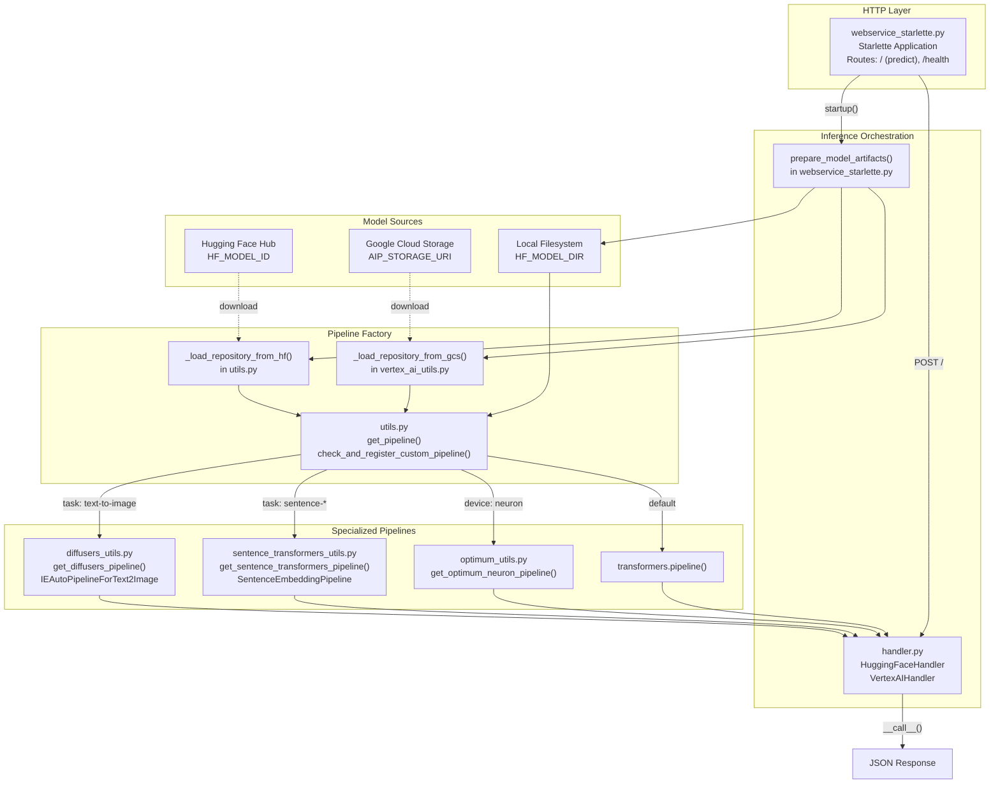
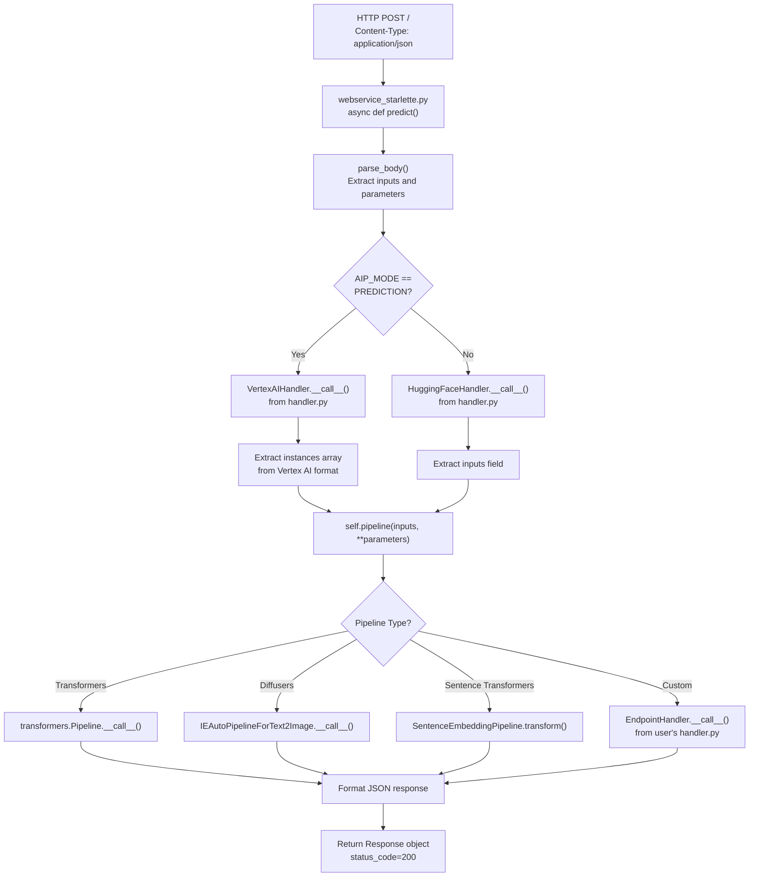
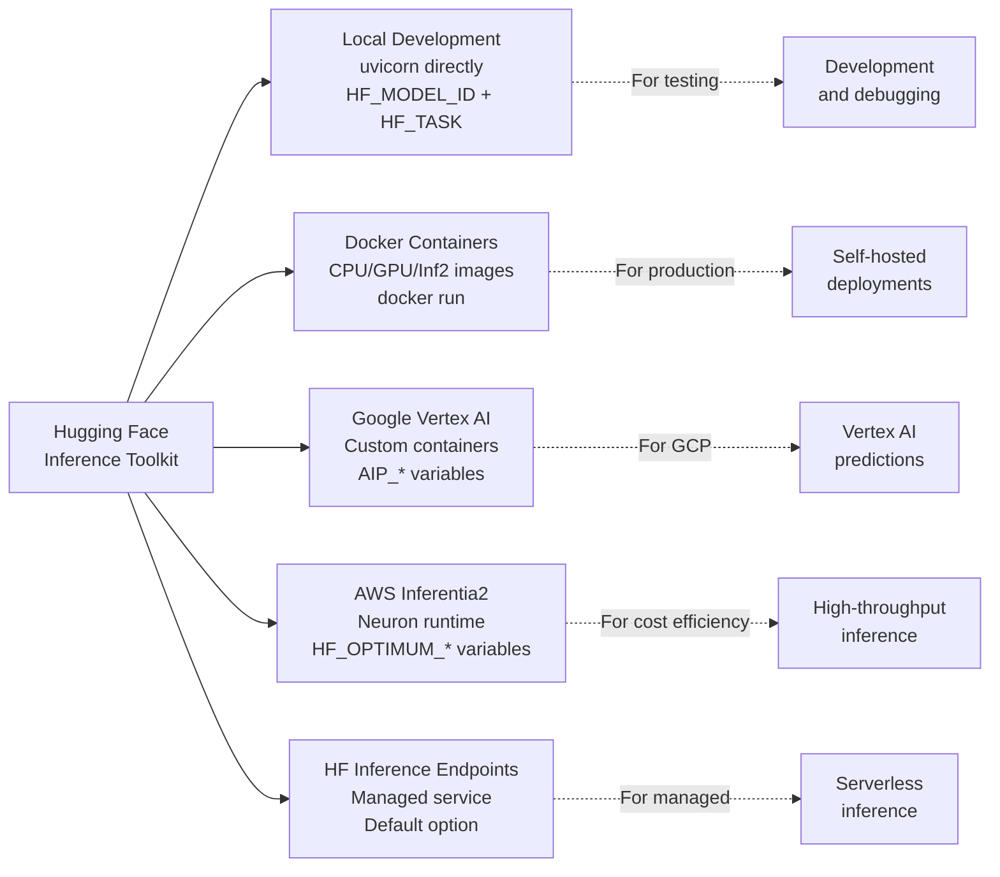

<!-- source: DeepWiki mcp.deepwiki.com · repo huggingface/huggingface-inference-toolkit · page 1 Overview · fetched 2026-10-26 -->

# Overview

<details>
<summary>Relevant source files</summary>

The following files were used as context for generating this wiki page:

- [README.md](README.md)
- [setup.py](setup.py)

</details>


## Purpose and Scope

This document provides an introduction to the Hugging Face Inference Toolkit, a system for serving machine learning models from the Hugging Face ecosystem in production environments. This page covers the toolkit's purpose, architecture, capabilities, and deployment options at a high level. For detailed installation instructions, see [Installation and Setup](#2). For deployment-specific guidance, see [Deployment Guide](#5).

## What is the Hugging Face Inference Toolkit

The Hugging Face Inference Toolkit is a containerized inference server that provides standardized HTTP APIs for serving models from three primary libraries:

- **Transformers**: NLP, vision, audio, and multimodal models
- **Diffusers**: Text-to-image generation models
- **Sentence Transformers**: Embedding and semantic similarity models

The toolkit eliminates boilerplate inference code by providing default implementations of model loading, pre-processing, prediction, and post-processing for 30+ task types. It is production-ready and serves as the default inference implementation for Hugging Face Inference Endpoints.

**Sources:** [setup.py:1-86](), [README.md:1-6]()

## Key Capabilities

| Capability | Description |
|------------|-------------|
| **Multi-Framework Support** | PyTorch, TensorFlow, and ONNX models |
| **Model Source Flexibility** | Load from Hugging Face Hub, Google Cloud Storage, or local filesystem |
| **Hardware Optimization** | CPU, GPU (CUDA), and AWS Inferentia2 acceleration |
| **Custom Inference Logic** | Override default behavior with custom `handler.py` files |
| **Zero-Configuration Deployment** | Automatic pipeline selection based on task type |
| **Multi-Platform Deployment** | Standalone Docker, Vertex AI, Inferentia2, and HF Endpoints |

The toolkit uses environment variables for configuration (see [Configuration](#3)) and requires minimal setup to serve most models from the Hugging Face Hub.

**Sources:** [README.md:7-82](), [setup.py:15-58]()

## High-Level System Architecture

The following diagram shows the core components and their relationships in the inference system:

### Component Architecture Diagram



**Sources:** [src/huggingface_inference_toolkit/webservice_starlette.py:1-200](), [src/huggingface_inference_toolkit/handler.py:1-150](), [src/huggingface_inference_toolkit/utils.py:1-300]()

### Request Processing Flow

The following diagram traces how an inference request flows through the system, showing the actual function calls and decision points:



**Sources:** [src/huggingface_inference_toolkit/webservice_starlette.py:80-150](), [src/huggingface_inference_toolkit/handler.py:20-100]()

## Supported Model Types and Tasks

The toolkit provides built-in support for the following task categories:

### Transformers Tasks

| Task Type | Example Models | Pipeline Class |
|-----------|----------------|----------------|
| `text-classification` | DistilBERT, BERT | `TextClassificationPipeline` |
| `question-answering` | RoBERTa, ALBERT | `QuestionAnsweringPipeline` |
| `token-classification` | BERT, RoBERTa | `TokenClassificationPipeline` |
| `summarization` | BART, T5 | `SummarizationPipeline` |
| `translation` | MarianMT, T5 | `TranslationPipeline` |
| `text-generation` | GPT-2, GPT-Neo | `TextGenerationPipeline` |
| `image-classification` | ViT, ResNet | `ImageClassificationPipeline` |
| `object-detection` | DETR, YOLOS | `ObjectDetectionPipeline` |
| `automatic-speech-recognition` | Wav2Vec2, Whisper | `AutomaticSpeechRecognitionPipeline` |
| `audio-classification` | Wav2Vec2 | `AudioClassificationPipeline` |

### Specialized Pipelines

- **Diffusers**: `text-to-image` tasks using Stable Diffusion and similar models (see [Diffusers Integration](#6.1))
- **Sentence Transformers**: `sentence-similarity`, `sentence-embeddings`, `sentence-ranking` (see [Sentence Transformers Support](#6.2))
- **Optimum Neuron**: Hardware-accelerated inference on AWS Inferentia2 (see [AWS Neuron Optimization](#6.3))

For a complete list of supported tasks and validation, see [tests/integ/config.py:1-100]().

**Sources:** [setup.py:15-58](), [README.md:217-221]()

## Deployment Targets

The toolkit supports five primary deployment scenarios, each configured through environment variables:



Each deployment target uses the same codebase but is configured differently:

| Target | Configuration | Container Image |
|--------|---------------|-----------------|
| **Local Development** | `HF_MODEL_ID`, `HF_TASK` environment variables | N/A (runs directly) |
| **Docker Standalone** | Environment variables in `docker run` | `inference-pytorch-cpu/gpu` |
| **Vertex AI** | `AIP_MODE=PREDICTION`, `AIP_STORAGE_URI` | Custom container |
| **Inferentia2** | `HF_OPTIMUM_BATCH_SIZE`, `HF_OPTIMUM_SEQUENCE_LENGTH` | `inference-pytorch-inf2` |
| **HF Endpoints** | Managed by platform | Platform-provided |

For detailed deployment instructions, see [Deployment Guide](#5).

**Sources:** [README.md:16-196](), [dockerfiles/]()

## Key Components

The toolkit's codebase is organized around the following core modules:

### Primary Modules

| Module | Path | Purpose |
|--------|------|---------|
| **Web Service** | `src/huggingface_inference_toolkit/webservice_starlette.py` | Starlette HTTP server with `/` (predict) and `/health` endpoints |
| **Handler** | `src/huggingface_inference_toolkit/handler.py` | `HuggingFaceHandler` and `VertexAIHandler` classes for orchestrating inference |
| **Utils** | `src/huggingface_inference_toolkit/utils.py` | `get_pipeline()` factory, model loading from Hub/GCS, custom handler detection |
| **Constants** | `src/huggingface_inference_toolkit/const.py` | Environment variable definitions and defaults |

### Specialized Modules

| Module | Path | Purpose |
|--------|------|---------|
| **Diffusers** | `src/huggingface_inference_toolkit/diffusers_utils.py` | `get_diffusers_pipeline()` for text-to-image generation |
| **Sentence Transformers** | `src/huggingface_inference_toolkit/sentence_transformers_utils.py` | `get_sentence_transformers_pipeline()` for embeddings |
| **Optimum Neuron** | `src/huggingface_inference_toolkit/optimum_utils.py` | `get_optimum_neuron_pipeline()` for Inferentia2 |
| **Vertex AI** | `src/huggingface_inference_toolkit/vertex_ai_utils.py` | `_load_repository_from_gcs()` for GCS model loading |

### Package Definition

The `setup.py` file defines the package structure and optional dependencies:

```
huggingface-inference-toolkit
├── Core dependencies: transformers, huggingface_hub, starlette, uvicorn
├── extras["torch"]: torch, torchvision, torchaudio, peft
├── extras["diffusers"]: diffusers, accelerate
├── extras["st"]: sentence_transformers
├── extras["inf2"]: optimum-neuron
└── extras["google"]: google-cloud-storage
```

Users install only the dependencies needed for their use case. For example, a text classification deployment on CPU requires only the core dependencies plus `extras["torch"]`, while a text-to-image deployment on GPU requires `extras["torch"]` and `extras["diffusers"]`.

**Sources:** [setup.py:1-86](), [src/huggingface_inference_toolkit/]()

## Extension Points

The toolkit provides two primary extension mechanisms:

### Custom Handlers

Users can override default inference behavior by including a `handler.py` file in their model repository. This file must define an `EndpointHandler` class with a `__call__` method:

```python
class EndpointHandler:
    def __init__(self, path: str):
        # Custom initialization
        pass
    
    def __call__(self, data: dict) -> dict:
        # Custom inference logic
        pass
```

The system automatically detects and loads custom handlers via `check_and_register_custom_pipeline()` in [src/huggingface_inference_toolkit/utils.py]().

### Custom Dependencies

Users can include a `requirements.txt` file in their model repository to install additional Python packages at container startup. This enables use of domain-specific libraries not included in the base image.

For implementation details, see [Custom Handlers and Pipelines](#6.4).

**Sources:** [README.md:63-78](), [src/huggingface_inference_toolkit/utils.py:100-200]()

## Next Steps

- To install the toolkit locally or in a container, see [Installation and Setup](#2)
- To understand configuration options, see [Configuration](#3)
- To learn about the system's internal architecture, see [Core Architecture](#4)
- To deploy the toolkit, see [Deployment Guide](#5)

**Sources:** [README.md:1-292](), [setup.py:1-86]()

---

