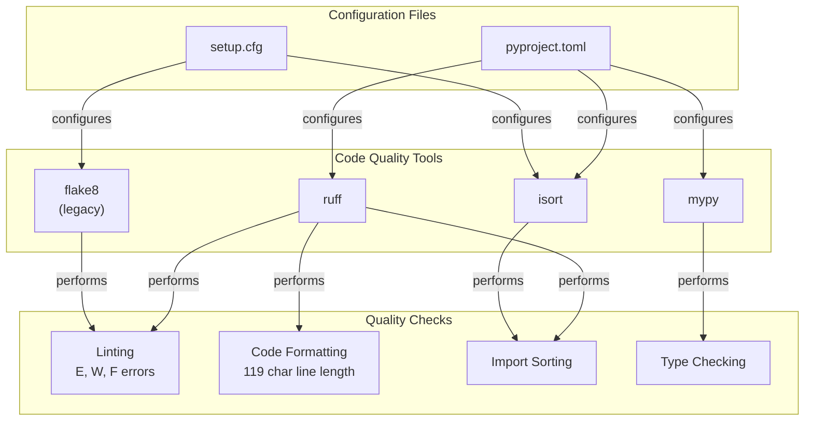
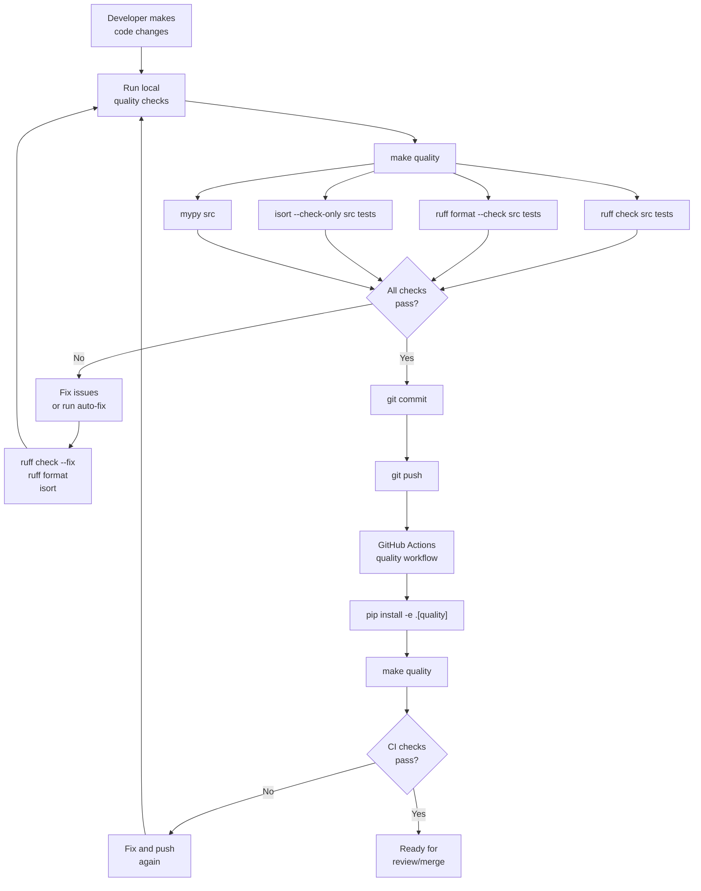
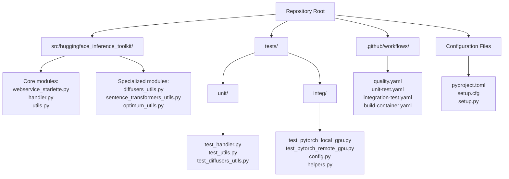
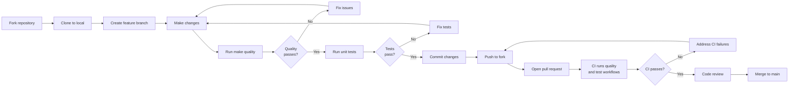

<!-- source: DeepWiki mcp.deepwiki.com · repo huggingface/huggingface-inference-toolkit · page 10 Development Guide · fetched 2026-10-26 -->

# Development Guide

<details>
<summary>Relevant source files</summary>

The following files were used as context for generating this wiki page:

- [.github/workflows/integration-test.yaml](.github/workflows/integration-test.yaml)
- [.github/workflows/quality.yaml](.github/workflows/quality.yaml)
- [pyproject.toml](pyproject.toml)
- [setup.cfg](setup.cfg)

</details>


This document provides guidelines for developers contributing to the Hugging Face Inference Toolkit. It covers code quality standards, linting and formatting tools, development workflow, and best practices for maintaining code consistency.

For information about running tests, see [Testing](#8). For CI/CD pipeline details, see [CI/CD Pipeline](#9). For installation and setup instructions for end-users, see [Installation and Setup](#2).

## Purpose and Scope

This guide is intended for contributors who want to modify or extend the toolkit's codebase. It documents:
- Code quality tools and their configuration
- Linting and formatting standards
- Local development workflow
- Pre-commit quality checks
- How quality checks integrate with CI/CD

## Development Environment Setup

### Prerequisites

To set up a development environment, you need Python 3.11 or later. The toolkit's code quality tools are configured to target Python 3.11 as specified in [pyproject.toml:10]().

### Installation for Development

Install the toolkit in editable mode with quality checking dependencies:

```bash
pip install -e .[quality]
```

This installs the package in development mode along with all tools required for code quality checks as referenced in [.github/workflows/quality.yaml:26]().

### Available Installation Extras

The toolkit provides several installation extras for different use cases. While the `quality` extra installs code quality tools, other extras enable specific functionality. Refer to the `setup.py` file for the complete list of extras including `torch`, `diffusers`, `st` (sentence-transformers), `inf2`, and `google`.

**Sources:** [pyproject.toml:1-33](), [.github/workflows/quality.yaml:1-28]()

## Code Quality Tools

The toolkit uses a modern Python toolchain for code quality enforcement. The primary configuration is in `pyproject.toml` with some legacy configuration remaining in `setup.cfg`.

### Tool Configuration Overview



**Sources:** [pyproject.toml:1-33](), [setup.cfg:1-22]()

### Ruff Configuration

Ruff is the primary linting and formatting tool, configured in [pyproject.toml:6-28](). It combines the functionality of multiple tools into a single fast implementation.

**Configuration Details:**

| Setting | Value | Purpose |
|---------|-------|---------|
| `line-length` | 119 | Maximum line length (matches Black formatter) |
| `target-version` | `py311` | Target Python 3.11 syntax |
| `select` | E, W, F, I, C, B | Enabled rule categories |

**Enabled Rule Categories:**

- **E**: pycodestyle errors
- **W**: pycodestyle warnings  
- **F**: pyflakes (undefined names, unused imports)
- **I**: isort (import sorting)
- **C**: flake8-comprehensions (list/dict/set comprehension issues)
- **B**: flake8-bugbear (common bugs and design problems)

**Ignored Rules:**

- **E501**: Line length (handled by ruff-format)
- **B008**: Function calls in argument defaults
- **C901**: Function complexity

**Special Rules:**

- Unused variables with underscore prefix are allowed via [pyproject.toml:27]()
- Unused imports in `__init__.py` files are allowed via [pyproject.toml:28]()

**Sources:** [pyproject.toml:6-28]()

### Isort Configuration

Import sorting is handled by both ruff (as the `I` rule category) and isort. The configuration ensures consistent import organization:

```
profile = "black"
known_third_party = ["transformers", "starlette", "huggingface_hub"]
```

The toolkit recognizes specific third-party packages to ensure they are sorted in the correct section of import statements [pyproject.toml:30-32]().

Additional isort settings in `setup.cfg` include:
- Line length: 119 characters
- Force grid wrap: 0
- Include trailing comma: True
- Multi-line output mode: 3 (vertical hanging indent)

**Sources:** [pyproject.toml:30-32](), [setup.cfg:1-18]()

### Mypy Configuration

Type checking is configured with mypy in [pyproject.toml:1-4](). The configuration is minimal but strict:

- `ignore_missing_imports = true`: Allows imports from packages without type stubs
- `no_implicit_optional = true`: Requires explicit `Optional` type annotations
- `scripts_are_modules = true`: Treats scripts as importable modules

**Sources:** [pyproject.toml:1-4]()

### Legacy Flake8 Configuration

Some legacy flake8 configuration remains in `setup.cfg` but is largely superseded by ruff:

- Ignored errors: E203, E501, E741, W503, W605
- Max line length: 119

**Sources:** [setup.cfg:19-22]()

## Development Workflow

### Quality Check Execution Flow



**Sources:** [.github/workflows/quality.yaml:1-28]()

### Running Quality Checks Locally

Execute quality checks before committing code:

```bash
make quality
```

This command runs all configured linters and formatters in check mode. The exact implementation depends on the Makefile, but based on the CI workflow at [.github/workflows/quality.yaml:27](), it executes the configured quality tools.

### Auto-fixing Issues

Many issues can be automatically fixed:

```bash
# Fix linting issues
ruff check --fix src tests

# Format code
ruff format src tests

# Sort imports
isort src tests
```

These commands modify files in place to conform to the code quality standards.

**Sources:** [pyproject.toml:6-28]()

## Code Style Standards

### Line Length and Formatting

All code must adhere to a maximum line length of **119 characters** as specified in [pyproject.toml:8](). This is consistent with Black formatter conventions.

### Import Organization

Imports should be organized in the following order:
1. Standard library imports
2. Third-party imports (transformers, starlette, huggingface_hub)
3. First-party imports (huggingface_inference_toolkit)

Imports within each group should be sorted alphabetically. Use the `isort` tool or ruff's `I` rules to ensure proper ordering.

### Type Annotations

While not strictly required everywhere, type annotations are encouraged. When used:
- Avoid implicit `Optional` types (use `Optional[Type]` explicitly)
- Import type stubs where available
- Use `mypy` to validate type correctness

**Sources:** [pyproject.toml:1-4](), [pyproject.toml:30-32](), [setup.cfg:1-18]()

## File Organization

### Source Code Structure



**Sources:** [.github/workflows/quality.yaml:1-28](), [.github/workflows/integration-test.yaml:1-45]()

## Continuous Integration Quality Checks

### GitHub Actions Quality Workflow

The quality workflow runs automatically on every push and pull request (except when only README.md changes). It executes on `ubuntu-latest` runners with Python 3.11.

**Workflow Steps:**

1. **Checkout**: Retrieve the repository code
2. **Setup Python**: Install Python 3.11
3. **Install Dependencies**: `pip install -e .[quality]`
4. **Run Quality Checks**: `make quality`

The workflow is defined in [.github/workflows/quality.yaml:1-28]().

### Concurrency Control

The quality workflow implements concurrency control to cancel in-progress runs when new commits are pushed:

```yaml
concurrency:
  group: ${{ github.workflow }}-${{ github.head_ref || github.run_id }}
  cancel-in-progress: true
```

This optimization saves CI resources and provides faster feedback on the most recent code changes [.github/workflows/quality.yaml:14-16]().

**Sources:** [.github/workflows/quality.yaml:1-28]()

## Testing During Development

While comprehensive testing documentation is available in [Testing](#8), developers should be aware of basic testing workflows:

### Running Tests Locally

For detailed testing instructions, refer to [Unit Tests](#8.1) and [Integration Tests](#8.2). Integration tests require Docker and use fixtures for container management.

### Quality Checks vs. Tests

| Check Type | Command | Purpose | When to Run |
|------------|---------|---------|-------------|
| Quality | `make quality` | Lint, format, type check | Before every commit |
| Unit Tests | `pytest tests/unit/` | Validate component logic | After code changes |
| Integration Tests | `pytest tests/integ/` | Validate end-to-end behavior | Before PR submission |

**Sources:** [.github/workflows/quality.yaml:1-28](), [.github/workflows/integration-test.yaml:1-45]()

## Contribution Workflow

### Standard Git Workflow



### Pre-Commit Best Practices

1. **Always run quality checks** before committing: `make quality`
2. **Run relevant unit tests** for modified components
3. **Write meaningful commit messages** describing the change
4. **Keep commits focused** on a single logical change
5. **Test integration scenarios** if modifying core components

**Sources:** [.github/workflows/quality.yaml:1-28]()

## Path Ignore Patterns

The quality workflow ignores changes to specific files to avoid unnecessary CI runs:

- `README.md`: Documentation-only changes don't require quality checks
- `.github/workflows/unit-test.yaml`: Changes to other workflow files
- `.github/workflows/quality.yaml`: Self-reference to avoid loops

This is configured in [.github/workflows/quality.yaml:5-7]().

**Sources:** [.github/workflows/quality.yaml:5-7]()

## Configuration File Priority

When tools have configuration in multiple files, the priority is:

1. **pyproject.toml** (preferred, modern configuration)
2. **setup.cfg** (legacy configuration, maintained for compatibility)

New configuration should be added to `pyproject.toml`. The `setup.cfg` file is maintained for tools that don't yet support `pyproject.toml` configuration.

**Sources:** [pyproject.toml:1-33](), [setup.cfg:1-22]()

## Troubleshooting Development Issues

### Common Quality Check Failures

| Issue | Cause | Solution |
|-------|-------|----------|
| E501 line too long | Line exceeds 119 characters | Break line or use ruff format |
| F401 unused import | Import not referenced | Remove import or add to `__init__.py` if intentional |
| I001 import not sorted | Imports out of order | Run `isort src tests` |
| Type errors from mypy | Missing type annotations | Add explicit types or use `# type: ignore` with justification |

### Fixing Import Issues

If isort and ruff disagree on import ordering:
1. Run `isort src tests` first
2. Then run `ruff format src tests`
3. Verify with `make quality`

### CI Failures

If CI passes locally but fails in GitHub Actions:
1. Ensure you're using Python 3.11 locally
2. Verify all dependencies are installed: `pip install -e .[quality]`
3. Check for platform-specific issues (Windows vs. Linux line endings)

**Sources:** [pyproject.toml:6-28](), [.github/workflows/quality.yaml:22-24]()

---

