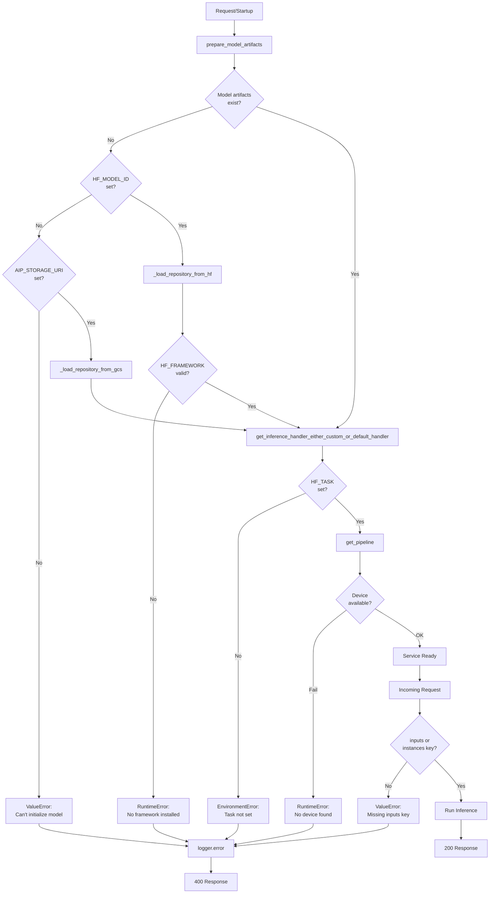
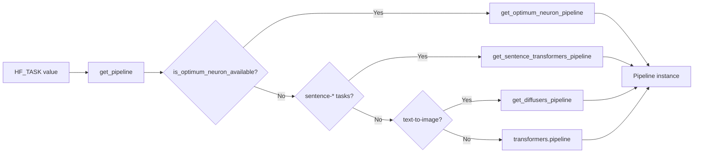
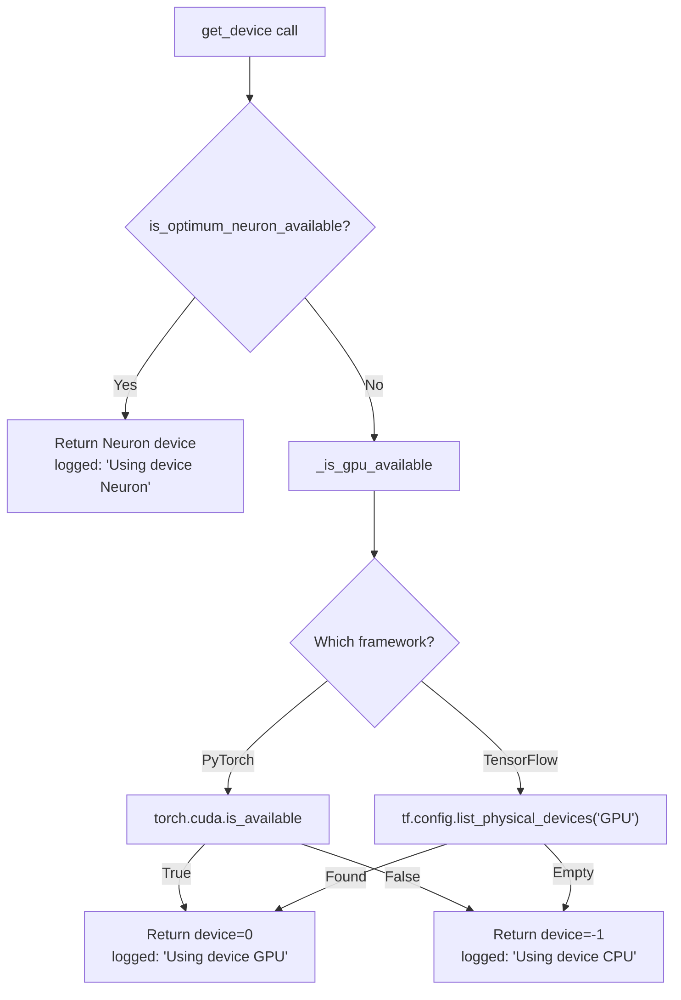
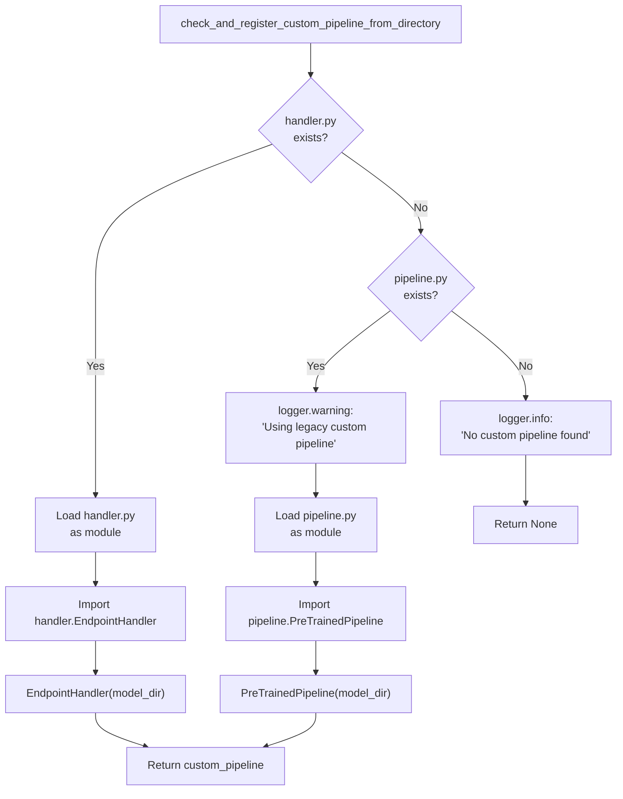

<!-- source: DeepWiki mcp.deepwiki.com · repo huggingface/huggingface-inference-toolkit · page 11 Troubleshooting · fetched 2026-10-26 -->

# Troubleshooting

<details>
<summary>Relevant source files</summary>

The following files were used as context for generating this wiki page:

- [README.md](README.md)
- [src/huggingface_inference_toolkit/const.py](src/huggingface_inference_toolkit/const.py)
- [src/huggingface_inference_toolkit/utils.py](src/huggingface_inference_toolkit/utils.py)
- [src/huggingface_inference_toolkit/webservice_starlette.py](src/huggingface_inference_toolkit/webservice_starlette.py)
- [tests/unit/test_const.py](tests/unit/test_const.py)

</details>


This document provides diagnostic guidance and solutions for common issues encountered when deploying and running the Hugging Face Inference Toolkit. It covers problems related to model loading, configuration, hardware compatibility, request handling, and deployment-specific scenarios.

For general deployment instructions, see [Deployment Guide](#5). For configuration reference, see [Configuration](#3). For custom handler implementation guidance, see [Custom Handlers and Pipelines](#6.4).

---

## Common Error Patterns

The toolkit's error handling follows a consistent pattern where issues are logged and returned as JSON responses with 400 status codes. Understanding the error flow helps diagnose problems quickly.



**Sources:** [src/huggingface_inference_toolkit/webservice_starlette.py:33-139](), [src/huggingface_inference_toolkit/utils.py:206-263]()

---

## Model Loading Issues

### Model Not Found Error

**Symptom:** `ValueError: Can't initialize model. Please set env HF_MODEL_DIR or provider a HF_MODEL_ID.`

**Cause:** The toolkit cannot locate model artifacts during startup at [webservice_starlette.py:54-59]().

**Diagnosis Steps:**

| Check | Command | Expected Result |
|-------|---------|----------------|
| Model directory exists | `ls -la $HF_MODEL_DIR` | Directory contains model files |
| Environment variable set | `echo $HF_MODEL_ID` | Model ID string |
| GCS URI (Vertex AI) | `echo $AIP_STORAGE_URI` | GCS path starting with `gs://` |

**Solutions:**

1. **Local deployment**: Ensure model files are present in `HF_MODEL_DIR` (default: `/opt/huggingface/model`)
   ```bash
   # Verify model files exist
   ls /opt/huggingface/model/config.json
   ls /opt/huggingface/model/pytorch_model.bin
   ```

2. **Hub download**: Set `HF_MODEL_ID` to download automatically
   ```bash
   export HF_MODEL_ID="distilbert-base-uncased-finetuned-sst-2-english"
   export HF_TASK="text-classification"
   ```

3. **Vertex AI**: Ensure `AIP_STORAGE_URI` points to valid GCS location with model artifacts
   ```bash
   export AIP_MODE="PREDICTION"
   export AIP_STORAGE_URI="gs://my-bucket/model/"
   ```

**Sources:** [src/huggingface_inference_toolkit/webservice_starlette.py:33-59]()

---

### Framework Not Installed Error

**Symptom:** `RuntimeError: At least one of TensorFlow 2.0 or PyTorch should be installed.`

**Cause:** Neither PyTorch nor TensorFlow is available in the environment, checked at [utils.py:81-85]() and [utils.py:98-102]().

**Diagnosis:**
```bash
# Check PyTorch installation
python -c "import torch; print(torch.__version__)"

# Check TensorFlow installation
python -c "import tensorflow; print(tensorflow.__version__)"
```

**Solutions:**

1. **Install with extras**: Use appropriate package extras during installation
   ```bash
   # PyTorch support
   pip install -e ".[torch]"
   
   # Add sentence transformers
   pip install -e ".[torch,st]"
   
   # Add diffusers
   pip install -e ".[torch,diffusers]"
   ```

2. **Set framework explicitly**: If both are installed, specify which to use
   ```bash
   export HF_FRAMEWORK="pytorch"  # or "tensorflow"
   ```

3. **Use correct Docker image**: Each image contains specific frameworks
   - `integration-test-pytorch:cpu` - PyTorch CPU
   - `integration-test-pytorch:gpu` - PyTorch GPU  
   - `integration-test-pytorch:inf2` - PyTorch + Optimum Neuron

**Sources:** [src/huggingface_inference_toolkit/utils.py:26-31](), [src/huggingface_inference_toolkit/utils.py:88-102](), [README.md:10-12]()

---

### Artifact Filter Issues

**Symptom:** Wrong framework weights downloaded, or excessive download size.

**Cause:** The `create_artifact_filter` function at [utils.py:58-69]() filters model files by framework, but may download unnecessary artifacts if `HF_FRAMEWORK` is not set correctly.

**Diagnosis:**
```bash
# Check which files were downloaded
ls -lh $HF_MODEL_DIR/

# Look for framework-specific patterns
ls $HF_MODEL_DIR/*.bin        # PyTorch
ls $HF_MODEL_DIR/*.safetensors # SafeTensors
ls $HF_MODEL_DIR/*.h5          # TensorFlow
```

**Solution:**
```bash
# Set framework before download
export HF_FRAMEWORK="pytorch"
export HF_MODEL_ID="your-model-id"

# The toolkit will automatically filter to pytorch* patterns
# and ignore tf*, onnx*, etc.
```

**Supported framework patterns:**
| Framework | Pattern | File Extensions |
|-----------|---------|-----------------|
| pytorch | `pytorch*` | `.bin`, `.pth` |
| safetensors | `*safetensors` | `.safetensors` |
| tensorflow | `tf*` | `.h5`, `.pb` |
| onnx | `*onnx*` | `.onnx` |

**Sources:** [src/huggingface_inference_toolkit/utils.py:41-69](), [src/huggingface_inference_toolkit/utils.py:129-137]()

---

### Private Model Authentication

**Symptom:** HTTP 401 or 403 errors when downloading private models.

**Cause:** Missing or invalid `HF_HUB_TOKEN` for authenticated Hub access at [utils.py:116-117]().

**Diagnosis:**
```bash
# Check if token is set
echo $HF_HUB_TOKEN

# Test token manually
huggingface-cli whoami
```

**Solution:**
```bash
# Set valid Hugging Face token
export HF_HUB_TOKEN="hf_xxxxxxxxxxxxxxxxxxxxx"

# For gated models, ensure token has accepted model terms
# on huggingface.co
```

**Sources:** [src/huggingface_inference_toolkit/utils.py:105-117](), [src/huggingface_inference_toolkit/const.py:11](), [README.md:239-245]()

---

## Configuration Errors

### Task Not Set Error

**Symptom:** `EnvironmentError: The task for this model is not set`

**Cause:** `HF_TASK` environment variable is not configured at startup, validated at [utils.py:214-217]().

**Diagnosis:**
```bash
# Check if task is set
echo $HF_TASK

# Verify model card on Hub has task metadata
curl https://huggingface.co/api/models/$HF_MODEL_ID | jq '.pipeline_tag'
```

**Solution:**
```bash
# Set task explicitly
export HF_TASK="text-classification"

# Supported tasks include:
# - text-classification
# - question-answering
# - token-classification
# - summarization
# - translation
# - text-generation
# - image-classification
# - automatic-speech-recognition
# - text-to-image
# - sentence-similarity
# See full list at tests/integ/config.py
```

**Task to Pipeline Mapping:**



**Sources:** [src/huggingface_inference_toolkit/utils.py:206-263](), [src/huggingface_inference_toolkit/const.py:8](), [README.md:215-221]()

---

### Vertex AI Configuration Errors

**Symptom:** `ValueError: AIP_PREDICT_ROUTE and AIP_HEALTH_ROUTE need to be set in Vertex AI environment`

**Cause:** Running with `AIP_MODE=PREDICTION` but missing required Vertex AI route configuration at [webservice_starlette.py:148-151]().

**Required Environment Variables:**

| Variable | Purpose | Example |
|----------|---------|---------|
| `AIP_MODE` | Enables Vertex AI mode | `PREDICTION` |
| `AIP_HTTP_PORT` | Server port | `8080` |
| `AIP_PREDICT_ROUTE` | Prediction endpoint path | `/predict` |
| `AIP_HEALTH_ROUTE` | Health check path | `/health` |
| `AIP_STORAGE_URI` | GCS model location (optional) | `gs://bucket/model/` |

**Solution:**
```bash
# Complete Vertex AI configuration
export AIP_MODE="PREDICTION"
export AIP_HTTP_PORT="8080"
export AIP_PREDICT_ROUTE="/predict"
export AIP_HEALTH_ROUTE="/health"

# Either provide model locally or from GCS
export AIP_STORAGE_URI="gs://my-bucket/model/"
# OR
export HF_MODEL_ID="distilbert-base-uncased"
export HF_TASK="text-classification"
```

**Sources:** [src/huggingface_inference_toolkit/webservice_starlette.py:143-160](), [README.md:80-129]()

---

### Remote Code Trust Error

**Symptom:** Model fails to load with security warning about remote code execution.

**Cause:** Model requires custom code execution but `HF_TRUST_REMOTE_CODE` is disabled (default: `"0"`).

**Solution:**
```bash
# Enable trust remote code (use with caution)
export HF_TRUST_REMOTE_CODE="1"

# Only enable for models you trust, as this allows
# arbitrary code execution from model repository
```

**Sources:** [src/huggingface_inference_toolkit/const.py:12](), [README.md:247-253]()

---

## Device and Hardware Issues

### GPU Not Available

**Symptom:** Model runs on CPU despite GPU hardware being present.

**Diagnosis:**
```bash
# Check CUDA availability
python -c "import torch; print(torch.cuda.is_available())"
python -c "import torch; print(torch.cuda.device_count())"

# Check nvidia-smi
nvidia-smi

# For TensorFlow
python -c "import tensorflow as tf; print(tf.config.list_physical_devices('GPU'))"
```

**Common Causes:**

1. **Docker missing GPU access**: Add `--gpus all` flag
   ```bash
   # Wrong
   docker run -p 5000:5000 -e HF_MODEL_ID=... image:gpu
   
   # Correct
   docker run --gpus all -p 5000:5000 -e HF_MODEL_ID=... image:gpu
   ```

2. **CUDA driver mismatch**: Ensure host CUDA drivers match container requirements
   ```bash
   # Check host driver version
   nvidia-smi
   
   # Verify container can see GPU
   docker run --gpus all nvidia/cuda:11.8.0-base-ubuntu22.04 nvidia-smi
   ```

3. **PyTorch CPU-only build**: Reinstall with CUDA support
   ```bash
   pip uninstall torch
   pip install torch --index-url https://download.pytorch.org/whl/cu118
   ```

**Device Selection Logic:**



**Sources:** [src/huggingface_inference_toolkit/utils.py:72-86](), [src/huggingface_inference_toolkit/utils.py:194-203](), [src/huggingface_inference_toolkit/utils.py:222-227]()

---

### AWS Inferentia2 Compilation Issues

**Symptom:** Model fails to compile for Neuron, or compilation takes excessive time.

**Cause:** Missing or incorrect input shape configuration for Neuron compiler.

**Required Configuration:**

| Variable | Purpose | Required When |
|----------|---------|---------------|
| `HF_OPTIMUM_BATCH_SIZE` | Static batch size for compilation | Always for new models |
| `HF_OPTIMUM_SEQUENCE_LENGTH` | Static sequence length | Always for new models |
| Model already compiled | Pre-compiled `.neuron` artifacts | Alternative to compilation |

**Solution:**

1. **Provide compilation parameters:**
   ```bash
   export HF_MODEL_ID="distilbert-base-uncased"
   export HF_TASK="text-classification"
   export HF_OPTIMUM_BATCH_SIZE=1
   export HF_OPTIMUM_SEQUENCE_LENGTH=128
   
   # Run with Neuron device access
   docker run --device=/dev/neuron0 -p 5000:5000 \
     -e HF_MODEL_ID=$HF_MODEL_ID \
     -e HF_TASK=$HF_TASK \
     -e HF_OPTIMUM_BATCH_SIZE=$HF_OPTIMUM_BATCH_SIZE \
     -e HF_OPTIMUM_SEQUENCE_LENGTH=$HF_OPTIMUM_SEQUENCE_LENGTH \
     integration-test-pytorch:inf2
   ```

2. **Use pre-compiled model:**
   ```bash
   # Model already contains .neuron artifacts
   export HF_MODEL_ID="optimum/bge-base-en-v1.5-neuronx"
   export HF_TASK="feature-extraction"
   # No batch size or sequence length needed
   ```

3. **Embed config in model repository:** Add to `config.json`:
   ```json
   {
     "neuron": {
       "static_batch_size": 1,
       "static_sequence_length": 128
     }
   }
   ```

**Compilation Time:** First run may take 5-15 minutes as the model compiles. Subsequent runs use cached compilation.

**Sources:** [README.md:131-196](), [README.md:263-277]()

---

## Request and Response Errors

### Missing Input Key Error

**Symptom:** `ValueError: Body needs to provide a inputs key`

**Cause:** Request body does not contain required `"inputs"` or `"instances"` key, validated at [webservice_starlette.py:94-97]().

**Diagnosis:**
```bash
# Check request format
curl -X POST http://localhost:5000 \
  -H "Content-Type: application/json" \
  -d '{"wrong_key": "value"}'
```

**Solution:**

Standard format (default):
```bash
curl -X POST http://localhost:5000 \
  -H "Content-Type: application/json" \
  -d '{
    "inputs": "This is the input text",
    "parameters": {"top_k": 2}
  }'
```

Vertex AI format:
```bash
curl -X POST http://localhost:8080/predict \
  -H "Content-Type: application/json" \
  -d '{
    "instances": ["Input 1", "Input 2"],
    "parameters": {"top_k": 2}
  }'
```

**Input Format by Task:**

| Task | Input Format | Example |
|------|-------------|---------|
| text-classification | String or list | `"I love this"` |
| question-answering | Dict with question/context | `{"question": "...", "context": "..."}` |
| image-classification | Base64 string | `"iVBORw0KGgo..."` (in parameters) |
| automatic-speech-recognition | Base64 audio | `"UklGRi..."` (decoded automatically) |
| text-to-image | String prompt | `"A cat"` |

**Sources:** [src/huggingface_inference_toolkit/webservice_starlette.py:94-97](), [README.md:49-61]()

---

### Base64 Audio Decoding Errors

**Symptom:** `binascii.Error: Invalid base64-encoded string` for audio tasks.

**Cause:** Audio input for ASR or audio classification must be valid base64-encoded binary data, decoded at [webservice_starlette.py:99-107]().

**Diagnosis:**
```bash
# Check if audio is properly encoded
echo "$AUDIO_DATA" | base64 -d > test.wav
file test.wav  # Should show audio format
```

**Solution:**
```bash
# Properly encode audio file
AUDIO_B64=$(base64 -w 0 audio.wav)

# Send request
curl -X POST http://localhost:5000 \
  -H "Content-Type: application/json" \
  -d "{
    \"inputs\": \"$AUDIO_B64\",
    \"parameters\": {}
  }"
```

**Important:** The `validate=True` parameter at [webservice_starlette.py:106]() enforces strict base64 validation. Ensure no extra whitespace or invalid characters.

**Sources:** [src/huggingface_inference_toolkit/webservice_starlette.py:99-107]()

---

### Content Type Negotiation

**Symptom:** Response in unexpected format or serialization errors.

**Cause:** The `accept` header controls response format, defaulting to `application/json` at [webservice_starlette.py:125-127]().

**Supported Content Types:**

Request `Content-Type`:
- `application/json` (default)
- Determined by `ContentType.get_deserializer()` at [webservice_starlette.py:90-92]()

Response `accept`:
- `application/json` (default)
- `*/*` (defaults to JSON)
- Determined by `ContentType.get_serializer()` at [webservice_starlette.py:129-131]()

**Solution:**
```bash
# Specify accept header explicitly
curl -X POST http://localhost:5000 \
  -H "Content-Type: application/json" \
  -H "Accept: application/json" \
  -d '{"inputs": "text"}'
```

**Sources:** [src/huggingface_inference_toolkit/webservice_starlette.py:88-132]()

---

## Custom Handler Issues

### Handler Not Found

**Symptom:** Custom handler not loaded despite presence of `handler.py` in model directory.

**Diagnosis:**
```bash
# Check if handler.py exists
ls $HF_MODEL_DIR/handler.py

# Check file permissions
ls -l $HF_MODEL_DIR/handler.py

# Verify EndpointHandler class exists
grep "class EndpointHandler" $HF_MODEL_DIR/handler.py
```

**Custom Handler Detection Flow:**



**Required Structure:**

`handler.py`:
```python
class EndpointHandler:
    def __init__(self, path: str):
        # Initialize with model_dir
        pass
    
    def __call__(self, data: dict):
        # Process data and return predictions
        return predictions
```

**Common Issues:**

1. **Wrong class name**: Must be `EndpointHandler`, not `Handler` or `CustomPipeline`
2. **Wrong file name**: Must be `handler.py` (unless `HF_DEFAULT_PIPELINE_NAME` is set)
3. **Missing `__init__` or `__call__`**: Both methods are required
4. **Import errors**: Handler can import submodules, but they must be in `sys.path`

**Sources:** [src/huggingface_inference_toolkit/utils.py:152-191](), [src/huggingface_inference_toolkit/const.py:14-18](), [README.md:63-78]()

---

### Handler Dependencies Not Found

**Symptom:** `ImportError` or `ModuleNotFoundError` when custom handler loads.

**Cause:** Handler imports modules not available in base environment.

**Solution:**

1. **Include `requirements.txt` in model directory:**
   ```
   model/
   ├── handler.py
   ├── requirements.txt  # Add custom dependencies here
   ├── config.json
   └── pytorch_model.bin
   ```

2. **Install dependencies before starting service:**
   ```bash
   # In Dockerfile
   RUN pip install -r /opt/huggingface/model/requirements.txt
   ```

3. **Check dependency installation:**
   ```bash
   # Verify imports work
   python -c "import your_custom_module"
   ```

**Note:** The toolkit adds `model_dir` to `sys.path` at [utils.py:164]() and [utils.py:181](), allowing handler to import local submodules.

**Sources:** [src/huggingface_inference_toolkit/utils.py:163-164](), [src/huggingface_inference_toolkit/utils.py:180-181](), [README.md:73-74]()

---

## Performance and Resource Issues

### Out of Memory (OOM) Errors

**Symptom:** Process killed with exit code 137 or `CUDA out of memory` error.

**Diagnosis:**
```bash
# Check available memory
free -h

# Check GPU memory
nvidia-smi

# Monitor during inference
watch -n 1 nvidia-smi
```

**Solutions:**

1. **Reduce batch size for Inferentia2:**
   ```bash
   export HF_OPTIMUM_BATCH_SIZE=1  # Smaller batch size
   ```

2. **Use CPU for large models:**
   ```bash
   # Force CPU execution
   docker run -e HF_MODEL_ID=... integration-test-pytorch:cpu
   ```

3. **Increase Docker memory limit:**
   ```bash
   docker run --memory=8g --memory-swap=8g ...
   ```

4. **Use model quantization or distillation:**
   ```bash
   # Use smaller variant
   export HF_MODEL_ID="distilbert-base-uncased"  # instead of bert-base-uncased
   ```

**Sources:** [README.md:263-269]()

---

### Port Binding Errors

**Symptom:** `OSError: [Errno 98] Address already in use`

**Diagnosis:**
```bash
# Check what's using the port
lsof -i :5000
netstat -tlnp | grep 5000
```

**Solutions:**

1. **Use different port:**
   ```bash
   # Local run
   uvicorn src.huggingface_inference_toolkit.webservice_starlette:app --port 5001
   
   # Docker
   docker run -p 5001:5000 ...
   ```

2. **Vertex AI port configuration:**
   ```bash
   export AIP_HTTP_PORT=8080  # Use Vertex AI port
   ```

3. **Kill existing process:**
   ```bash
   kill $(lsof -t -i:5000)
   ```

**Sources:** [README.md:20](), [README.md:90]()

---

## Debugging Strategies

### Enable Detailed Logging

**Check logs for diagnostic information:**
```bash
# Logs show:
# - Model directory: "Initializing model from directory:..."
# - Device selection: "Using device GPU" or "Using device CPU"
# - Custom pipeline: "Found custom pipeline at..." or "No custom pipeline found"
# - Request timing: "POST / | Duration: X ms"
```

**Key Log Messages:**

| Log Message | Location | Indicates |
|-------------|----------|-----------|
| `"Ignore regex pattern for files..."` | [utils.py:137]() | Framework filter applied |
| `"Found custom pipeline at..."` | [utils.py:160]() | Custom handler detected |
| `"Using legacy custom pipeline"` | [utils.py:173-177]() | Old pipeline.py format |
| `"Using device Neuron"` | [utils.py:223]() | Inferentia2 detected |
| `"Using device GPU/CPU"` | [utils.py:227]() | Device selection |
| `"POST {path} \| Duration: {time} ms"` | [webservice_starlette.py:120-122]() | Request timing |

**Sources:** [src/huggingface_inference_toolkit/utils.py:137](), [src/huggingface_inference_toolkit/utils.py:160-189](), [src/huggingface_inference_toolkit/utils.py:223-227](), [src/huggingface_inference_toolkit/webservice_starlette.py:120-122]()

---

### Test with Minimal Configuration

**Isolate issues using minimal working configuration:**

```bash
# 1. Simplest CPU inference
export HF_MODEL_ID="hf-internal-testing/tiny-random-distilbert"
export HF_TASK="text-classification"
uvicorn src.huggingface_inference_toolkit.webservice_starlette:app --port 5000

# 2. Test request
curl -X POST http://localhost:5000 \
  -H "Content-Type: application/json" \
  -d '{"inputs": "test"}'

# 3. If working, add complexity incrementally:
#    - Switch to target model
#    - Add GPU support
#    - Add custom handler
#    - Add specific parameters
```

**Sources:** [README.md:16-21]()

---

### Health Check and Metrics

**Use health and metrics endpoints for monitoring:**

```bash
# Health check (standard deployment)
curl http://localhost:5000/health

# Vertex AI health check
curl http://localhost:8080$AIP_HEALTH_ROUTE

# Metrics (standard deployment only)
curl http://localhost:5000/metrics
```

**Metrics Output:**
```
inf_batch_current_size {current_requests}
inf_queue_size {waiting_requests}
```

The metrics reflect:
- `inf_batch_current_size`: Number of requests being processed, calculated from `MAX_CONCURRENT_THREADS - MAX_THREADS_GUARD.value` at [webservice_starlette.py:77]()
- `inf_queue_size`: Number of requests waiting in queue, from `MAX_THREADS_GUARD.statistics().tasks_waiting` at [webservice_starlette.py:78]()

**Sources:** [src/huggingface_inference_toolkit/webservice_starlette.py:69-82]()

---

## Common Error Messages Reference

| Error Message | Location | Common Cause | Solution |
|---------------|----------|--------------|----------|
| `"Can't initialize model"` | [webservice_starlette.py:54-59]() | No model source configured | Set `HF_MODEL_ID` or provide model in `HF_MODEL_DIR` |
| `"At least one of TensorFlow 2.0 or PyTorch should be installed"` | [utils.py:81-85](), [utils.py:98-102]() | Missing framework | Install with `pip install ".[torch]"` |
| `"The task for this model is not set"` | [utils.py:214-217]() | Missing `HF_TASK` | Set `HF_TASK` environment variable |
| `"Body needs to provide a inputs key"` | [webservice_starlette.py:94-97]() | Wrong request format | Include `"inputs"` or `"instances"` in JSON body |
| `"Invalid base64-encoded string"` | [webservice_starlette.py:105-107]() | Malformed audio data | Properly base64-encode audio file |
| `"AIP_PREDICT_ROUTE and AIP_HEALTH_ROUTE need to be set"` | [webservice_starlette.py:148-151]() | Incomplete Vertex AI config | Set all `AIP_*` variables |

**Sources:** [src/huggingface_inference_toolkit/webservice_starlette.py:54-151](), [src/huggingface_inference_toolkit/utils.py:81-217]()