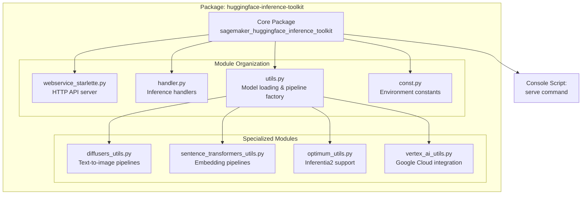
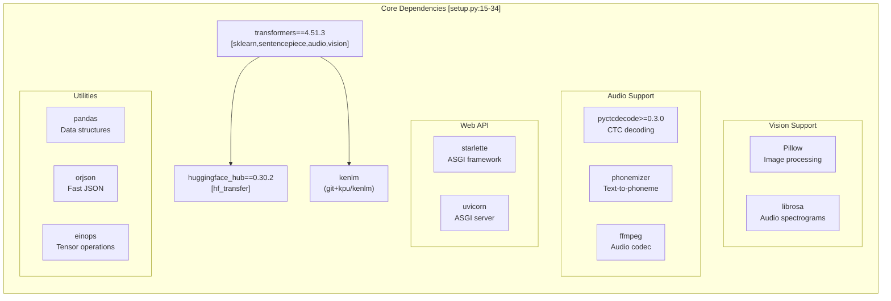
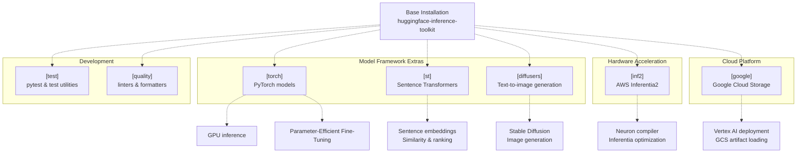
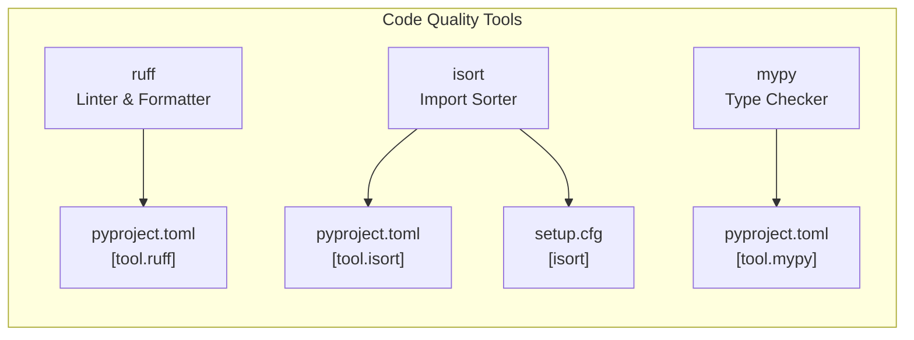

<!-- source: DeepWiki mcp.deepwiki.com · repo huggingface/huggingface-inference-toolkit · page 2 Installation and Setup · fetched 2026-10-26 -->

# Installation and Setup

<details>
<summary>Relevant source files</summary>

The following files were used as context for generating this wiki page:

- [pyproject.toml](pyproject.toml)
- [setup.cfg](setup.cfg)
- [setup.py](setup.py)

</details>


This document covers the installation process for the Hugging Face Inference Toolkit, package structure, dependency management, and optional features. It explains how to install the toolkit for different use cases, from basic CPU-only inference to specialized scenarios like Diffusers text-to-image generation or AWS Inferentia2 deployment.

For information about configuring the toolkit after installation, see [Configuration](#3). For deployment-specific setup, see [Deployment Guide](#5).

---

## Basic Installation

The Hugging Face Inference Toolkit is distributed as a Python package named `huggingface-inference-toolkit`. The package can be installed via pip:

```bash
pip install huggingface-inference-toolkit
```

This installs the core package with standard dependencies required for serving Transformers models via HTTP. The package requires Python 3.9 or higher [setup.py:70]().

**Sources:** [setup.py:60-71]()

---

## Package Structure

The toolkit follows a standard Python package layout with source code located in the `src/` directory and the package itself namespaced under `sagemaker_huggingface_inference_toolkit`.



**Package Metadata:**
- **Name:** `huggingface-inference-toolkit` [setup.py:60]()
- **Version:** `0.5.6` [setup.py:8]()
- **License:** Apache License 2.0 [setup.py:71]()
- **Source Directory:** `src/` [setup.py:65]()

The package provides a console entry point `serve` that maps to `sagemaker_huggingface_inference_toolkit.serving:main` [setup.py:69](), which is used to start the inference server.

**Sources:** [setup.py:1-86]()

---

## Core Dependencies

The toolkit has a comprehensive set of core dependencies installed by default. These dependencies enable standard Transformers model serving without requiring additional extras.

### Transformers Ecosystem



**Key Dependencies:**

| Dependency | Version | Purpose |
|------------|---------|---------|
| `transformers` | 4.51.3 | Core model library with sklearn, sentencepiece, audio, and vision extras [setup.py:19]() |
| `huggingface_hub` | 0.30.2 | Model repository access with hf_transfer for faster downloads [setup.py:20]() |
| `kenlm` | git@ba83eaf | Language modeling (installed from git due to cmake compatibility) [setup.py:16-18]() |
| `starlette` | latest | ASGI web framework [setup.py:29]() |
| `uvicorn` | latest | ASGI server for production [setup.py:30]() |
| `Pillow` | latest | Image processing for vision models [setup.py:22]() |
| `librosa` | latest | Audio feature extraction [setup.py:23]() |
| `pyctcdecode` | ≥0.3.0 | CTC beam search decoding for ASR [setup.py:25]() |
| `phonemizer` | latest | Phoneme conversion for TTS [setup.py:26]() |
| `ffmpeg` | latest | Audio/video codec support [setup.py:27]() |

**Note on KenLM:** The toolkit installs KenLM from a specific git commit to work around a cmake error affecting the main branch. This is consistent with a patch in Transformers [setup.py:16-18]().

**Sources:** [setup.py:15-34]()

---

## Optional Extras

The toolkit uses setuptools extras to provide optional functionality. Each extra installs additional dependencies required for specific use cases. This modular approach minimizes installation size for users who don't need all features.

### Installation with Extras

To install with one or more extras:

```bash
# Single extra
pip install huggingface-inference-toolkit[torch]

# Multiple extras
pip install huggingface-inference-toolkit[torch,diffusers,st]

# All extras
pip install huggingface-inference-toolkit[torch,diffusers,st,inf2,google,test,quality]
```

### Extras Reference



| Extra | Dependencies | Use Case | Details |
|-------|-------------|----------|---------|
| **`torch`** | `torch==2.5.1`<br/>`torchvision`<br/>`torchaudio`<br/>`peft==0.15.1` | PyTorch model inference, GPU acceleration, PEFT adapters | Required for most models. Includes PEFT for parameter-efficient fine-tuning [setup.py:42](). |
| **`st`** | `sentence_transformers==4.0.2` | Sentence embeddings, similarity, ranking tasks | Required for `sentence-similarity`, `sentence-embeddings`, and `sentence-ranking` tasks [setup.py:38](). See [Sentence Transformers Support](#6.2). |
| **`diffusers`** | `diffusers==0.33.1`<br/>`accelerate==1.6.0` | Text-to-image generation, Stable Diffusion models | Required for `text-to-image` task [setup.py:39](). See [Diffusers Integration](#6.1). |
| **`inf2`** | `optimum-neuron` | AWS Inferentia2 deployment | Required for running on AWS Inf2 instances [setup.py:56](). See [AWS Inferentia2 Deployment](#5.4). |
| **`google`** | `google-cloud-storage`<br/>`crcmod==1.7` | Google Vertex AI deployment, GCS model artifacts | Required for Vertex AI custom containers [setup.py:57](). See [Google Vertex AI Deployment](#5.3). |
| **`test`** | `pytest==7.2.1`<br/>`pytest-xdist`<br/>`parameterized`<br/>`psutil`<br/>`datasets`<br/>`pytest-sugar`<br/>`mock==2.0.0`<br/>`docker`<br/>`requests`<br/>`tenacity` | Running test suite | Required for developers contributing to the toolkit [setup.py:43-54](). See [Testing](#8). |
| **`quality`** | `isort`<br/>`ruff` | Code formatting and linting | Required for developers to run quality checks [setup.py:55](). See [Development Guide](#10). |

**Important:** The `torch` extra includes `peft` as a dependency because PEFT requires PyTorch. If `peft` were a core dependency, PyTorch would be installed even without the `torch` extra, which would conflict with users who want TensorFlow-only installations [setup.py:40-42]().

**Sources:** [setup.py:36-57]()

---

## System Requirements

### Python Version

The toolkit requires Python 3.9 or higher [setup.py:70](). Supported versions include:
- Python 3.9
- Python 3.10
- Python 3.11
- Python 3.12

**Sources:** [setup.py:70-83]()

### Ubuntu System Packages

For full audio processing capabilities, the following Ubuntu packages must be installed at the system level:

```bash
# Required for torchaudio
apt install libsndfile1-dev

# Required for audio processing (ffmpeg)
apt install ffmpeg

# Additional codecs for ffmpeg
apt install libavcodec-extra
```

**Rationale:**
- **`libsndfile1-dev`:** torchaudio requires the development version of the libsndfile package for audio I/O operations [setup.py:11]()
- **`ffmpeg`:** Required for audio preprocessing and format conversion [setup.py:12]()
- **`libavcodec-extra`:** Provides additional codec support for ffmpeg [setup.py:13]()

These packages are typically pre-installed in the toolkit's Docker images but must be installed separately for local development.

**Sources:** [setup.py:10-13]()

---

## Development Setup

For contributors or users who want to run tests and quality checks, install the toolkit with development extras:

```bash
# Clone the repository
git clone https://github.com/huggingface/huggingface-inference-toolkit
cd huggingface-inference-toolkit

# Install in editable mode with all development dependencies
pip install -e ".[torch,diffusers,st,test,quality]"
```

### Development Tools Configuration

The toolkit uses several development tools configured via `pyproject.toml` and `setup.cfg`:

**Tool Configuration Overview:**



#### Ruff Configuration

Ruff handles linting and formatting with the following settings:
- **Line length:** 119 characters [pyproject.toml:8]()
- **Target version:** Python 3.11 [pyproject.toml:10]()
- **Enabled rules:** pycodestyle errors (E), warnings (W), pyflakes (F), isort (I), flake8-comprehensions (C), flake8-bugbear (B) [pyproject.toml:13-20]()
- **Ignored rules:** E501 (line length, handled by formatter), B008, C901 [pyproject.toml:21-25]()

#### Isort Configuration

Import sorting is configured via both `pyproject.toml` and `setup.cfg`:
- **Profile:** black-compatible [pyproject.toml:31]()
- **Line length:** 119 characters [setup.cfg:14]()
- **Multi-line mode:** Vertical hanging indent (mode 3) [setup.cfg:16]()
- **Known third-party:** `transformers`, `starlette`, `huggingface_hub` [pyproject.toml:32]()

#### MyPy Configuration

Type checking configuration:
- **Ignore missing imports:** true [pyproject.toml:2]()
- **No implicit optional:** true [pyproject.toml:3]()
- **Scripts are modules:** true [pyproject.toml:4]()

**Running Quality Checks:**

```bash
# Run ruff linter
ruff check src/

# Run ruff formatter
ruff format src/

# Run isort
isort src/

# Run mypy
mypy src/
```

**Sources:** [pyproject.toml:1-33](), [setup.cfg:1-22]()

---

## Installation Verification

After installation, verify the toolkit is correctly installed:

```bash
# Check package version
python -c "import sagemaker_huggingface_inference_toolkit; print(sagemaker_huggingface_inference_toolkit.__version__)"

# Verify serve command is available
which serve

# Test import of core modules
python -c "from sagemaker_huggingface_inference_toolkit import utils, handler, webservice_starlette"
```

For local development and testing, see [Local Development](#5.1). For running the test suite, see [Testing](#8).

**Sources:** [setup.py:60-86]()

---

