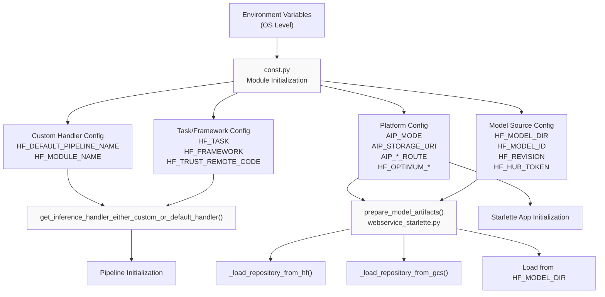
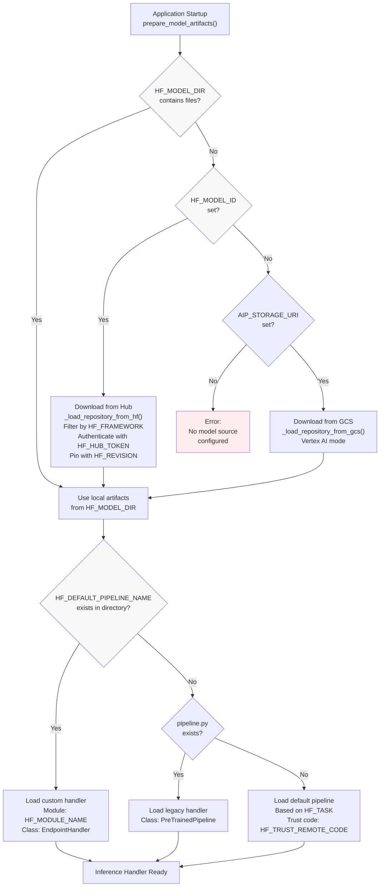
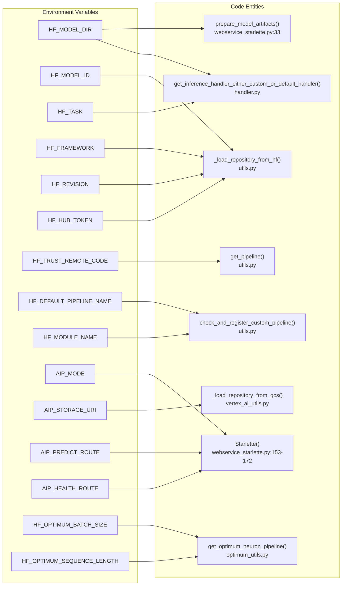

<!-- source: DeepWiki mcp.deepwiki.com · repo huggingface/huggingface-inference-toolkit · page 3 Configuration · fetched 2026-10-26 -->

# Configuration

<details>
<summary>Relevant source files</summary>

The following files were used as context for generating this wiki page:

- [README.md](README.md)
- [src/huggingface_inference_toolkit/const.py](src/huggingface_inference_toolkit/const.py)
- [src/huggingface_inference_toolkit/webservice_starlette.py](src/huggingface_inference_toolkit/webservice_starlette.py)
- [tests/unit/test_const.py](tests/unit/test_const.py)

</details>


This page documents all environment variables and configuration options that control the Hugging Face Inference Toolkit's runtime behavior. Configuration determines how models are loaded, which inference pipelines are selected, and how the toolkit adapts to different deployment platforms.

For information about the deployment-specific setup procedures, see [Deployment Guide](#5). For details about the web service endpoints that respond to these configurations, see [Web Service Layer](#4.1).

## Overview

The toolkit's behavior is controlled entirely through environment variables, with no configuration files required. All configuration constants are centralized in [src/huggingface_inference_toolkit/const.py:1-19]() and imported throughout the codebase. The configuration system supports:

- Model source specification (Hugging Face Hub, local directory, or cloud storage)
- Task and framework selection for pipeline initialization
- Platform-specific adaptations (Google Vertex AI, AWS Inferentia2)
- Custom handler discovery
- Security and authentication settings

Sources: [src/huggingface_inference_toolkit/const.py:1-19](), [README.md:199-278]()

## Configuration Architecture

The following diagram shows how environment variables flow from their definition in `const.py` through the application initialization and into runtime components:



Sources: [src/huggingface_inference_toolkit/const.py:1-19](), [src/huggingface_inference_toolkit/webservice_starlette.py:33-67]()

## Configuration Variables Reference

### Model Source Configuration

These variables determine where the model artifacts are located and how they should be loaded.

| Variable | Type | Default | Required | Description |
|----------|------|---------|----------|-------------|
| `HF_MODEL_DIR` | string | `/opt/huggingface/model` | No | Directory where model artifacts are stored or will be downloaded to |
| `HF_MODEL_ID` | string | `None` | Conditional | Hugging Face Hub model identifier (e.g., `distilbert-base-uncased`) |
| `HF_REVISION` | string | `None` | No | Git revision/commit hash to pin specific model version |
| `HF_HUB_TOKEN` | string | `None` | Conditional | Hugging Face API token for accessing private models |

**Usage Rules:**
- If `HF_MODEL_DIR` contains model artifacts, the toolkit uses them directly
- If `HF_MODEL_DIR` is empty and `HF_MODEL_ID` is set, the model is downloaded from the Hub to `HF_MODEL_DIR`
- If neither is properly configured, the toolkit checks for `AIP_STORAGE_URI` (Vertex AI mode)
- `HF_HUB_TOKEN` is required for private models on the Hub
- `HF_REVISION` should be a full commit hash for reproducible deployments

Sources: [src/huggingface_inference_toolkit/const.py:6-11](), [README.md:203-245](), [src/huggingface_inference_toolkit/webservice_starlette.py:36-59]()

### Task and Framework Configuration

These variables control which inference pipeline is initialized and how the model is loaded.

| Variable | Type | Default | Required | Description |
|----------|------|---------|----------|-------------|
| `HF_TASK` | string | `None` | Yes | Task type for pipeline selection (e.g., `text-classification`, `text-to-image`) |
| `HF_FRAMEWORK` | string | `None` | No | Deep learning framework (`pytorch`, `tensorflow`, or `onnx`) |
| `HF_TRUST_REMOTE_CODE` | boolean | `"0"` | No | Whether to trust and execute remote code from Hub models |

**Framework Detection:**
- If `HF_FRAMEWORK` is not set, the toolkit automatically detects the framework from model artifacts
- Setting `HF_FRAMEWORK` explicitly improves Hub download efficiency by filtering unnecessary files
- Valid values: `"pytorch"`, `"tensorflow"`, `"onnx"`

**Security Considerations:**
- `HF_TRUST_REMOTE_CODE` defaults to `"0"` (false) for security
- Set to `"1"` to enable loading models with custom modeling code
- Only enable for trusted model sources

Sources: [src/huggingface_inference_toolkit/const.py:8-12](), [README.md:215-261]()

### Custom Handler Configuration

These variables control custom inference handler discovery and loading.

| Variable | Type | Default | Required | Description |
|----------|------|---------|----------|-------------|
| `HF_DEFAULT_PIPELINE_NAME` | string | `handler.py` | No | Filename for custom handler script in model directory |
| `HF_MODULE_NAME` | string | `handler.EndpointHandler` | No | Python module path to custom handler class |

**Handler Resolution:**
The toolkit searches for custom handlers in this order:
1. `{HF_MODEL_DIR}/{HF_DEFAULT_PIPELINE_NAME}` containing `EndpointHandler` class
2. `{HF_MODEL_DIR}/pipeline.py` containing `PreTrainedPipeline` class (legacy)
3. Falls back to default pipeline based on `HF_TASK`

**Module Name Format:**
- Derived from `HF_DEFAULT_PIPELINE_NAME`: `{stem}.EndpointHandler`
- Example: `handler.py` → `handler.EndpointHandler`
- Example: `custom.py` → `custom.EndpointHandler`

Sources: [src/huggingface_inference_toolkit/const.py:13-18](), [README.md:63-78]()

### Google Vertex AI Configuration

These variables are automatically set by Vertex AI and control the toolkit's behavior in that environment.

| Variable | Type | Default | Required | Description |
|----------|------|---------|----------|-------------|
| `AIP_MODE` | string | `None` | No | Set to `PREDICTION` by Vertex AI to enable prediction mode |
| `AIP_STORAGE_URI` | string | `None` | Conditional | GCS URI containing model artifacts (e.g., `gs://bucket/path`) |
| `AIP_PREDICT_ROUTE` | string | `None` | Yes* | HTTP route for prediction endpoint (e.g., `/predict`) |
| `AIP_HEALTH_ROUTE` | string | `None` | Yes* | HTTP route for health check endpoint (e.g., `/health`) |
| `AIP_HTTP_PORT` | string | `None` | No | Port number for the HTTP server |

*Required when `AIP_MODE=PREDICTION`

**Vertex AI Behavior:**
When `AIP_MODE=PREDICTION`, the toolkit:
1. Changes route structure to use `AIP_PREDICT_ROUTE` and `AIP_HEALTH_ROUTE`
2. Disables the `/metrics` endpoint
3. Supports loading model artifacts from GCS via `AIP_STORAGE_URI`

Sources: [src/huggingface_inference_toolkit/webservice_starlette.py:143-160](), [README.md:80-129]()

### AWS Inferentia2 Configuration

These variables control model compilation and inference on AWS Inferentia2 accelerators.

| Variable | Type | Default | Required | Description |
|----------|------|---------|----------|-------------|
| `HF_OPTIMUM_BATCH_SIZE` | integer | `1` | Conditional | Static batch size for Neuron compilation |
| `HF_OPTIMUM_SEQUENCE_LENGTH` | integer | `None` | Conditional | Static sequence length for Neuron compilation |

**Compilation Modes:**
The toolkit supports three modes for Inferentia2:

1. **Pre-compiled model from Hub:** Model repository contains `.neuron` artifacts
   - No compilation variables required
   - Example: `HF_MODEL_ID=optimum/bge-base-en-v1.5-neuronx`

2. **Runtime compilation:** Compile model on first startup
   - Both `HF_OPTIMUM_BATCH_SIZE` and `HF_OPTIMUM_SEQUENCE_LENGTH` required
   - Model artifacts cached for subsequent startups
   - Example: `HF_OPTIMUM_BATCH_SIZE=1 HF_OPTIMUM_SEQUENCE_LENGTH=128`

3. **Config-based compilation:** Compilation parameters in model's `config.json`
   - `config.json` contains `neuron` dictionary with `static_batch_size` and `static_sequence_length`
   - No environment variables required

**Important Notes:**
- Input shapes are static and must be known at compilation time
- Compiled models are tied to specific batch size and sequence length
- Recompilation occurs if shapes change

Sources: [README.md:131-196]()

## Configuration Flow Diagram

The following diagram illustrates the decision tree for model loading based on configuration variables:



Sources: [src/huggingface_inference_toolkit/webservice_starlette.py:33-67](), [src/huggingface_inference_toolkit/const.py:1-19]()

## Configuration Examples

### Standard Deployment

Basic deployment with a public Hub model:

```bash
HF_MODEL_ID=distilbert-base-uncased-finetuned-sst-2-english
HF_TASK=text-classification
```

### Private Model with Authentication

Accessing a private model from the Hub:

```bash
HF_MODEL_ID=myorg/private-model
HF_TASK=text-generation
HF_HUB_TOKEN=hf_xxxxxxxxxxxxxxxxxxxxxxxxxxxxx
HF_REVISION=03b4d196c19d0a73c7e0322684e97db1ec397613
```

### Local Model Directory

Using pre-downloaded model artifacts:

```bash
HF_MODEL_DIR=/mnt/models/my-model
HF_TASK=question-answering
```

### Vertex AI Deployment

Configuration for Google Vertex AI (most variables set by platform):

```bash
AIP_MODE=PREDICTION
AIP_HTTP_PORT=8080
AIP_PREDICT_ROUTE=/predict
AIP_HEALTH_ROUTE=/health
AIP_STORAGE_URI=gs://my-bucket/models/my-model
HF_TASK=text-classification
```

### AWS Inferentia2 with Runtime Compilation

Deploying on Inferentia2 with on-the-fly compilation:

```bash
HF_MODEL_ID=distilbert-base-uncased-finetuned-sst-2-english
HF_TASK=text-classification
HF_OPTIMUM_BATCH_SIZE=1
HF_OPTIMUM_SEQUENCE_LENGTH=128
```

### Custom Handler with Framework Selection

Using a custom handler with specific framework:

```bash
HF_MODEL_DIR=/opt/models/custom-model
HF_TASK=text-classification
HF_FRAMEWORK=pytorch
HF_DEFAULT_PIPELINE_NAME=inference.py
HF_MODULE_NAME=inference.CustomHandler
```

Sources: [README.md:16-196]()

## Configuration Validation

The following table summarizes configuration validation rules enforced at startup:

| Condition | Validation | Error Message |
|-----------|------------|---------------|
| Model source | At least one of `HF_MODEL_DIR` (non-empty), `HF_MODEL_ID`, or `AIP_STORAGE_URI` must be set | `Can't initialize model. Please set env HF_MODEL_DIR or provider a HF_MODEL_ID.` |
| Vertex AI routes | When `AIP_MODE=PREDICTION`, both `AIP_PREDICT_ROUTE` and `AIP_HEALTH_ROUTE` required | `AIP_PREDICT_ROUTE and AIP_HEALTH_ROUTE need to be set in Vertex AI environment` |
| Custom handler | If `HF_DEFAULT_PIPELINE_NAME` set, file must exist in `HF_MODEL_DIR` | Handler falls back to default pipeline |
| Inferentia2 | For runtime compilation, both `HF_OPTIMUM_BATCH_SIZE` and `HF_OPTIMUM_SEQUENCE_LENGTH` recommended | May fail at compilation if shapes not specified |

Sources: [src/huggingface_inference_toolkit/webservice_starlette.py:54-59](), [src/huggingface_inference_toolkit/webservice_starlette.py:148-151]()

## Environment Variable to Code Entity Mapping

The following diagram maps configuration variables to the specific code locations where they are consumed:



Sources: [src/huggingface_inference_toolkit/const.py:1-19](), [src/huggingface_inference_toolkit/webservice_starlette.py:1-173]()

## Configuration Precedence

When multiple configuration methods are available, the toolkit follows this precedence order:

1. **Explicit environment variables** - Highest priority
2. **Platform-injected variables** (e.g., `AIP_*` from Vertex AI) - Second priority
3. **Default values in const.py** - Lowest priority

Example scenario: If both `HF_MODEL_DIR` contains files AND `HF_MODEL_ID` is set, the local directory takes precedence and no Hub download occurs.

Sources: [src/huggingface_inference_toolkit/webservice_starlette.py:36-59]()

## Related Configuration Files

While runtime behavior is controlled by environment variables, the following files define package-level configuration:

| File | Purpose | Key Content |
|------|---------|-------------|
| `setup.py` | Package dependencies and optional extras | Defines `torch`, `st`, `diffusers`, `inf2`, `google` extras |
| `pyproject.toml` | Development tool configuration | Configures `isort`, `ruff`, `pytest` |
| `.env` (not in repo) | Local development environment variables | User-created file for local testing |

For information about installing optional dependencies, see [Installation and Setup](#2).

Sources: [README.md:9-14]()

---

