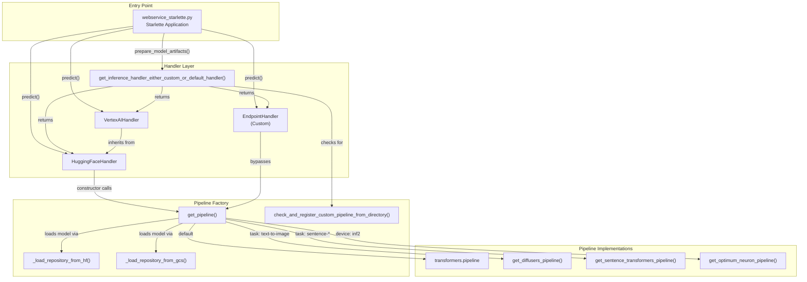
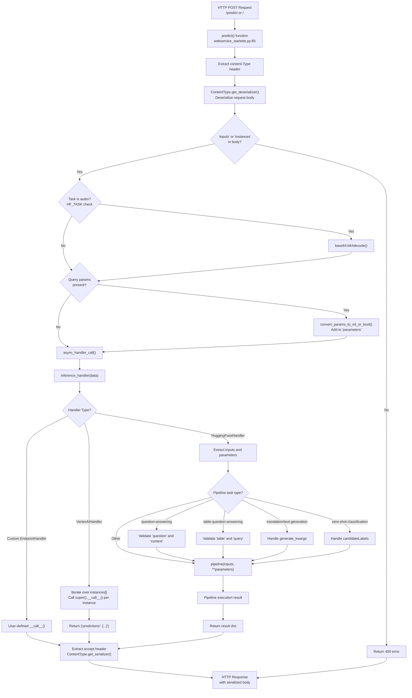
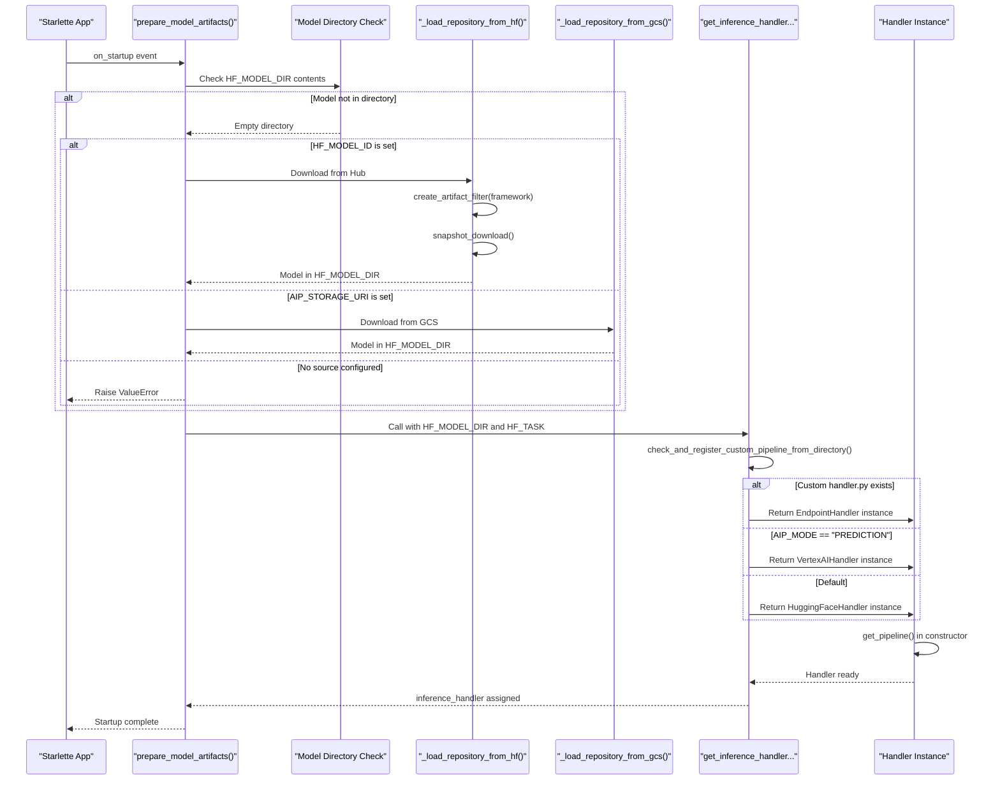
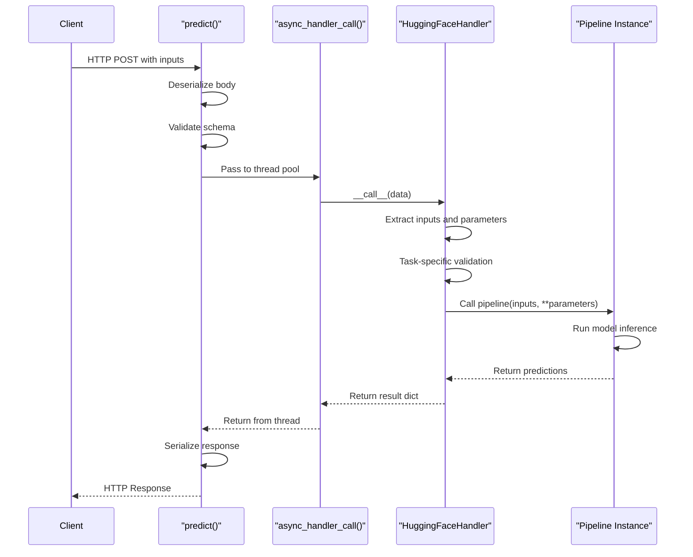
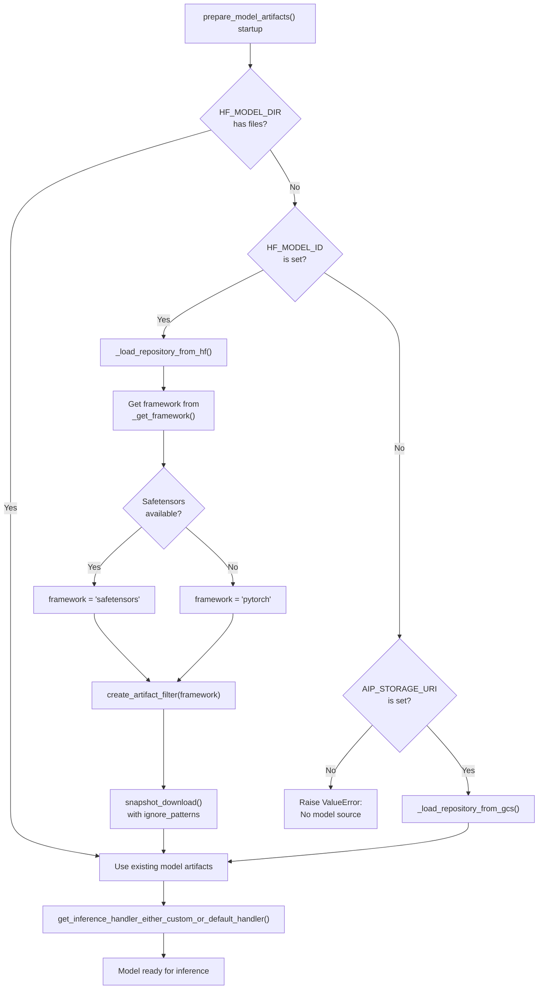
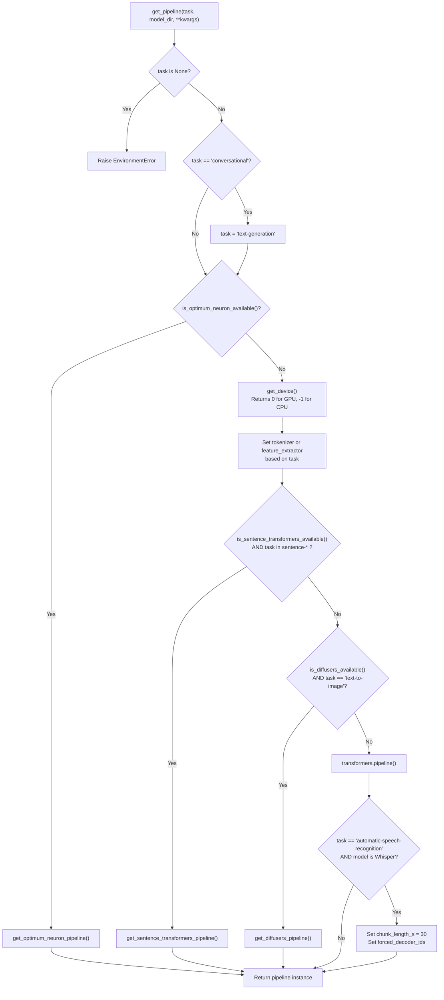
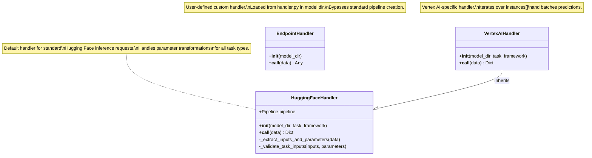
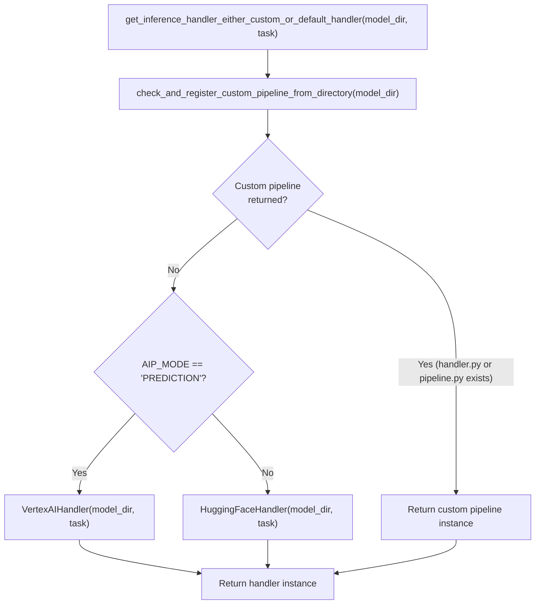

<!-- source: DeepWiki mcp.deepwiki.com · repo huggingface/huggingface-inference-toolkit · page 4 Core Architecture · fetched 2026-10-26 -->

# Core Architecture

<details>
<summary>Relevant source files</summary>

The following files were used as context for generating this wiki page:

- [src/huggingface_inference_toolkit/const.py](src/huggingface_inference_toolkit/const.py)
- [src/huggingface_inference_toolkit/handler.py](src/huggingface_inference_toolkit/handler.py)
- [src/huggingface_inference_toolkit/utils.py](src/huggingface_inference_toolkit/utils.py)
- [src/huggingface_inference_toolkit/webservice_starlette.py](src/huggingface_inference_toolkit/webservice_starlette.py)
- [tests/unit/test_const.py](tests/unit/test_const.py)

</details>


## Purpose and Scope

This document describes the overall system architecture of the Hugging Face Inference Toolkit, including the relationships between core components and the data flow through the inference pipeline. It covers the three primary architectural layers: the HTTP web service, the handler abstraction, and the pipeline factory system.

For specific deployment configurations and environment variables, see [Configuration](#3). For details about individual pipeline types (Diffusers, Sentence Transformers, Optimum Neuron), see [Specialized Pipeline Support](#6). For HTTP API schemas and endpoints, see [API Reference](#7).

## System Overview

The Hugging Face Inference Toolkit follows a three-tier architecture where HTTP requests flow through a web service layer, are processed by inference handlers, and are executed by task-specific pipelines. The system is designed to support multiple model types, frameworks, and deployment platforms through a unified interface.

### Core Components



**Sources:** [src/huggingface_inference_toolkit/webservice_starlette.py:33-67](), [src/huggingface_inference_toolkit/handler.py:141-159](), [src/huggingface_inference_toolkit/utils.py:206-263]()

| Component | File | Primary Responsibility |
|-----------|------|------------------------|
| `Starlette` app | `webservice_starlette.py` | HTTP endpoint routing, request deserialization, response serialization |
| `get_inference_handler_either_custom_or_default_handler()` | `handler.py` | Selects appropriate handler based on environment and custom handler presence |
| `HuggingFaceHandler` | `handler.py` | Default handler for standard inference requests |
| `VertexAIHandler` | `handler.py` | Vertex AI-specific handler with batch instance processing |
| `EndpointHandler` | Custom `handler.py` | User-defined custom inference logic |
| `get_pipeline()` | `utils.py` | Pipeline factory that selects and instantiates task-specific pipelines |
| `_load_repository_from_hf()` | `utils.py` | Downloads models from Hugging Face Hub |
| `_load_repository_from_gcs()` | `vertex_ai_utils.py` | Downloads models from Google Cloud Storage |

## Request Processing Flow

The following diagram shows the complete lifecycle of an inference request from HTTP entry to response serialization:



**Sources:** [src/huggingface_inference_toolkit/webservice_starlette.py:85-139](), [src/huggingface_inference_toolkit/handler.py:29-106](), [src/huggingface_inference_toolkit/handler.py:120-138]()

### Request Processing Steps

1. **Request Reception** - The `predict()` function in `webservice_starlette.py` receives the HTTP POST request [webservice_starlette.py:85]().

2. **Content Deserialization** - The `content-Type` header determines the deserialization strategy. The system uses `ContentType.get_deserializer()` to parse the request body [webservice_starlette.py:88-92]().

3. **Schema Validation** - The deserialized body must contain either `inputs` or `instances` key [webservice_starlette.py:94-97]().

4. **Audio Preprocessing** - For audio tasks (`automatic-speech-recognition`, `audio-classification`), base64-encoded inputs are decoded [webservice_starlette.py:100-107]().

5. **Parameter Handling** - Query parameters are converted to integers or booleans and merged into the `parameters` dict [webservice_starlette.py:110-113]().

6. **Asynchronous Handler Call** - The request is passed to `async_handler_call()` which manages thread pool execution [webservice_starlette.py:118]().

7. **Handler Execution** - The appropriate handler (`HuggingFaceHandler`, `VertexAIHandler`, or custom) processes the request [handler.py:29-106]().

8. **Response Serialization** - The result is serialized according to the `accept` header and returned [webservice_starlette.py:125-132]().

## Component Interactions

### Startup Sequence



**Sources:** [src/huggingface_inference_toolkit/webservice_starlette.py:33-66](), [src/huggingface_inference_toolkit/handler.py:141-159](), [src/huggingface_inference_toolkit/utils.py:105-149]()

### Runtime Request Handling



**Sources:** [src/huggingface_inference_toolkit/webservice_starlette.py:85-139](), [src/huggingface_inference_toolkit/handler.py:29-106]()

## Model Loading Architecture

The system supports three model loading strategies, evaluated in order during the `prepare_model_artifacts()` startup phase:

### Loading Priority



**Sources:** [src/huggingface_inference_toolkit/webservice_starlette.py:33-66](), [src/huggingface_inference_toolkit/utils.py:105-149](), [src/huggingface_inference_toolkit/const.py:6-11]()

### Framework-Specific Artifact Filtering

The `create_artifact_filter()` function generates regex patterns to exclude unnecessary model files based on the target framework. This reduces download time and storage requirements [utils.py:58-69]().

| Framework | Pattern | Files Included | Files Excluded |
|-----------|---------|----------------|----------------|
| `pytorch` | `pytorch*` | `pytorch_model.bin`, `model.safetensors` | TensorFlow, ONNX, Flax weights |
| `tensorflow` | `tf*` | `tf_model.h5`, `saved_model.pb` | PyTorch, ONNX, Flax weights |
| `onnx` | `*onnx*` | `model.onnx` | Framework-specific weights |
| `safetensors` | `*safetensors` | `model.safetensors` | Legacy weight formats |

The `framework2weight` mapping defines all recognized patterns [utils.py:41-55]().

### Environment Variables for Model Loading

| Variable | Source File | Purpose | Default |
|----------|-------------|---------|---------|
| `HF_MODEL_DIR` | `const.py:6` | Local directory for model artifacts | `/opt/huggingface/model` |
| `HF_MODEL_ID` | `const.py:7` | Hugging Face Hub repository identifier | `None` |
| `HF_REVISION` | `const.py:10` | Git commit hash or branch name | `None` (latest) |
| `HF_HUB_TOKEN` | `const.py:11` | Authentication token for private repos | `None` |
| `HF_FRAMEWORK` | `const.py:9` | Explicit framework selection | Auto-detected |
| `AIP_STORAGE_URI` | N/A | Google Cloud Storage URI for Vertex AI | `None` |

**Sources:** [src/huggingface_inference_toolkit/const.py:1-18]()

## Pipeline Selection Logic

The `get_pipeline()` function implements a decision tree that selects the appropriate pipeline implementation based on hardware availability, task type, and custom handler presence [utils.py:206-263]().

### Pipeline Selection Decision Tree



**Sources:** [src/huggingface_inference_toolkit/utils.py:206-263]()

### Device Detection

The `get_device()` function returns the appropriate device identifier for pipeline initialization [utils.py:194-203]():

- Returns `0` if GPU is available (CUDA for PyTorch, GPU device for TensorFlow)
- Returns `-1` for CPU-only execution
- GPU availability checked via `torch.cuda.is_available()` or `tf.config.list_physical_devices("GPU")`

### Task-Specific Pipeline Routing

| Task Category | Condition | Pipeline Function | Source File |
|---------------|-----------|-------------------|-------------|
| AWS Inferentia2 | `is_optimum_neuron_available()` returns `True` | `get_optimum_neuron_pipeline()` | `optimum_utils.py` |
| Sentence Embeddings | Task in `["sentence-similarity", "sentence-embeddings", "sentence-ranking", "text-ranking"]` | `get_sentence_transformers_pipeline()` | `sentence_transformers_utils.py` |
| Text-to-Image | Task is `"text-to-image"` | `get_diffusers_pipeline()` | `diffusers_utils.py` |
| Standard Tasks | All other tasks | `transformers.pipeline()` | `transformers` library |

**Sources:** [src/huggingface_inference_toolkit/utils.py:222-256]()

### Custom Pipeline Override

Before any standard pipeline selection, the system checks for custom handler implementations [utils.py:152-191]():

1. **Primary Custom Handler** - Looks for `handler.py` in the model directory, expecting an `EndpointHandler` class [utils.py:157-170]()
2. **Legacy Custom Handler** - Falls back to `pipeline.py` with a `PreTrainedPipeline` class [utils.py:172-187]()
3. **No Custom Handler** - Proceeds with standard pipeline selection [utils.py:189-191]()

The custom handler path is configured via the `HF_DEFAULT_PIPELINE_NAME` environment variable (defaults to `"handler.py"`) [const.py:14]().

## Handler Abstraction

The handler layer provides a uniform interface between the web service and the underlying pipelines, handling request preprocessing, task-specific parameter transformations, and response formatting.

### Handler Class Hierarchy



**Sources:** [src/huggingface_inference_toolkit/handler.py:13-159]()

### HuggingFaceHandler Request Processing

The `HuggingFaceHandler.__call__()` method implements task-specific input transformations [handler.py:29-106]():

#### Input Extraction
```python
inputs = data.pop("inputs", data)
parameters = data.pop("parameters", {})
```
[handler.py:36-37]()

#### Task-Specific Transformations

| Task Type | Transformation | Lines |
|-----------|----------------|-------|
| `question-answering` | Validates `question` and `context` keys exist | [handler.py:53-60]() |
| `table-question-answering` | Renames `question` to `query`, validates `table` key | [handler.py:62-71]() |
| `translation` / `text-generation` | Moves `generation_parameters` to `generate_kwargs` | [handler.py:73-82]() |
| `zero-shot-classification` | Renames `candidateLabels` to `candidate_labels`, wraps text in `sequences` | [handler.py:90-102]() |
| Sentence Transformers | Passes inputs directly without parameters | [handler.py:40-45]() |
| Diffusers | Supports both dict and string inputs with parameters | [handler.py:47-51]() |

### VertexAIHandler Batch Processing

The `VertexAIHandler` extends `HuggingFaceHandler` to support Vertex AI's batch prediction format [handler.py:109-138]():

1. Validates `instances` key exists in request [handler.py:127-128]()
2. Extracts shared `parameters` from request [handler.py:129]()
3. Iterates over each instance in the `instances` array [handler.py:133]()
4. Constructs individual payload: `{"inputs": instance, "parameters": parameters}` [handler.py:134]()
5. Calls parent `HuggingFaceHandler.__call__()` for each instance [handler.py:135]()
6. Wraps results in `{"predictions": [...]}` response format [handler.py:138]()

This enables Vertex AI to send multiple instances in a single request while maintaining the standard Hugging Face inference interface for each individual prediction.

### Handler Selection Strategy

The `get_inference_handler_either_custom_or_default_handler()` function determines which handler to instantiate [handler.py:141-159]():



**Sources:** [src/huggingface_inference_toolkit/handler.py:141-159]()

## Configuration System

The core architecture relies on environment variables defined in `const.py` for runtime configuration [const.py:1-18]().

### Configuration Loading

All configuration values are loaded at module import time and stored as module-level constants:

| Constant | Environment Variable | Type | Default | Purpose |
|----------|---------------------|------|---------|---------|
| `HF_MODEL_DIR` | `HF_MODEL_DIR` | `str` | `/opt/huggingface/model` | Local storage path for model artifacts |
| `HF_MODEL_ID` | `HF_MODEL_ID` | `str \| None` | `None` | Hugging Face Hub repository identifier |
| `HF_TASK` | `HF_TASK` | `str \| None` | `None` | ML task type (e.g., `text-classification`) |
| `HF_FRAMEWORK` | `HF_FRAMEWORK` | `str \| None` | `None` | DL framework (`pytorch`, `tensorflow`) |
| `HF_REVISION` | `HF_REVISION` | `str \| None` | `None` | Git revision (commit hash, branch, tag) |
| `HF_HUB_TOKEN` | `HF_HUB_TOKEN` | `str \| None` | `None` | Authentication token for private models |
| `HF_TRUST_REMOTE_CODE` | `HF_TRUST_REMOTE_CODE` | `bool` | `False` | Allow execution of remote code in models |
| `HF_DEFAULT_PIPELINE_NAME` | `HF_DEFAULT_PIPELINE_NAME` | `str` | `handler.py` | Filename for custom handler module |
| `HF_MODULE_NAME` | `HF_MODULE_NAME` | `str` | `handler.EndpointHandler` | Fully qualified class name for custom handler |

**Sources:** [src/huggingface_inference_toolkit/const.py:1-18]()

### Security Considerations

The `HF_TRUST_REMOTE_CODE` flag controls whether models can execute custom Python code from the repository [const.py:12]():

- Default is `False` (secure by default)
- Must be explicitly set to `"1"` or `"true"` to enable
- Converted to boolean via `strtobool()` utility
- Required for models that use custom modeling code

**Sources:** [src/huggingface_inference_toolkit/const.py:12](), [src/huggingface_inference_toolkit/handler.py:26]()

---

