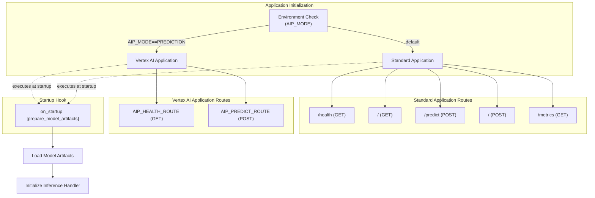
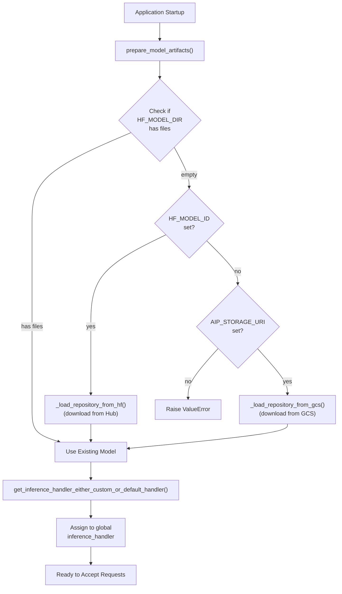
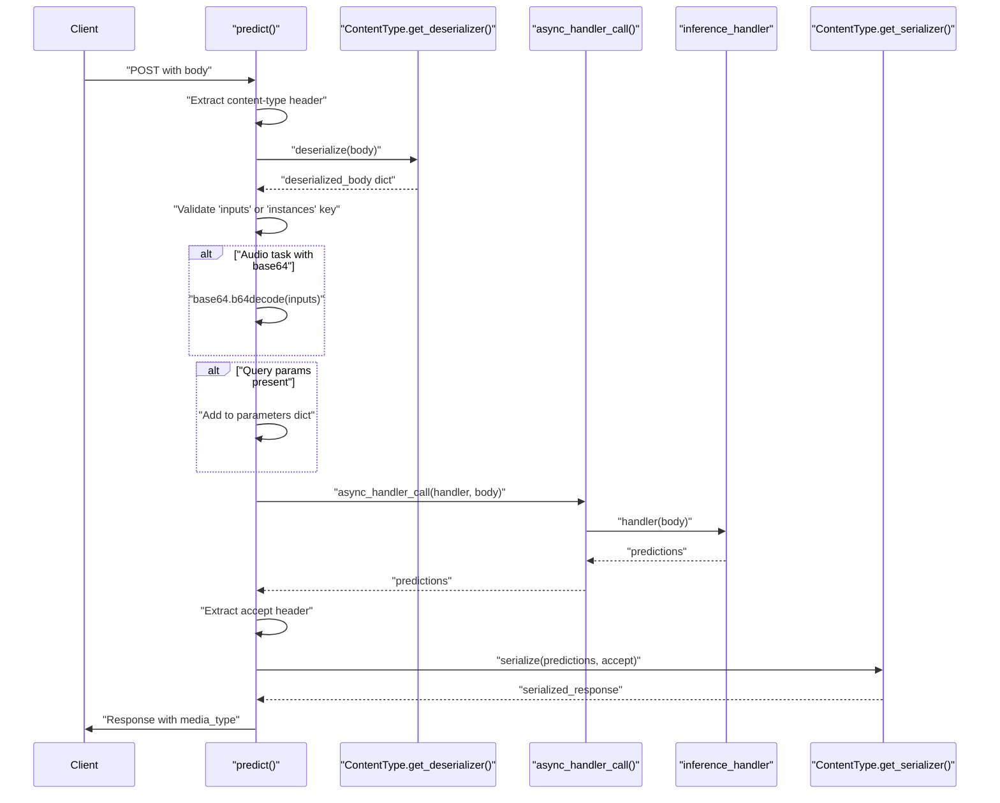
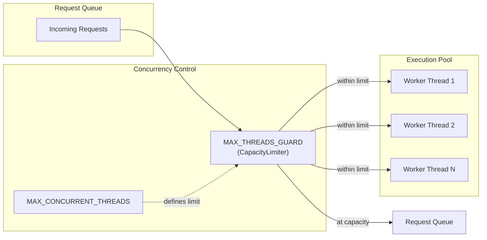

<!-- source: DeepWiki mcp.deepwiki.com · repo huggingface/huggingface-inference-toolkit · page 4.1 Web Service Layer · fetched 2026-10-26 -->

# Web Service Layer

<details>
<summary>Relevant source files</summary>

The following files were used as context for generating this wiki page:

- [src/huggingface_inference_toolkit/const.py](src/huggingface_inference_toolkit/const.py)
- [src/huggingface_inference_toolkit/webservice_starlette.py](src/huggingface_inference_toolkit/webservice_starlette.py)
- [tests/unit/test_const.py](tests/unit/test_const.py)

</details>


## Purpose and Scope

This document details the HTTP web service layer that serves as the entry point for all inference requests. The web service is implemented using [Starlette](https://www.starlette.io/) and provides REST API endpoints for model inference, health checks, and metrics reporting.

For information about:
- How models are loaded and pipelines are created, see [Model Loading and Pipeline Factory](#4.2)
- How inference handlers process requests, see [Inference Handlers](#4.3)
- Configuration of environment variables, see [Configuration](#3)
- Deployment-specific routing and setup, see [Deployment Guide](#5)

**Sources:** [src/huggingface_inference_toolkit/webservice_starlette.py:1-173]()

## Application Architecture

The web service layer is built on Starlette and provides an asynchronous ASGI application. The application operates in two modes depending on the deployment environment:

1. **Standard Mode**: Default mode with multiple endpoints for health, prediction, and metrics
2. **Vertex AI Mode**: Google Cloud Vertex AI compatible mode with custom routes



**Sources:** [src/huggingface_inference_toolkit/webservice_starlette.py:143-172]()

### Application Instantiation

The `app` object is created conditionally based on the `AIP_MODE` environment variable:

| Condition | Application Mode | Routes Defined |
|-----------|-----------------|----------------|
| `AIP_MODE == "PREDICTION"` | Vertex AI | Custom routes from `AIP_HEALTH_ROUTE` and `AIP_PREDICT_ROUTE` |
| Otherwise | Standard | `/`, `/health`, `/predict`, `/metrics` |

Both application modes share the same startup hook that executes `prepare_model_artifacts()` to initialize the model before accepting requests.

**Sources:** [src/huggingface_inference_toolkit/webservice_starlette.py:143-172]()

## Startup Lifecycle

The `prepare_model_artifacts()` async function executes during application startup and is responsible for ensuring model artifacts are available and the inference handler is initialized.



### Model Source Cascade

The model loading logic follows a priority order:

1. **Local Directory**: Check if `HF_MODEL_DIR` (default: `/opt/huggingface/model`) already contains model files
2. **Hugging Face Hub**: If `HF_MODEL_ID` is set, download from the Hub using `_load_repository_from_hf()`
3. **Google Cloud Storage**: If `AIP_STORAGE_URI` is set (Vertex AI deployment), download from GCS
4. **Error**: If none of the above sources are available, raise a `ValueError`

The loaded model artifacts are then used to instantiate the appropriate inference handler, which is stored in the global `inference_handler` variable for use by the predict endpoint.

**Sources:** [src/huggingface_inference_toolkit/webservice_starlette.py:33-66]()

## HTTP Endpoints

The web service exposes the following endpoints:

### Standard Mode Endpoints

| Endpoint | Method | Handler Function | Purpose |
|----------|--------|-----------------|---------|
| `/` | GET | `health()` | Root health check |
| `/health` | GET | `health()` | Health check endpoint |
| `/` | POST | `predict()` | Root prediction endpoint |
| `/predict` | POST | `predict()` | Named prediction endpoint |
| `/metrics` | GET | `metrics()` | Prometheus-compatible metrics |

### Vertex AI Mode Endpoints

| Endpoint | Method | Handler Function | Purpose |
|----------|--------|-----------------|---------|
| `$AIP_HEALTH_ROUTE` | GET | `health()` | Health check (route from env var) |
| `$AIP_PREDICT_ROUTE` | POST | `predict()` | Prediction (route from env var) |

**Sources:** [src/huggingface_inference_toolkit/webservice_starlette.py:153-172]()

## Health Check Endpoint

The `health()` function provides a simple liveness check that returns HTTP 200 with "Ok" as plain text.

```python
async def health(request):
    return PlainTextResponse("Ok")
```

This endpoint is used by:
- Container orchestration systems (Kubernetes, ECS) for liveness probes
- Load balancers for health checks
- Vertex AI's health monitoring

**Sources:** [src/huggingface_inference_toolkit/webservice_starlette.py:69-70]()

## Metrics Endpoint

The `metrics()` function exposes Prometheus-compatible metrics in plain text format:

```
inf_batch_current_size <value>
inf_queue_size <value>
```

### Metrics Definitions

| Metric Name | Description | Calculation |
|-------------|-------------|-------------|
| `inf_batch_current_size` | Number of requests currently being processed | `MAX_CONCURRENT_THREADS - MAX_THREADS_GUARD.value` |
| `inf_queue_size` | Number of requests waiting in the queue | `MAX_THREADS_GUARD.statistics().tasks_waiting` |

These metrics are derived from the async concurrency control system (see Concurrency Model section below).

**Sources:** [src/huggingface_inference_toolkit/webservice_starlette.py:73-82]()

## Prediction Endpoint

The `predict()` async function is the core inference endpoint. It handles request deserialization, input validation, inference execution, and response serialization.



### Request Processing Flow

1. **Content-Type Handling**: Extract `content-type` header and deserialize request body using appropriate deserializer
2. **Input Validation**: Verify that body contains either `inputs` or `instances` key (Vertex AI compatibility)
3. **Audio Preprocessing**: For audio tasks (`automatic-speech-recognition`, `audio-classification`), decode base64-encoded inputs
4. **Query Parameters**: If query parameters are present and no `parameters` key exists in body, add them to the request
5. **Async Inference**: Execute inference via `async_handler_call()` which manages concurrency
6. **Response Serialization**: Use `accept` header to determine output format and serialize response

**Sources:** [src/huggingface_inference_toolkit/webservice_starlette.py:85-139]()

### Input Schema

The request body must contain one of:

| Key | Type | Description |
|-----|------|-------------|
| `inputs` | Any | Standard HF format - model inputs |
| `instances` | Array | Vertex AI format - array of input instances |
| `parameters` | Object | Optional inference parameters |

### Audio Task Handling

For audio tasks, the toolkit expects base64-encoded audio data in the `inputs` field:

```python
if "parameters" in deserialized_body and HF_TASK in {
    "automatic-speech-recognition",
    "audio-classification",
}:
    deserialized_body["inputs"] = base64.b64decode(
        deserialized_body["inputs"], validate=True
    )
```

The `validate=True` flag ensures strict base64 validation to prevent malformed data from reaching the model.

**Sources:** [src/huggingface_inference_toolkit/webservice_starlette.py:99-107]()

### Query Parameter Processing

Query parameters are automatically converted to `parameters` if no explicit `parameters` key exists in the request body:

```python
if request.query_params and "parameters" not in deserialized_body:
    deserialized_body["parameters"] = convert_params_to_int_or_bool(
        dict(request.query_params)
    )
```

The `convert_params_to_int_or_bool()` utility function intelligently converts string values to integers or booleans where appropriate.

**Sources:** [src/huggingface_inference_toolkit/webservice_starlette.py:109-113]()

### Response Format

Responses are serialized based on the `accept` header:

| Accept Header | Serializer | Default Behavior |
|--------------|-----------|------------------|
| `application/json` | JSON serializer | Yes (default) |
| `*/*` | JSON serializer | Fallback to JSON |
| Other | Content-type specific | Based on serializer registry |

**Sources:** [src/huggingface_inference_toolkit/webservice_starlette.py:124-132]()

## Error Handling

The predict endpoint wraps all processing in a try-except block. Errors are caught and returned as JSON responses with HTTP 400 status:

```python
except Exception as e:
    logger.error(e)
    return Response(
        Jsoner.serialize({"error": str(e)}),
        status_code=400,
        media_type="application/json",
    )
```

Error responses always use JSON format regardless of the `accept` header, ensuring clients can reliably parse error information.

**Sources:** [src/huggingface_inference_toolkit/webservice_starlette.py:133-139]()

## Concurrency Model

The web service uses an asynchronous concurrency model with thread limiting to control resource usage:



The `async_handler_call()` function (imported from `async_utils`) manages concurrent execution using the `MAX_THREADS_GUARD` capacity limiter. This prevents the system from being overwhelmed by too many simultaneous inference requests.

Metrics exposed by the `/metrics` endpoint reflect this concurrency state:
- **Current batch size**: `MAX_CONCURRENT_THREADS - MAX_THREADS_GUARD.value`
- **Queue size**: `MAX_THREADS_GUARD.statistics().tasks_waiting`

**Sources:** [src/huggingface_inference_toolkit/webservice_starlette.py:11-12](), [src/huggingface_inference_toolkit/webservice_starlette.py:76-81](), [src/huggingface_inference_toolkit/webservice_starlette.py:118]()

## Request Timing

The predict endpoint tracks and logs request duration using `perf_counter`:

```python
start_time = perf_counter()
pred = await async_handler_call(inference_handler, deserialized_body)
logger.info(
    f"POST {request.url.path} | Duration: {(perf_counter()-start_time) *1000:.2f} ms"
)
```

This provides millisecond-precision timing information in the application logs for monitoring inference performance.

**Sources:** [src/huggingface_inference_toolkit/webservice_starlette.py:116-122]()

## Environment Variables

The web service layer relies on several environment variables defined in [const.py]():

| Variable | Default | Purpose | Used By |
|----------|---------|---------|---------|
| `HF_MODEL_DIR` | `/opt/huggingface/model` | Model artifact directory | `prepare_model_artifacts()` |
| `HF_MODEL_ID` | `None` | Hugging Face Hub model identifier | `prepare_model_artifacts()` |
| `HF_TASK` | `None` | Task type (e.g., `text-classification`) | `predict()` audio handling, handler selection |
| `HF_FRAMEWORK` | `None` | Framework filter (pytorch/tensorflow) | Model loading |
| `HF_REVISION` | `None` | Git revision to download | Model loading |
| `HF_HUB_TOKEN` | `None` | Authentication token for Hub | Model loading |
| `AIP_MODE` | `None` | Set to `"PREDICTION"` for Vertex AI | Application routing |
| `AIP_HEALTH_ROUTE` | `None` | Vertex AI health endpoint path | Vertex AI routing |
| `AIP_PREDICT_ROUTE` | `None` | Vertex AI prediction endpoint path | Vertex AI routing |
| `AIP_STORAGE_URI` | `None` | GCS URI for model artifacts | `prepare_model_artifacts()` |

**Sources:** [src/huggingface_inference_toolkit/const.py:1-18](), [src/huggingface_inference_toolkit/webservice_starlette.py:12-19](), [src/huggingface_inference_toolkit/webservice_starlette.py:143-151]()

## Global State

The web service maintains minimal global state:

```python
global inference_handler
```

The `inference_handler` variable is initialized during application startup by `prepare_model_artifacts()` and is subsequently accessed by all requests to the `predict()` endpoint. This global state is thread-safe because it is initialized once during startup before the web server begins accepting requests, and is only read (not written) during request processing.

**Sources:** [src/huggingface_inference_toolkit/webservice_starlette.py:34](), [src/huggingface_inference_toolkit/webservice_starlette.py:63](), [src/huggingface_inference_toolkit/webservice_starlette.py:118]()

---

