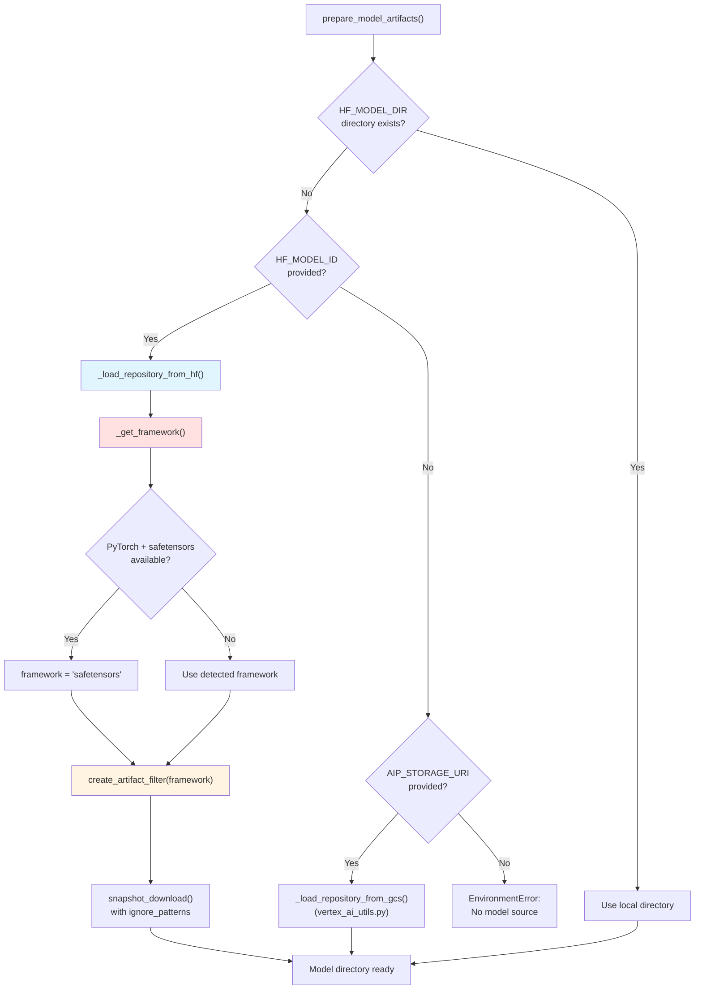
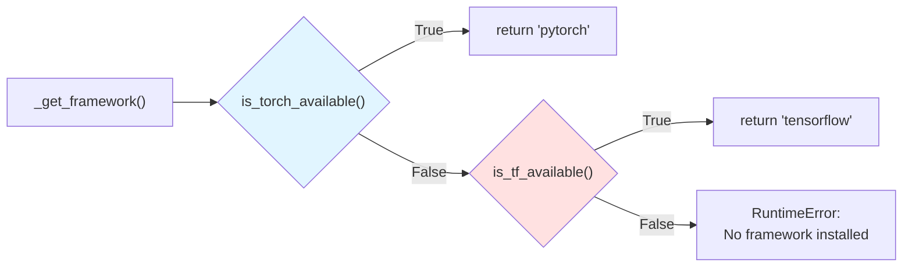
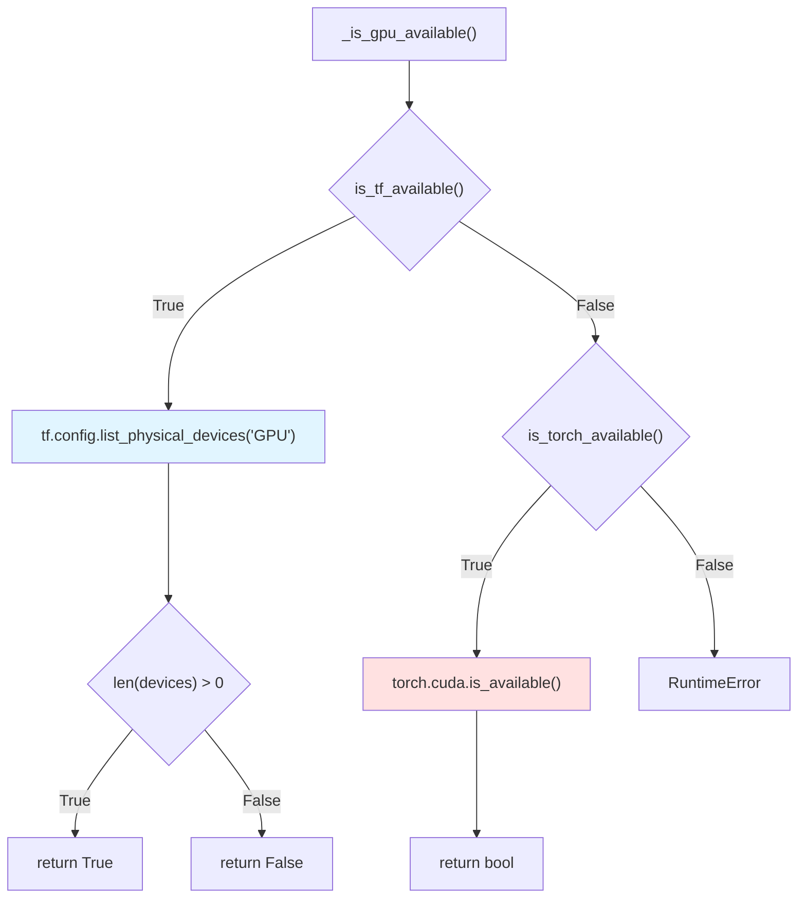
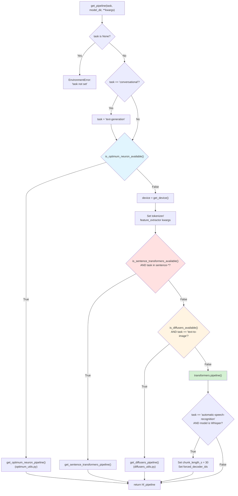
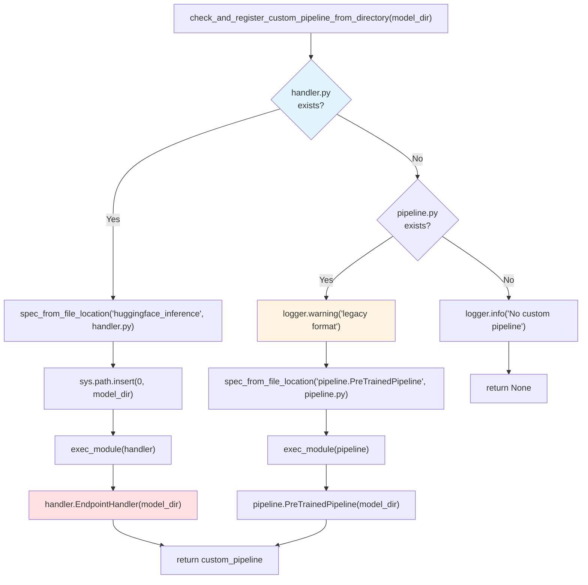

<!-- source: DeepWiki mcp.deepwiki.com · repo huggingface/huggingface-inference-toolkit · page 4.2 Model Loading and Pipeline Factory · fetched 2026-10-26 -->

# Model Loading and Pipeline Factory

<details>
<summary>Relevant source files</summary>

The following files were used as context for generating this wiki page:

- [src/huggingface_inference_toolkit/utils.py](src/huggingface_inference_toolkit/utils.py)
- [tests/unit/test_utils.py](tests/unit/test_utils.py)

</details>


This document explains the model loading and pipeline instantiation mechanisms in the Hugging Face Inference Toolkit. The utilities described here handle downloading models from remote sources, filtering framework-specific artifacts, detecting available hardware, and routing to the appropriate pipeline implementation based on task type and hardware availability.

For information about how pipelines are invoked during inference, see [Inference Handlers](#4.3). For deployment-specific model loading (GCS for Vertex AI, cached models for Inferentia2), see sections [5.3](#5.3) and [5.4](#5.4). For specialized pipeline implementations, see [Specialized Pipeline Support](#6).

## Model Loading Architecture

The model loading system supports three primary sources: Hugging Face Hub, Google Cloud Storage (Vertex AI), and local directories. The system automatically detects the source based on environment variables and delegates to the appropriate loading mechanism.

### Model Source Resolution Flow



**Model Source Resolution and Artifact Filtering**

Sources: [src/huggingface_inference_toolkit/utils.py:105-149]()

### Loading from Hugging Face Hub

The `_load_repository_from_hf()` function handles downloading models from the Hugging Face Hub with framework-specific artifact filtering.

| Parameter | Type | Purpose |
|-----------|------|---------|
| `repository_id` | `Optional[str]` | Hub model identifier (e.g., "bert-base-uncased") |
| `target_dir` | `Optional[Union[str, Path]]` | Local directory for model artifacts |
| `framework` | `Optional[str]` | Framework to filter artifacts for (auto-detected if None) |
| `revision` | `Optional[str]` | Git commit hash or branch name |
| `hf_hub_token` | `Optional[str]` | Authentication token for private models |

**Key behaviors:**

1. **Authentication**: If `hf_hub_token` is provided, calls `login(token=hf_hub_token)` [line 117]
2. **Framework auto-detection**: If `framework` is None, calls `_get_framework()` [line 120]
3. **SafeTensors preference**: For PyTorch, checks if safetensors weights exist and prefers them over pickle-based weights [lines 130-133]
4. **Artifact filtering**: Uses `create_artifact_filter()` to generate regex patterns that exclude non-framework artifacts [line 136]
5. **Download**: Uses `snapshot_download()` with `ignore_patterns` to selectively download files [lines 141-147]

Sources: [src/huggingface_inference_toolkit/utils.py:105-149](), [tests/unit/test_utils.py:21-84]()

## Framework Detection and Artifact Filtering

### Framework Detection Logic



**Framework Detection Priority: PyTorch > TensorFlow**

The `_get_framework()` function determines which deep learning framework is available, with PyTorch taking priority if both are installed [lines 88-102]. This ensures consistent behavior across environments.

Sources: [src/huggingface_inference_toolkit/utils.py:88-102](), [tests/unit/test_utils.py:92-104]()

### Artifact Filtering Mechanism

The `framework2weight` dictionary maps framework identifiers to file pattern wildcards:

| Framework | Pattern | Files Matched |
|-----------|---------|---------------|
| `pytorch` | `pytorch*` | pytorch_model.bin, pytorch_model.bin.index.json |
| `tensorflow` / `tf` | `tf*` | tf_model.h5, tf_model.h5.index.json |
| `safetensors` | `*safetensors` | model.safetensors |
| `onnx` | `*onnx*` | model.onnx |
| `flax` | `flax*` | flax_model.msgpack |
| `rust` | `rust*` | rust_model.ot |
| `openvino` | `*openvino*` | openvino_model.xml, openvino_model.bin |
| `coreml` | `*mlmodel` | model.mlmodel |
| `tflite` | `*tflite` | model.tflite |
| `savedmodel` | `*tar.gz` | model.tar.gz |
| `ckpt` | `*ckpt` | checkpoint files |

The `create_artifact_filter()` function [lines 58-69] generates a list of regex patterns to **exclude** all framework weights except the specified one. This reduces download time and storage requirements by only retrieving relevant artifacts.

**Example**: For `framework="pytorch"`, the function returns all patterns **except** `pytorch*`, causing `snapshot_download()` to skip TensorFlow, ONNX, and other framework files.

Sources: [src/huggingface_inference_toolkit/utils.py:41-69](), [tests/unit/test_utils.py:33-84]()

## Device Detection

### GPU Availability Check



**Framework-Specific GPU Detection**

The `_is_gpu_available()` function [lines 72-85] checks for GPU availability using framework-specific APIs:
- **TensorFlow**: Uses `tf.config.list_physical_devices("GPU")`
- **PyTorch**: Uses `torch.cuda.is_available()`

The `get_device()` function [lines 194-203] converts this boolean to device index notation:
- GPU available: returns `0` (device index for first GPU)
- No GPU: returns `-1` (CPU in transformers convention)

Sources: [src/huggingface_inference_toolkit/utils.py:72-85](), [src/huggingface_inference_toolkit/utils.py:194-203](), [tests/unit/test_utils.py:86-90]()

## Pipeline Factory System

The `get_pipeline()` function [lines 206-263] is the central dispatcher that instantiates the appropriate pipeline based on task type, available hardware, and installed dependencies.

### Pipeline Selection Logic



**Pipeline Routing Decision Tree**

Sources: [src/huggingface_inference_toolkit/utils.py:206-263](), [tests/unit/test_utils.py:108-166]()

### Pipeline Type Routing Table

| Condition | Pipeline Implementation | Purpose |
|-----------|------------------------|---------|
| `is_optimum_neuron_available()` | `get_optimum_neuron_pipeline()` | AWS Inferentia2 acceleration (see [6.3](#6.3)) |
| `task in ["sentence-similarity", "sentence-embeddings", "sentence-ranking", "text-ranking"]` | `get_sentence_transformers_pipeline()` | Sentence embeddings and similarity (see [6.2](#6.2)) |
| `task == "text-to-image"` | `get_diffusers_pipeline()` | Diffusion models for image generation (see [6.1](#6.1)) |
| Default | `transformers.pipeline()` | Standard transformers tasks |

### Tokenizer and Feature Extractor Configuration

The pipeline factory automatically determines whether to load a tokenizer or feature extractor based on task type [lines 231-241]:

**Feature extractor tasks** (load `feature_extractor` kwarg):
- `automatic-speech-recognition`
- `image-segmentation`
- `image-classification`
- `audio-classification`
- `object-detection`
- `zero-shot-image-classification`

**No tokenizer/feature extractor** (model handles internally):
- `image-text-to-text` (multimodal models)
- `image-to-text` (vision models)
- `text-to-image` (diffusion models)

**Tokenizer tasks** (all others): Load `tokenizer` kwarg for text-based models

Sources: [src/huggingface_inference_toolkit/utils.py:231-241]()

### Task-Specific Optimizations

#### Whisper Long Audio Support

For Whisper models in automatic speech recognition tasks, the pipeline factory applies special configuration [lines 257-262]:

1. **Chunk length**: Sets `chunk_length_s = 30` to enable processing of audio files longer than 30 seconds
2. **Decoder prompts**: Configures `forced_decoder_ids` for English transcription

This optimization allows Whisper to process long audio files without memory issues.

Sources: [src/huggingface_inference_toolkit/utils.py:257-262](), [tests/unit/test_utils.py:122-137]()

#### Conversational Task Mapping

The `conversational` task is automatically mapped to `text-generation` [lines 219-220] because conversational models use text generation under the hood. This provides backward compatibility with older task naming conventions.

Sources: [src/huggingface_inference_toolkit/utils.py:219-220](), [tests/unit/test_utils.py:140-166]()

## Custom Pipeline Support

The toolkit supports user-defined inference logic through custom handlers, enabling specialized preprocessing, postprocessing, or model architectures beyond standard transformers pipelines.

### Custom Pipeline Discovery



**Custom Handler Loading Flow**

The `check_and_register_custom_pipeline_from_directory()` function [lines 152-191] searches for custom pipeline implementations in this priority order:

1. **`handler.py`** (preferred): Modern format using `EndpointHandler` class
2. **`pipeline.py`** (legacy): Deprecated format using `PreTrainedPipeline` class
3. **None**: Fall back to standard pipeline factory

### Custom Handler Interface

**Modern format** (`handler.py`):
```python
# Expected structure in model repository
class EndpointHandler:
    def __init__(self, path: str):
        # Initialize with model directory path
        self.path = path
        
    def __call__(self, data: dict) -> dict:
        # Custom inference logic
        return result
```

**Legacy format** (`pipeline.py`):
```python
# Deprecated - use handler.py instead
class PreTrainedPipeline:
    def __init__(self, path: str):
        self.path = path
        
    def __call__(self, inputs):
        return outputs
```

The custom pipeline is loaded by:
1. Creating a module spec from the file location [line 161 or 178]
2. Inserting the model directory into `sys.path` to support submodule imports [line 164 or 181]
3. Dynamically importing and executing the module [lines 166-168 or 183-185]
4. Instantiating the handler/pipeline class with `model_dir` [line 170 or 187]

Sources: [src/huggingface_inference_toolkit/utils.py:152-191](), [tests/unit/test_utils.py:168-199]()

### Custom Pipeline Use Cases

Custom handlers are commonly used for:
- **Non-standard preprocessing**: Domain-specific input transformations
- **Custom postprocessing**: Formatting outputs for specific APIs
- **Multi-model ensembles**: Combining predictions from multiple models
- **ONNX runtime**: Using optimized ONNX models instead of PyTorch/TensorFlow
- **Business logic**: Adding authentication, rate limiting, or data validation

For examples of custom handlers in deployment, see [6.4](#6.4).

Sources: [tests/unit/test_utils.py:168-199]()

## Utility Functions

### Parameter Type Conversion

The `convert_params_to_int_or_bool()` function [lines 266-275] normalizes query parameters from string format to appropriate Python types:

| Input String | Converted Type | Output |
|--------------|----------------|--------|
| `"123"` | `int` | `123` |
| `"true"` | `bool` | `True` |
| `"false"` | `bool` | `False` |
| Other strings | `str` | Unchanged |

This is used to convert HTTP query parameters (always strings) into the correct types expected by pipeline inference parameters.

Sources: [src/huggingface_inference_toolkit/utils.py:266-275]()

## Integration with Other Components

The model loading and pipeline factory system integrates with:

- **[Web Service Layer](#4.1)**: Called during server startup via `prepare_model_artifacts()`
- **[Inference Handlers](#4.3)**: Pipeline instances are wrapped by handler classes for inference
- **[Vertex AI Deployment](#5.3)**: Extends loading with `_load_repository_from_gcs()`
- **[Inferentia2 Deployment](#5.4)**: Routes to `get_optimum_neuron_pipeline()` for hardware acceleration
- **[Specialized Pipelines](#6)**: Factory delegates to specialized implementations based on task and hardware

The modular design allows new pipeline types and model sources to be added without modifying the core factory logic.

Sources: [src/huggingface_inference_toolkit/utils.py](), [tests/unit/test_utils.py]()

---

