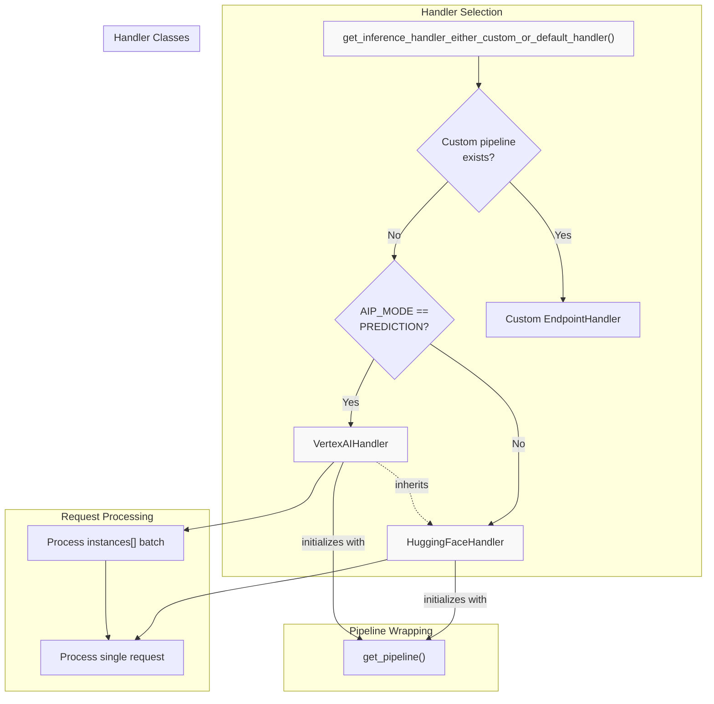
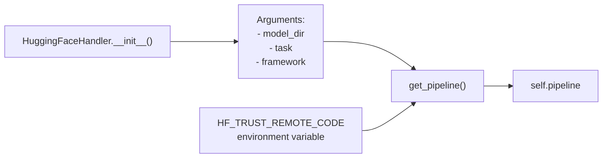
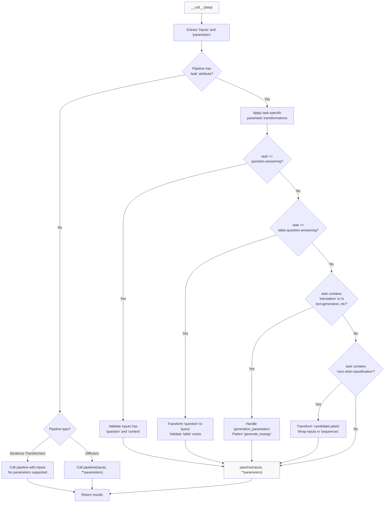
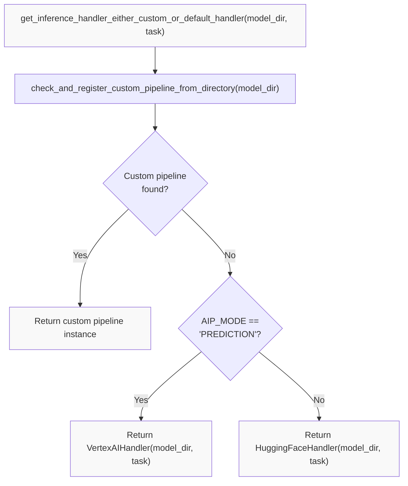

<!-- source: DeepWiki mcp.deepwiki.com · repo huggingface/huggingface-inference-toolkit · page 4.3 Inference Handlers · fetched 2026-10-26 -->

# Inference Handlers

<details>
<summary>Relevant source files</summary>

The following files were used as context for generating this wiki page:

- [src/huggingface_inference_toolkit/handler.py](src/huggingface_inference_toolkit/handler.py)
- [tests/unit/test_handler.py](tests/unit/test_handler.py)
- [tests/unit/test_sentence_transformers.py](tests/unit/test_sentence_transformers.py)

</details>


This document describes the handler layer that wraps inference pipelines and processes inference requests. Handlers are responsible for extracting input data and parameters from request payloads, applying task-specific transformations, and executing inference using the appropriate pipeline. For information about how pipelines are created and loaded, see [Model Loading and Pipeline Factory](#4.2). For web service integration, see [Web Service Layer](#4.1).

## Overview

The handler layer provides two main classes:

| Handler Class | Purpose | Deployment Target |
|--------------|---------|-------------------|
| `HuggingFaceHandler` | Default handler for standard inference requests | Local, Docker, AWS Inferentia2, HF Inference Endpoints |
| `VertexAIHandler` | Batch-oriented handler for Vertex AI's instance-based API | Google Vertex AI |

Both handlers wrap pipelines created by the pipeline factory and implement the callable interface `__call__(data: Dict[str, Any]) -> Dict[str, Any]`.

Sources: [src/huggingface_inference_toolkit/handler.py:13-159]()

## Handler Architecture



**Handler Selection and Class Hierarchy**

The factory function first checks for custom pipelines, then selects between Vertex AI and default handlers based on environment configuration.

Sources: [src/huggingface_inference_toolkit/handler.py:141-159]()

## HuggingFaceHandler

The `HuggingFaceHandler` class is the default handler implementation that supports all standard Transformers, Diffusers, Sentence Transformers, and Optimum pipelines.

### Initialization



**Handler Initialization Flow**

The handler delegates pipeline creation to `get_pipeline()` with the trust_remote_code flag from environment configuration.

Sources: [src/huggingface_inference_toolkit/handler.py:19-27](), [src/huggingface_inference_toolkit/const.py]()

### Request Processing

The `__call__` method processes inference requests by extracting inputs and parameters, applying task-specific transformations, and invoking the pipeline.



**Request Processing Flow in HuggingFaceHandler**

The handler branches based on pipeline type and task, applying specific transformations before execution.

Sources: [src/huggingface_inference_toolkit/handler.py:29-106]()

### Task-Specific Parameter Handling

The handler applies several task-specific transformations:

| Task Type | Transformation | Lines |
|-----------|---------------|-------|
| `question-answering` | Validates `inputs` contains both `question` and `context` keys | [53-60]() |
| `table-question-answering` | Renames `question` → `query`, validates `table` and `query` exist | [62-71]() |
| Translation, text-generation, image-to-text, ASR, TTS | Converts `generation_parameters` → `generate_kwargs` | [73-82]() |
| Translation, text-generation | Flattens `generate_kwargs` into top-level parameters | [84-88]() |
| `zero-shot-classification` | Renames `candidateLabels` → `candidate_labels`, wraps string inputs in `sequences` key | [90-102]() |

#### Diffusers and Sentence Transformers

Pipelines without a `task` attribute (Diffusers and Sentence Transformers) receive special handling:

- **Sentence Transformers**: Parameters are not yet supported; inputs are passed directly
- **Diffusers**: Both inputs and parameters are passed as keyword arguments

Sources: [src/huggingface_inference_toolkit/handler.py:39-51]()

### Input Data Structure

The handler expects request data in the following format:

```json
{
  "inputs": "<input_data>",
  "parameters": {
    "parameter_name": "value"
  }
}
```

Where `inputs` can be:
- A string (for most NLP tasks)
- A dictionary (for tasks like question-answering, zero-shot-classification, or Diffusers)
- A list (for batch processing)

Sources: [src/huggingface_inference_toolkit/handler.py:36-37]()

## VertexAIHandler

The `VertexAIHandler` extends `HuggingFaceHandler` to support Google Vertex AI's batch prediction API, which expects requests in the `instances` format.

```mermaid
graph TB
    subgraph "VertexAIHandler Request Flow"
        Request["Request with 'instances' array"]
        Validate{"'instances'<br/>exists?"}
        Extract["Extract 'parameters'"]
        Iterate["For each instance in instances[]"]
        BuildPayload["Build payload:<br/>{inputs: instance, parameters: parameters}"]
        CallSuper["super().__call__(payload)"]
        Collect["Collect prediction"]
        Return["Return {predictions: [...]"}"]
        
        Request --> Validate
        Validate -->|No| Error["Raise ValueError"]
        Validate -->|Yes| Extract
        Extract --> Iterate
        Iterate --> BuildPayload
        BuildPayload --> CallSuper
        CallSuper --> Collect
        Collect --> Iterate
        Iterate -->|Done| Return
    end
    
    style Request fill:#f9f9f9
    style CallSuper fill:#f9f9f9
```

**VertexAIHandler Batch Processing**

The handler processes each instance separately and aggregates results into a predictions array.

### Request Format

Vertex AI requests must follow this structure:

```json
{
  "instances": [
    "<instance_1>",
    "<instance_2>"
  ],
  "parameters": {
    "shared_parameter": "value"
  }
}
```

The response format is:

```json
{
  "predictions": [
    {"result": "..."},
    {"result": "..."}
  ]
}
```

Sources: [src/huggingface_inference_toolkit/handler.py:109-138]()

## Handler Selection Logic

The `get_inference_handler_either_custom_or_default_handler` function determines which handler to instantiate based on the model directory contents and environment variables.



**Handler Selection Decision Tree**

Custom pipelines take precedence, followed by Vertex AI mode detection, with the default handler as fallback.

### Selection Priority

1. **Custom Pipeline**: If `handler.py` or `pipeline.py` exists in the model directory, the custom handler is used
2. **Vertex AI Mode**: If `AIP_MODE` environment variable equals `"PREDICTION"`, `VertexAIHandler` is used
3. **Default**: Otherwise, `HuggingFaceHandler` is used

Sources: [src/huggingface_inference_toolkit/handler.py:141-159]()

## Custom Handler Integration

The handler system integrates with custom pipelines registered via `check_and_register_custom_pipeline_from_directory`. When a custom `handler.py` file exists in the model directory with an `EndpointHandler` class, that handler is used instead of the default handlers.

Custom handlers must implement:
- An `__init__` method that accepts `model_dir` (and optionally `task`)
- A `__call__` method that accepts a dictionary and returns a dictionary

For more details on custom handler implementation, see [Custom Handlers and Pipelines](#6.4).

Sources: [src/huggingface_inference_toolkit/handler.py:152-154](), [src/huggingface_inference_toolkit/utils.py]()

## Testing

The handler layer has comprehensive unit test coverage:

| Test File | Coverage |
|-----------|----------|
| `tests/unit/test_handler.py` | HuggingFaceHandler initialization, device selection, prediction calls, custom pipeline integration |
| `tests/unit/test_sentence_transformers.py` | Sentence Transformers pipeline wrapping through handlers |

### Key Test Scenarios

- **Device allocation**: Verifies handlers correctly place models on GPU when available, CPU otherwise
- **Prediction correctness**: Validates output structure for various tasks
- **Custom pipeline loading**: Tests `get_inference_handler_either_custom_or_default_handler` with custom handlers
- **Framework support**: Tests both PyTorch and TensorFlow handlers

Sources: [tests/unit/test_handler.py:1-120](), [tests/unit/test_sentence_transformers.py:1-115]()

---

