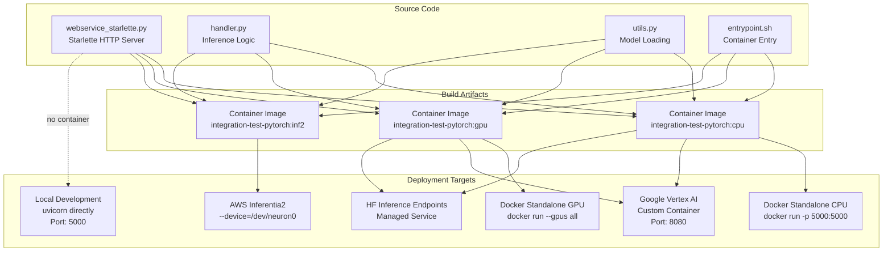
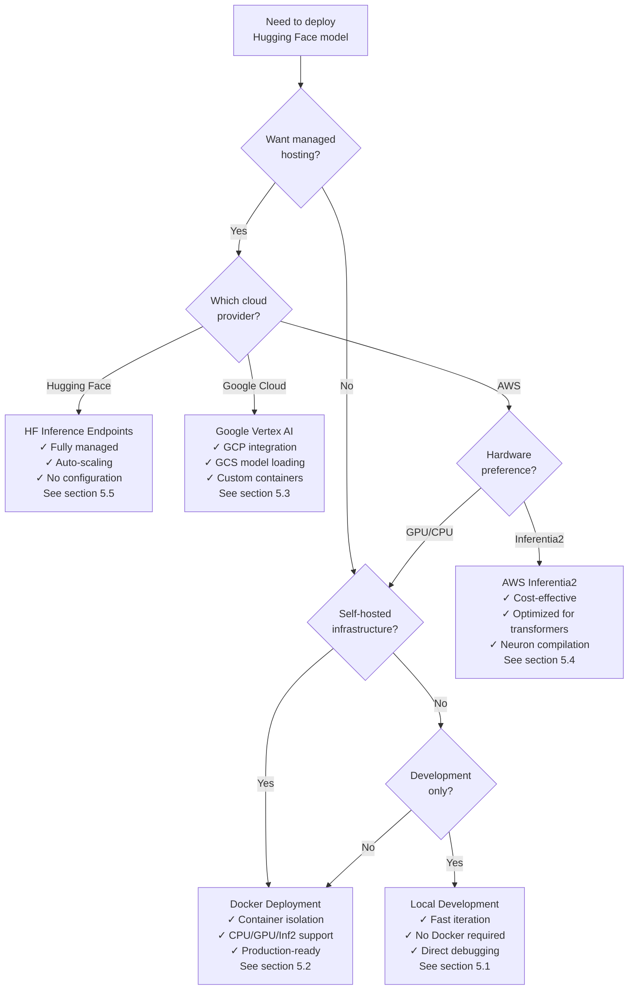
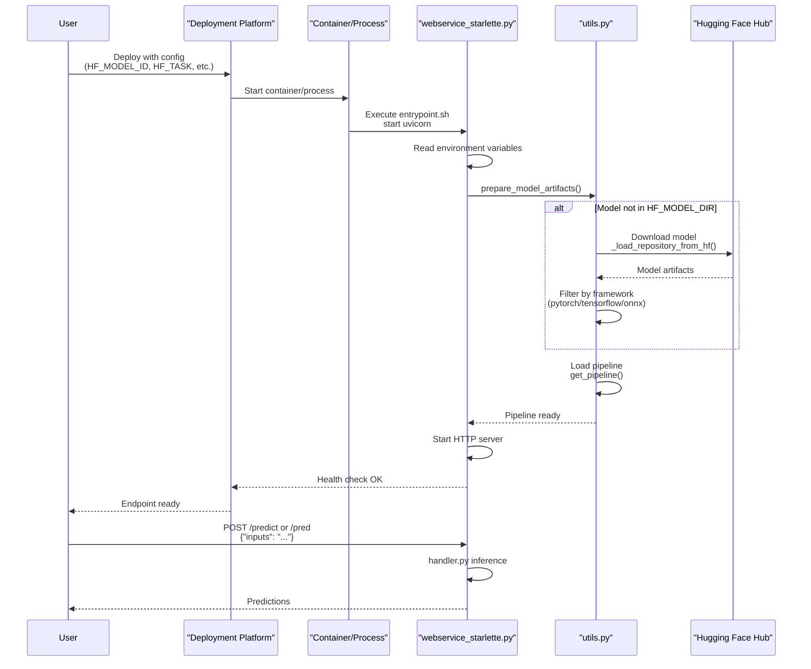

<!-- source: DeepWiki mcp.deepwiki.com · repo huggingface/huggingface-inference-toolkit · page 5 Deployment Guide · fetched 2026-10-26 -->

# Deployment Guide

<details>
<summary>Relevant source files</summary>

The following files were used as context for generating this wiki page:

- [README.md](README.md)
- [dockerfiles/pytorch/Dockerfile](dockerfiles/pytorch/Dockerfile)

</details>


This document provides an overview of all supported deployment scenarios for the Hugging Face Inference Toolkit and guidance on selecting the appropriate deployment strategy for your use case. The toolkit supports five primary deployment modes, each optimized for different environments and requirements.

For detailed configuration of environment variables and runtime behavior, see [Configuration](#3). For understanding the underlying architecture that enables multi-platform deployment, see [Core Architecture](#4).

---

## Supported Deployment Modes

The Hugging Face Inference Toolkit is designed to run identically across multiple deployment platforms through environment variable configuration. The same codebase serves all deployment targets through the `webservice_starlette.py` web service layer.

### Deployment Options

| Deployment Mode | Primary Use Case | Hardware Support | Model Loading | Configuration Complexity |
|----------------|------------------|------------------|---------------|-------------------------|
| Local Development | Development and testing | CPU/GPU | Hub or local directory | Low |
| Docker Standalone | Self-hosted production | CPU/GPU/Inferentia2 | Hub or local directory | Medium |
| Google Vertex AI | GCP-hosted inference | CPU/GPU | GCS or Hub | Medium |
| AWS Inferentia2 | Cost-optimized inference on AWS | Inferentia2 | Hub with Neuron compilation | High |
| HF Inference Endpoints | Managed serverless inference | CPU/GPU | Hub | Low |

**Sources:** [README.md:1-286]()

---

## Deployment Architecture Overview

The following diagram illustrates how the toolkit serves multiple deployment targets through a unified architecture:



**Sources:** [README.md:1-286](), [dockerfiles/pytorch/Dockerfile:1-61](), High-Level System Architecture Diagram 3

---

## Configuration Matrix

Different deployment modes require different environment variables. The following table shows the essential configuration for each mode:

| Environment Variable | Local Dev | Docker | Vertex AI | Inferentia2 | HF Endpoints |
|---------------------|-----------|--------|-----------|-------------|--------------|
| `HF_MODEL_ID` | Required* | Required* | Required* | Required* | Auto-set |
| `HF_TASK` | Required | Required | Required | Required | Auto-set |
| `HF_MODEL_DIR` | Required | Optional | Optional | Optional | Auto-set |
| `HF_HUB_TOKEN` | Optional | Optional | Optional | Optional | Auto-set |
| `AIP_MODE` | — | — | `PREDICTION` | — | — |
| `AIP_HTTP_PORT` | — | — | `8080` | — | — |
| `AIP_STORAGE_URI` | — | — | Optional | — | — |
| `HF_OPTIMUM_BATCH_SIZE` | — | — | — | Required** | — |
| `HF_OPTIMUM_SEQUENCE_LENGTH` | — | — | — | Required** | — |

\* Not required if model is pre-loaded in `HF_MODEL_DIR`  
\*\* Not required if model is already compiled to Neuron format

**Sources:** [README.md:199-278]()

---

## Deployment Decision Guide

The following diagram provides a decision tree for selecting the appropriate deployment mode:



**Sources:** [README.md:1-286](), High-Level System Architecture Diagram 3

---

## Common Deployment Workflow

Regardless of the chosen deployment mode, all deployments follow this general workflow:



**Sources:** [README.md:1-286](), [src/huggingface_inference_toolkit/webservice_starlette.py](), [src/huggingface_inference_toolkit/utils.py]()

---

## Container Images

The toolkit provides three specialized container images built from the same Dockerfile with different base images:

| Image Name | Base Image | Primary Use | Size Consideration |
|-----------|------------|-------------|-------------------|
| `integration-test-pytorch:cpu` | Ubuntu 22.04 | CPU inference, development | Smallest |
| `integration-test-pytorch:gpu` | nvidia/cuda:12.1.0-devel-ubuntu22.04 | GPU inference | Large (includes CUDA) |
| `integration-test-pytorch:inf2` | AWS Deep Learning Container | Inferentia2 inference | Large (includes Neuron SDK) |

All images include:
- Python 3.11
- PyTorch and transformers
- Optional extras: sentence-transformers, diffusers, optimum-neuron
- Starlette web service
- Health check endpoints

**Build Commands:**
```bash
# CPU image
make inference-pytorch-cpu

# GPU image
make inference-pytorch-gpu

# Inferentia2 image
make inference-pytorch-inf2
```

**Sources:** [README.md:25-47](), [dockerfiles/pytorch/Dockerfile:1-61]()

---

## Quick Start Examples

### Local Development
```bash
mkdir tmp/
HF_MODEL_ID=distilbert-base-uncased-finetuned-sst-2-english \
HF_TASK=text-classification \
HF_MODEL_DIR=tmp \
uvicorn src.huggingface_inference_toolkit.webservice_starlette:app --port 5000
```

### Docker Standalone (GPU)
```bash
docker run -ti -p 5000:5000 --gpus all \
  -e HF_MODEL_ID=nlpconnect/vit-gpt2-image-captioning \
  -e HF_TASK=image-to-text \
  integration-test-pytorch:gpu
```

### Vertex AI
```bash
docker run -ti -p 8080:8080 \
  -e AIP_MODE=PREDICTION \
  -e AIP_HTTP_PORT=8080 \
  -e AIP_PREDICT_ROUTE=/pred \
  -e AIP_HEALTH_ROUTE=/h \
  -e HF_MODEL_ID=distilbert-base-uncased-finetuned-sst-2-english \
  -e HF_TASK=text-classification \
  vertex-test-pytorch:gpu
```

### Inferentia2
```bash
docker run -ti -p 5000:5000 \
  -e HF_MODEL_ID=distilbert-base-uncased-finetuned-sst-2-english \
  -e HF_TASK=text-classification \
  -e HF_OPTIMUM_BATCH_SIZE=1 \
  -e HF_OPTIMUM_SEQUENCE_LENGTH=128 \
  --device=/dev/neuron0 \
  integration-test-pytorch:inf2
```

**Sources:** [README.md:16-195]()

---

## API Compatibility

All deployment modes expose the same HTTP API for inference, ensuring portability:

| Endpoint | Method | Purpose | Standard Mode | Vertex AI Mode |
|----------|--------|---------|---------------|----------------|
| Health Check | GET | Verify service is running | `/health` | `AIP_HEALTH_ROUTE` |
| Prediction | POST | Perform inference | `/` or `/predict` | `AIP_PREDICT_ROUTE` |

**Request Format:**
```json
{
  "inputs": "Your input text or data",
  "parameters": {
    "top_k": 2,
    "temperature": 0.7
  }
}
```

**Vertex AI Request Format:**
```json
{
  "instances": ["Input 1", "Input 2"],
  "parameters": {
    "top_k": 2
  }
}
```

**Sources:** [README.md:49-129](), [src/huggingface_inference_toolkit/webservice_starlette.py]()

---

## Deployment Mode Details

For comprehensive documentation on each deployment mode, refer to the following sections:

- **[Local Development](#5.1)**: Setting up local development environment, debugging, and testing without containers
- **[Docker Deployment](#5.2)**: Building and running containerized deployments for CPU and GPU
- **[Google Vertex AI Deployment](#5.3)**: Deploying to Google Cloud Platform with Vertex AI integration
- **[AWS Inferentia2 Deployment](#5.4)**: Deploying to AWS Inferentia2 with Neuron compiler optimization
- **[Hugging Face Inference Endpoints](#5.5)**: Using the managed inference service with zero configuration

---

## Custom Handler Support

All deployment modes support custom inference logic through `handler.py` files included in the model repository. This allows you to:

- Implement custom preprocessing
- Override inference logic
- Add custom postprocessing
- Integrate additional dependencies via `requirements.txt`

For details on implementing custom handlers, see [Custom Handlers and Pipelines](#6.4).

**Repository Structure with Custom Handler:**
```
model.tar.gz/
├── pytorch_model.bin
├── config.json
├── handler.py
└── requirements.txt
```

**Sources:** [README.md:63-78]()

---

## Security Considerations

When deploying models, consider the following security aspects:

| Consideration | Environment Variable | Default | Risk Level |
|--------------|---------------------|---------|------------|
| Remote code execution | `HF_TRUST_REMOTE_CODE` | `"0"` | High |
| Private model access | `HF_HUB_TOKEN` | Not set | Medium |
| Model versioning | `HF_REVISION` | Latest | Low |

**Recommendation:** Always pin model revisions in production using `HF_REVISION` to ensure reproducibility and prevent unexpected model updates.

**Sources:** [README.md:247-253]()

---

## Next Steps

After selecting your deployment mode:

1. Review the [Configuration](#3) page for environment variable details
2. Follow the detailed deployment guide for your chosen mode (sections 5.1-5.5)
3. Consult the [API Reference](#7) for request/response formats
4. Review [Troubleshooting](#11) if you encounter issues

For information on supported model types and tasks, see [Specialized Pipeline Support](#6).

---

