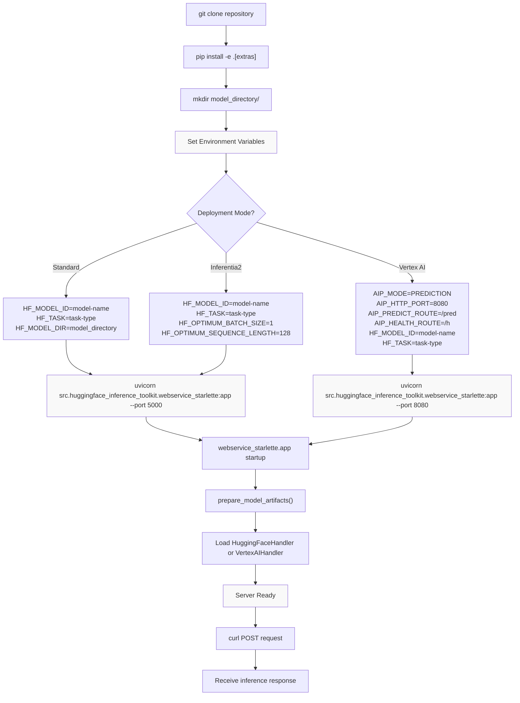
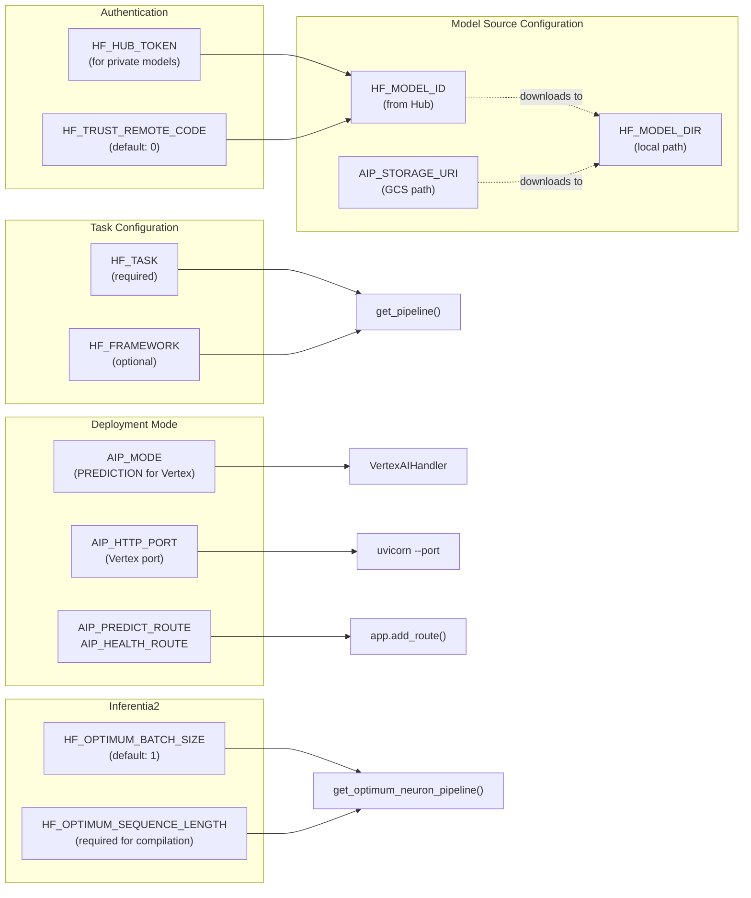
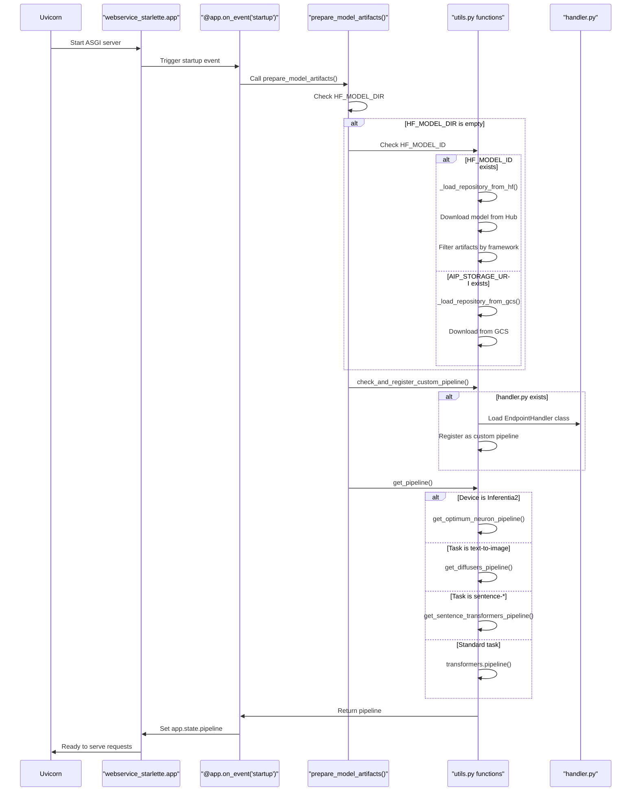
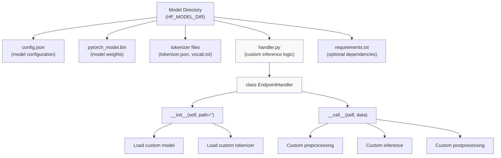

<!-- source: DeepWiki mcp.deepwiki.com · repo huggingface/huggingface-inference-toolkit · page 5.1 Local Development · fetched 2026-10-26 -->

# Local Development

<details>
<summary>Relevant source files</summary>

The following files were used as context for generating this wiki page:

- [README.md](README.md)
- [setup.py](setup.py)

</details>


This page provides instructions for running the Hugging Face Inference Toolkit locally without Docker containers, using uvicorn to serve models directly. This is the fastest way to test models, develop custom handlers, or debug inference issues during development.

For containerized deployment options, see [Docker Deployment](#5.2), [Google Vertex AI Deployment](#5.3), or [AWS Inferentia2 Deployment](#5.4). For general configuration options, see [Configuration](#3).

---

## Installation

### Basic Installation

Install the package in development mode with the required extras for your use case:

```bash
git clone https://github.com/huggingface/huggingface-inference-toolkit
cd huggingface-inference-toolkit
pip install -e ".[torch,st,diffusers,test,quality]"
```

The available extras are defined in [setup.py:36-57]():

| Extra | Purpose | Key Dependencies |
|-------|---------|------------------|
| `torch` | PyTorch models | `torch==2.5.1`, `torchvision`, `torchaudio`, `peft==0.15.1` |
| `st` | Sentence Transformers | `sentence_transformers==4.0.2` |
| `diffusers` | Text-to-image models | `diffusers==0.33.1`, `accelerate==1.6.0` |
| `inf2` | AWS Inferentia2 support | `optimum-neuron` |
| `google` | Google Cloud Storage | `google-cloud-storage`, `crcmod==1.7` |
| `test` | Testing dependencies | `pytest`, `docker`, `requests`, etc. |
| `quality` | Code quality tools | `isort`, `ruff` |

### Python Version Requirements

The toolkit requires Python 3.9 or higher, as specified in [setup.py:70]().

### Platform-Specific Installation

**AWS Inferentia2 Development:**
```bash
pip install -e ".[inf2,test,quality]" --upgrade
```

**Google Cloud Development:**
```bash
pip install -e ".[torch,st,diffusers,google,test,quality]"
```

Sources: [setup.py:1-86](), [README.md:9-14]()

---

## Local Development Setup Flow



Sources: [README.md:16-21](), [README.md:84-103](), [README.md:141-169]()

---

## Environment Configuration

### Required Environment Variables

The minimum configuration requires three environment variables:

| Variable | Purpose | Example |
|----------|---------|---------|
| `HF_MODEL_ID` | Model identifier from Hugging Face Hub | `distilbert-base-uncased-finetuned-sst-2-english` |
| `HF_TASK` | Task type for inference pipeline | `text-classification` |
| `HF_MODEL_DIR` | Directory for model storage | `./tmp_models/` |

### Environment Variable Resolution



Sources: [README.md:199-278](), [setup.py:1-86]()

---

## Running Locally with Uvicorn

### Standard Mode

The standard mode runs the Starlette ASGI application directly with default HTTP endpoints:

```bash
mkdir tmp_models/
HF_MODEL_ID=hf-internal-testing/tiny-random-distilbert \
HF_MODEL_DIR=tmp_models \
HF_TASK=text-classification \
uvicorn src.huggingface_inference_toolkit.webservice_starlette:app --port 5000
```

**Default Endpoints:**
- `POST /` - Inference endpoint
- `GET /health` - Health check endpoint

**Testing the inference:**
```bash
curl --request POST \
  --url http://localhost:5000 \
  --header 'Content-Type: application/json' \
  --data '{"inputs": "This is a great product!"}'
```

Sources: [README.md:16-21](), [README.md:51-61]()

### Vertex AI Mode

Vertex AI mode configures the application to use Google Vertex AI-compatible endpoints:

```bash
mkdir tmp_models/
AIP_MODE=PREDICTION \
AIP_HTTP_PORT=8080 \
AIP_PREDICT_ROUTE=/pred \
AIP_HEALTH_ROUTE=/h \
HF_MODEL_ID=distilbert/distilbert-base-uncased-finetuned-sst-2-english \
HF_TASK=text-classification \
HF_MODEL_DIR=tmp_models \
uvicorn src.huggingface_inference_toolkit.webservice_starlette:app --port 8080
```

**Vertex AI Endpoints:**
- `POST /pred` - Prediction endpoint (custom route)
- `GET /h` - Health check (custom route)

**Testing with Vertex AI schema:**
```bash
curl --request POST \
  --url http://localhost:8080/pred \
  --header 'Content-Type: application/json' \
  --data '{
    "instances": ["I love this product", "I hate this product"],
    "parameters": { "top_k": 2 }
  }'
```

The request format uses `instances` array instead of `inputs` for batch processing.

Sources: [README.md:84-103]()

### Inferentia2 Mode

For AWS Inferentia2 development, additional compilation parameters are required:

```bash
mkdir tmp_models/
HF_MODEL_ID="distilbert/distilbert-base-uncased-finetuned-sst-2-english" \
HF_TASK="text-classification" \
HF_OPTIMUM_BATCH_SIZE=1 \
HF_OPTIMUM_SEQUENCE_LENGTH=128 \
HF_MODEL_DIR=tmp_models \
uvicorn src.huggingface_inference_toolkit.webservice_starlette:app --port 5000
```

**Note:** This requires running on an actual Inferentia2 instance with `/dev/neuron0` device available. The model will be compiled to Neuron format on first run if not already compiled.

**Sentence Transformers on Inferentia2:**
```bash
HF_MODEL_ID="sentence-transformers/all-MiniLM-L6-v2" \
HF_TASK="feature-extraction" \
HF_OPTIMUM_BATCH_SIZE=1 \
HF_OPTIMUM_SEQUENCE_LENGTH=128 \
HF_MODEL_DIR=tmp_models \
uvicorn src.huggingface_inference_toolkit.webservice_starlette:app --port 5000
```

Sources: [README.md:141-169]()

---

## Application Startup Sequence



Sources: [README.md:16-21](), [setup.py:1-86]()

---

## Testing Different Model Types

### Text Classification

```bash
# Small test model
HF_MODEL_ID=hf-internal-testing/tiny-random-distilbert \
HF_MODEL_DIR=tmp_models \
HF_TASK=text-classification \
uvicorn src.huggingface_inference_toolkit.webservice_starlette:app --port 5000

# Test request
curl --request POST \
  --url http://localhost:5000 \
  --header 'Content-Type: application/json' \
  --data '{"inputs": "This is amazing!"}'
```

### Question Answering

```bash
HF_MODEL_ID=distilbert-base-uncased-distilled-squad \
HF_MODEL_DIR=tmp_models \
HF_TASK=question-answering \
uvicorn src.huggingface_inference_toolkit.webservice_starlette:app --port 5000

# Test request
curl --request POST \
  --url http://localhost:5000 \
  --header 'Content-Type: application/json' \
  --data '{
    "inputs": {
      "question": "What is used for inference?",
      "context": "This model is used with the inference toolkit for inference."
    }
  }'
```

### Image-to-Text (GPU Required)

```bash
HF_MODEL_ID=nlpconnect/vit-gpt2-image-captioning \
HF_MODEL_DIR=tmp_models \
HF_TASK=image-to-text \
uvicorn src.huggingface_inference_toolkit.webservice_starlette:app --port 5000

# Test with base64 encoded image
curl --request POST \
  --url http://localhost:5000 \
  --header 'Content-Type: application/json' \
  --data '{"inputs": "<base64_encoded_image>"}'
```

### Text-to-Image with Diffusers (GPU Required)

```bash
HF_MODEL_ID=echarlaix/tiny-random-stable-diffusion-xl \
HF_MODEL_DIR=tmp_models \
HF_TASK=text-to-image \
uvicorn src.huggingface_inference_toolkit.webservice_starlette:app --port 5000

# Test request
curl --request POST \
  --url http://localhost:5000 \
  --header 'Content-Type: application/json' \
  --data '{
    "inputs": "A beautiful sunset over mountains",
    "parameters": {
      "num_inference_steps": 25,
      "guidance_scale": 7.5
    }
  }'
```

Sources: [README.md:41-47](), [README.md:51-61]()

---

## Using Local Model Artifacts

Instead of downloading from the Hub, you can use pre-downloaded or custom models:

```bash
# Prepare local model directory
mkdir -p local_model/
# Copy model files to local_model/ (e.g., pytorch_model.bin, config.json, tokenizer files)

# Run with local model
HF_MODEL_DIR=local_model \
HF_TASK=text-classification \
uvicorn src.huggingface_inference_toolkit.webservice_starlette:app --port 5000
```

**Required files in model directory:**
- `config.json` - Model configuration
- `pytorch_model.bin` or `model.safetensors` - Model weights
- Tokenizer files (`tokenizer.json`, `tokenizer_config.json`, `vocab.txt`, etc.)
- (Optional) `handler.py` - Custom inference handler
- (Optional) `requirements.txt` - Additional dependencies

Sources: [README.md:46-47](), [README.md:63-77]()

---

## Custom Handler Development

### Directory Structure for Custom Handlers



### Testing Custom Handler Locally

```bash
# Create custom handler directory
mkdir custom_model/
cd custom_model/

# Download base model
huggingface-cli download philschmid/custom-pipeline-text-classification \
  --local-dir .

# Ensure handler.py exists
ls handler.py  # Should exist

# Run with custom handler
cd ..
HF_MODEL_DIR=custom_model \
HF_TASK=text-classification \
uvicorn src.huggingface_inference_toolkit.webservice_starlette:app --port 5000
```

The toolkit will automatically detect `handler.py` and use the custom `EndpointHandler` class instead of the default pipeline.

Sources: [README.md:63-78]()

---

## Private Model Authentication

For private models on Hugging Face Hub:

```bash
# Set HF_HUB_TOKEN for authentication
export HF_HUB_TOKEN="hf_xxxxxxxxxxxxxxxxxxxxx"

HF_MODEL_ID=your-org/private-model \
HF_MODEL_DIR=tmp_models \
HF_TASK=text-classification \
uvicorn src.huggingface_inference_toolkit.webservice_starlette:app --port 5000
```

The token is used for:
- Downloading private models from the Hub
- Accessing gated models that require acceptance
- Downloading private model dependencies

Sources: [README.md:239-245]()

---

## Framework-Specific Configuration

### Specifying Framework

To avoid downloading unnecessary files for frameworks you're not using:

```bash
# PyTorch only
HF_MODEL_ID=distilbert-base-uncased \
HF_TASK=text-classification \
HF_FRAMEWORK=pytorch \
HF_MODEL_DIR=tmp_models \
uvicorn src.huggingface_inference_toolkit.webservice_starlette:app --port 5000
```

This prevents downloading TensorFlow or ONNX weights when you only need PyTorch weights, reducing disk usage and download time.

Sources: [README.md:255-261]()

---

## Development Workflow

### Typical Development Cycle

1. **Install dependencies:**
   ```bash
   pip install -e ".[torch,test]"
   ```

2. **Create working directory:**
   ```bash
   mkdir dev_models/
   ```

3. **Test with small model:**
   ```bash
   HF_MODEL_ID=hf-internal-testing/tiny-random-distilbert \
   HF_MODEL_DIR=dev_models \
   HF_TASK=text-classification \
   uvicorn src.huggingface_inference_toolkit.webservice_starlette:app --port 5000 --reload
   ```
   
   Note the `--reload` flag enables auto-reloading when code changes.

4. **Make code changes** to handlers, utils, or webservice files

5. **Test changes** - the server automatically reloads

6. **Run unit tests:**
   ```bash
   make unit-test
   ```

7. **Run integration tests** (requires Docker):
   ```bash
   make integ-test
   ```

### Port Configuration

You can customize the port by changing the `--port` parameter:

```bash
# Use port 8000
uvicorn src.huggingface_inference_toolkit.webservice_starlette:app --port 8000

# Listen on all interfaces
uvicorn src.huggingface_inference_toolkit.webservice_starlette:app --host 0.0.0.0 --port 5000
```

Sources: [README.md:9-14](), [README.md:16-21]()

---

## Debugging and Logging

### Enabling Debug Logging

Uvicorn provides built-in logging. For more verbose output:

```bash
# Enable debug logging
HF_MODEL_ID=distilbert-base-uncased \
HF_TASK=text-classification \
HF_MODEL_DIR=tmp_models \
uvicorn src.huggingface_inference_toolkit.webservice_starlette:app \
  --port 5000 \
  --log-level debug
```

### Common Environment Variable Debugging

| Issue | Check | Solution |
|-------|-------|----------|
| Model not loading | `HF_MODEL_ID` and `HF_MODEL_DIR` | Ensure `HF_MODEL_ID` is valid or directory contains model files |
| Task not recognized | `HF_TASK` | Use supported task names (see [Configuration](#3)) |
| Authentication error | `HF_HUB_TOKEN` | Set valid token for private models |
| Framework mismatch | `HF_FRAMEWORK` | Specify `pytorch` or `tensorflow` explicitly |
| Inferentia2 compilation | `HF_OPTIMUM_BATCH_SIZE`, `HF_OPTIMUM_SEQUENCE_LENGTH` | Both must be set for compilation |

### Verifying Startup

Monitor the console output to verify successful startup:

```
INFO:     Started server process
INFO:     Waiting for application startup.
INFO:     Loading model from Hugging Face Hub...
INFO:     Model loaded successfully
INFO:     Application startup complete.
INFO:     Uvicorn running on http://127.0.0.1:5000
```

Sources: [README.md:199-278]()

---

## Quick Reference Commands

### Standard Deployment
```bash
HF_MODEL_ID=<model-id> HF_TASK=<task> HF_MODEL_DIR=tmp/ \
uvicorn src.huggingface_inference_toolkit.webservice_starlette:app --port 5000
```

### Vertex AI Mode
```bash
AIP_MODE=PREDICTION AIP_HTTP_PORT=8080 AIP_PREDICT_ROUTE=/pred AIP_HEALTH_ROUTE=/h \
HF_MODEL_ID=<model-id> HF_TASK=<task> HF_MODEL_DIR=tmp/ \
uvicorn src.huggingface_inference_toolkit.webservice_starlette:app --port 8080
```

### Inferentia2 Mode
```bash
HF_MODEL_ID=<model-id> HF_TASK=<task> \
HF_OPTIMUM_BATCH_SIZE=1 HF_OPTIMUM_SEQUENCE_LENGTH=128 \
HF_MODEL_DIR=tmp/ \
uvicorn src.huggingface_inference_toolkit.webservice_starlette:app --port 5000
```

### Local Model
```bash
HF_MODEL_DIR=/path/to/local/model HF_TASK=<task> \
uvicorn src.huggingface_inference_toolkit.webservice_starlette:app --port 5000
```

### With Auto-Reload
```bash
HF_MODEL_ID=<model-id> HF_TASK=<task> HF_MODEL_DIR=tmp/ \
uvicorn src.huggingface_inference_toolkit.webservice_starlette:app --port 5000 --reload
```

Sources: [README.md:16-169](), [setup.py:1-86]()

---

