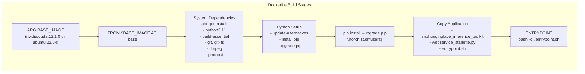
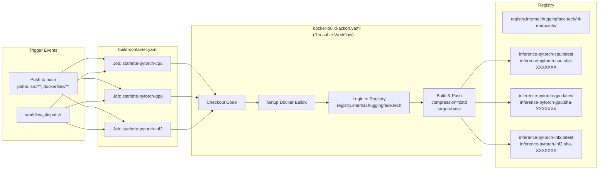
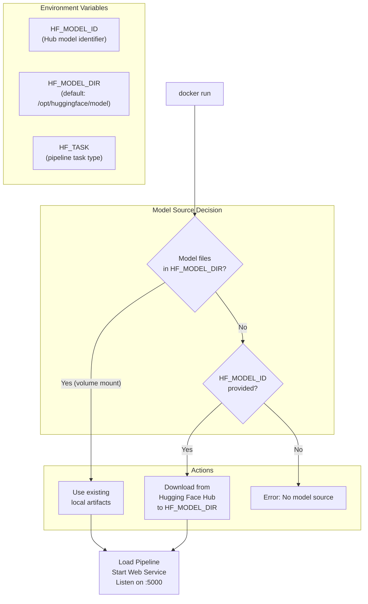
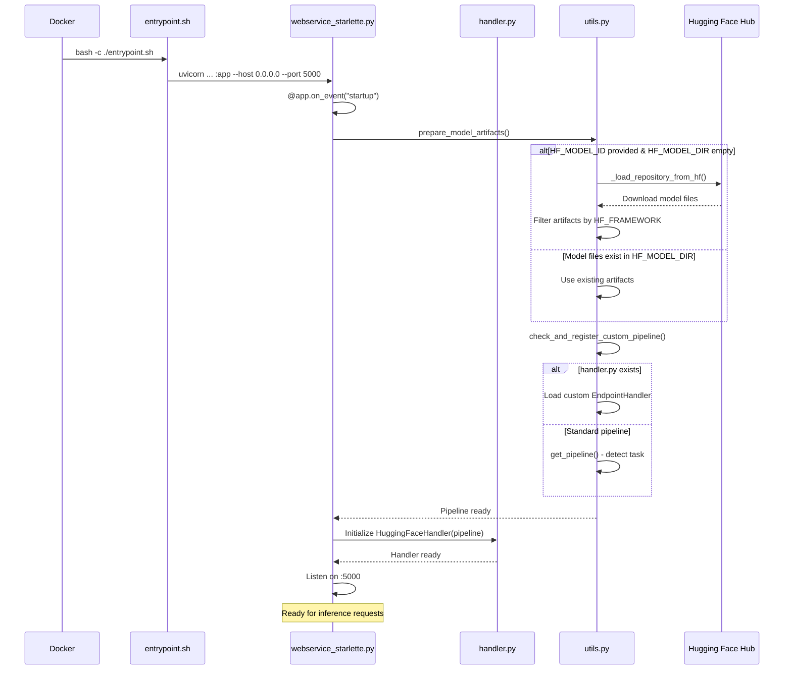
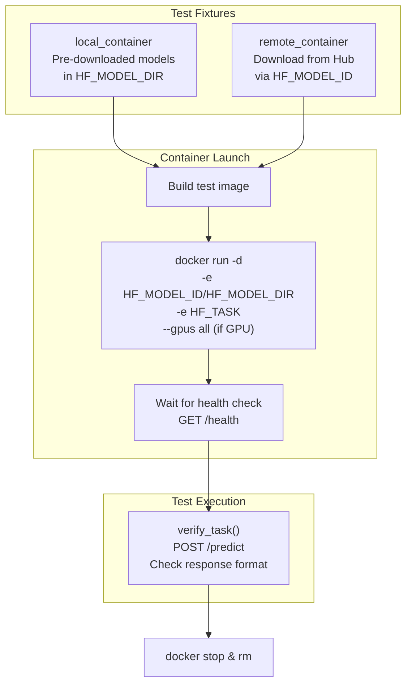

<!-- source: DeepWiki mcp.deepwiki.com · repo huggingface/huggingface-inference-toolkit · page 5.2 Docker Deployment · fetched 2026-10-26 -->

# Docker Deployment

<details>
<summary>Relevant source files</summary>

The following files were used as context for generating this wiki page:

- [.github/workflows/build-container.yaml](.github/workflows/build-container.yaml)
- [.github/workflows/docker-build-action.yaml](.github/workflows/docker-build-action.yaml)
- [README.md](README.md)
- [dockerfiles/pytorch/Dockerfile](dockerfiles/pytorch/Dockerfile)

</details>


This document describes how to build and run the Hugging Face Inference Toolkit using Docker containers. Docker deployment provides a standardized, portable way to run inference services with all dependencies pre-configured. For local development without containers, see [Local Development](#5.1). For cloud-specific deployments, see [Google Vertex AI Deployment](#5.3), [AWS Inferentia2 Deployment](#5.4), or [Hugging Face Inference Endpoints](#5.5).

## Overview

The toolkit provides pre-built Docker images for three hardware configurations:
- **CPU**: Standard x86 CPU inference (`inference-pytorch-cpu`)
- **GPU**: NVIDIA GPU-accelerated inference (`inference-pytorch-gpu`)
- **Inferentia2**: AWS Inferentia2 accelerator inference (`inference-pytorch-inf2`)

All images use Python 3.11 and include the necessary dependencies for PyTorch, Sentence Transformers, and Diffusers pipelines. The same web service code runs in all variants, with hardware-specific optimizations applied automatically based on detected devices.

Sources: [README.md:24-47](), [dockerfiles/pytorch/Dockerfile:1-61]()

## Docker Image Variants

The following table summarizes the available Docker images:

| Image Name | Base Image | Hardware Target | Install Extras | Use Case |
|------------|-----------|-----------------|----------------|----------|
| `inference-pytorch-cpu` | `ubuntu:22.04` | x86 CPU | `torch,st,diffusers` | Standard inference without GPU |
| `inference-pytorch-gpu` | `nvidia/cuda:12.1.0-devel-ubuntu22.04` | NVIDIA GPU | `torch,st,diffusers` | GPU-accelerated inference |
| `inference-pytorch-inf2` | Custom | AWS Inferentia2 | `inf2` | AWS Neuron-compiled models |

Sources: [.github/workflows/build-container.yaml:18-42](), [dockerfiles/pytorch/Dockerfile:1]()

## Dockerfile Structure

The primary Dockerfile for CPU and GPU variants follows a multi-stage build pattern:



**Key Build Steps:**

1. **Base Image Selection**: [dockerfiles/pytorch/Dockerfile:1]() - Uses `ARG BASE_IMAGE` to switch between CPU (Ubuntu) and GPU (CUDA) base images
2. **System Dependencies**: [dockerfiles/pytorch/Dockerfile:12-33]() - Installs Python 3.11, build tools, media libraries (ffmpeg), and Git LFS
3. **Python Configuration**: [dockerfiles/pytorch/Dockerfile:39-48]() - Sets Python 3.11 as default and installs pip from source
4. **Package Installation**: [dockerfiles/pytorch/Dockerfile:51]() - Installs the toolkit with `.[torch,st,diffusers]` extras
5. **Application Copy**: [dockerfiles/pytorch/Dockerfile:54-55]() - Copies the application modules into the container
6. **Entrypoint Setup**: [dockerfiles/pytorch/Dockerfile:58-60]() - Configures `entrypoint.sh` as the container's entry point

Sources: [dockerfiles/pytorch/Dockerfile:1-61]()

## Building Docker Images

### Local Build

Build images locally using the provided Makefile targets:

```bash
# Build CPU image
make inference-pytorch-cpu

# Build GPU image
make inference-pytorch-gpu

# Build Inferentia2 image
make inference-pytorch-inf2
```

These commands invoke Docker build with the appropriate Dockerfile and build arguments. The CPU variant overrides the base image:

```bash
docker build -f dockerfiles/pytorch/Dockerfile \
  --build-arg BASE_IMAGE=ubuntu:22.04 \
  -t inference-pytorch-cpu .
```

Sources: [README.md:24-37]()

### CI/CD Build Pipeline

The automated build pipeline consists of two workflow files:



**Workflow Details:**

- **Trigger**: [.github/workflows/build-container.yaml:4-11]() - Activates on pushes to `main` affecting `src/**`, `dockerfiles/**`, or `scripts/**`, or manual dispatch
- **Jobs**: [.github/workflows/build-container.yaml:18-42]() - Defines three parallel jobs for CPU, GPU, and Inf2 variants
- **Reusable Workflow**: [.github/workflows/docker-build-action.yaml:1-62]() - Shared build logic using Docker Buildx
- **Registry**: Images are tagged with both `latest` and `sha-<commit>` tags at [.github/workflows/docker-build-action.yaml:61]()

Sources: [.github/workflows/build-container.yaml:1-42](), [.github/workflows/docker-build-action.yaml:1-62]()

## Running Containers

### Basic Container Execution

The general pattern for running a container is:

```bash
docker run -ti -p 5000:5000 \
  -e HF_MODEL_ID=<model-id> \
  -e HF_TASK=<task-name> \
  <image-name>
```

### Model Loading Strategies

Containers support two model loading approaches:



**Strategy 1: Download from Hub**
```bash
docker run -ti -p 5000:5000 \
  -e HF_MODEL_ID=distilbert-base-uncased-distilled-squad \
  -e HF_TASK=question-answering \
  inference-pytorch-cpu
```

**Strategy 2: Mount Local Model**
```bash
docker run -ti -p 5000:5000 \
  -e HF_MODEL_DIR=/repository \
  -v $(pwd)/distilbert-base-uncased-emotion:/repository \
  inference-pytorch-cpu
```

Sources: [README.md:39-47]()

### GPU-Enabled Containers

For GPU inference, use the `--gpus` flag to expose NVIDIA GPUs to the container:

```bash
# Image-to-text with GPU
docker run -ti -p 5000:5000 --gpus all \
  -e HF_MODEL_ID=nlpconnect/vit-gpt2-image-captioning \
  -e HF_TASK=image-to-text \
  inference-pytorch-gpu

# Text-to-image with GPU
docker run -ti -p 5000:5000 --gpus all \
  -e HF_MODEL_ID=stabilityai/stable-diffusion-xl-base-1.0 \
  -e HF_TASK=text-to-image \
  inference-pytorch-gpu
```

The `--gpus all` flag requires the NVIDIA Container Toolkit to be installed on the host system.

Sources: [README.md:43-45]()

### Inferentia2 Containers

For AWS Inferentia2 deployment, expose the Neuron device:

```bash
docker run -ti -p 5000:5000 \
  -e HF_MODEL_ID=distilbert/distilbert-base-uncased-finetuned-sst-2-english \
  -e HF_TASK=text-classification \
  -e HF_OPTIMUM_BATCH_SIZE=1 \
  -e HF_OPTIMUM_SEQUENCE_LENGTH=128 \
  --device=/dev/neuron0 \
  inference-pytorch-inf2
```

The `--device=/dev/neuron0` flag grants access to the first Inferentia2 chip. Additional environment variables `HF_OPTIMUM_BATCH_SIZE` and `HF_OPTIMUM_SEQUENCE_LENGTH` configure model compilation parameters.

Sources: [README.md:181-183]()

## Runtime Architecture

When a container starts, the following initialization sequence occurs:



**Key Runtime Components:**

1. **Entrypoint Script**: [dockerfiles/pytorch/Dockerfile:60]() - `scripts/entrypoint.sh` starts the web service with appropriate parameters
2. **Startup Handler**: The `prepare_model_artifacts()` function executes during the Starlette application's startup event
3. **Model Loading**: Models are loaded either from the Hub or from mounted volumes based on environment configuration
4. **Pipeline Creation**: The appropriate pipeline (standard Transformers, Diffusers, Sentence Transformers, or custom) is instantiated
5. **Handler Initialization**: A handler wraps the pipeline to process HTTP requests

Sources: [dockerfiles/pytorch/Dockerfile:54-60]()

## Common Docker Configuration Patterns

### Authentication with Private Models

```bash
docker run -ti -p 5000:5000 \
  -e HF_MODEL_ID=organization/private-model \
  -e HF_TASK=text-classification \
  -e HF_HUB_TOKEN=hf_xxxxxxxxxxxxxxxxxxxx \
  inference-pytorch-cpu
```

### Pinning Model Revisions

```bash
docker run -ti -p 5000:5000 \
  -e HF_MODEL_ID=distilbert-base-uncased \
  -e HF_TASK=fill-mask \
  -e HF_REVISION=03b4d196c19d0a73c7e0322684e97db1ec397613 \
  inference-pytorch-cpu
```

### Enabling Remote Code Execution

```bash
docker run -ti -p 5000:5000 \
  -e HF_MODEL_ID=custom-model-with-code \
  -e HF_TASK=text-generation \
  -e HF_TRUST_REMOTE_CODE=1 \
  inference-pytorch-gpu
```

### Custom Port Binding

```bash
docker run -ti -p 8080:5000 \
  -e HF_MODEL_ID=model-id \
  -e HF_TASK=task-name \
  inference-pytorch-cpu
```

The container always listens on port 5000 internally, but Docker's `-p` flag maps it to any host port.

Sources: [README.md:39-61]()

## Container Environment Variables

The following environment variables are commonly used in Docker deployments:

| Variable | Purpose | Default | Required |
|----------|---------|---------|----------|
| `HF_MODEL_ID` | Hub model identifier | None | No* |
| `HF_MODEL_DIR` | Directory containing model files | `/opt/huggingface/model` | No |
| `HF_TASK` | Pipeline task type | None | Yes |
| `HF_REVISION` | Model commit hash | Latest | No |
| `HF_HUB_TOKEN` | Authentication token | None | No** |
| `HF_TRUST_REMOTE_CODE` | Trust custom model code | `"0"` | No |
| `HF_FRAMEWORK` | Framework (pytorch/tensorflow) | `"pytorch"` | No |

\* Required if `HF_MODEL_DIR` is empty  
\** Required for private models

For complete environment variable documentation, see [Configuration](#3).

Sources: [README.md:199-277]()

## Testing Docker Images

The integration test suite validates Docker images across different hardware configurations. Tests use pytest fixtures to launch containers with pre-configured models:



Integration tests are located in `tests/integ/` and use the `integration-test-action.yaml` workflow for CI/CD validation.

Sources: [.github/workflows/build-container.yaml:1-42]()

## Troubleshooting

### Container Fails to Start

**Symptom**: Container exits immediately after `docker run`

**Common Causes**:
- Missing required environment variables (`HF_TASK` not set)
- Invalid `HF_MODEL_ID` or authentication failure
- Empty `HF_MODEL_DIR` with no `HF_MODEL_ID` specified

**Solution**: Check container logs with `docker logs <container-id>`

### Model Download Failures

**Symptom**: Hub download errors during startup

**Common Causes**:
- Network connectivity issues
- Private model without `HF_HUB_TOKEN`
- Invalid `HF_REVISION` hash

**Solution**: Verify network access to `huggingface.co` and authenticate with valid token

### GPU Not Detected

**Symptom**: Model runs on CPU despite using GPU image

**Common Causes**:
- `--gpus` flag not specified
- NVIDIA Container Toolkit not installed
- CUDA driver mismatch

**Solution**: Install NVIDIA Container Toolkit and verify with `docker run --gpus all nvidia/cuda:12.1.0-base-ubuntu22.04 nvidia-smi`

For detailed troubleshooting guidance, see [Troubleshooting](#11).

Sources: [README.md:24-61]()

---

