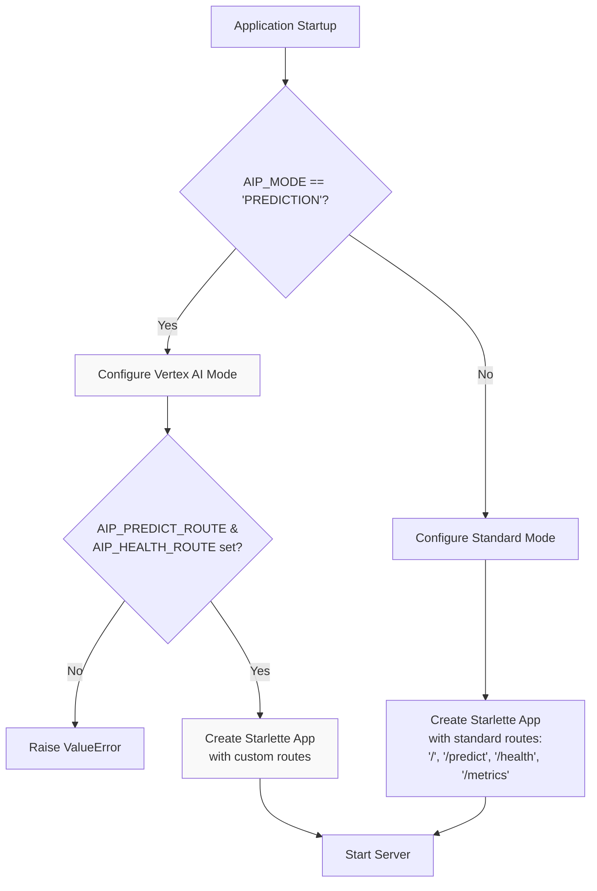
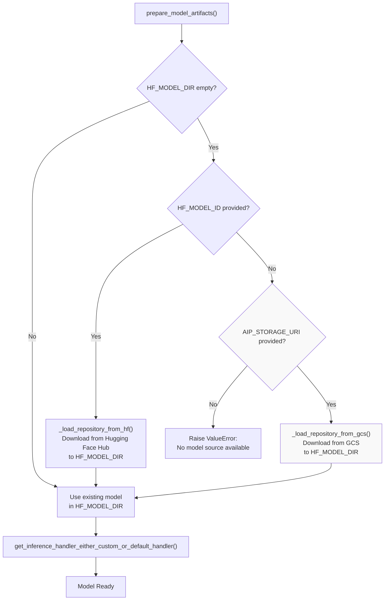
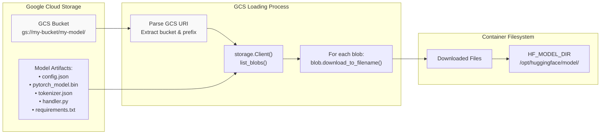
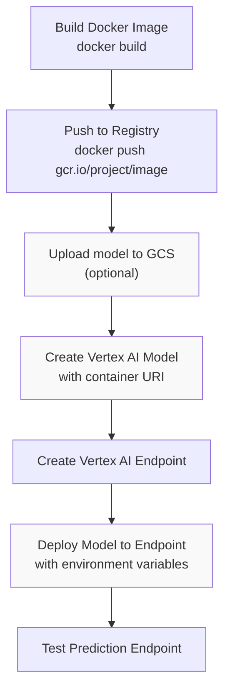

<!-- source: DeepWiki mcp.deepwiki.com · repo huggingface/huggingface-inference-toolkit · page 5.3 Google Vertex AI Deployment · fetched 2026-10-26 -->

# Google Vertex AI Deployment

<details>
<summary>Relevant source files</summary>

The following files were used as context for generating this wiki page:

- [README.md](README.md)
- [src/huggingface_inference_toolkit/const.py](src/huggingface_inference_toolkit/const.py)
- [src/huggingface_inference_toolkit/vertex_ai_utils.py](src/huggingface_inference_toolkit/vertex_ai_utils.py)
- [src/huggingface_inference_toolkit/webservice_starlette.py](src/huggingface_inference_toolkit/webservice_starlette.py)
- [tests/unit/test_const.py](tests/unit/test_const.py)
- [tests/unit/test_vertex_ai_utils.py](tests/unit/test_vertex_ai_utils.py)

</details>


## Purpose and Scope

This document explains how to deploy the Hugging Face Inference Toolkit on Google Vertex AI as a custom prediction container. It covers Vertex AI-specific configuration, model artifact loading from Google Cloud Storage (GCS), HTTP API route customization, and container deployment patterns.

For general deployment concepts, see [Deployment Guide](#5). For AWS Inferentia2-specific deployment, see [AWS Inferentia2 Deployment](#5.4). For local development without cloud infrastructure, see [Local Development](#5.1).

## Overview

The toolkit integrates with Google Vertex AI by implementing the [Custom Container Requirements for Prediction](https://cloud.google.com/vertex-ai/docs/predictions/custom-container-requirements). The integration automatically detects Vertex AI environment variables and adapts the HTTP routes, model loading strategy, and request/response formats accordingly.

**Key Features:**
- Automatic detection of Vertex AI environment via `AIP_MODE` 
- Model loading from GCS using `AIP_STORAGE_URI`
- Configurable HTTP routes via `AIP_PREDICT_ROUTE` and `AIP_HEALTH_ROUTE`
- Support for Vertex AI's `instances` request format alongside standard `inputs` format
- Fallback to Hugging Face Hub when GCS storage URI is not provided

Sources: [README.md:80-129](), [src/huggingface_inference_toolkit/webservice_starlette.py:143-160]()

## Vertex AI Environment Detection

The toolkit determines whether it is running in a Vertex AI environment by checking the `AIP_MODE` environment variable. When this variable is set to `"PREDICTION"`, the web service adapts its configuration for Vertex AI compatibility.



**Diagram: Vertex AI Environment Detection and Route Configuration**

The detection logic is implemented in [src/huggingface_inference_toolkit/webservice_starlette.py:143-172](). When `AIP_MODE` is detected, the application validates that required route environment variables are present and creates a minimal Starlette application with only the prediction and health routes.

Sources: [src/huggingface_inference_toolkit/webservice_starlette.py:143-172]()

## Environment Variables

### Vertex AI-Specific Variables

These environment variables are automatically set by Vertex AI when deploying custom containers:

| Variable | Description | Required | Example |
|----------|-------------|----------|---------|
| `AIP_MODE` | Operating mode, must be `"PREDICTION"` for inference | Yes | `PREDICTION` |
| `AIP_PREDICT_ROUTE` | HTTP route for prediction requests | Yes | `/predict` or `/pred` |
| `AIP_HEALTH_ROUTE` | HTTP route for health checks | Yes | `/health` or `/h` |
| `AIP_STORAGE_URI` | GCS URI for model artifacts | No* | `gs://my-bucket/my-model/` |
| `AIP_HTTP_PORT` | Port for HTTP server (default: 8080) | No | `8080` |

\* `AIP_STORAGE_URI` is optional if `HF_MODEL_ID` is provided for Hub-based loading

### Hugging Face Toolkit Variables

Standard toolkit variables work alongside Vertex AI variables:

| Variable | Description | Example |
|----------|-------------|---------|
| `HF_MODEL_ID` | Hugging Face Hub model identifier | `distilbert-base-uncased` |
| `HF_TASK` | ML task type | `text-classification` |
| `HF_MODEL_DIR` | Directory for model storage | `/opt/huggingface/model` |
| `HF_HUB_TOKEN` | Authentication token for private models | `hf_xxxxx` |
| `HF_FRAMEWORK` | Deep learning framework | `pytorch` |

For complete environment variable documentation, see [Configuration](#3).

Sources: [README.md:80-129](), [src/huggingface_inference_toolkit/webservice_starlette.py:143-151](), [src/huggingface_inference_toolkit/const.py:1-19]()

## Model Loading Strategy

The toolkit implements a three-tier fallback strategy for model loading in Vertex AI environments:



**Diagram: Model Loading Decision Flow for Vertex AI**

The loading strategy is implemented in [src/huggingface_inference_toolkit/webservice_starlette.py:33-66](). The key logic:

1. **Check Local Directory** (line 36): If `HF_MODEL_DIR` contains files, use them directly
2. **Hub Fallback** (lines 38-45): If directory is empty and `HF_MODEL_ID` is set, download from Hugging Face Hub
3. **GCS Fallback** (lines 48-51): If directory is empty and `AIP_STORAGE_URI` is set, download from GCS
4. **Error** (lines 53-59): If no model source is available, raise a descriptive error

Sources: [src/huggingface_inference_toolkit/webservice_starlette.py:33-66]()

## GCS Artifact Loading

The GCS loading functionality is implemented in [src/huggingface_inference_toolkit/vertex_ai_utils.py:11-42](). The `_load_repository_from_gcs()` function downloads all files from a GCS bucket to the local model directory.



**Diagram: GCS to Local Filesystem Transfer Process**

### Implementation Details

The GCS loading function performs the following steps:

1. **URI Parsing** (lines 23-25): Extract bucket name and prefix from the `gs://` URI using regex
2. **Client Creation** (line 27): Create an authenticated `google.cloud.storage.Client`
3. **Blob Listing** (line 28): List all blobs matching the prefix
4. **Directory Structure** (lines 36-38): Recreate the directory hierarchy locally
5. **File Download** (line 40): Download each blob to its corresponding local path

The function handles nested directory structures and skips empty directory markers (blobs ending with `/`).

**Key Code References:**
- URI parsing: [src/huggingface_inference_toolkit/vertex_ai_utils.py:23-25]()
- Blob iteration: [src/huggingface_inference_toolkit/vertex_ai_utils.py:28-40]()
- Path handling: [src/huggingface_inference_toolkit/vertex_ai_utils.py:30-38]()

Sources: [src/huggingface_inference_toolkit/vertex_ai_utils.py:11-42](), [tests/unit/test_vertex_ai_utils.py:4-57]()

## HTTP API Configuration

In Vertex AI mode, the HTTP API adapts to use custom routes specified by environment variables instead of the standard routes.

### Route Mapping

| Standard Mode | Vertex AI Mode | Method | Purpose |
|---------------|----------------|--------|---------|
| `/` | `${AIP_PREDICT_ROUTE}` | POST | Inference endpoint |
| `/predict` | `${AIP_PREDICT_ROUTE}` | POST | Inference endpoint |
| `/health` | `${AIP_HEALTH_ROUTE}` | GET | Health check |
| `/` | `${AIP_HEALTH_ROUTE}` | GET | Health check |
| `/metrics` | N/A | GET | Prometheus metrics |

**Note:** The `/metrics` endpoint is not available in Vertex AI mode as it is not part of the custom container requirements.

### Request Format

Vertex AI supports both the standard `inputs` format and the Vertex AI-specific `instances` format:

**Standard Format:**
```json
{
  "inputs": "I love this product",
  "parameters": {
    "top_k": 2
  }
}
```

**Vertex AI Format:**
```json
{
  "instances": ["I love this product", "I hate this product"],
  "parameters": {
    "top_k": 2
  }
}
```

Both formats are handled by the same prediction endpoint. The validation logic in [src/huggingface_inference_toolkit/webservice_starlette.py:94-97]() checks for either key.

Sources: [src/huggingface_inference_toolkit/webservice_starlette.py:143-172](), [README.md:95-103]()

## Container Setup

### Building the Container

Build a Docker image for Vertex AI deployment:

```bash
docker build -f dockerfiles/pytorch/Dockerfile -t vertex-inference:gpu .
```

For CPU-only deployments:
```bash
docker build -f dockerfiles/pytorch/Dockerfile -t vertex-inference:cpu .
```

### Running Locally for Testing

Test the Vertex AI configuration locally before deploying:

**With HF_MODEL_ID (Hub-based loading):**
```bash
docker run -ti -p 8080:8080 \
  -e AIP_MODE=PREDICTION \
  -e AIP_HTTP_PORT=8080 \
  -e AIP_PREDICT_ROUTE=/pred \
  -e AIP_HEALTH_ROUTE=/h \
  -e HF_MODEL_ID=distilbert/distilbert-base-uncased-finetuned-sst-2-english \
  -e HF_TASK=text-classification \
  vertex-inference:gpu
```

**With AIP_STORAGE_URI (GCS-based loading):**
```bash
docker run -ti -p 8080:8080 \
  -e AIP_MODE=PREDICTION \
  -e AIP_HTTP_PORT=8080 \
  -e AIP_PREDICT_ROUTE=/pred \
  -e AIP_HEALTH_ROUTE=/h \
  -e AIP_STORAGE_URI=gs://my-bucket/my-model \
  -e HF_TASK=text-classification \
  -e GOOGLE_APPLICATION_CREDENTIALS=/secrets/gcp-credentials.json \
  -v /path/to/credentials.json:/secrets/gcp-credentials.json \
  vertex-inference:gpu
```

### Testing the Endpoints

**Health Check:**
```bash
curl http://localhost:8080/h
```

**Prediction Request:**
```bash
curl --request POST \
  --url http://localhost:8080/pred \
  --header 'Content-Type: application/json' \
  --data '{
    "instances": ["I love this product", "I hate this product"],
    "parameters": { "top_k": 2 }
  }'
```

Sources: [README.md:105-129]()

## Deployment to Vertex AI

### Prerequisites

1. **Google Cloud Project**: Active GCP project with Vertex AI API enabled
2. **Container Registry**: Push the built image to a registry accessible by Vertex AI (GCR, Artifact Registry)
3. **Model Artifacts**: Model files uploaded to GCS or use `HF_MODEL_ID` for Hub models
4. **IAM Permissions**: Service account with Storage Object Viewer for GCS access

### Deployment Steps



**Diagram: Vertex AI Deployment Workflow**

### Example Configuration

**Model with GCS Artifacts:**
- **Container Image**: `gcr.io/my-project/vertex-inference:gpu`
- **Environment Variables**:
  - `AIP_STORAGE_URI`: Set by Vertex AI from model's `artifactUri`
  - `HF_TASK=text-classification`
- **Machine Type**: `n1-standard-4` with GPU (e.g., `NVIDIA_TESLA_T4`)

**Model with Hub Loading:**
- **Container Image**: `gcr.io/my-project/vertex-inference:gpu`
- **Environment Variables**:
  - `HF_MODEL_ID=distilbert-base-uncased`
  - `HF_TASK=text-classification`
  - `HF_HUB_TOKEN=hf_xxxxx` (if model is private)
- **Machine Type**: `n1-standard-4` with GPU

The Vertex AI platform automatically sets `AIP_MODE`, `AIP_PREDICT_ROUTE`, `AIP_HEALTH_ROUTE`, and `AIP_HTTP_PORT` based on the endpoint configuration.

Sources: [README.md:80-129]()

## Authentication and Permissions

### Service Account Configuration

The container requires a service account with appropriate permissions:

**For GCS Model Loading:**
- Role: `roles/storage.objectViewer` on the GCS bucket containing model artifacts
- The service account is automatically available in the container via [Application Default Credentials](https://cloud.google.com/docs/authentication/application-default-credentials)

**For Private Hub Models:**
- Set `HF_HUB_TOKEN` environment variable
- Store the token in [Secret Manager](https://cloud.google.com/secret-manager) and inject as environment variable

### Code Reference

The GCS client authentication is handled transparently by the `google.cloud.storage.Client()` constructor in [src/huggingface_inference_toolkit/vertex_ai_utils.py:27](), which automatically uses Application Default Credentials.

Sources: [src/huggingface_inference_toolkit/vertex_ai_utils.py:11-42]()

## Request and Response Formats

### Request Schema

The prediction endpoint accepts JSON payloads with either `inputs` or `instances`:

**Text Classification Example:**
```json
{
  "instances": ["This is great!", "This is terrible"],
  "parameters": {
    "top_k": 2
  }
}
```

**Question Answering Example:**
```json
{
  "inputs": {
    "question": "What is Vertex AI?",
    "context": "Vertex AI is Google Cloud's unified ML platform."
  }
}
```

### Response Schema

Responses follow the same format as the standard Hugging Face Inference API:

```json
[
  [
    {"label": "POSITIVE", "score": 0.9998},
    {"label": "NEGATIVE", "score": 0.0002}
  ],
  [
    {"label": "NEGATIVE", "score": 0.9995},
    {"label": "POSITIVE", "score": 0.0005}
  ]
]
```

For detailed API reference, see [API Reference](#7).

Sources: [src/huggingface_inference_toolkit/webservice_starlette.py:85-139](), [README.md:95-103]()

## Comparison with Standard Deployment

| Aspect | Standard Mode | Vertex AI Mode |
|--------|---------------|----------------|
| **Environment Detection** | No special variable | `AIP_MODE=PREDICTION` |
| **HTTP Routes** | Fixed (`/`, `/predict`, `/health`) | Configurable via env vars |
| **Model Source** | Hub or local volume | Hub, GCS, or local volume |
| **Request Format** | `inputs` only | `inputs` or `instances` |
| **Metrics Endpoint** | Available at `/metrics` | Not available |
| **Health Route** | `/health` and `/` | Configurable via `AIP_HEALTH_ROUTE` |
| **Authentication** | `HF_HUB_TOKEN` for Hub | Application Default Credentials for GCS |

Sources: [src/huggingface_inference_toolkit/webservice_starlette.py:142-172]()

## Troubleshooting

### Model Not Found Error

**Error:** `ValueError: Can't initialize model`

**Cause:** Neither `HF_MODEL_ID` nor `AIP_STORAGE_URI` is set, and `HF_MODEL_DIR` is empty.

**Solution:** Provide either:
- `HF_MODEL_ID` for Hub-based loading
- `AIP_STORAGE_URI` for GCS-based loading (set automatically by Vertex AI if model has `artifactUri`)
- Mount model files to `HF_MODEL_DIR`

### Route Configuration Error

**Error:** `ValueError: AIP_PREDICT_ROUTE and AIP_HEALTH_ROUTE need to be set in Vertex AI environment`

**Cause:** `AIP_MODE=PREDICTION` is set but route variables are missing.

**Solution:** Set both `AIP_PREDICT_ROUTE` and `AIP_HEALTH_ROUTE`. Vertex AI sets these automatically when deploying.

### GCS Authentication Error

**Error:** `google.auth.exceptions.DefaultCredentialsError`

**Cause:** No valid credentials available for accessing GCS.

**Solution:** 
- For local testing: Set `GOOGLE_APPLICATION_CREDENTIALS` to point to a service account key file
- For Vertex AI deployment: Ensure the endpoint's service account has `roles/storage.objectViewer` permission

### Task Detection Issues

**Error:** Task cannot be inferred from model

**Cause:** `HF_TASK` is not set and cannot be detected from `config.json`

**Solution:** Always set `HF_TASK` environment variable explicitly for Vertex AI deployments.

For general troubleshooting, see [Troubleshooting](#11).

Sources: [src/huggingface_inference_toolkit/webservice_starlette.py:33-66](), [src/huggingface_inference_toolkit/webservice_starlette.py:143-151]()

---

