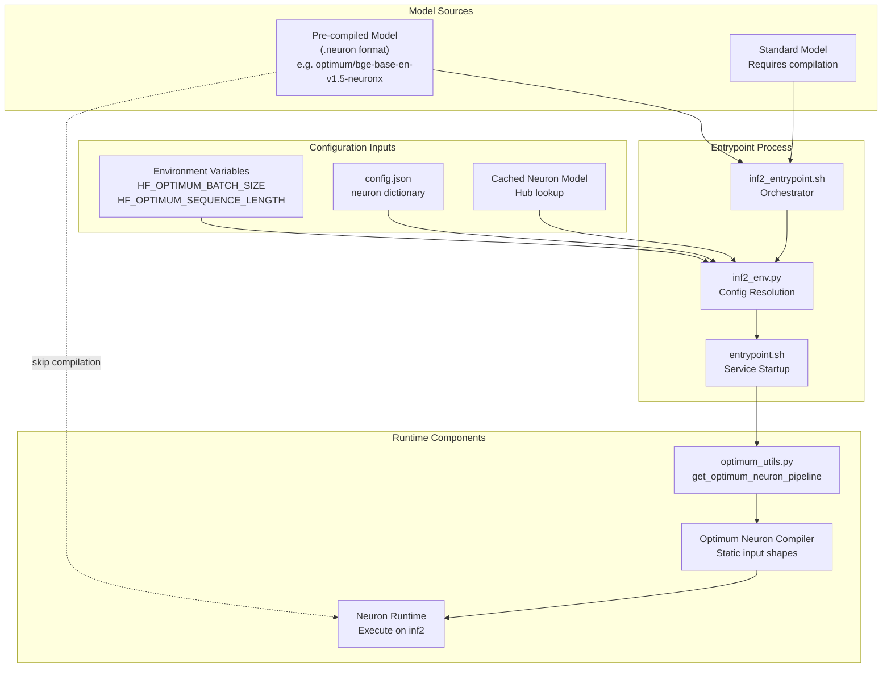
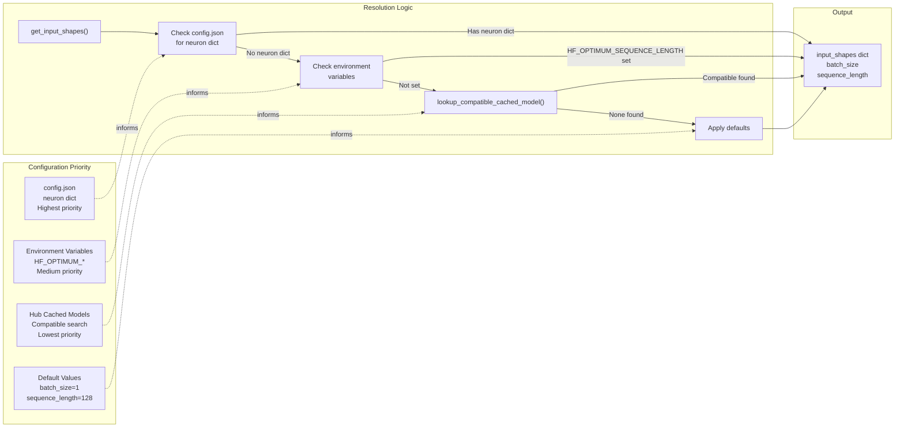
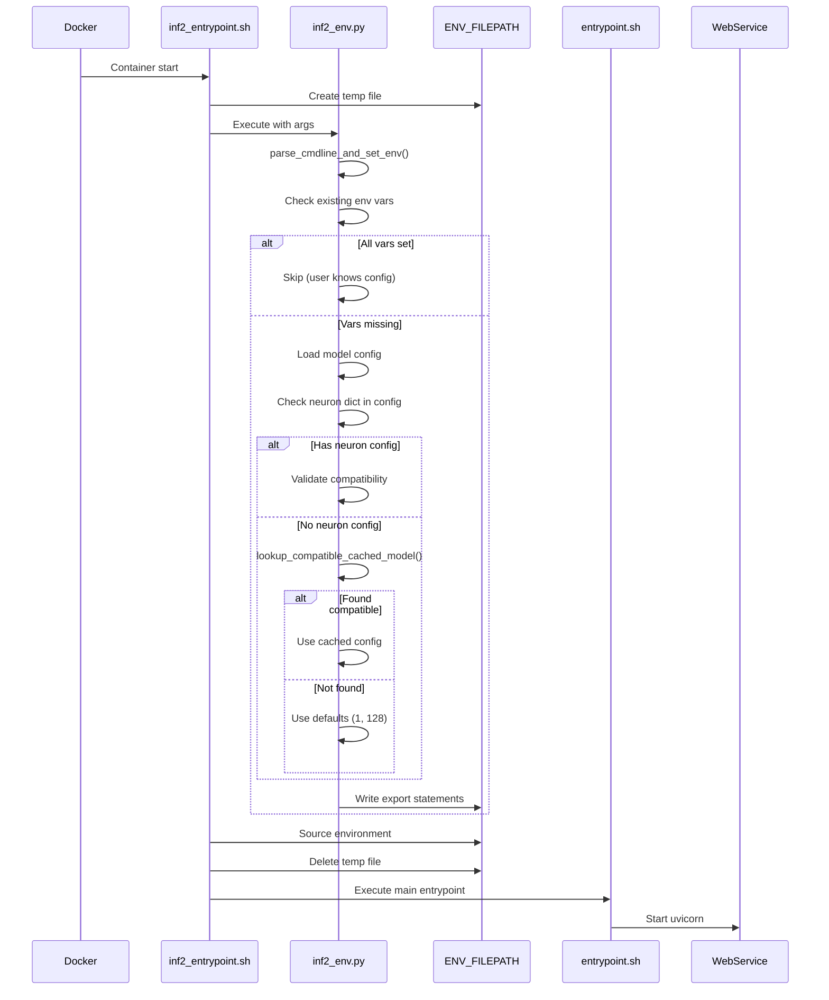
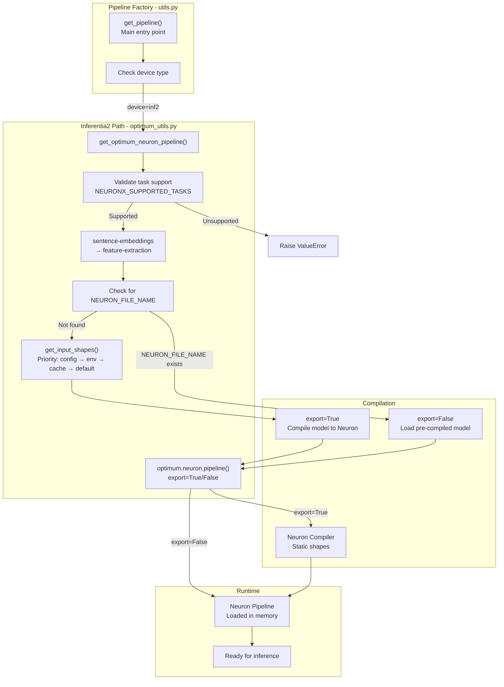

<!-- source: DeepWiki mcp.deepwiki.com · repo huggingface/huggingface-inference-toolkit · page 5.4 AWS Inferentia2 Deployment · fetched 2026-10-26 -->

# AWS Inferentia2 Deployment

<details>
<summary>Relevant source files</summary>

The following files were used as context for generating this wiki page:

- [.gitignore](.gitignore)
- [README.md](README.md)
- [dockerfiles/pytorch/Dockerfile.inf2](dockerfiles/pytorch/Dockerfile.inf2)
- [scripts/inf2_entrypoint.sh](scripts/inf2_entrypoint.sh)
- [scripts/inf2_env.py](scripts/inf2_env.py)
- [src/huggingface_inference_toolkit/optimum_utils.py](src/huggingface_inference_toolkit/optimum_utils.py)
- [tests/integ/test_pytorch_local_inf2.py](tests/integ/test_pytorch_local_inf2.py)
- [tests/unit/test_optimum_utils.py](tests/unit/test_optimum_utils.py)

</details>


This document covers deploying Hugging Face models on AWS Inferentia2 hardware using the Hugging Face Inference Toolkit. AWS Inferentia2 is AWS's custom machine learning accelerator chip designed for high-performance, cost-effective inference workloads. The toolkit leverages Optimum Neuron to compile and serve models optimized for Inferentia2's architecture.

For general deployment strategies, see [Deployment Guide](#5). For custom handlers that can be used with Inferentia2, see [Custom Handlers and Pipelines](#6.4). For detailed information about the Optimum Neuron integration, see [AWS Neuron Optimization](#6.3).

## Overview

AWS Inferentia2 accelerators require models to be compiled for the Neuron runtime using static input shapes. The toolkit provides three deployment approaches:

1. **Pre-compiled models**: Use models already compiled to `.neuron` format from the Hugging Face Hub
2. **On-the-fly compilation**: Provide compilation parameters via environment variables
3. **Config-based compilation**: Include compilation parameters in the model's `config.json`

The compilation process converts standard PyTorch models into Neuron-optimized format with fixed batch sizes and sequence lengths, enabling efficient execution on Inferentia2 hardware.

**Sources**: [README.md:131-139](), [src/huggingface_inference_toolkit/optimum_utils.py:73-114]()

## Deployment Architecture



**Sources**: [scripts/inf2_entrypoint.sh:1-18](), [scripts/inf2_env.py:184-235](), [src/huggingface_inference_toolkit/optimum_utils.py:73-114]()

## Container Image

The Inferentia2 container image is built using a specialized Dockerfile that includes Neuron SDK components and Optimum Neuron libraries.

### Image Components

| Component | Version/Details | Purpose |
|-----------|----------------|---------|
| Base Image | `ubuntu:22.04` | Operating system foundation |
| Neuron Collectives | `2.22.33.0-d2128d1aa` | Inter-device communication |
| Neuron Runtime | `2.22.19.0-5856c0b42` | Inferentia2 execution runtime |
| Neuron Tools | `2.19.0.0` | Neuron compiler and utilities |
| Optimum Neuron | `0.0.28` | HF-Neuron integration layer |
| Sentence Transformers | Optional via `[st]` extra | Embedding model support |

### Build Process

```bash
# Build Inferentia2 container
make inference-pytorch-inf2

# Or manually
docker build -f dockerfiles/pytorch/Dockerfile.inf2 \
  -t integration-test-pytorch:inf2 .
```

The Dockerfile installs Neuron SDK packages from AWS's APT repository and configures the environment for Neuron runtime execution.

**Sources**: [dockerfiles/pytorch/Dockerfile.inf2:1-79](), [README.md:175-177]()

## Configuration System



**Sources**: [src/huggingface_inference_toolkit/optimum_utils.py:16-71](), [scripts/inf2_env.py:80-231]()

### Environment Variables

#### Required Variables

**`HF_OPTIMUM_SEQUENCE_LENGTH`**: Maximum sequence length for model compilation. Must be specified unless the model is pre-compiled or has a neuron configuration in `config.json`.

```bash
export HF_OPTIMUM_SEQUENCE_LENGTH=128
```

#### Optional Variables

**`HF_OPTIMUM_BATCH_SIZE`**: Batch size for compiled model. Defaults to `1` if not specified.

```bash
export HF_OPTIMUM_BATCH_SIZE=1
```

**`HF_MODEL_ID`**: Model repository ID or local path.

```bash
export HF_MODEL_ID="distilbert/distilbert-base-uncased-finetuned-sst-2-english"
```

**`HF_TASK`**: Task type for the pipeline (e.g., `text-classification`, `feature-extraction`).

```bash
export HF_TASK="text-classification"
```

**Sources**: [README.md:263-277](), [src/huggingface_inference_toolkit/optimum_utils.py:56-70]()

### Configuration in config.json

Models can include static input shape configuration directly in their `config.json`:

```json
{
  "neuron": {
    "static_batch_size": 1,
    "static_sequence_length": 128
  }
}
```

When present, this configuration takes precedence over environment variables and triggers a warning if environment variables are also set.

**Sources**: [src/huggingface_inference_toolkit/optimum_utils.py:24-47](), [README.md:137-138]()

## Entrypoint Process

The Inferentia2 deployment uses a two-stage entrypoint process that resolves configuration before starting the web service.

### Entrypoint Flow



**Sources**: [scripts/inf2_entrypoint.sh:1-18](), [scripts/inf2_env.py:37-235]()

### inf2_env.py Configuration Resolution

The `inf2_env.py` script implements intelligent configuration resolution:

1. **Parse command-line arguments**: Extract batch size, sequence length, model ID, and revision from command-line arguments or environment variables [scripts/inf2_env.py:37-78]()

2. **Check existing configuration**: If all required environment variables are set, skip resolution [scripts/inf2_env.py:192-200]()

3. **Load model config**: Attempt to load configuration from the model's `config.json` [scripts/inf2_env.py:206-218]()

4. **Search cached models**: If no config found, search for compatible pre-compiled models in the Hugging Face Hub cache [scripts/inf2_env.py:90-128]()

5. **Apply defaults**: If no compatible configuration found, fall back to default values (`batch_size=1`, `sequence_length=128`) [scripts/inf2_env.py:222-227]()

6. **Write environment**: Export resolved configuration to temporary file for sourcing [scripts/inf2_env.py:80-84]()

The compatibility checking ensures that cached models match the compiler version and input shape requirements [scripts/inf2_env.py:131-174]().

**Sources**: [scripts/inf2_env.py:184-235]()

## Model Compilation and Loading

### Pipeline Creation Flow



**Sources**: [src/huggingface_inference_toolkit/optimum_utils.py:73-114]()

### Compilation Process

The compilation process converts standard transformers models to Neuron-optimized format:

1. **Task validation**: Verify the task is supported by checking against `NEURONX_SUPPORTED_TASKS` from Optimum Neuron [src/huggingface_inference_toolkit/optimum_utils.py:86-94]()

2. **Task normalization**: Convert `sentence-embeddings` to `feature-extraction` for compatibility [src/huggingface_inference_toolkit/optimum_utils.py:86-88]()

3. **Check pre-compilation**: Look for `NEURON_FILE_NAME` in model directory to determine if model is already compiled [src/huggingface_inference_toolkit/optimum_utils.py:97-99]()

4. **Input shape resolution**: Call `get_input_shapes()` to determine static batch size and sequence length [src/huggingface_inference_toolkit/optimum_utils.py:106]()

5. **Pipeline creation**: Instantiate `optimum.neuron.pipeline()` with `export=True` (compile) or `export=False` (load existing) [src/huggingface_inference_toolkit/optimum_utils.py:111-113]()

The compilation process is automatic and transparent - if a model is not pre-compiled, the toolkit compiles it on first load using the provided input shapes.

**Sources**: [src/huggingface_inference_toolkit/optimum_utils.py:73-114]()

## Running Containers

### Local Development

For local testing on an Inferentia2 instance:

```bash
# With environment variables (on-the-fly compilation)
mkdir tmp2/
HF_MODEL_ID="distilbert/distilbert-base-uncased-finetuned-sst-2-english" \
HF_TASK="text-classification" \
HF_OPTIMUM_BATCH_SIZE=1 \
HF_OPTIMUM_SEQUENCE_LENGTH=128 \
HF_MODEL_DIR=tmp2 \
uvicorn src.huggingface_inference_toolkit.webservice_starlette:app --port 5000

# With sentence transformers
HF_MODEL_ID="sentence-transformers/all-MiniLM-L6-v2" \
HF_TASK="feature-extraction" \
HF_OPTIMUM_BATCH_SIZE=1 \
HF_OPTIMUM_SEQUENCE_LENGTH=128 \
HF_MODEL_DIR=tmp2 \
uvicorn src.huggingface_inference_toolkit.webservice_starlette:app --port 5000
```

**Sources**: [README.md:141-169]()

### Container Execution

```bash
# Build the container
make inference-pytorch-inf2

# Run with on-the-fly compilation
docker run -ti -p 5000:5000 \
  -e HF_MODEL_ID="distilbert/distilbert-base-uncased-finetuned-sst-2-english" \
  -e HF_TASK="text-classification" \
  -e HF_OPTIMUM_BATCH_SIZE=1 \
  -e HF_OPTIMUM_SEQUENCE_LENGTH=128 \
  --device=/dev/neuron0 \
  integration-test-pytorch:inf2

# Run with pre-compiled model
docker run -ti -p 5000:5000 \
  -e HF_MODEL_ID="optimum/bge-base-en-v1.5-neuronx" \
  -e HF_TASK="feature-extraction" \
  --device=/dev/neuron0 \
  integration-test-pytorch:inf2
```

The `--device=/dev/neuron0` flag grants the container access to the Inferentia2 device.

**Sources**: [README.md:171-195]()

### Sending Requests

```bash
curl --request POST \
  --url http://localhost:5000 \
  --header 'Content-Type: application/json' \
  --data '{
    "inputs": "Wow, this is such a great product. I love it!",
    "parameters": { "top_k": 2 }
  }'
```

The API schema matches the standard Hugging Face Inference API format.

**Sources**: [README.md:187-195]()

## Supported Tasks

The following tasks are supported on Inferentia2 through Optimum Neuron:

| Task | Example Use Case | Compilation Required |
|------|------------------|---------------------|
| `text-classification` | Sentiment analysis | Yes (unless pre-compiled) |
| `token-classification` | Named entity recognition | Yes (unless pre-compiled) |
| `question-answering` | Extractive QA | Yes (unless pre-compiled) |
| `fill-mask` | Masked language modeling | Yes (unless pre-compiled) |
| `feature-extraction` | Embeddings generation | Yes (unless pre-compiled) |
| `sentence-embeddings` | Semantic similarity | Yes (unless pre-compiled) |

The supported tasks are determined by `NEURONX_SUPPORTED_TASKS` from the Optimum Neuron library. Task support is validated at pipeline creation time [src/huggingface_inference_toolkit/optimum_utils.py:91-94]().

For LLM inference on Inferentia2, use [Neuronx TGI](https://huggingface.co/blog/text-generation-inference-on-inferentia2) instead, as it is specifically optimized for large language models.

**Sources**: [README.md:139-140](), [tests/integ/test_pytorch_local_inf2.py:16-32](), [src/huggingface_inference_toolkit/optimum_utils.py:91-94]()

## Static Input Shapes

### Shape Requirements

AWS Inferentia2 requires models to be compiled with static input shapes. This means:

- **Batch size**: Fixed number of samples per inference call
- **Sequence length**: Fixed maximum token length for text inputs

Inputs that don't match the compiled shapes are automatically padded or truncated by the Optimum Neuron pipeline.

### Performance Implications

| Configuration | Memory Usage | Throughput | Latency |
|--------------|--------------|------------|---------|
| Small shapes (1, 128) | Low | Lower | Lower |
| Medium shapes (4, 256) | Medium | Medium | Medium |
| Large shapes (8, 512) | High | Higher | Higher |

Choose shapes based on your workload characteristics:
- Smaller shapes for latency-sensitive applications
- Larger shapes for throughput-optimized batch processing

**Sources**: [README.md:133-138](), [src/huggingface_inference_toolkit/optimum_utils.py:16-71]()

## Testing

### Unit Tests

The unit test suite validates Optimum Neuron integration:

```bash
# Run all Inferentia2 unit tests
pytest tests/unit/test_optimum_utils.py
```

Key test scenarios:
- Input shape extraction from config files [tests/unit/test_optimum_utils.py:35-43]()
- Input shape extraction from environment variables [tests/unit/test_optimum_utils.py:48-58]()
- Pipeline creation from pre-compiled models [tests/unit/test_optimum_utils.py:63-72]()
- Pipeline creation with on-the-fly compilation [tests/unit/test_optimum_utils.py:77-88]()

**Sources**: [tests/unit/test_optimum_utils.py:1-89]()

### Integration Tests

Integration tests validate end-to-end functionality:

```bash
# Run Inferentia2 integration tests
pytest tests/integ/test_pytorch_local_inf2.py
```

Tests cover multiple tasks (`feature-extraction`, `fill-mask`, `question-answering`, `text-classification`, `token-classification`) on Inferentia2 hardware using both local and remote model loading fixtures.

**Sources**: [tests/integ/test_pytorch_local_inf2.py:1-33]()

## Troubleshooting

### Common Issues

**Missing HF_OPTIMUM_SEQUENCE_LENGTH**

If the model is not pre-compiled and this variable is not set:
```
ValueError: HF_OPTIMUM_SEQUENCE_LENGTH environment variable is not set.
```

**Solution**: Set `HF_OPTIMUM_SEQUENCE_LENGTH` or use a pre-compiled model [src/huggingface_inference_toolkit/optimum_utils.py:56-60]().

**Unsupported Task**

If the task is not supported by Neuron:
```
ValueError: Task {task} is not supported by optimum neuron and inf2.
```

**Solution**: Check the list of supported tasks or use a different deployment target [src/huggingface_inference_toolkit/optimum_utils.py:91-94]().

**Compiler Version Mismatch**

The `inf2_env.py` script checks compiler version compatibility for cached models. If versions don't match, the cached model is skipped [scripts/inf2_env.py:146-155]().

**Device Access**

Ensure the container has access to Neuron devices using `--device=/dev/neuron0` flag when running Docker containers.

**Sources**: [src/huggingface_inference_toolkit/optimum_utils.py:56-94](), [scripts/inf2_env.py:146-155]()

---

