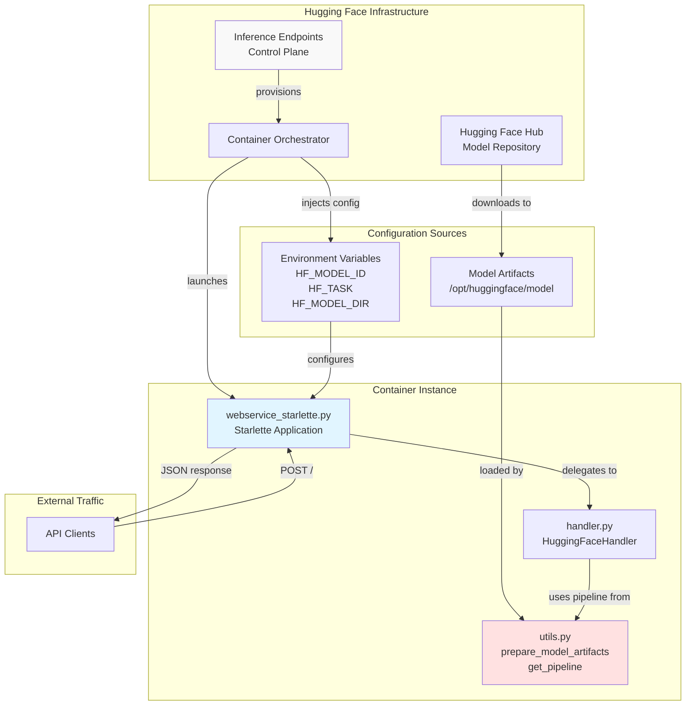
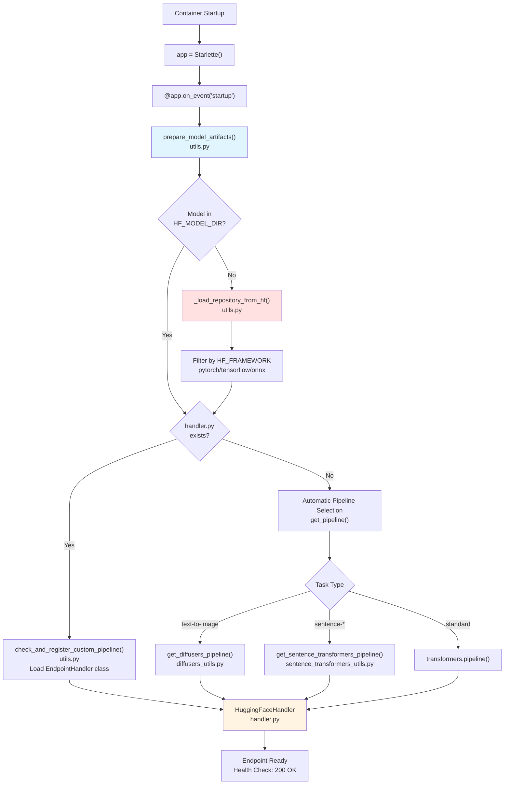
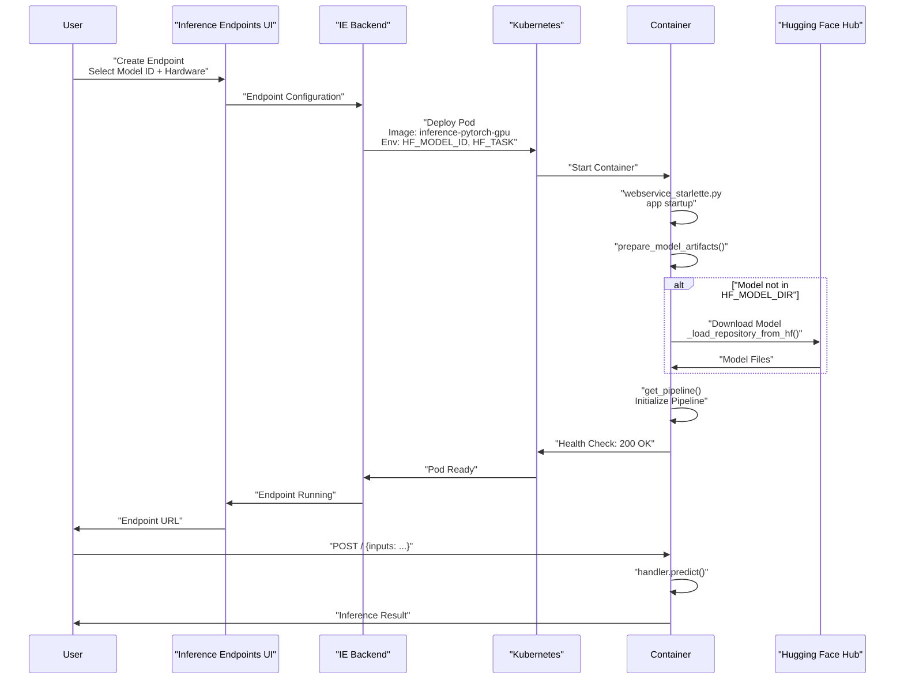

<!-- source: DeepWiki mcp.deepwiki.com · repo huggingface/huggingface-inference-toolkit · page 5.5 Hugging Face Inference Endpoints · fetched 2026-10-26 -->

# Hugging Face Inference Endpoints

<details>
<summary>Relevant source files</summary>

The following files were used as context for generating this wiki page:

- [README.md](README.md)
- [setup.py](setup.py)

</details>


## Purpose and Scope

This document explains how the Hugging Face Inference Toolkit serves as the default serving runtime for Hugging Face Inference Endpoints. It covers the integration mechanism, runtime configuration, and deployment flow specific to this managed service platform.

For information about other deployment modes, see:
- [Local Development](#5.1) for running the toolkit locally with uvicorn
- [Docker Deployment](#5.2) for standalone containerized deployments
- [Google Vertex AI Deployment](#5.3) for GCP-specific configuration
- [AWS Inferentia2 Deployment](#5.4) for Neuron-optimized deployments

## Overview

Hugging Face Inference Endpoints is a managed service that provides production-ready inference infrastructure for models hosted on the Hugging Face Hub. This toolkit serves as the default container runtime for the service, providing standardized inference capabilities without requiring users to write custom serving code.

The relationship is defined in [setup.py:63]():
```
description="Hugging Face Inference Toolkit is for serving 🤗 Transformers models in containers."
```

And in [README.md:5]():
```
The Toolkit is built to work with the Hugging Face Hub and is used as the "default" option in Inference Endpoints
```

**Sources:** [setup.py:59-69](), [README.md:1-6]()

## Integration Architecture

The toolkit integrates with Inference Endpoints through a containerized deployment model where the service orchestrates container lifecycle, model loading, and traffic routing.



**Diagram: Inference Endpoints Integration Flow**

The Inference Endpoints control plane manages the container lifecycle and injects configuration through environment variables. The toolkit then loads models and serves inference requests through the standard Starlette web service interface.

**Sources:** [setup.py:59-69](), [README.md:1-6]()

## Runtime Configuration

### Environment Variables

When deployed on Inference Endpoints, the service automatically configures the following environment variables:

| Variable | Source | Purpose |
|----------|--------|---------|
| `HF_MODEL_ID` | Endpoint configuration | Model repository identifier on Hub |
| `HF_TASK` | Auto-detected or configured | ML task type for pipeline selection |
| `HF_MODEL_DIR` | Default: `/opt/huggingface/model` | Directory for model artifacts |
| `HF_HUB_TOKEN` | Endpoint secrets | Authentication for private models |
| `HF_REVISION` | Optional configuration | Pin specific model commit |
| `HF_FRAMEWORK` | Auto-detected | `pytorch` or `tensorflow` |

The `HF_MODEL_ID` is the primary configuration point, as documented in [README.md:224-229]():
```
The HF_MODEL_ID environment variable defines the model id, which will be automatically loaded from huggingface.co/models when starting the container.
```

### Model Loading Flow



**Diagram: Model Loading and Initialization Sequence**

The startup sequence follows the logic in [src/huggingface_inference_toolkit/webservice_starlette.py]() where the `prepare_model_artifacts()` function is called during application startup to load or download the model, followed by pipeline instantiation.

**Sources:** [src/huggingface_inference_toolkit/utils.py](), [src/huggingface_inference_toolkit/webservice_starlette.py]()

## Container Images

Inference Endpoints uses the same container images built by this toolkit. The primary images are:

| Image Variant | Base | Use Case |
|---------------|------|----------|
| `inference-pytorch-cpu` | CPU-optimized PyTorch | CPU endpoints, cost-effective |
| `inference-pytorch-gpu` | GPU-enabled PyTorch | GPU endpoints, high throughput |
| `inference-pytorch-inf2` | AWS Neuron SDK | Inferentia2 hardware acceleration |

These images are built via [.github/workflows/build-container.yaml]() and include all dependencies specified in [setup.py:15-34]():

- `transformers[sklearn,sentencepiece,audio,vision]==4.51.3`
- `huggingface_hub[hf_transfer]==0.30.2`
- `starlette` and `uvicorn` for web service
- Vision libraries: `Pillow`, `librosa`
- Audio processing: `pyctcdecode`, `phonemizer`, `ffmpeg`

**Sources:** [setup.py:15-34](), [.github/workflows/build-container.yaml]()

## API Compatibility

### Standard Endpoint Interface

The toolkit exposes a POST endpoint at `/` that accepts requests matching the [Inference API schema](https://huggingface.co/docs/api-inference/detailed_parameters):

```json
{
  "inputs": "<input_data>",
  "parameters": {
    "key": "value"
  }
}
```

This is implemented in [src/huggingface_inference_toolkit/webservice_starlette.py]() where the Starlette application defines the route handler.

### Health and Metrics Endpoints

| Endpoint | Method | Purpose |
|----------|--------|---------|
| `/` | POST | Inference requests |
| `/health` | GET | Liveness/readiness probe |
| `/metrics` | GET | Prometheus metrics (if enabled) |

### Task-Specific Request Formats

The request format varies by task type. Examples documented in [README.md:49-61]():

**Question Answering:**
```json
{
  "inputs": {
    "question": "What is used for inference?",
    "context": "This model is used with sagemaker for inference."
  }
}
```

**Text Classification:**
```json
{
  "inputs": "I love this product"
}
```

**Sources:** [README.md:49-61](), [src/huggingface_inference_toolkit/webservice_starlette.py]()

## Deployment Flow



**Diagram: End-to-End Deployment Sequence**

The deployment follows this sequence:
1. User configures endpoint through UI
2. Backend provisions container with environment variables
3. Container starts and loads model during startup
4. Health checks confirm readiness
5. Endpoint becomes available for inference

**Sources:** [setup.py:59-69](), [README.md:1-6]()

## Configuration Examples

### Standard Transformers Model

For a standard model like DistilBERT:

```bash
HF_MODEL_ID=distilbert-base-uncased-finetuned-sst-2-english
HF_TASK=text-classification
HF_MODEL_DIR=/opt/huggingface/model
```

As shown in [README.md:42]():
```
docker run -e HF_MODEL_ID=distilbert-base-uncased-distilled-squad -e HF_TASK=question-answering
```

### Diffusers Model

For text-to-image generation:

```bash
HF_MODEL_ID=stabilityai/stable-diffusion-xl-base-1.0
HF_TASK=text-to-image
```

Example from [README.md:45]():
```
docker run --gpus all -e HF_MODEL_ID=stabilityai/stable-diffusion-xl-base-1.0 -e HF_TASK=text-to-image
```

### Private Model with Authentication

For gated or private models:

```bash
HF_MODEL_ID=meta-llama/Llama-2-7b-hf
HF_HUB_TOKEN=hf_xxxxxxxxxxxxx
HF_TASK=text-generation
```

The token is documented in [README.md:239-245]():
```
The HF_HUB_TOKEN environment variable defines your Hugging Face authorization token.
```

**Sources:** [README.md:42-47](), [README.md:224-245]()

## Differences from Other Deployment Modes

### vs. Local Development

| Aspect | Inference Endpoints | Local Development |
|--------|---------------------|-------------------|
| Container | Managed by service | User runs manually |
| Model Download | Automatic on startup | Manual setup |
| Environment Variables | Injected by platform | User configures |
| Scaling | Auto-scaling available | Single instance |
| Monitoring | Built-in metrics | User implements |

### vs. Vertex AI

| Feature | Inference Endpoints | Vertex AI |
|---------|---------------------|-----------|
| Route Configuration | Standard `/` | `AIP_PREDICT_ROUTE` customizable |
| Request Format | `{"inputs": ...}` | `{"instances": [...]}` |
| Model Source | Hub-native | Hub or GCS (`AIP_STORAGE_URI`) |
| Health Endpoint | `/health` | `AIP_HEALTH_ROUTE` customizable |

Vertex AI configuration shown in [README.md:82-103]() requires `AIP_*` environment variables, while Inference Endpoints uses standard Hub configuration.

### vs. Docker Standalone

| Aspect | Inference Endpoints | Docker Standalone |
|--------|---------------------|-------------------|
| Orchestration | Kubernetes managed | User manages |
| GPU Allocation | Automatic | `--gpus all` flag required |
| Port Configuration | Managed | User specifies `-p 5000:5000` |
| Updates | Rolling deployments | Manual recreation |

**Sources:** [README.md:16-61](), [README.md:80-129]()

## Custom Handler Support

Inference Endpoints fully supports custom handlers via `handler.py` files in model repositories. This is documented in [README.md:63-78]():

```
model.tar.gz/
|- pytorch_model.bin
|- handler.py
|- requirements.txt
```

The custom handler is detected and loaded by [src/huggingface_inference_toolkit/utils.py]() in the `check_and_register_custom_pipeline()` function, which looks for an `EndpointHandler` class.

### Custom Handler Example Structure

A custom handler must implement:

```python
class EndpointHandler:
    def __init__(self, path=""):
        # Initialize model and dependencies
        pass
    
    def __call__(self, data: dict):
        # Process inputs and return predictions
        pass
```

The handler is then wrapped by `HuggingFaceHandler` in [src/huggingface_inference_toolkit/handler.py]() for integration with the web service.

**Sources:** [README.md:63-78](), [src/huggingface_inference_toolkit/utils.py](), [src/huggingface_inference_toolkit/handler.py]()

## Supported Front-End Status

As noted in [README.md:283]():

- ✅ Starlette (HF Endpoints) - Fully supported
- ✅ Starlette (Vertex AI) - Supported
- ⏳ Starlette (Azure ML) - Planned
- ⏳ Starlette (SageMaker) - Planned

The current implementation in [src/huggingface_inference_toolkit/webservice_starlette.py]() provides the foundation for all Starlette-based deployments.

**Sources:** [README.md:280-286]()

## Model Artifact Handling

The toolkit handles model artifacts efficiently during container startup. The logic in [README.md:203-213]() explains:

```
If HF_MODEL_ID is not set the toolkit expects a model artifact at this directory.
If HF_MODEL_ID is set and the directory is empty, the toolkit will download the model from the Hub.
```

This lazy-loading approach optimizes cold start time by only downloading when necessary. The download is performed by `_load_repository_from_hf()` in [src/huggingface_inference_toolkit/utils.py](), which:

1. Downloads model files to `HF_MODEL_DIR`
2. Filters by framework (`HF_FRAMEWORK`) to avoid downloading unnecessary files
3. Respects `HF_REVISION` for version pinning
4. Uses `HF_HUB_TOKEN` for authentication

**Sources:** [README.md:203-213](), [src/huggingface_inference_toolkit/utils.py]()

## Summary

Hugging Face Inference Endpoints leverages this toolkit as its default serving runtime, providing:

- **Zero-configuration deployment** for standard Hub models
- **Automatic pipeline selection** based on task and model type  
- **Custom handler support** for specialized inference logic
- **Standard API compatibility** with the Inference API schema
- **Multi-framework support** (PyTorch, TensorFlow)
- **Specialized optimizations** (Diffusers, Sentence Transformers, Neuron)

The integration is transparent to users, who only need to select a model and hardware configuration. The toolkit handles all model loading, pipeline initialization, and request processing automatically.

**Sources:** [setup.py:59-69](), [README.md:1-6](), [README.md:280-286]()

---

