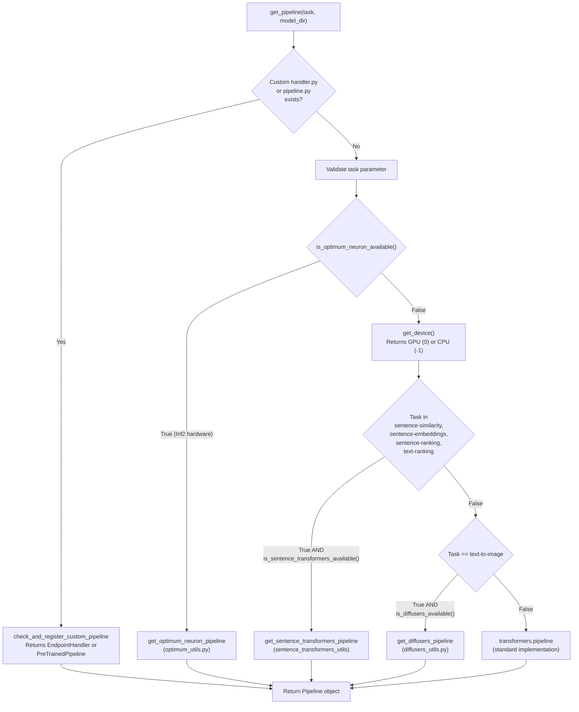
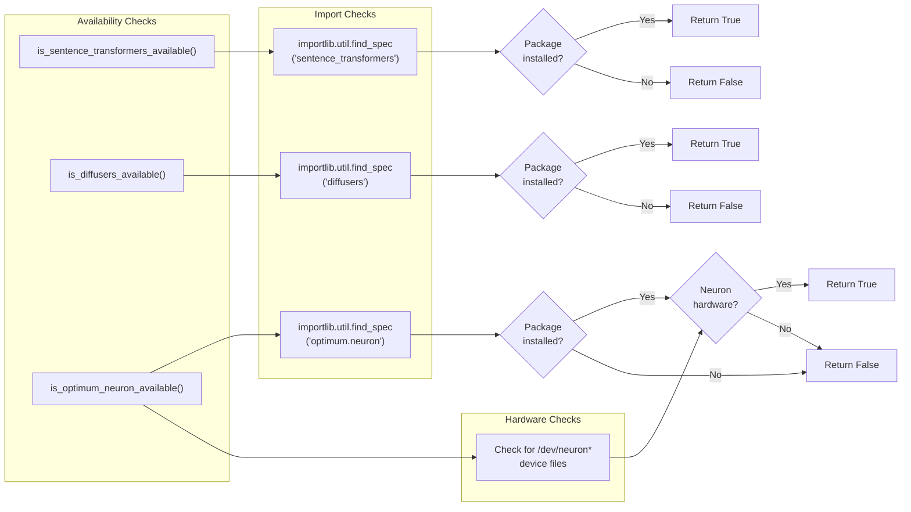
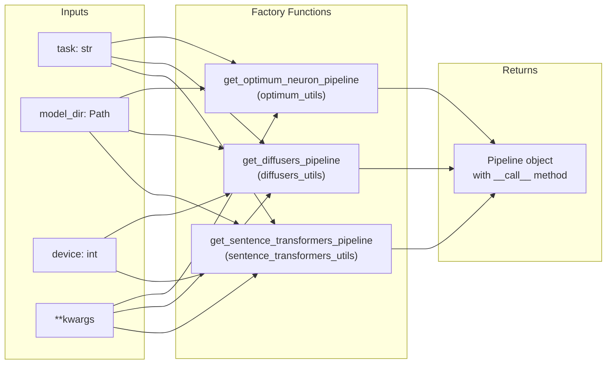
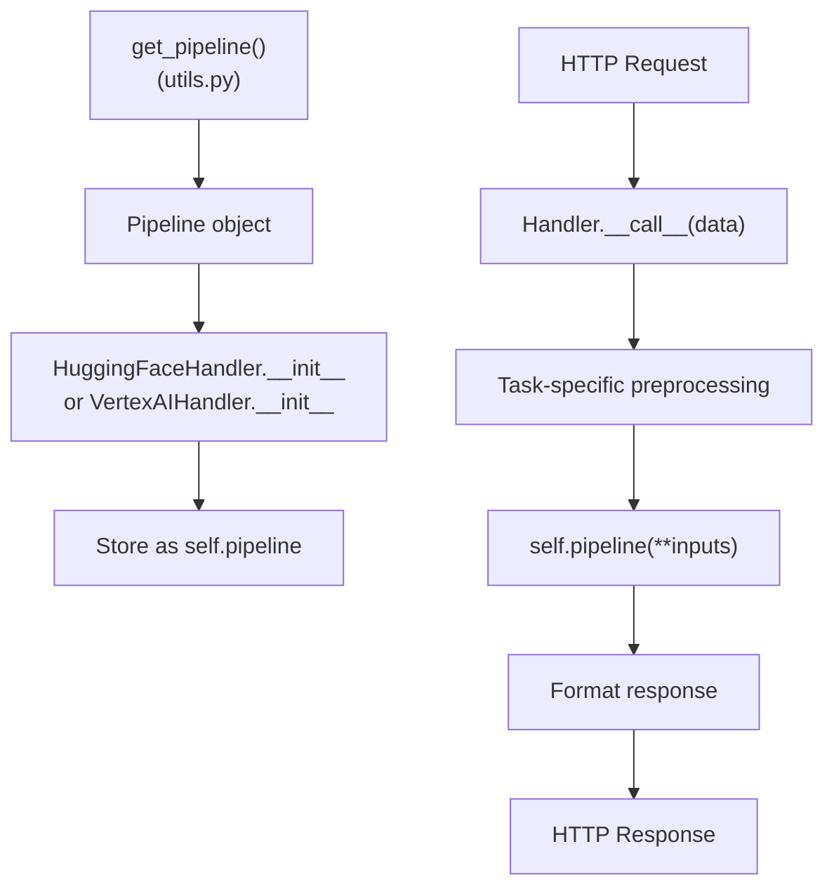

<!-- source: DeepWiki mcp.deepwiki.com · repo huggingface/huggingface-inference-toolkit · page 6 Specialized Pipeline Support · fetched 2026-10-26 -->

# Specialized Pipeline Support

<details>
<summary>Relevant source files</summary>

The following files were used as context for generating this wiki page:

- [setup.py](setup.py)
- [src/huggingface_inference_toolkit/utils.py](src/huggingface_inference_toolkit/utils.py)

</details>


## Purpose and Scope

This document provides an overview of the toolkit's support for specialized pipeline implementations beyond the standard Transformers library. It explains the routing logic that determines when to use Diffusers, Sentence Transformers, Optimum Neuron, or custom handlers instead of the default Transformers pipelines.

For deployment-specific configurations (Inferentia2 hardware setup, Vertex AI integration), see [Deployment Guide](#5). For standard Transformers pipeline usage, see [Inference Handlers](#4.3). For detailed information about each specialized pipeline type, see the subsections:
- Diffusers text-to-image generation: [6.1](#6.1)
- Sentence Transformers embeddings: [6.2](#6.2)
- AWS Neuron optimization: [6.3](#6.3)
- Custom handler implementation: [6.4](#6.4)

## Why Specialized Pipelines

The standard `transformers.pipeline` function provides excellent support for most NLP, vision, and audio tasks. However, certain model types and hardware platforms benefit from specialized implementations that provide:

- **Domain-specific optimizations**: Diffusers pipelines include scheduler optimizations and parameter normalization for generative models
- **Hardware acceleration**: Optimum Neuron provides static shape compilation for AWS Inferentia2
- **Extended task coverage**: Sentence Transformers adds embeddings, similarity, and ranking tasks not in the base Transformers library
- **Custom inference logic**: User-defined handlers enable arbitrary preprocessing, postprocessing, and model ensemble patterns

The toolkit automatically selects the appropriate pipeline implementation based on task type, hardware availability, and the presence of custom handler files.

## Installation and Dependencies

Specialized pipelines require additional dependencies that are installed via `extras_require` in [setup.py](). The modular installation system allows users to install only what they need:

| Extra | Package Dependencies | Use Case |
|-------|---------------------|----------|
| `st` | `sentence_transformers==4.0.2` | Embedding and similarity tasks |
| `diffusers` | `diffusers==0.33.1`, `accelerate==1.6.0` | Text-to-image generation |
| `inf2` | `optimum-neuron` | AWS Inferentia2 deployment |
| `torch` | `torch==2.5.1`, `torchvision`, `torchaudio`, `peft==0.15.1` | PyTorch-based models |

Installation examples:
```bash
# Install with Diffusers support
pip install huggingface-inference-toolkit[diffusers,torch]

# Install with Sentence Transformers support
pip install huggingface-inference-toolkit[st,torch]

# Install with Inferentia2 support
pip install huggingface-inference-toolkit[inf2,torch]

# Install with all specialized pipelines
pip install huggingface-inference-toolkit[st,diffusers,inf2,torch]
```

**Sources:** [setup.py:36-58]()

## Pipeline Selection Architecture

The `get_pipeline` function in `utils.py` implements the central routing logic that determines which pipeline implementation to use. The selection process follows a priority hierarchy:



**Key decision points:**

1. **Custom handlers take absolute priority**: If `handler.py` or `pipeline.py` exists in the model directory, it is loaded regardless of task type or hardware ([utils.py:152-191]())

2. **Hardware detection**: Inferentia2 availability is checked via `is_optimum_neuron_available()`, and if present, all tasks are routed to Optimum Neuron ([utils.py:222-224]())

3. **Task-based routing**: For non-custom, non-Inferentia2 scenarios, the task name determines whether to use Sentence Transformers or Diffusers ([utils.py:243-253]())

4. **Fallback to Transformers**: If no specialized implementation matches, the standard `transformers.pipeline` is used ([utils.py:255]())

**Sources:** [utils.py:206-263](), [utils.py:152-191]()

## Pipeline Routing Logic in Code

The `get_pipeline` function implements this routing as follows:

```python
# Priority 1: Check for Inferentia2 hardware
if is_optimum_neuron_available():
    return get_optimum_neuron_pipeline(task=task, model_dir=model_dir)

# Priority 2: Check for Sentence Transformers tasks
if is_sentence_transformers_available() and task in [
    "sentence-similarity",
    "sentence-embeddings", 
    "sentence-ranking",
    "text-ranking"
]:
    return get_sentence_transformers_pipeline(task, model_dir, device, **kwargs)

# Priority 3: Check for Diffusers tasks  
elif is_diffusers_available() and task == "text-to-image":
    return get_diffusers_pipeline(task, model_dir, device, **kwargs)

# Priority 4: Use standard Transformers pipeline
else:
    return pipeline(task=task, model=model_dir, device=device, **kwargs)
```

Note that custom handler checking happens before `get_pipeline` is called, in the model preparation phase. See [Custom Handlers and Pipelines](#6.4) for details.

**Sources:** [utils.py:206-263]()

## Task to Pipeline Mapping

The following table shows which tasks are handled by each specialized pipeline implementation:

| Task | Pipeline Implementation | Module | Hardware Requirements |
|------|------------------------|--------|----------------------|
| `sentence-similarity` | Sentence Transformers | `sentence_transformers_utils` | GPU or CPU |
| `sentence-embeddings` | Sentence Transformers | `sentence_transformers_utils` | GPU or CPU |
| `sentence-ranking` | Sentence Transformers | `sentence_transformers_utils` | GPU or CPU |
| `text-ranking` | Sentence Transformers (mapped to `sentence-ranking`) | `sentence_transformers_utils` | GPU or CPU |
| `text-to-image` | Diffusers | `diffusers_utils` | GPU (recommended) or CPU |
| All tasks | Optimum Neuron | `optimum_utils` | AWS Inferentia2 only |
| Any task | Custom handlers | User-provided `handler.py` | User-defined |
| All other tasks | Standard Transformers | `transformers.pipeline` | GPU or CPU |

**Task name normalization:** The `text-ranking` task is automatically mapped to `sentence-ranking` ([utils.py:249-250]()). The `conversational` task is mapped to `text-generation` ([utils.py:219-220]()).

**Sources:** [utils.py:243-255]()

## Availability Detection

Each specialized pipeline module provides an availability check function that the toolkit uses to determine whether to route to that implementation:



These functions are called during pipeline selection to determine which implementations are available in the current environment. If a specialized package is not installed, the toolkit gracefully falls back to the standard Transformers pipeline.

**Sources:** [utils.py:12-24]()

## Configuration Parameters

Each specialized pipeline type has its own configuration parameters. These are typically passed through the `get_pipeline` function via `**kwargs`:

### Common Parameters (All Pipelines)

| Parameter | Type | Description | Default |
|-----------|------|-------------|---------|
| `task` | `str` | Task identifier (e.g., `text-to-image`) | Required |
| `model_dir` | `Path` | Local directory containing model artifacts | Required |
| `device` | `int` | Device ID: 0 for GPU, -1 for CPU | Auto-detected |

### Tokenizer/Feature Extractor Selection

The `get_pipeline` function automatically sets up the correct tokenizer or feature extractor based on task type:

- **Feature extractor tasks** (lines 231-239): `automatic-speech-recognition`, `image-segmentation`, `image-classification`, `audio-classification`, `object-detection`, `zero-shot-image-classification`
- **Tokenizer tasks**: Most NLP tasks except `image-text-to-text`, `image-to-text`, `text-to-image` (lines 240-241)

This ensures the pipeline loads the correct preprocessing components from the model directory.

**Sources:** [utils.py:229-241]()

## Special Case Handling

### Whisper Model Configuration

For automatic speech recognition using Whisper models, the toolkit applies special configuration:

```python
if task == "automatic-speech-recognition" and isinstance(
    hf_pipeline.model, WhisperForConditionalGeneration
):
    # Enable long audio file processing
    hf_pipeline._preprocess_params["chunk_length_s"] = 30
    
    # Set English transcription as default
    hf_pipeline.model.config.forced_decoder_ids = (
        hf_pipeline.tokenizer.get_decoder_prompt_ids(
            language="english", task="transcribe"
        )
    )
```

This configuration enables processing of audio files longer than 30 seconds and sets the default language to English ([utils.py:257-262]()).

**Sources:** [utils.py:257-262]()

## Pipeline Factory Pattern

The specialized pipeline utilities follow a consistent factory pattern:



Each factory function:
1. Takes standard parameters (`task`, `model_dir`, optional `device`)
2. Loads the appropriate model class for the specialized library
3. Returns a pipeline object with a `__call__` method compatible with the handler interface
4. Handles library-specific parameter normalization

**Sources:** [utils.py:206-263]()

## Device Management

Device selection differs between specialized pipelines:

- **Standard Transformers**: Uses `device` parameter from `get_device()` function, which returns `0` for GPU or `-1` for CPU ([utils.py:194-203]())
- **Sentence Transformers**: Accepts device parameter and uses it directly ([utils.py:251]())
- **Diffusers**: Accepts device parameter and uses it directly ([utils.py:253]())
- **Optimum Neuron**: Does not use device parameter; automatically detects and uses Neuron cores ([utils.py:223-224]())

The `get_device()` function uses framework-specific checks:
- For PyTorch: `torch.cuda.is_available()`
- For TensorFlow: `len(tf.config.list_physical_devices("GPU")) > 0`

**Sources:** [utils.py:72-86](), [utils.py:194-203]()

## Integration with Handler Classes

The pipeline objects returned by `get_pipeline` are wrapped by handler classes that provide a standardized inference interface:



This abstraction allows all specialized pipelines to be served through the same HTTP interface, regardless of their underlying implementation. See [Inference Handlers](#4.3) for details on handler classes.

**Sources:** [utils.py:206-263]()

## Next Steps

For detailed information about each specialized pipeline type, including specific parameters, optimization techniques, and implementation details, see:

- **[Diffusers Integration (Text-to-Image)](#6.1)**: Image generation with Stable Diffusion and other diffusion models
- **[Sentence Transformers Support](#6.2)**: Embedding generation, semantic similarity, and ranking
- **[AWS Neuron Optimization](#6.3)**: Static shape compilation for Inferentia2 hardware
- **[Custom Handlers and Pipelines](#6.4)**: Implementing user-defined inference logic

---

