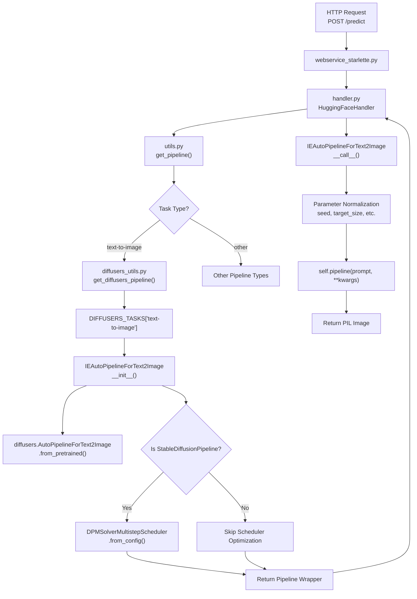
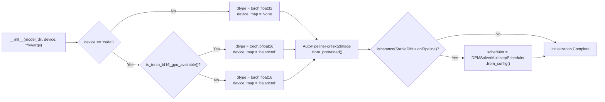
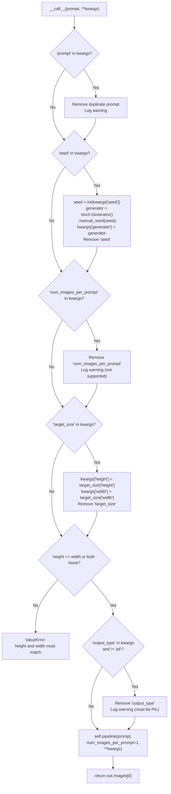
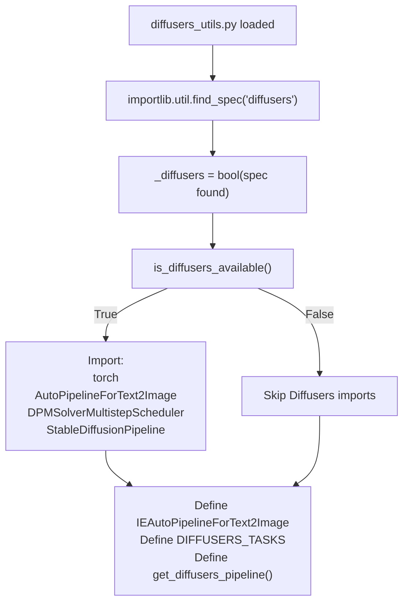

<!-- source: DeepWiki mcp.deepwiki.com · repo huggingface/huggingface-inference-toolkit · page 6.1 Diffusers Integration (Text-to-Image) · fetched 2026-10-26 -->

# Diffusers Integration (Text-to-Image)

<details>
<summary>Relevant source files</summary>

The following files were used as context for generating this wiki page:

- [src/huggingface_inference_toolkit/diffusers_utils.py](src/huggingface_inference_toolkit/diffusers_utils.py)
- [tests/unit/conftest.py](tests/unit/conftest.py)
- [tests/unit/test_diffusers.py](tests/unit/test_diffusers.py)
- [tests/unit/test_serializer.py](tests/unit/test_serializer.py)

</details>


## Purpose and Scope

This document describes the Diffusers integration in the Hugging Face Inference Toolkit, which enables text-to-image generation capabilities. The integration provides a standardized wrapper around the Diffusers library's text-to-image pipelines, handling parameter normalization, device configuration, and scheduler optimization.

This page focuses specifically on the text-to-image task. For other specialized pipeline types, see [Sentence Transformers Support](#6.2) and [AWS Neuron Optimization](#6.3). For information about custom inference logic, see [Custom Handlers and Pipelines](#6.4).

## Overview

The Diffusers integration serves as a bridge between the toolkit's standardized inference API and the Diffusers library. It translates common inference parameters (such as `seed` and `target_size`) into Diffusers-specific formats, automatically configures optimal device placement and data types, and optionally applies scheduler optimizations for faster inference.

Sources: [src/huggingface_inference_toolkit/diffusers_utils.py:1-96]()

## Architecture

The Diffusers integration is invoked by the main pipeline factory when the task type is `"text-to-image"`. The following diagram illustrates how it fits into the overall system:



Sources: [src/huggingface_inference_toolkit/diffusers_utils.py:86-96](), [src/huggingface_inference_toolkit/diffusers_utils.py:24-40]()

## Core Components

### Task Registration

The Diffusers integration registers its support through the `DIFFUSERS_TASKS` dictionary:

```python
DIFFUSERS_TASKS = {
    "text-to-image": IEAutoPipelineForText2Image,
}
```

This mapping is used by `get_diffusers_pipeline()` to instantiate the appropriate wrapper class.

Sources: [src/huggingface_inference_toolkit/diffusers_utils.py:86-88]()

### get_diffusers_pipeline Function

The factory function that creates Diffusers pipeline instances:

| Parameter | Type | Description |
|-----------|------|-------------|
| `task` | str | Task identifier (currently only `"text-to-image"`) |
| `model_dir` | str | Path to model directory |
| `device` | int | Device ID (0 for CUDA, -1 for CPU) |
| `**kwargs` | dict | Additional arguments passed to pipeline constructor |

The function converts the numeric device ID to a string (`"cuda"` or `"cpu"`) before instantiation.

Sources: [src/huggingface_inference_toolkit/diffusers_utils.py:91-95]()

### IEAutoPipelineForText2Image Class

The main wrapper class that encapsulates a Diffusers text-to-image pipeline with standardized parameter handling.

#### Initialization

The constructor handles device placement and dtype selection:



**Device and Dtype Configuration:**

| Device | Data Type | Device Map | Rationale |
|--------|-----------|------------|-----------|
| `"cuda"` | `torch.bfloat16` | `"balanced"` | Best performance on GPUs with BF16 support |
| `"cuda"` | `torch.float16` | `"balanced"` | Fallback for GPUs without BF16 |
| `"cpu"` | `torch.float32` | `None` | CPU requires full precision |

Sources: [src/huggingface_inference_toolkit/diffusers_utils.py:24-40]()

#### Scheduler Optimization

For `StableDiffusionPipeline` instances, the constructor attempts to replace the default scheduler with `DPMSolverMultistepScheduler`:

```python
if isinstance(self.pipeline, StableDiffusionPipeline):
    try:
        self.pipeline.scheduler = DPMSolverMultistepScheduler.from_config(
            self.pipeline.scheduler.config
        )
    except Exception:
        pass
```

The DPM-Solver scheduler typically provides faster convergence with fewer inference steps, improving generation speed without sacrificing quality. The optimization is wrapped in a try-except block to gracefully handle models where this scheduler is incompatible.

Sources: [src/huggingface_inference_toolkit/diffusers_utils.py:35-39]()

## Parameter Normalization

The `__call__` method performs extensive parameter normalization to bridge the gap between the toolkit's standardized API and Diffusers-specific conventions.

### Parameter Transformation Flow



Sources: [src/huggingface_inference_toolkit/diffusers_utils.py:41-83]()

### Parameter Mapping Table

| Input Parameter | Transformation | Diffusers Parameter | Notes |
|----------------|----------------|---------------------|-------|
| `prompt` (arg) | Direct passthrough | `prompt` | Takes precedence over `prompt` in kwargs |
| `seed` | Convert to `torch.Generator` | `generator` | Seeds random number generation for reproducibility |
| `target_size` | Extract dimensions | `height`, `width` | Nested dict flattened to separate params |
| `num_images_per_prompt` | Removed | Fixed at `1` | Multiple images not supported |
| `output_type` | Removed | Fixed at `"pil"` | Output format locked to PIL Image |
| `height` | Validated | `height` | Must equal `width` (or both None) |
| `width` | Validated | `width` | Must equal `height` (or both None) |

Sources: [src/huggingface_inference_toolkit/diffusers_utils.py:46-78]()

### Seed Handling

The conversion from `seed` to `generator` ensures deterministic generation:

```python
if "seed" in kwargs:
    seed = int(kwargs["seed"])
    generator = torch.Generator().manual_seed(seed)
    kwargs["generator"] = generator
    kwargs.pop("seed")
```

This allows API clients to specify a simple integer seed value, which is internally converted to PyTorch's `Generator` object expected by Diffusers pipelines.

Sources: [src/huggingface_inference_toolkit/diffusers_utils.py:54-59]()

### Target Size Normalization

The `target_size` parameter accepts a nested dictionary and extracts it into separate dimensions:

```python
if "target_size" in kwargs:
    kwargs["height"] = kwargs["target_size"].pop("height")
    kwargs["width"] = kwargs["target_size"].pop("width")
    kwargs.pop("target_size")
```

The implementation enforces that both dimensions must be equal or both must be unspecified. This constraint prevents aspect ratio issues with certain model architectures.

Sources: [src/huggingface_inference_toolkit/diffusers_utils.py:66-74]()

## Return Value

The `__call__` method always returns a single PIL Image object:

```python
out = self.pipeline(prompt, num_images_per_prompt=1, **kwargs)
return out.images[0]
```

Even though Diffusers pipelines return a list of images, the wrapper extracts only the first image to maintain a consistent single-image API contract.

Sources: [src/huggingface_inference_toolkit/diffusers_utils.py:81-83]()

## Integration Points

### Import Structure

The module uses conditional imports to handle environments where Diffusers is not installed:



This pattern allows the toolkit to function even when the `diffusers` extra is not installed, with the pipeline factory simply skipping text-to-image support.

Sources: [src/huggingface_inference_toolkit/diffusers_utils.py:1-21]()

### Main Pipeline Factory Integration

The `get_pipeline` function in `utils.py` delegates to `get_diffusers_pipeline()` when appropriate:

```python
# Pseudocode representation
if task == "text-to-image" and is_diffusers_available():
    return get_diffusers_pipeline(task=task, model_dir=model_dir, device=device, **kwargs)
```

This integration point allows the Diffusers wrapper to participate in the unified pipeline creation flow.

Sources: [src/huggingface_inference_toolkit/diffusers_utils.py:91-95]()

## Usage Example

### API Request Format

A typical text-to-image request would include:

```json
{
  "inputs": "A photo of an astronaut riding a horse on Mars",
  "parameters": {
    "seed": 42,
    "target_size": {
      "height": 512,
      "width": 512
    },
    "num_inference_steps": 25,
    "guidance_scale": 7.5
  }
}
```

### Parameter Processing

The system processes this request as follows:

1. `inputs` → `prompt` argument
2. `seed` → converted to `torch.Generator().manual_seed(42)`
3. `target_size` → extracted to `height=512, width=512`
4. `num_inference_steps` → passed directly to Diffusers
5. `guidance_scale` → passed directly to Diffusers

### Response Format

The response contains the generated image serialized according to the `Accept` header (typically PNG or JPEG format).

Sources: [src/huggingface_inference_toolkit/diffusers_utils.py:41-83]()

## Testing

The Diffusers integration includes unit tests that verify:

1. **Pipeline instantiation**: Confirming `get_pipeline()` returns `IEAutoPipelineForText2Image` for text-to-image tasks
2. **GPU device placement**: Validating the pipeline is correctly placed on CUDA devices
3. **Image generation**: Ensuring the pipeline produces valid PIL Image objects

Test coverage includes both CPU and GPU execution paths, with small test models (`echarlaix/tiny-random-stable-diffusion-xl`) used to minimize resource requirements.

Sources: [tests/unit/test_diffusers.py:1-52]()

## Dependencies

The Diffusers integration requires the following packages (installed via the `diffusers` extra in `setup.py`):

- `diffusers` - Core text-to-image pipeline implementations
- `accelerate` - Device placement and memory optimization
- `torch` - PyTorch framework
- `transformers` - For utility functions like `is_torch_bf16_gpu_available()`

These dependencies are optional and only loaded when the `diffusers` extra is installed.

Sources: [src/huggingface_inference_toolkit/diffusers_utils.py:1-21]()

---

