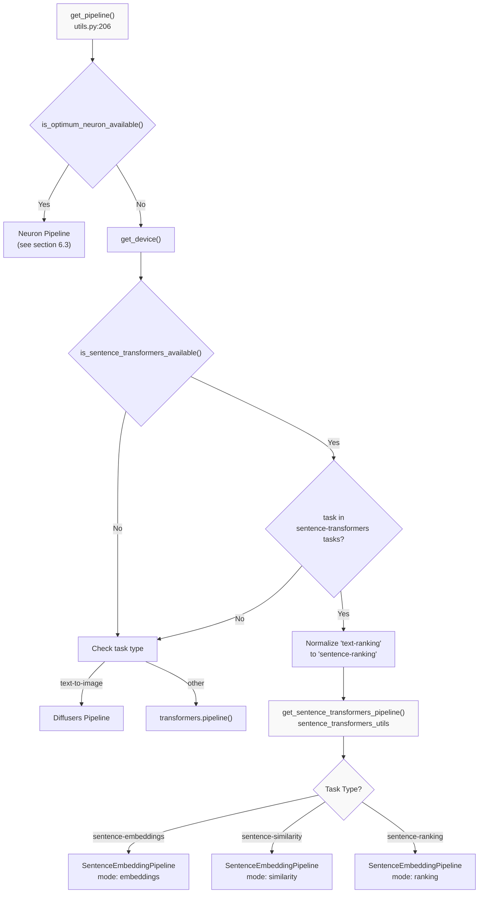
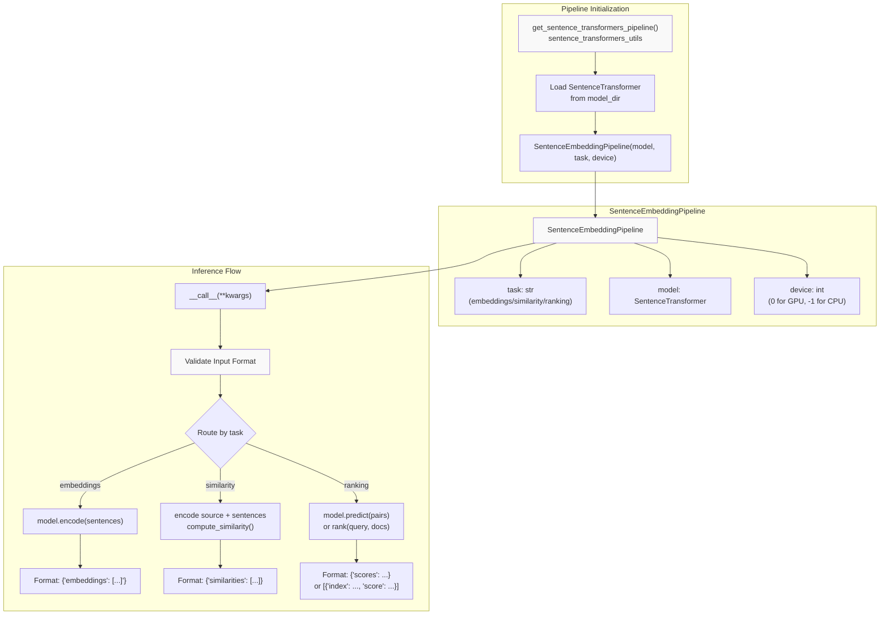
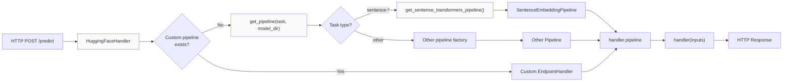

<!-- source: DeepWiki mcp.deepwiki.com · repo huggingface/huggingface-inference-toolkit · page 6.2 Sentence Transformers Support · fetched 2026-10-26 -->

# Sentence Transformers Support

<details>
<summary>Relevant source files</summary>

The following files were used as context for generating this wiki page:

- [src/huggingface_inference_toolkit/utils.py](src/huggingface_inference_toolkit/utils.py)
- [tests/unit/test_handler.py](tests/unit/test_handler.py)
- [tests/unit/test_sentence_transformers.py](tests/unit/test_sentence_transformers.py)

</details>


This document describes the specialized support for sentence-transformers models in the Hugging Face Inference Toolkit. The sentence-transformers library provides state-of-the-art models for generating sentence embeddings, computing semantic similarity, and performing text ranking tasks. The toolkit provides dedicated pipeline implementations that handle the unique requirements of these models.

For information about other specialized pipeline types, see [Diffusers Integration](#6.1), [AWS Neuron Optimization](#6.3), and [Custom Handlers](#6.4).

## Overview

The sentence-transformers integration enables three primary task types:
- **sentence-embeddings**: Generate dense vector representations of text
- **sentence-similarity**: Compute semantic similarity scores between sentences
- **sentence-ranking**: Rank text passages based on relevance to a query (also known as `text-ranking`)

These tasks are handled by the `SentenceEmbeddingPipeline` class, which wraps sentence-transformers models and provides a standardized interface compatible with the toolkit's handler architecture.

**Sources:** [src/huggingface_inference_toolkit/utils.py:243-251](), [tests/unit/test_sentence_transformers.py:1-115]()

## Task Detection and Routing



**Task Detection Logic**

The `get_pipeline` function routes sentence-transformers tasks through the following logic:

1. **Availability Check**: Verifies `sentence_transformers` library is installed via `is_sentence_transformers_available()`
2. **Task Matching**: Checks if task is one of: `"sentence-similarity"`, `"sentence-embeddings"`, `"sentence-ranking"`, `"text-ranking"`
3. **Task Normalization**: Converts `"text-ranking"` alias to canonical `"sentence-ranking"`
4. **Factory Invocation**: Calls `get_sentence_transformers_pipeline(task, model_dir, device, **kwargs)`

**Sources:** [src/huggingface_inference_toolkit/utils.py:243-251](), [tests/unit/test_sentence_transformers.py:16-21]()

## Supported Tasks

### Sentence Embeddings

The `sentence-embeddings` task generates dense vector representations of input text. These embeddings capture semantic meaning and can be used for downstream tasks like clustering, semantic search, or classification.

**Input Format:**
- `sentences` (string or list of strings): Text to encode

**Output Format:**
```json
{
  "embeddings": [[0.123, -0.456, ...], ...]
}
```

**Example Usage:**
```python
# Single sentence
pipe(sentences="Lets create an embedding")
# Returns: {"embeddings": [[...]]}

# Multiple sentences
pipe(sentences=["Lets create an embedding", "Another sentence"])
# Returns: {"embeddings": [[...], [...]]}
```

**Sources:** [tests/unit/test_sentence_transformers.py:25-33]()

### Sentence Similarity

The `sentence-similarity` task computes semantic similarity scores between a source sentence and one or more target sentences. Scores are typically in the range [-1, 1] or [0, 1] depending on the model.

**Input Format:**
- `source_sentence` (string): Reference sentence for comparison
- `sentences` (list of strings): Candidate sentences to compare against

**Output Format:**
```json
{
  "similarities": [0.85, 0.23, ...]
}
```

**Example Usage:**
```python
pipe(
    source_sentence="Lets create an embedding",
    sentences=["Lets create an embedding", "I like noodles"]
)
# Returns: {"similarities": [0.99, 0.12]}
```

**Sources:** [tests/unit/test_sentence_transformers.py:37-42]()

### Sentence Ranking

The `sentence-ranking` task uses cross-encoder models to compute relevance scores for text passages. Unlike bi-encoders used for embeddings, cross-encoders process query-passage pairs jointly, providing more accurate but slower ranking.

**Input Formats:**

The ranking pipeline supports two input formats:

1. **Sentence Pairs Format** (legacy):
```python
# Single pair
pipe(sentences=["query text", "passage text"])
# Returns: {"scores": 0.89}

# Multiple pairs
pipe(sentences=[
    ["query1", "passage1"],
    ["query2", "passage2"]
])
# Returns: {"scores": [0.89, 0.45]}
```

2. **Query-Texts Format** (TEI-compatible):
```python
pipe(
    query="What is machine learning?",
    texts=["ML is a subset of AI", "The weather is nice"],
    return_documents=False  # Optional
)
# Returns: [
#   {"index": 0, "score": 0.95},
#   {"index": 1, "score": 0.12}
# ]

# With return_documents=True
# Returns: [
#   {"index": 0, "score": 0.95, "text": "ML is a subset of AI"},
#   {"index": 1, "score": 0.12, "text": "The weather is nice"}
# ]
```

**Input Validation:**

The pipeline enforces mutually exclusive input formats:
- **Cannot mix formats**: Providing both `sentences` and (`query` + `texts`) raises `ValueError`
- **Query requires texts**: Providing `query` without `texts` raises `ValueError`
- **Texts must be non-empty**: `texts` must be a non-empty list of strings

**Sources:** [tests/unit/test_sentence_transformers.py:46-115]()

## Pipeline Architecture



**Pipeline Lifecycle:**

1. **Factory Creation**: `get_sentence_transformers_pipeline` loads the model from `model_dir` and instantiates `SentenceEmbeddingPipeline`
2. **Device Assignment**: Pipeline receives device ID (0 for GPU, -1 for CPU) determined by `get_device()`
3. **Task Configuration**: Pipeline stores task type to determine inference behavior
4. **Inference Execution**: `__call__` method validates inputs, routes to appropriate model method, and formats outputs

**Sources:** [tests/unit/test_sentence_transformers.py:16-21](), [src/huggingface_inference_toolkit/utils.py:243-251]()

## Integration with Handler System



The sentence-transformers pipeline integrates seamlessly with the handler system:

1. **Handler Detection**: During initialization, `HuggingFaceHandler` calls `get_pipeline` to create the appropriate pipeline instance
2. **Task-Based Routing**: If task is in sentence-transformers task list, routes to `get_sentence_transformers_pipeline`
3. **Pipeline Storage**: Resulting `SentenceEmbeddingPipeline` is stored as `handler.pipeline`
4. **Inference Execution**: Handler's `__call__` method delegates to `pipeline(**inputs)`

**Sources:** [tests/unit/test_handler.py:65-73](), [src/huggingface_inference_toolkit/utils.py:206-263]()

## Input/Output Format Summary

| Task | Input Parameters | Output Format | Example Model |
|------|------------------|---------------|---------------|
| `sentence-embeddings` | `sentences`: str or List[str] | `{"embeddings": List[List[float]]}` | sentence-transformers/all-MiniLM-L6-v2 |
| `sentence-similarity` | `source_sentence`: str<br/>`sentences`: List[str] | `{"similarities": List[float]}` | sentence-transformers/all-MiniLM-L6-v2 |
| `sentence-ranking` | **Legacy:** `sentences`: str or List[List[str]]<br/>**TEI:** `query`: str, `texts`: List[str] | **Legacy:** `{"scores": float or List[float]}`<br/>**TEI:** `List[{"index": int, "score": float}]` | cross-encoder/ms-marco-MiniLM-L-6-v2 |

**Sources:** [tests/unit/test_sentence_transformers.py:25-80]()

## Device and Framework Support

### Device Handling

The sentence-transformers pipeline respects the toolkit's device detection logic:

```python
device = get_device()  # Returns 0 for GPU, -1 for CPU
pipeline = get_sentence_transformers_pipeline(
    task=task, 
    model_dir=model_dir, 
    device=device
)
```

The device ID is passed through to the underlying `SentenceTransformer` model, which handles device placement accordingly.

**Sources:** [src/huggingface_inference_toolkit/utils.py:226-251]()

### Framework Limitations

**PyTorch Only**: Sentence-transformers support is currently limited to PyTorch models. Attempting to use a TensorFlow framework raises an exception:

```python
# This will fail
handler = get_inference_handler_either_custom_or_default_handler(
    model_dir, 
    task="sentence-embeddings",
    framework="tensorflow"
)
# Raises: Exception (TF not supported for sentence-transformers)
```

**Sources:** [tests/unit/test_handler.py:111-119]()

## Model Repository Expectations

Sentence-transformers models loaded from the Hugging Face Hub should contain:
- Model weights (PyTorch format or safetensors)
- `config.json` with model configuration
- Tokenizer files
- Optional: `modules.json` for sentence-transformers-specific configuration

The toolkit automatically filters artifacts during download to include only PyTorch-related files when loading sentence-transformers models.

**Sources:** [src/huggingface_inference_toolkit/utils.py:105-149]()

## Error Handling

The sentence-ranking pipeline implements comprehensive input validation:

### Invalid Input Combinations

**Mixed Format Error:**
```python
# Cannot provide both sentence pairs AND query+texts
pipe(
    sentences=["query", "passage"],
    query="query",
    texts=["passage"]
)
# Raises: ValueError - mutually exclusive input formats
```

### Missing Required Inputs

**No Input Error:**
```python
pipe(sentences=None, query=None, texts=None)
# Raises: ValueError - no inputs provided
```

**Incomplete Query-Texts Format:**
```python
pipe(query="What is ML?", texts=None)
# Raises: ValueError - texts must be provided with query
```

**Sources:** [tests/unit/test_sentence_transformers.py:82-114]()

## Usage Examples

### Complete Integration Example

```python
# 1. Model is loaded from Hub or local directory
storage_dir = _load_repository_from_hf(
    "sentence-transformers/all-MiniLM-L6-v2",
    "/tmp/model",
    framework="pytorch"
)

# 2. Handler creates appropriate pipeline
handler = get_inference_handler_either_custom_or_default_handler(
    str(storage_dir),
    task="sentence-embeddings"
)

# 3. Handler wraps SentenceEmbeddingPipeline
assert isinstance(handler.pipeline, SentenceEmbeddingPipeline)

# 4. Inference through handler
result = handler({"inputs": "Generate embeddings for this text"})
assert "embeddings" in result
assert isinstance(result["embeddings"], list)
```

**Sources:** [tests/unit/test_handler.py:65-73](), [tests/unit/test_sentence_transformers.py:16-33]()

---

